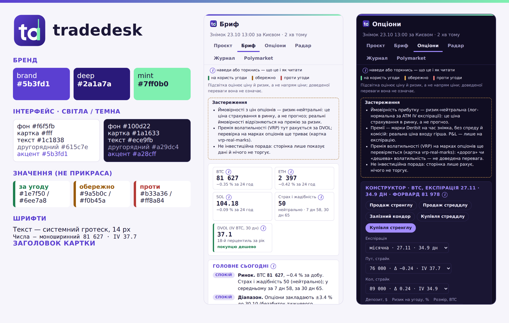

# Бренд-бук tradedesk

Обрав власник 23.10.2026. Лого: геометричні «td», ніжка «d» — зелена свічка з гнотом (ринок), фіолетовий фон.

Тут — усе, щоб нові екрани, повідомлення й картинки виглядали однаково. Джерело правди для кольорів панелі —
змінні `:root` у `scripts/dashboard.py` (`CSS`); цей файл їх пояснює.

## Лого

- `logo.svg` — основне (заокруглений квадрат, радіус 56 з 256); `logo-square.svg` — на весь квадрат, для круглих аватарок (Telegram сам обрізає коло).
- PNG: `logo-512.png`, `logo-180.png` (іконка домашнього екрана iPhone, без заокруглення — iOS заокруглює сам), `logo-64.png` (іконка вкладки), `avatar-512.png` (бот і група в Telegram).
- Вільне поле довкола — не менше ⅛ ширини знака. Найменший розмір — 16 px (іконка вкладки); у шапці панелі — 22 px.
- Не можна: розтягувати, повертати, міняти кольори знака поодинці, класти на строкатий фон без підкладки, додавати тіні й обведення.
- Слово поруч зі знаком пишеться малими: **tradedesk**.

## Кольори

**Бренд** (однакові у світлій і темній темах):
- `--brand` **#5b3fd1** — фіолетовий, основний колір знака й акцентів (91, 63, 209).
- `--brand-deep` **#2a1a7a** — глибокий фіолетовий, кінець градієнта фону знака.
- `--mint` **#7ff0b0** — м'ятний, свічка в знаку; лише як підсвітка бренду (смужка вгорі сторінки), не як «добре/погано».
- Градієнт бренду: `#5b3fd1 → #7ff0b0` (смужка 4 px угорі кожної вкладки), фон знака: `#5b3fd1 → #2a1a7a` по діагоналі.

**Інтерфейс, світла тема:** фон `#f6f5fb`, картка `#ffffff`, текст `#1c1838`, другорядний `#615c7e`, лінії `#e3e0ef`, акцент `#5b3fd1`.

**Інтерфейс, темна тема:** фон `#100d22`, картка `#1a1633`, текст `#ece9fb`, другорядний `#a29dc4`, лінії `#2d2752`, акцент `#a28cff` (світліший фіолетовий, щоб читався на темному).

**Значення (не бренд, а сенс):** зелений — на користь угоди, бурштиновий — обережно, червоний — проти.
- світла: `--ok #1e7f50`, `--warn #9a5b0c`, `--bad #b33a36`;
- темна: `--ok #6ee7a8`, `--warn #f0b45a`, `--bad #ff8a84`.
- Ці кольори завжди означають одне й те саме і не використовуються для прикраси. Фіолетовий ніколи не означає «добре» чи «погано».
- Напівпрозорі підкладки (чипи, рядки таблиць, зони на графіках) — через `rgba(var(--acc-rgb), α)` тощо; α 0.11–0.25.

**Контраст (WCAG):** кожен колір тексту має ≥ 4.5 : 1 до фону й картки (перевірено 23.10: другорядний 5.8, акцент 6.3, «добре» 4.6 у світлій; усі > 6 у темній). Новий колір тексту — спершу перевірити контраст.

## Шрифти

- Текст: системний (`-apple-system, "Segoe UI", Helvetica, Arial, sans-serif`), 14 px, міжрядковий 1.45; на телефоні нічого не завантажується.
- Числа в таблицях і коді: `Menlo, Consolas, monospace`, 12 px.
- Заголовки вкладок (`h1`) — 19 px, жирний; заголовки карток (`h2`) — 14 px, ВЕЛИКИМИ, розрядка 0.04 em, колір акценту.
- Знак лого спирається на геометричний гротеск (як Futura / Avenir): якщо колись знадобиться шрифт для слова, брати такий, а не з засічками.

## Елементи

- Картки: фон картки, рамка 1 px кольору ліній, радіус 8 px.
- Активна вкладка — підкреслення 3 px кольором акценту; інші — другорядним кольором.
- Значок `i` — підказка «що це і як читати»; смужка зліва плитки — оцінка «за / обережно / проти» (див. легенду на кожній вкладці).
- Прогрес-смужки — акцент; попередження й помилки — бурштиновий і червоний.

## Голос

- Українська, коротко, на «ти» в інтерфейсі; терміни англійською лише там, де так кажуть трейдери (IV, DVOL, funding).
- Чесні застереження: ймовірності з опціонів — ризик-нейтральні, підсвітка — не порада. Без «гарантовано», «100 %», емодзі-ракет.

## Telegram

- Фото групи — `avatar-512.png` (поставлено 23.10). Аватар бота ставить власник: @BotFather → `/setuserpic`.
- Кольори тем задає Telegram зі свого набору (`scripts/telegram_topics.py`); їх не міняємо.
