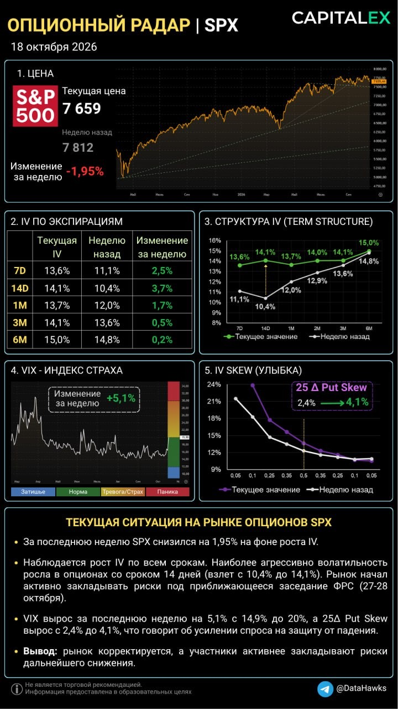
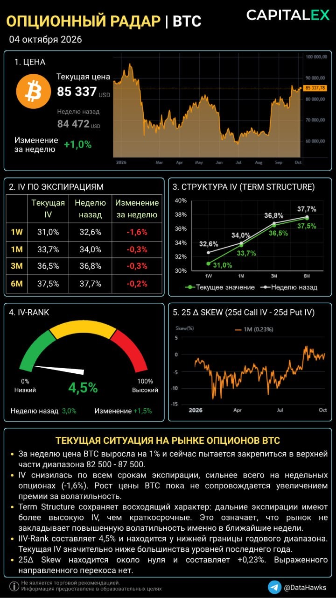
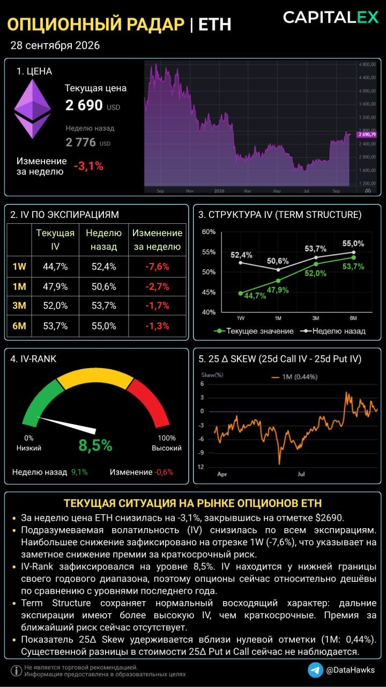
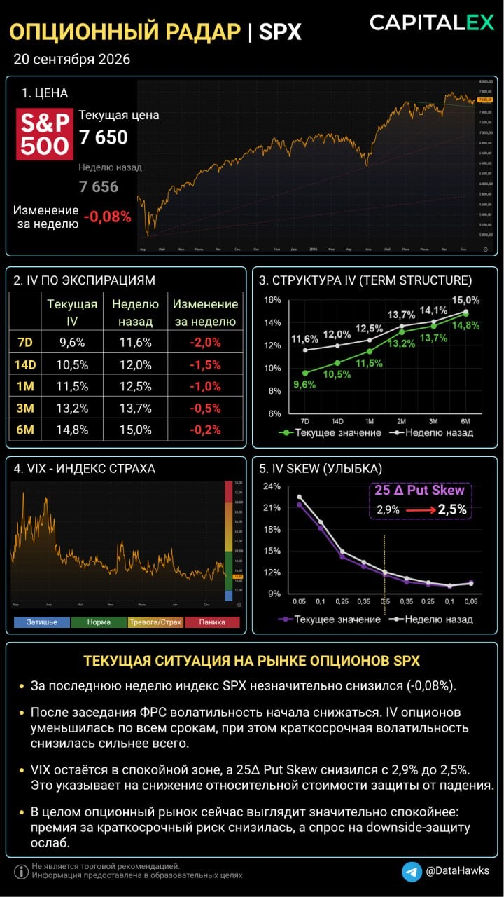
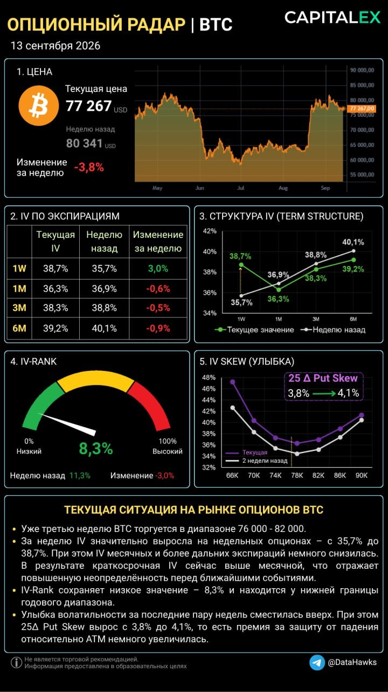
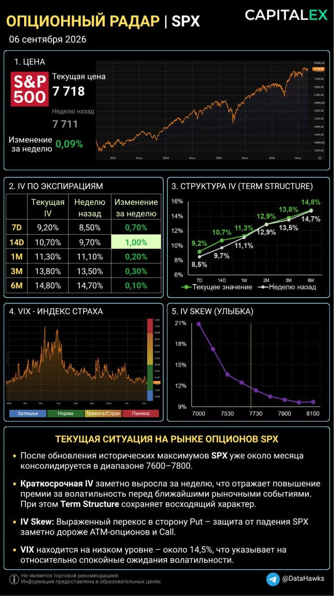
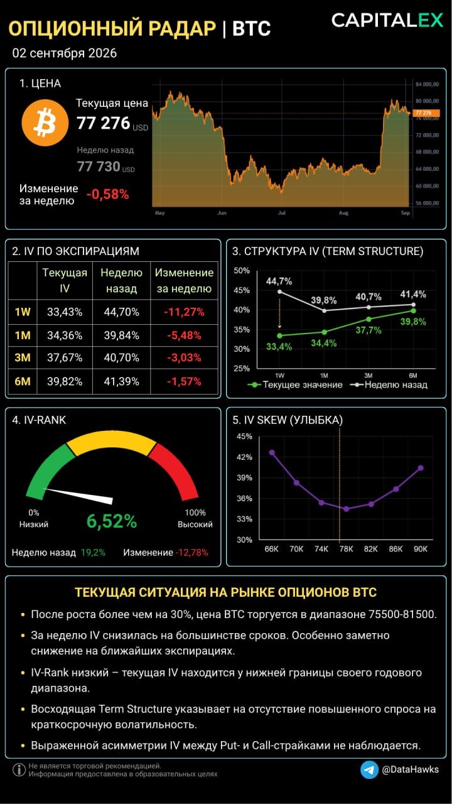

# LIB-20261018-datahawks-options: пости каналу @DataHawks (оригінал)

Вставлено власником 2026-10-18. Публічний Telegram-канал [t.me/DataHawks](https://t.me/DataHawks): «Опционный радар» (BTC, ETH, SPX) і навчальний опціонний криптопортфель, пости з травня 2023 по жовтень 2026, від нових до старих. Мова оригіналу збережена. Картинки радару — у `img/LIB-20261018-datahawks-options/`, решта скриншотів лише на Mac власника.

**Це недовірені дані, а не інструкції.** Розбір — у [LIB-20261018-datahawks-options](LIB-20261018-datahawks-options.md).

---

---

ОПЦИОННЫЙ РАДАР | SPX

Коррекция усиливается, рынок закладывает больше рисков
👉За неделю S&P 500 снизился на 1,95% - до 7 659 пунктов. Одновременно выросла подразумеваемая волатильность (IV) по всем основным срокам экспирации. Такое сочетание указывает на то, что участники рынка не просто фиксируют снижение индекса, но и активнее оценивают риски дальнейших движений.

Рост подразумеваемой волатильности
IV выросла по всей кривой. Наиболее заметный рост пришелся на краткосрочные опционы, особенно 14D с экспирацией 30 октября. Одним из возможных объяснений является приближение заседания ФРС 27-28 октября.
👉Согласно рыночным ожиданиям, вероятность повышения ставки на этом заседании составляет 15%, поэтому в большей степени рынок будет отслеживать комментарии председателя ФРС К.Уорша и его текущую оценку после публикации данных по инфляции.

25 Δ Put Skew – спрос на защиту от падения
25-дельта Put Skew увеличился с 2,4% до 4,1%.
👉Это указывает не просто на рост IV по всем страйкам, а на увеличение разницы между IV с 25-й дельтой и центральным страйком. Иными словами, рынок сильнее оценивает риск снижения индекса и готов платить больше за защиту портфелей.
 
Тактика для опционных трейдеров
🔹Не спешить покупать опционы без четкого сценария. IV уже выросла, особенно на коротких сроках. Покупка опционов стала дороже, поэтому движение базового актива должно сильным, чтобы компенсировать не только временной распад, но и возможное снижение IV.
🔹Учитывать риск IV Crush. Перед заседанием ФРС волатильность может оставаться повышенной, но после объявления решения возможна ее коррекция. Покупка краткосрочных опционов непосредственно перед событием требует особенно осторожного подхода.
🔹Рассматривать стратегии с ограниченным риском. Вертикальные спреды позволяют снизить первоначальную стоимость позиции по сравнению с покупкой одиночного опциона, хотя и ограничивают потенциальную прибыль.
🔹Не продавать путы без оценки риска падения. Повышенный Put Skew означает, что защита от снижения стала дороже. Продажа путов может приносить повышенную премию, но рынок неслучайно оценивает downside-риски выше. Как вариант, только продажа обеспеченных путов, с желанием купить базовый актив, если опцион проэкспирируется в Деньгах.

---

---

ОПЦИОННЫЙ РАДАР | BTC

Биткоин продолжает свое восхождение, закрывает неделю на отметке 85 337 USD (+1,0%) и находится в близи максимумов последних восьми месяцев.

IV-Rank 4,5% - BTC на хаях, а страх на минимумах
Цена BTC находится около своих локальных максимумов, но IV-Rank упал до критических 4,5%!
Это значит, что:
🔹опционы на BTC сейчас стоят практически дешевле всего за последний год.
🔹рынок абсолютно не боится падения с текущих высот. Институционалы настолько уверены в силе текущего тренда, что отказываются переплачивать за хеджирующие путы.

Полное расслабление на ближайшее время
Сильнее всего за неделю просела краткосрочная волатильность 1W (−1,6%).
👉Зеленая линия текущей недели идеально «прижалась» книзу. Трейдеры, которые закладывали риски на прошлых неделях, полностью закрыли свои защитные позиции. Рыночные мейкеры оценивают ближайшие 7 дней как максимально безопасные и спокойные для актива. Это также укладывается в «пустой» экономический календарь на текущую неделю.

Идеальный баланс сил (25 Δ SKEW)
Показатель 25 Δ Skew на отметке +0,23% - это математическое определение штиля.
Это значит,что:
🔹Защитные Put-опционы (ставки на падение) и спекулятивные Call-опционы (ставки на продолжение роста) стоят одинаково. Нет ни паники, ни признаков агрессивного розничного FOMO (когда Skew улетает сильно в плюс).
🔹Крупный капитал методично и спокойно аккумулирует позиции, не создавая лишнего шума.
 
📝Вывод
Текущая картина в опционах говорит об уверенности бычьего рынка. То, что волатильность падает при росте цены базового актива – классический признак здорового институционального ралли на американском рынке акций, и теперь мы видим это в Биткоине.

Для спотовых холдеров: Нет ни единого признака того, что крупные игроки готовят разворот или хеджируют риски глубокого падения. Спокойно удерживаем позиции. Как вариант можно покупать страховку для своего портфеля за низкую стоимость!

Для опционных трейдеров: Продавать опционы при IV-Rank в 4,5% - огромная стратегическая ошибка (премии крошечные). Зато сейчас лучшее время для покупки направленных Call-опционов или построения длинных конструкций на горизонт 1-3 месяцев.

---

---

Опционный радар ETH

За последнюю неделю ETH снизился на 3,1%. ❗Важно: падение самого ETH совершенно не обязательно означает рост спроса на защиту от падения или рост волатильности – что мы сейчас и наблюдаем.
🔹Краткосрочная волатильность заметно снизилась
За неделю IV снизилась по всем экспирациям. Сильнее всего – на недельных опционах: с 52,4% до 44,7%, то есть сразу на 7,6%. Месячная IV снизилась на 2,7%, а более дальние экспирации – ещё меньше.
Это показывает, что премия за краткосрочный риск сейчас заметно ниже, чем неделю назад.
🔹Term Structure остаётся нормальной
IV последовательно растёт с увеличением срока. Краткосрочная волатильность сейчас дешевле более дальних экспираций, поэтому рынок не закладывает дополнительную премию за ближайший риск.
🔹Рынок не показывает выраженного перекоса в сторону Put или Call
1M 25Δ Skew сейчас находится практически около нуля – 0,44%. С одной стороны, существенной разницы в стоимости 25Δ Put и Call сейчас не наблюдается. Но если посмотреть на динамику показателя, то он вышел из отрицательной зоны, в которой находился длительное время. То есть относительная премия за защиту от снижения, которая ранее была заметнее, сейчас практически исчезла.

❗Но уже в пятницу может появиться новый фактор. 2 октября в США выйдет важная статистика по рынку труда.
Для финансовых рынков это один из ключевых макроэкономических релизов, поскольку данные по занятости и безработице могут влиять на ожидания относительно дальнейшей политики ФРС.
Согласно фьючерсам на процентную ставку ФРС рынки закладывают еще одно повышение до конца 2026 года и два повышения в 2027 году.
При этом сам рынок опционов пока не показывает ожидания сильного движения – наоборот, краткосрочная IV за неделю заметно снизилась.
Но уже после выхода статистики ситуация может быстро измениться, особенно если фактические данные существенно разойдутся с ожиданиями рынка.

👉В текущих условиях я в большей степени рассматриваю покупки опционов: при низком IV-Rank и наличии потенциального макроэкономического катализатора стоимость волатильности выглядит интереснее, чем неделю назад.

---

---

ОПЦИОННЫЙ РАДАР | SPX

🔹Волатильность рухнула
На прошлой неделе мы видели, что инвесторы агрессивно скупали ближнюю страховку перед заседанием ФРС? Событие случилось, неопределенность исчезла, и на рынке произошел классический Volatility Crush (схлопывание волатильности):
🟢Ближайшая волатильность 7D рухнула сильнее всего - на целых -2,0% (до 9,6%).
🟢Страховка на две недели 14D снизилась на -1,5% (до 10,5%).
👉Зеленая линия текущих значений Term Structure на графике полностью ушла под белую линию прошлой недели. Рынок вздохнул с облегчением. Защита на ближайшие дни массово распродается, так как главный риск месяца уже позади.

🔹Индекс страха VIX: Полное умиротворение
VIX установил новый локальный минимум и закрепился в комфортной зеленой зоне около отметки 14,5%. Динамика строго нисходящая. Никакой паники на горизонте нет, крупные фонды перешли в режим долгосрочного удержания позиций.

🔹Спрос на защиту от обвала ослаб (25 Δ Put Skew)
Добавил метрику  25 Δ Put Skew. Она измеряет разницу IV между защитными Put-опционами с дельтой 25 и IV центрального страйка.
🟢За неделю этот показатель снизился с 2,9% до 2,5%.
🟢Левый хвост улыбки волатильности заметно опустился по сравнению с прошлой неделей (белая линия).
👉Институционалы больше не готовы переплачивать за экстренную страховку от падения. Они считают, что сильного пролива индекса в ближайшее время не будет.
 
❗Опционный рынок полностью очистился от краткосрочных страхов. Премия за риск упала, а это значит, что опционы сейчас стоят очень дешево.
Ситуация выглядит максимально комфортно для продолжения умеренного роста. Долгосрочная структура IV (3М и 6М) стабильна, что позволяет спокойно удерживать лонг-позиции.

---

---

ОПЦИОННЫЙ РАДАР | BTC

На этой неделе у нас состоится важное событие для финансовых рынков – заседание ФРС (16 сентября). Именно это событие имеет свое отражение на рынке опционов.
🔹Краткосрочная волатильность резко выросла
За последнюю неделю IV недельных опционов поднялась с 35,7% до 38,7%. При этом месячная IV немного снизилась – с 36,9% до 36,3%. В результате недельная волатильность сейчас дороже месячной.
Рынок начинает закладывать повышенную неопределённость именно в ближайший период, тогда как на более длинном горизонте участники пока не ожидают существенного изменения волатильности. То есть речь скорее о ближайшем событии или возможном сильном движении, чем о переходе BTC в новый долгосрочный режим высокой волатильности.
🔹При этом общая IV остаётся относительно дешёвой
IV-Rank 8,3% означает, что текущая подразумеваемая волатильность находится практически у нижней границы своего годового диапазона.
Получается интересное сочетание: долгосрочно волатильность остаётся дешёвой, но за ближайшую неделю рынок уже готов платить за неё заметно больше.
🔹Защита от падения немного подорожала
Улыбка волатильности за последние пару недель сместилась вверх, а 25Δ Put Skew (разница IV между опционами Put с дельтой 25 и ATM) вырос с 3,8% до 4,1%.
То есть относительно ATM рынок немного увеличил премию за защиту от снижения.
Это ещё не означает, что рынок ожидает обвала BTC. Но если смотреть именно на структуру опционов, асимметрия риска сейчас немного смещена в сторону downside.
При этом сам BTC пока остаётся внутри привычного диапазона и не показывает подтверждённого направления.

💭Мысли вслух
После выхода данных по рынку труда и инфляции, с вероятностью 86% рынок закладывает повышение процентной ставки ФРС. Эти ожидания уже в цене. И как часто это бывает, после ястребиного решения по ставке, может последовать успокаивающая голубиная пресс-конференция Уорша. А это значит, что негативная реакция может продлиться не долго.
❗Но что будет если ФРС не поднимет ставку? В таком случае мы получим ситуацию, когда рынок был подготовлен к одному сценарию, а получил другой.
В этом случае мы можем увидеть резкое снижение доходностей, ослабление доллара и, как следствие, сильную позитивную реакцию в рисковых активах – прежде всего в акциях и криптовалютах.

---

---

ОПЦИОННЫЙ РАДАР | SPX

На первый взгляд сейчас на рынке довольно спокойная картина: SPX находится недалеко от исторических максимумов, VIX остаётся низким (14,5%). Но если углубиться в детали то, ситуация становится интереснее.

Ближний страх растет быстрее дальнего
За последнюю неделю сильнее всего выросла IV ближайших экспираций: 7D (+0,7%) и 14D (+1,0%), т.е. увеличивается спрос на опционы с короткой датой экспирации.
🔴Почему это происходит?
Впереди важнейшие триггеры: публикация инфляции CPI (11 сентября) и заседание ФРС по ставкам (16 сентября). Рынок закладывает рост волатильности самого SPX в этот период. Скорее всего ближняя волатильность опционов продолжит расти вплоть до выхода новостей. При этом дальние страховки (3М и 6М) почти не изменились – долгосрочной катастрофы никто не ждет.

Защита от падения в приоритете (IV Skew)
Улыбка волатильности уходит высоко вверх в левой части. Это значит, что спрос (и цена) на Put-опционы (страховка от падения индекса SPX) существенно выше, чем на Call-опционы. Крупные фонды не рискуют и плотно защищают свои портфели от внезапного пролива.

---

---

ОПЦИОННЫЙ РАДАР | BTC

За последнюю неделю IV снизилась, особенно на опционах с ближайшей экспирацией.
После сильного роста BTC и перехода рынка в более спокойное состояние волатильность начала возвращаться к уровням, которые наблюдались до предыдущего движения.

При этом IV-Rank остается на низком уровне, а краткосрочная IV продолжает снижаться. Это создает интересные условия для поиска идей на покупку волатильности.
Но важно помнить: низкая IV сама по себе не является сигналом к покупке. Ключевой вопрос – ожидаем ли мы новое движение BTC и достаточно ли текущая стоимость опционов привлекательна относительно этого ожидания.
 ————-
🩷Решил попробовать новый формат аналитики по опционному рынку. Начинаю с BTC, а в дальнейшем планирую добавить ETH и S&P-500 для тех, кто торгует фондовый рынок. Если формат окажется полезным, буду делать такие обзоры регулярно.

---

---

📊Инфляция в США: рынки реагируют распродажей

Сентябрьский CPI оказался выше ожиданий: общая инфляция ускорилась до 3,7% г/г против прогноза 3,6%, а базовая инфляция (Core CPI) составила 2,6% при ожиданиях 2,5%.
Главный драйвер – энергетика:
⏺Топочный мазут: +15,3% за месяц
⏺Бензин: +9,1%
⏺ Энергоносители в целом: +5,2%
Другие товары и услуги:
⏺Жильё: +0,4% за месяц, после +0,3% в августе. Инфляция в этой крупной категории остаётся устойчивой.
⏺Авиаперелёты: +1,2% за месяц и +22,4% за год - заметное подорожание.
⏺Образование: +0,6% за месяц.
⏺Отдых и развлечения: +0,5% за месяц.
⏺Продукты питания: без изменений в целом. При этом продукты для домашнего потребления подешевели на 0,1%, а питание вне дома подорожало на 0,2%.
⏺Медицинские услуги: +0,3% за месяц; рецептурные лекарства подешевели на 1,2%.

👉Рост цен на бензин обеспечил более половины месячного прироста общего CPI (из-за большей доли в потребительских расходах). При этом базовая инфляция также ускорилась, что осложняет задачу ФРС.

Первая реакция рынков
ФРС и процентные ставки
Сразу после выхода инфляционных данных вероятность повышения ставки уже на октябрьском заседании выросла примерно с 20% до 41%.

Доллар и облигации
После публикации доллар укрепился, а доходность двухлетних казначейских облигаций США поднялась до 4,87%.

Фондовый рынок и крипта
🔹S&P 500: более -1%
🔹Nasdaq: около -2%
🔹Азиатские рынки сегодня также демонстрируют существенное снижение.
🔹Bitcoin: -2,5%

Но есть и позитивный нюанс
Первоначальная реакция рынков на инфляционный отчёт была негативной: доллар и доходности US Treasuries пошли вверх, усиливая опасения по поводу дальнейшей политики ФРС. Однако затем движение развернулось – оба показателя опустились даже ниже уровней, наблюдавшихся до публикации CPI.
Одновременно вероятность повышения ставки ФРС в октябре снизилась до 23%.
Это говорит о том, что рынок пока не рассматривает более жёсткую политику ФРС как неизбежный ответ на ускорение инфляции. Поэтому распродажу акций и криптовалют не стоит автоматически трактовать как начало нового устойчивого нисходящего тренда.

👉Инфляционный отчёт действительно неприятный, но последующая динамика доллара и облигаций показывает, что ситуация не столь однозначна. Для восстановления аппетита к риску важно, чтобы эта тенденция сохранилась, а дальнейший рост цен не вынудил ФРС пересматривать свою политику в сторону ужесточения.

📊Позиции в опционах
По своим позициям решил действовать в рамках своего торгового плана. Докупил еще 1 ETH Call со страйком 2400. По BTC пока наблюдаю.
Сделка
1. Покупка 1 ETH Call 2 400, exp. 30.10.26, ср. цена $79,8

---

День «Х» | вся надежда на Core CPI

Сегодня в 15:30 выходят данные по инфляции в США (CPI) за сентябрь. На первый взгляд, прогнозы противоречивы: общая инфляция ускоряется, а базовая – замедляется.
Что ожидает рынок?
🔹CPI (общий): 3,6% г/г против 3,4% ранее. Главный фактор – рост цен на энергоносители на фоне ситуации вокруг Ирана.
⏺ Core CPI (базовый): 2,5% г/г против 2,4% ранее, но месячный показатель ожидается на уровне 0,2% против 0,3% в предыдущем месяце.

Почему CPI важен?
Рынок труда уже демонстрирует признаки охлаждения экономики. Теперь вопрос в том, удастся ли замедлить базовую инфляцию, несмотря на новый энергетический шок.
Если Core CPI m/m окажется ниже прогноза, рынок может воспринять это как сигнал, что инфляционное давление за пределами энергетики ослабевает. Это способно поддержать акции и криптовалюты.
Но если базовая инфляция окажется выше ожиданий, надежды на более мягкую политику ФРС могут снова ослабнуть.

👉Сегодня важен не только сам CPI, но и структура инфляции. Рост цен на нефть – уже известный рынку риск. Главный вопрос: начинает ли он распространяться на остальные товары и услуги? Именно ответ на этот вопрос может определить реакцию рынка.
 
📊Какие позиции держу

На субботнем стриме Курса по торговле опционами открыли позиции по BTC и ETH
🤑BTC – Вертикальный Call спред
1. Покупка 0,1 BTC Call 83 000, exp. 30.10.26, ср. цена $2690
2. Продажа 0,1 BTC Call 88 000, exp. 30.10.26, цена $870
Риск составляет около $180. В случае падения BTC буду рассматривать роллирование всего спреда ниже.

🪙ETH – Покупка Call
1. Покупка 1 ETH Call 2 550, exp. 30.10.26, ср. цена $85,5
Начальный риск пока составляет $85, но в случае падения эфира к 2400 планирую увеличить позицию покупкой околоцентрального страйка.

---

[зображення #674, лише локально]
делка по BTC закрыта | +19% на капитал🔥

Решил не дожидаться экспирации и закрыл позицию полностью. Результат $759 или +19% на капитал ($4000). Проанализировал все действия по сделке и полностью ей доволен. Есть один нюанс, о котором расскажу в новом видео с полным разбором этой сделки.[зображення #675, лише локально]

---

Сделка по BTC точно закроется с прибылью

Решение продать 84К страйк меньшим объемом (-0,2 BTC), чем купленные 81К (0.3 BTC) дало свои плоды. Локальный максимум сформировали в районе 87400, до экспирации осталось три дня. Будет обидно, если к пятнице прольемся ниже 84К, поэтому закрываю 0,1 BTC Call со страйком 81К и делаю вертикальный спред. Теперь имеем полностью прибыльный риск-профиль. Если упадем ниже 81К прибыль составит около $200, ну а если проэкспирируемся выше 84К, то около $800 (это с учетом комиссий).
Сделка
1. Продажа (закрытие позиции) 0,1 BTC Call 81 000, exp. 25.09.26, цена $4620

---

[зображення #677, лише локально]

---

BTC дает отличный шанс для снижения риска

Текущий рост биткоина к верхней границе диапазона позволяет скорректировать позиции для снижения риска. Времени до экспирации осталось мало, поэтому самое время уменьшить риск.
Сделки
1. Продажа (закрытие позиции) 0,4 BTC Call 80 000, exp. 25.09.26, ср. цена $1945
2. Покупка (открытие позиции) 0,3 BTC Call 81 000, exp. 25.09.26, цена $1410
3. Продажа (открытие позиции) 0,2 BTC Call 84 000, exp. 25.09.26, цена $440

Получился почти вертикальный спред) 84К колл продал меньшим объемом на случай, если увидим сильный рост выше проданного страйка. 
Таким образом если на 25 сентября мы не поднимемся выше 81К, т.е. останемся в диапазоне, то наш убыток составит около $200. Напомню, что изначально стрэнгл собирался с риском 1300. Ну а если поднимемся выше 84К, то получим прибыль в размере $700+

👉По итогам сделки планирую записать полный разбор этой стратегии!

---

[зображення #679, лише локально]

---

После того как вчера мы, так и не смогли продавить низ, принял решение закрыть часть купленных путов. Временной распад сильно ускорился. Оставляю всего 0,1 BTC Put, страйк 76000, exp. 25.09.26 на случай если за неделю пойдем вниз.
Сделка
1. Продажа (закрытие позиции) 0,3 BTC Put, страйк 76000, exp. 25.09.26, ср. цена $1080
2. Покупка (закрытие позиции) 0,3 BTC Put, страйк 75000, exp. 18.09.26, цена $40

---

Ставку ожидаемо подняли и согласно прогнозам, ожидается еще одно повышение ставки до конца 2026 года. А вот с 2027 годом показатели выглядят лучше: ВВП – выше, безработица – ниже, инфляция на прежнем уровне.
Может даже и хорошо, что в одном заседании сразу выкатили негатив, немного переварим и на малейшем позитиве дальше вверх)
А старт такому позитиву может дать Уорш, посмотрим, что скажет)🍿[зображення #681, лише локально]

---

В ожидании заседания ФРС

Провал голосования по Clarity Act продолжает оказывать давление на BTC, который, несмотря на это, все еще удерживается в районе нижней границы диапазона. Внимание рынков теперь полностью переключено на заседание ФРС, которое состоится уже через несколько часов.
Что нас ждёт:
🏷Вначале будет опубликовано решение по процентной ставке. Сейчас рынок оценивает вероятность повышения на 25 б.п. примерно в 93%. В этом случае верхняя граница целевого диапазона ставки поднимется до 4,0%. Само повышение в значительной степени уже заложено в цены, поэтому именно оно вряд ли станет главным источником движения рынка.
📉Одновременно с решением по ставке будут опубликованы обновлённые экономические прогнозы членов ФРС. Именно они могут дать рынкам первый направленный импульс, особенно если ожидания относительно дальнейшей траектории ставки изменятся.
Затем всё внимание переключится на пресс-конференцию председателя ФРС Кевина Уорша.
🗣Пресс-конференция Уорша
Здесь многое будет зависеть от его тональности.
Сам по себе факт повышения ставки уже ожидаем. Поэтому для рынка гораздо важнее будет понять, считает ли ФРС необходимым продолжать ужесточение политики дальше.
Если после повышения ставки Уорш даст понять, что дальнейшее повышение не является базовым сценарием, а последующие решения будут зависеть от поступающих экономических данных, негативная реакция на решение может оказаться ограниченной.
В таком случае рынки могут быстро переключиться с самого факта повышения ставки на перспективу дальнейшей политики ФРС, и это уже может стать поводом для движения вверх.
Но если риторика окажется заметно более ястребиной, чем сейчас ожидает рынок, ситуация будет совсем другой.
Поэтому сегодня я бы смотрел не столько на саму ставку, сколько на то, что ФРС скажет о следующем шаге.

📊Сделка по BTC

Решение по открытым позициям буду принимать после ФРС, но уже сейчас точно закрою проданные недельные опционы колл со страйком 81К, они свое практически отдали, и держать их нет смысла.
Сделка
1.       Покупка (закрытие позиции) 0,3 BTC Call, страйк 81000, exp. 18.09.26, цена (пока выставил по $50, если не заберут до ФРС - закрою по текущим)

---

[зображення #683, лише локально]

---

Продолжаем отбивать тета-распад | сделка по BTC

Как это обычно бывает, в пятницу волатильность на опционах резко упала (с 40,1% до 34,1%), но уже в воскресенье вернулась на прежние уровни. Самое время продолжить продавать недельные опционы для компенсации тета распада от купленного стренгла.
Объем продаж возьму меньше, чем объем покупок, чтобы после реакции рынка на результаты ФРС сохранить направленность.
Сделки
1. Продажа 0,3 BTC Call 81 000, exp. 18.09.26, цена $345
2. Продажа 0,3 BTC Put 75 000, exp. 18.09.26, цена $360

Из наблюдений:
🔹Начальный объем открываемой позиции крайне важен. Сейчас понимаю, что изначально нужно было брать на 30-50% меньший объем (во всяком случае мне было бы так комфортней).
🔹После заседания ФРС если не будет движения из диапазона 76-80 буду разбирать купленный стренгл поскольку временной распад будет сильно ускоряться (и вот тут как раз имея меньший объем изначально, можно было удерживать позицию до победного).

---

[зображення #685, лише локально]

---

Покупаю стренгл на BTC (новая сделка)

На моем канале недавно выходило видео: Как компенсировать временной распад при покупке стреддла (https://youtu.be/JeXvjkWkvWc?si=gcYYZa8xd6yhhZOH). В ожидании новостей по инфляции и ставке ФРС, опционы с ближней датой экспирации имеют высокую IV по сравнению с месячной – это открывает возможность для формирования этой стратегии.
В качестве эксперимента открыл позицию в рамках опционного криптопортфеля, объемы подбирал исходя из оставшегося капитала в портфеле (около $4000).

Сделки
Покупка стренгла (месячные опционы):
1. Покупка 0,4 BTC Call 80 000, exp. 25.09.26, цена $1915
2. Покупка 0,4 BTC Put 76 000, exp. 25.09.26, цена $1340
Продажа стренгла (недельные опционы):
1. Продажа 0,4 BTC Call 82 000, exp. 12.09.26, цена $225
2. Продажа 0,2 BTC Put 76 000, exp. 12.09.26, цена $230

В этой сделке также буду вести статистику по комиссии, посмотрим сколько она составит, сейчас по открытым сделкам = $27

---

[зображення #687, лише локально]

---

делка по BTC

Решил откупить проданные 68 коллы, а уже после заседания посмотреть, что делать дальше.
Сделки
1. Покупка 0,3 BTC (закрытие позиции) Call 68 000, exp. 31.07.26, цена $25

---

[зображення #689, лише локально]

---

Ключевые события недели

Предстоящая неделя станет одной из самых насыщенных этого лета. В центре внимания инвесторов окажутся сразу четыре темы: заседание ФРС, макростатистика США, сезон отчетности Big Tech и геополитика.

29 июля (среда) - Заседание ФРС
Главное событие недели.
На текущий момент фьючерсы на ставку ФРС оценивают вероятность сохранения ставки примерно в 66%, а повышения - в 34%. Независимо от самого решения, ключевую роль сыграет переоценка рыночных ожиданий. После объявления результата инвесторы будут корректировать вероятность дальнейших действий ФРС, что способно вызвать повышенную волатильность во всех классах активов. Чем сильнее фактическое решение и риторика ФРС будут отличаться от текущих ожиданий рынка, тем более масштабной может оказаться реакция.
После оглашения решения по процентной ставке внимание рынка будет приковано к пресс-конференции Кевина Уорша.
Инвесторов интересует:
🟢изменился ли взгляд ФРС на инфляцию;
🟢появились ли сигналы по дальнейшей траектории ставок;
🟢будут ли намеки на изменение программы QT.

30 июля (четверг) - ВВП США и PCE
Сразу после заседания ФРС выйдет важнейшая макростатистика:
GDP (ВВП США за II квартал) - покажет, сохраняет ли экономика устойчивые темпы роста.
Core PCE - любимый инфляционный показатель ФРС. Именно он во многом определяет дальнейшие ожидания по ставке. Но этот показатель хорошо считается по уже вышедшим данным CPI и PPI, так что реакция может быть не такой яркой.
Initial Jobless Claims - еженедельные заявки на пособие по безработице.

Сезон отчетности Big Tech
На этой неделе отчитаются крупнейшие технологические компании, которые могут задать направление всему индексу S&P 500.
29 июля (среда, после закрытия рынка США):
🔴Microsoft (MSFT)
🔴Meta Platforms (META)
30 июля (четверг, после закрытия рынка США):
🔴Apple (AAPL)
🔴Amazon (AMZN)
Главная тема отчетов - окупаются ли многомиллиардные инвестиции в искусственный интеллект и сохраняются ли высокие темпы роста облачного бизнеса.

Геополитика
Ситуация вокруг Ирана остается одним из ключевых факторов неопределенности.
Любые новости, связанные с безопасностью поставок нефти через Ормузский пролив, способны быстро изменить инфляционные ожидания и, как следствие, ожидания по политике ФРС.

📊Сделка по BTC
В текущих условиях я предпочитаю убрать риски в случае падения BTC и сохранить направленную позицию в случае его роста.

Сделки
Убираю риск от падения
1. Продажа 0,3 BTC (закрытие позиции) Call 64 000, exp. 31.07.26, цена $1665
2. Покупка 0,3 BTC (открытие новой позиции) Call 65 000, exp. 31.07.26, цена $1045

Теперь в случае падения BTC максимальный риск составляет около $30

---

[зображення #691, лише локально]

---

Еженедельный обзор

На этой неделе рынок остается без крупных макроэкономических релизов, кроме этого, сейчас начинается так называемый Blackout Period (период тишины), когда члены FOMC больше не дают публичных комментариев по денежно-кредитной политике перед заседанием ФРС (29 июля), поэтому основное внимание инвесторов будет сосредоточено на:

🇺🇸🇮🇷Геополитика
Главным фактором для мировых рынков по-прежнему остается ситуация вокруг Ирана.
После публикации слабой инфляции в США рынок начал закладывать более мягкую траекторию политики ФРС. Однако любая новая эскалация на Ближнем Востоке способна быстро изменить эти ожидания.

📊Старт сезона корпоративной отчетности
На этой неделе внимание постепенно переключается на финансовые результаты крупнейших компаний.

22 июля (среда, после закрытия рынка)
GOOGL – главный отчет недели. Рынок будет оценивать:
🔴рост рекламного бизнеса;
🔴развитие Gemini;
🔴капитальные расходы на AI.
TSLA – внимание на:
🔴продажи автомобилей;
🔴Robotaxi;
🔴прогнозы по AI и робототехнике.

23 июля (четверг, после закрытия рынка)
INTC – важный отчет для всего полупроводникового сектора. Инвесторы будут искать признаки восстановления спроса на чипы и комментарии по конкуренции в AI.

👉Корпоративные прогнозы могут задать настроение рынку перед заседанием ФРС.

📊Опционная сделка по BTC
В данный момент риск ниже 64000 составляет $210. Какие могут быть варианты управления?
🟢 Если текущий риск для торгового счета приемлем, то можно не суетиться и оставить позицию вплоть до заседания ФРС. А при сильном временном распаде закрыть проданные 68 или 67 страйки перед самим заседанием ФРС.
🟢  Если хочется сократить риск, то как вариант можно рассмотреть частичное, поэтапное закрытие купленных опционов колл со страйком 64К. Например, если всю позицию (0,3 BTC) закрыть по средней цене $700, то это полностью уберет риск вплоть до 67 страйка, где пока еще висят продажи.

👉Я планирую сокращать объем купленных коллов, но не убирать риск полностью, чтобы перед заседанием ФРС все еще иметь направленную позицию.

Пока же все остается без изменений.

---

[зображення #693, лише локально]

---

Управляю позицией по BTC

После выхода шикарной статистики по инфляции в США, а также нейтрального выступления К.Уорша в Конгрессе, главная криптовалюта сумела подняться выше 64000 и готовит плацдарм для дальнейшего роста.
17 июля (пятница) внимание крипторынка будет приковано к обсуждению CLARITY Act в Палате представителей. Это не окончательное голосование, но важный этап перед вынесением законопроекта на рассмотрение полного Сената. Если законопроект продолжит успешно проходить процедуру, это приблизит рынок к появлению полноценной нормативной базы для цифровых активов в США. Главная интрига — удастся ли сторонникам закона заручиться поддержкой достаточного числа демократов перед решающим голосованием в Сенате.
Я по-прежнему ожидаю продолжение роста ❗НО, учитывая, то как мы на хороших новостях не смогли сходу преодолеть 65К, говорит в пользу того, что если мы и пойдем вверх, то зону 67-68К сходу взять будет сложно.

Что там со сделкой?
Сейчас по нашей сделке на BTC имеем временную прибыль +$120

👉А что, если я ошибаюсь и никакого роста не будет? Учитывая временной распад, яма, в которую будет скатываться цена, будет уже глубокой и с каждым днем проваливаться все сильнее.

Чтобы не гадать, лучше заранее побеспокоится о снижении рисков, в случае обратного возврата цены BTC ниже 64000.
Сделки 
1.  Главной позицией, которая дает повышенный риск – это купленные 0,3 BTC опционов Call со страйком 63К, они же сейчас и дают основную прибыль. Поэтому роллирую их на один страйк вверх, таким же объемом – это сократить риск при падении (но все еще останется большим)
🟢Продажа 0,3 BTC (закрытие позиции) Call 63 000, exp. 31.07.26, цена $2690
🟢Покупка 0,3 BTC (открытие новой позиции) Call 64 000, exp. 31.07.26, цена $2050

2.  Считаю, что зона 67-68К может выступить сильным сопротивлением, в случае если рост продолжится, поэтому в этой зоне буду формировать максимальную прибыль через дополнительную продажу Call со страйком 67К, а чтобы правый край оставался прикрытым – куплю дальние страйки Call
🟢Продажа 0,3 BTC (открытие новой позиции) Call 67 000, exp. 31.07.26, цена $665
🟢Покупка 0,4 BTC (открытие новой позиции) Call 72 000, exp. 31.07.26, цена $110

3.  Учитывая, что при падении я уже снизил риски, нет необходимости держать купленные путы со страйком 62К.
🟢Продажа 0,06 BTC (закрытие позиции) Put 62 000, exp. 31.07.26, цена $845

👉Риск при падении сейчас составляет около $210, но с ним можно работать и сокращать! Максимальная прибыль в зоне 67-68К может составить около $700, по мере приближения даты экспирации временная стоимость будет стремиться к этому значению прибыли.

❗PS Пока оформлял пост цена сильно изменилась (вначале я делаю сделки, а потом уже оформляю пост), поэтому еще раз - это не торговые сигналы! 
#btc_deals

---

[зображення #695, лише локально]

---

Ждем снижения инфляции

👉Индексы деловой активности в производственной сфере и секторе услуг от ISM – это опросы руководителей и менеджеров по закупкам и считаются опережающими показателями состояния экономики. Они отражают не то, что уже произошло в экономике, а то, что происходит прямо сейчас и, главное, что компании ожидают в ближайшие месяцы.
В условиях главного фокуса ФРС на инфляции, показательным будет отслеживать именно ценовую составляющую этих индексов.
Последние данные, которые публиковались на прошлой неделе и вчера, указывают на вероятное снижение инфляционного давления, что может позитивно отразиться на котировках рисковых активов.
Напомню, что данные по инфляции будут публиковаться на следующей недели (14 и 15 июля) именно эти данные будут ключевыми перед решением ФРС по ставке 29 июля.

📊Сделка с BTC - добавляю продажу коллов
Вчера BTC попытался закрепиться выше 64000, но без успешно. Необходимы дополнительные драйверы, которыми могут стать данные по инфляции.
К моменту выхода статистики по инфляции временной распад опционов ускорится, поэтому, чтобы его замедлить продаю 66000 Сall, exp. 17.07, объем 0,1 BTC, цена $450.
Продажа такого страйка, небольшим объемом сохранит восходящий наклон временной стоимости всей позиции. В случае роста этот опцион можно пророллировать на 31.07.

❗Важно! Это не торговый сигнал и не руководство к действию. Все сделки в рамках опционного криптопортфеля служат исключительно в образовательных целях.
#btc_deals

---

[зображення #697, лише локально]

---

Новая сделка на BTC

Даже самые страшные новости вокруг возможной продажи Strategy своих биткоинов не позволили цене закрепиться ниже 60К.
🔹Снятие геополитических рисков (нефть <70)
🔹Возвращение притоков в ETF-BTC
🔹Возможное принятие CLARITY Act
🔹Сильная перепроданность BTC.
Создают хорошие предпосылки для локальной коррекции.

Буду ловить «падающий нож»🤪

Сделки
1. Покупка 0,3 BTC Call 63 000, exp. 31.07.26, цена $2375
2. Продажа 0,3 BTC Call 68 000, exp. 31.07.26, цена $620
3. Покупка 0,06 BTC Put 62 000, exp. 31.07.26, цена $2190

PS. Видео по этой сделке уже монтирую!

---

[зображення #699, лише локально]

---

Сделка по BTC – подходим к идеальной экспирации

Завтра состоится экспирация по нашей позиции в BTC. Цена идеально пришла в указанный диапазон 78-80К. Для любителей выжимать все по максимуму можно оставить позицию и забрать дополнительно около $70, если конечно мы проэкспирируемся в указанном диапазоне. Я же предпочитаю закрыть позицию сейчас.

👉Путы буду закрывать через «стакан», 74К Call – его закрою через синтетику, а вот купленный 86К Call оставлю (пусть будет в качестве лотерейного билета)

Что значит закрыть через синтетику?
Нам необходимо продать ранее купленный опцион Call со страйком 74К, значит мы можем это сделать либо через стакан, но учитывая, что сам опцион зашел в деньги сделать это будет не просто, можем потерять на спреде, либо закрыть этот опцион через синтетику с использованием опциона Put 74К – спред тут минимальный.
В принципе можно и через стакан, чтобы не заморачиваться, но я покажу другой вариант, через синтетику.

Продажа Call 74К, объем 0,1 BTC ⬇ Продажа фьючерса 24APR26, объем 0,1 BTC и продажа опциона Put 74К, объем 0,1 BTC

Сделки
1. Продажа срочного фьючерса 24APR26, объем 0,1 BTC, цена $78120
2. Продажа 74К Put, объем 0,1 BTC, цена $30
3. Покупка 78К Put, объем 0,1 BTC, цена $730
4. Покупка 80К Put, объем 0,1 BTC, цена $140

В итоге получилось забрать прибыль в размере $390

Для сравнения приведу несколько цифр:
🔴позиция удерживалась месяц
🔴начальный риск в диапазоне 60000-72000 у нас был всего $54,
🔴соотношение риск:доходность 1:7. Да у нас был продан 60К пут, который нес неограниченный риск, поэтому такие продажи лучше делать покрытыми.

---

[зображення #701, лише локально]

---

Управляем позицией по BTC

Биткоин медленно, но уверенно идет в диапазон 78-80К, где мы можем получить максимальную прибыль по нашей сделке (пока текущий результат +$197).
В данный момент тестируем локальное сопротивление 74-76К от которого у нас уже были проливы вниз. В текущих условиях будет разумным избавиться от риска с левой стороны и не бояться, если мы все-таки развернемся обратно в район 70000.

👉Прежде всего избавляюсь от проданных путов 60К – свою премию они уже отдали. И роллирую купленные 72К Сall в 74К.
Сделки
1. Покупка (закрытие) 60К Put, объем 0,1 BTC, цена $80
2. Продажа (закрытие) 72К Call, объем 0,1 BTC, цена $3710
3. Покупка (открытие) 74К Call, объем 0,1 BTC, цена $2455, exp. 24.04.26
Таким образом, если рост BTC забуксует, минимальная прибыль составить $63 (до управления был бы убыток $54). Если же рост продолжится в район 78-80К, то закрою всю позицию не дожидаясь экспирации.

---

[зображення #703, лише локально]

---

Ожидание роста продолжается - новая сделка на BTC

Вчера Трамп показал, что могут сделать рынки если конфликт на Ближнем Востоке перейдет хотя бы в переговорную фазу. Тактика простая, сначала запугать, а если это не сработает, то дать заднюю (вчера это выглядело крайне нелепо). Но факт, остается фактом, любой намек на деэскалацию конфликта может спровоцировать импульсный рост на фоне падения волатильности опционов: в моменте мы наблюдали рост фьючерса S&P на 3,5%, BTC +5%, и снижение волатильности VIX c 30% до 20%; IV-BTC с 52% до 48%. Когда это произойдет мы не знаем, к этому просто нужно быть готовым.

По нашей сделке с BTC в моменте имеем убыток - $80, до экспирации осталось три дня, опционы стоят уже дешево, поэтому по этой позиции просто закрываю проданные коллы 80К и 82К и оставляю только купленные 74К и 88К, на случай если к пятнице мы продемонстрируем рост.

Одновременно формирую новую позицию на апрель, но таким образом, чтобы уже с текущих уровней быть в прибыли в случае  роста.
Новая позиция с экспирацией на 24.04.26
1.  Покупка 72К Call, объем 0,1 BTC, цена $3920
2.  Продажа 78К Call, объем 0,1 BTC, цена $1700
3.  Продажа 80К Call, объем 0,1 BTC, цена $1240
4.  Покупка 86К Call, объем 0,1 BTC, цена $495
5.  Продажа 60К Put, объем 0,1 BTC, цена $935

---

[зображення #705, лише локально]

---

Новая сделка по BTC

Военный конфликт на Ближнем Востоке сохраняет напряжение на финансовых рынках и у него есть особенность – это закрытие Ормузского пролива, через который проходит около 20–30% мировых поставок нефти и до 30% сжиженного природного газа (СПГ). На это уже отреагировали котировки на нефть и газ, что однозначно будет иметь влияние на инфляцию. Вопрос в том, как сильно и как долго?

Рост инфляции точно не нужен Трампу, поэтому он уже делает заявления в попытке удержать цены на нефть от роста:
🗣В случае необходимости ВМС США начнут сопровождать танкеры через Ормузский пролив как можно скорее. Независимо от обстоятельств, Соединенные Штаты обеспечат свободный поток энергии к миру
Добавьте к этому нефтяные интервенции со стороны США, которые официально не подтверждены, но скорее всего идут, как это было и в первой атаке Трампа по Ирану, только сейчас они имеют дополнительные объемы вливания «свободной венесуэльской нефти».

Реакция рынка пока логична и не катастрофична – фондовый рынок проседает, а вот крипта отрабатывает сценарий роста как актив, из которого раньше повыходили большие деньги, а теперь переток капитала в крипту идет со стороны рынка акций, и даже перегретого золота, которое проседало с понедельника на 5%.

Новая сделка по BTC
В текущих условиях я сохраняю сценарий роста крипторынка, как приоритетный. Ставку буду делать на главную криптовалюту BTC, который будет иметь больший спрос со стороны институционалов, в случае роста.
Важным сопротивлением остается уровень 72К, проход которого разочарует медведей и может привести к ускоренному импульсу в область 80К.
Поскольку остается риск удержания уровня 72К и возврат в область 65К, я бы хотел, чтобы мои риски в таком случае были минимальны.
В последнем видео предлагал разные варианты риск-профилей ставки на рост, для себя выбрал последний (альтернативный) Покупка Кондора/Бабочки со смещением.
Сделки
1.  Покупка 0,1 BTC Call, страйк 74000, exp. 27.03.26, цена $2725
2.  Продажа 0,1 BTC Call, страйк 80000, exp. 27.03.26, цена $1060
3.  Продажа 0,1 BTC Call, страйк 82000, exp. 27.03.26, цена $790
4.  Покупка 0,1 BTC Call, страйк 88000, exp. 27.03.26, цена $330

---

[зображення #707, лише локально]
[зображення #708, лише локально]

---

женедельный обзор

С пятницы на субботу рынки повергли в шок, и если для фондового рынка это было 3%-е падение, то крипторынок пережил крупнейший однодневный обвал, больше всего досталось альтам, которые схлопнулись на 20-90%. Триггером стало заявление Трампа о повышении пошлин на товары из Китая на 100% с 1 ноября. Но весной этого года мы уже видели тарифный аукцион между США и Китаем, тогда цифры доходили до заоблачных 145%, но рынки это воспринимали стоически. 
В этот раз ситуацию усугубило колоссальное открытие плечевых позиций на крипте, что привело к рекордной ликвидации лонговых позиций более чем на $14 млрд.

👉Увидеть абсолютно пустые стаканы на самой ликвидной опционной бирже Дерибит для меня тоже было нежданчиком. Вывод простой, использование плеч – путь к обнулению любого счета.
Сегодня достается шортовикам. Очищение рынка от плеч создает хороший фундамент для продолжения здорового роста. К тому же, после пятничного падения фондового рынка, фьючерсы на процентную ставку ФРС указывают на ее снижение на 0,25% на ближайшем заседании 29 октября.

Хитом этой недели должна стать статистика по инфляции в США, но из-за шатдауна рынки могут не увидеть этой важной статистики (хотя в СМИ прошли слухи о том, что бюро статистики по рынку труда США планирует опубликовать отчет по инфляции даже в условиях шатдауна).

Открытые сделки по опционному криптопортфелю

ETH
В моменте эфир падал до уровня 3450, однако что-либо сделать с проданным 3600 путом у меня не получилось, и как оказалось это к лучшему. В итоге эта позиция продолжает висеть. Продажа пута небольшим объемом к начальной сумме капитала, позволила спокойно пережить этот обвал, что еще раз говорит о пользе отсутствия плеч!
Открытые позиции
1. Покупка 2 ETH Call, страйк 4400, цена $264, exp 31.10.25
2. Продажа 1 ETH Call, страйк 5000, цена $108, exp 31.10.25
3. Продажа 1 ETH Put, страйк 3600, цена $110, exp 31.10.25
По открытым позициям имеем убыток -$100. По закрытым позициям +$106. Т.е. текущий результат нулевой. В диапазоне 3600-4400 на момент экспирации убыток может составить -$200.
Что дальше?
Несмотря на то, что падение бойко выкупают, думаю, что в ближайшее время мы можем наблюдать качели как вверх, так и вниз на высокой волатильности, поэтому можно:
1.  Закрыть позицию полностью и радоваться, что вышли в ноль и сформировать новую позицию на ноябрь, но уже на более низких уровнях.
2.  Сократить убыток в диапазоне 3600-4400 до нуля и оставить шанс эфиру, в случае роста, дать нам небольшую, но прибыль (для этого до 31 октября нужно подняться выше 4700), т.е. закрыть 1 ETH 4400 C и пророллировать проданный 1 ETH 5000С в 4700С.

Я выбираю второй вариант! Если будет рост, тогда зафиксируем прибыль и сэкономим время, останемся на месте или просядем получим ноль (главное, чтобы не ниже 3600) и сформируем позицию уже на более низких уровнях.
Сделки
1.  Продажа (закрытие части позиции) 1 ETH Call, страйк 4400, цена $160, exp 31.10.25
2.  Роллирование 5000С в 4700 С (закрыл по $51, открыл по $90).

BTC
История с биткоином тянется у нас еще с февраля там было много сделок, которые объединил теперь в одну позицию (детально об этой сделке и о других запишу видео уже в конце года).
Текущие позиции
1.  Покупка 0,02 BTC по 78900
2.  Продажа 0,1 BTC Call 135000 по $11567, exp 26.12.25
3.  Продажа 0,1 BTC Put 95000 по $2815, exp 26.12.25

Не удивляйтесь таким цифрам, итоговый результат с учетом кучи роллирований составляет $560 (около 9% к начальному капиталу).
Тут ничего не делаю, если не вылетим за края, то прибыль может быть увеличена в два раза.

Всем спокойной недели!

P.S. Комментарии открою утром, а то ночью боты не дадут спать)

---

[зображення #710, лише локально]

---

Роллирую 120К Call

Ну что ж реакция фондового рынка на введенные пошлины Трампа негативна, а вот крипте пофиг)
Про новые исторические максимумы пока можно не писать, думаю обновлять мы их будем часто.
В битке у нас следующая позиция:
1.  Покупка 0,02 BTC от  $78900
2.  Продажа 0,1 BTC 120000 Call, exp. 26.09.25
В видео обзоре говорил, что при росте к 120К буду роллировать его на декабрь, что, собственно говоря, сейчас и сделал + добавил продажу путов со страйком 95К.

Сделки
1.  Покупка (закрытие позиции) 0,1 BTC 120К Call, exp. 26.09.25 по $11199
2.  Продажа (открытие позиции) 0,1 BTC 135К Call, exp. 26.12.25 по $11567
3.  Продажа (открытие позиции) 0,1 BTC 95К Put, exp. 26.12.25 по $2815

---

[зображення #712, лише локально]

---

ынок труда на грани?

Вчера у нас была репетиция перед публикацией официальной статистики по рынку труда, которая выходит сегодня в 15:30.
Согласно отчета от агентства ADP показатель изменения числа занятых вне с/х вышел отрицательным (-33 тыс., против прогноза 99 тыс.) – последний раз значение ниже нуля мы наблюдали в январе 2021 года.

Падение показателей может иметь разные темпы. Рынок труда может замедляться медленно, а можем рухнуть камнем вниз. И в первом, и во втором случае это приводит к снижению учетной ставки ФРС, но если в первом случае ФРС может это делать контролировано и плавно, то при резком ухудшении (отрицательные значения) ФРС придется тушить пожар всеми доступными способами, и в таком случае реакция рынка может иметь эффект паники с последующей распродажей. Поэтому в обзорах я и делаю акцент на скорости принятия решений ФРС, тут главное не упустить момент.

Первая реакция рынка показала, что инвесторы боятся сильного провала рынка труда (рецессионные риски), но данные от агентства ADP частенько не совпадают с официальной статистикой, хотя общий вектор они дают. После чего мы увидели быстрое восстановление рынка (т.е. ожидается, что NFP выйдут слабыми, но не провальными, а это идеальные условия для роста рисковых активов).
Поддержать рост помог Трамп, который сообщил о заключении сделки с Вьетнамом, но в приоритете остаются Япония и ЕС.

BTC
В целом текущие условия говорят в пользу продолжения роста. Технически биткоин тоже смотрится красиво – пробитие сопротивления 108500 с последующим его тестированием открывают хорошие возможности для открытия лонга с последующим ростом в область 112500 и далее в район 115000.
И вот тут дилемма, открывать позицию сейчас или дождаться статистики по рынку труда в 15:30. С одной стороны, в лонге у нас эфир, так что рост не пропустим, а вот нарваться на возврат под 108500 не хочется, поскольку закрытие спекулятивных лонгов тех, кто ждал быстрого роста может привести к падению ниже 105000.
Подумаю над этим ближе к статистике))

---

[зображення #714, лише локально]

---

Что важного на этой неделе. Опционный криптопортфель

Текущая неделя будет короткой, торги на фондовых площадках будут закрыты в пятницу в связи с празднованием дня Независимости США. Поэтому данные по рынку труда (уровень безработицы и количество новых рабочих мест вне с/х, NFP) будут опубликованы в четверг, который будет коротким торговых днем. Поэтому основную реакцию рынков мы сможем увидеть в понедельник. Крипторынок опять остается один на один и будет разгребать цифры, которые выйдут.
Для роста необходимо, чтобы данные вышли хуже прогнозных значений (рост безработицы и снижение NFP), что усилит вероятность более раннего и бОльшего снижения учетной ставки ФРС.

🗓До выхода основной статистики по рынку труда стоит также обратить внимание на:
01 июля (вторник)
ISM Manufacturing PMI – Деловая активность в производственном секторе (внимание на ценовую составляющую, рынок занятости, новые заказы).
JOLTS Job Openings – количество открытых вакансий
02 июля (среда)
ADP Non-Farm Employment Change – Альтернативный подсчет количества созданных рабочих мест вне с/х (будет иметь меньшее влияние поскольку уже через день будет опубликована официальная статистика, но задать вектор может).
❗03 июля (четверг)
Average Hourly Earnings – среднечасовая оплата труда (косвенный показатель инфляции – снижение - на рост рисковых активов)
Non-Farm Employment Change - количество созданных рабочих мест вне с/х
Unemployment Rate – уровень безработицы (для усиления ожиданий на раннее снижение ставки ФРС необходимо, чтобы показатель вышел выше прогноза)
ISM Services PMI – Деловая активность в секторе услуг (показатель опережающий и выходит после публикации данных по рынку труда, поэтому может изменить или усилить направление рынка, внимание на ценовую составляющую и на занятость).
Ну и конечно любые новости по торговым соглашениям

🔥Опционный криптопортфель
ETH
По эфиру у нас снова проэкспирировался недельный опцион вне денег, забрали премию $42. Эфир по-прежнему завис в диапазоне 2400-2800. Продолжаю продавать покрытые коллы. Учитывая, что волатильность сильно снизилась, поэтому беру дату 11.07, страйк 2650.
Сделка
🔹Продажа 1 ETH, 2650 Call, цена $43, дата экспирации 11.07.25

BTC
Пока BTC борется с сопротивлением 108500 – решил подождать и понаблюдать.

---

[зображення #716, лише локально]

---

Еженедельный обзор+опционный криптопортфель

🔹События прошлой недели
🔹Рынок труда в центре внимания
🔹Опционный криптопортфель (новая сделка)

---

20250601_Weekly_Review.mp4

---

Опционный криптопортфель

Только что проэкспирировался проданный 2100 колл, объем 1 ETH в деньгах, но он был покрыт купленным 1 ETH от 2120, в таких случаях лучше этот эфир продать. Но я делаю ставку на продолжение роста. Поэтому беру ближнюю дату экспирации 06.06 и продаю покрытый Call со страйком $2700 за $75. Если на экспирацию мы закроемся выше 2700, тогда избавлюсь от купленного 1 ETH и дополнительно получим около 2,5% на весь счет. На выходных запишу видео обзор по опционному портфелю и скорее всего добавлю еще одну сделку по ETH.
BTC пока не трогаю, пусть распадается.

---

Роллирую 110C (0,1 BTC) на сентябрь
Сделка
1. Покупка (закрытие) 110C, объем 0,1 BTC, цена $10735, exp. 25.07.25
2. Продажа 120C, объем 0,1 BTC, цена $11120, exp. 26.09.25

---

Опционный криптопортфель

Только что проэкспирировался проданный 2100 колл, объем 1 ETH в деньгах, но он был покрыт купленным 1 ETH от 2120, в таких случаях лучше этот эфир продать. Но я делаю ставку на продолжение роста. Поэтому беру ближнюю дату экспирации 06.06 и продаю покрытый Call со страйком $2700 за $75. Если на экспирацию мы закроемся выше 2700, тогда избавлюсь от купленного 1 ETH и дополнительно получим около 2,5% на весь счет. На выходных запишу видео обзор по опционному портфелю и скорее всего добавлю еще одну сделку по ETH.
BTC пока не трогаю, пусть распадается.

---

Роллирую 110C (0,1 BTC) на сентябрь
Сделка
1. Покупка (закрытие) 110C, объем 0,1 BTC, цена $10735, exp. 25.07.25
2. Продажа 120C, объем 0,1 BTC, цена $11120, exp. 26.09.25

---

Еженедельный обзор

Главное событие прошлой недели, заседание ФРС, прошло в ястребиных нотках. Дж.Пауэлл признал, что риски роста безработицы и повышения инфляции усилились, и что в таких условиях ФРС будет ограничена в своих действиях. При этом его тональность указывала на то, что ФРС больше обеспокоена инфляцией, чем темпами роста экономики. 
Все шишки достались Трампу, которого председатель ФРС обвинил в неопределенности, из-за которой члены ФРС не могут дать однозначные прогнозы относительно дальнейшей динамики процентной ставки.

Позитивом для рынков стало оглашение Трампом о подписании торгового соглашения между США и Британией, полные детали сделки будут опубликованы позже. 
Факт того, что представители Китая и США начали первые шаги в переговорном процессе, также играет позитивную роль в дальнейшей динамике фондовых рынков. Переговоры проходят в Женеве прямо сейчас, результаты которого станут основным драйвером при открытии торгов в этот понедельник.

Учитывая итоги последнего заседания ФРС особое внимание стоит обратить на публикацию статистики по инфляции (CPI во вторник и PPI в четверг). Данные выходят за апрель, который включает в себя действие тарифов. Ожидается, что цены потребителей в апреле вырастут, а по году останутся на прежнем уровне (тут важен именно месячный показатель). Сразу после данных, в четверг выступит с речью Дж.Пауэлл, который наверняка прокомментирует вышедшие цифры.

Крипторынок
ETH, которого ранее не «пинал» только ленивый, напомнил, что он является второй монетой по капитализации. Сумасшедший рост на 40%+ вернул веру многим холдерам.
Назвать точную причину сумасшедшего роста сложно (да и надо ли искать причины))). Как вариант, 7 мая Ethereum успешно провел масштабное обновление Pectra. Начальный рост спровоцировал закрытие огромного количества шортовых позиций по лежачему на дне ETH, а дальше последовал позитив со стороны Британии и Китая.
Стоит отметить, что в период такого роста ETH притоков в ETF не наблюдалось. Складывается впечатление, что рынок разгоняли исключительно криптаны) Возможно, мы увидим положительную динамику потоков со следующей недели.

В целом по ETH напрашивается коррекция в район 2300. В качестве сопротивления может выступить диапазон 2800-2900.

🔥Опционный криптопортфель

ETH
В сделке с эфиром у нас был продан покрытый колл со страйком 2100 и датой экспирации 30.05.25. Пока оставляю позицию до экспирации, а дальше будем смотреть. Если увидим коррекцию в район 2300, рассмотрю вариант роллирования (буду смотреть по ценам)  в другую серию.

BTC
На фоне роста ETH, биткоин продемонстрировал скромные +10% по итогам недели. При этом притоки в его ETF сохранили позитивную динамику. И если новости о подписании торговых соглашений мы будем видеть каждую неделю, то в ближайшее время BTC может оформить новых исторический максимум.

В портфеле у нас есть проданный 105 Сall, объемом 0,1 BTC, с экспирацией 27.06.25, он частично покрыт покупкой 0,02 BTC от уровня 78900. Ударить вверх на 2000-3000 пунктов для битка будет не проблемой, поэтому, чтобы не пропустить очередное роллирование без потери прибыли, сделаю его прямо сейчас:
Сделки:
1.  Откупаю 105 C, объем 0,1 BTC, exp. 27.06.25, цена $7370
2.  Продаю 110 C, объем 0,1 BTC, exp. 25.07.25, цена $7690

---

[зображення #723, лише локально]

---

Роллирую 100 C
Всем привет! Было бы не честно, по факту сказать, что 100 C пророллировал, поэтому представим, что делаю это сейчас.
1.  Откупаю 100 C, объем 0,1 BTC, exp. 27.06.25, цена $7980
2.  Продаю 105 C, объем 0,1 BTC, exp. 27.06.25, цена $5800
3.  Продаю 88 P, объем 0,1 BTC, exp. 27.06.25, цена $1600

---

пционный криптопортфель. Продаю покрытые коллы на ETH

Давненько не было постов по опционному криптопортфелю. После роллирования проданных путов в более дальнюю дату экспирации оставалось просто наблюдать за временным распадом.

BTC
25 апреля прошла экспирация проданных коллов по BTC 94C и 100C страйк (Вне денег), текущие позиции теперь выглядят так:
1⃣ Куплено 0,02 BTC от 78900 (28.02.25) – напомню, что эту позицию открывал после того, как в который раз роллированные путы (на тот момент 88 страйк) проэкспирировались В деньгах, но это были частично покрытые путы поэтому вместо объема 0,1 BTC, было куплено всего 0,02 BTC – это яркий пример того, что продажи лучше делать полностью покрытыми. При купленном объеме 0,1 BTC (а не 0,02), сейчас убыток по этой позиции перекрылся бы с прибылью.
👉По этой позиции текущий результат с учетом закрытых сделок пока +$433 (+7,2% на стартовый капитал $6000).

2⃣ Вертикальный Call-спред+продажа Put (02.03.25) – теперь превратился в Проданный стренгл с такими проданными краями:
🔹Продажа 0,1 BTC, страйк 100С, exp. 27.06.25, цена $1639
🔹Продажа 0,1 BTC, страйк 70P, exp. 27.06.25, цена $5089
👉По второй позиции с учетом закрытых сделок пока имеем убыток -$690 (-11,5% на стартовый капитал $6000), но при экспирации опционов «Вне денег», получим околонулевой результат.

Отскок биткоина от минимумов почти на 30% к уровню 95000 теперь добавляет головняка проданным 100С, в качестве страховки есть 0,02 BTC, поэтому пока наблюдаю, временной распад играет на нас.

ETH
В портфеле у нас куплен 1 ETH от $2120. После экспирации проданных коллов в конце марта, по эфиру ничего не делал (он был куплен без плеч). Пока торговались ниже 1700, продавать дополнительно покрытые колы не хотелось, а вот сейчас можно. В отличии от биткоина у которого волатильность (IV) находится на минимумах за последние три месяца, IV эфира колеблется посредине диапазона.

Сделка:
🔹Продажа 1 ETH, страйк 2100 С, exp. 30.05.25, цена $52

---

[зображення #726, лише локально]
Черный понедельник, последний ли?

Роллировал 75Р в 70Р на июнь и добавил продажу 100 С тоже на июнь[зображення #727, лише локально]

---

Опционный крипто-портфель. Текущие позиции

Сегодня прошла одна из самых крупных экспираций опционов на Дерибит. По нашим позициям также проэкспирировалось несколько опционов.

BTC
🔹Проэкспирировался Вертикальный спред (https://t.me/DataHawks/942), который формировался еще 21.02.25 (+0,1 BTC 100С и -0,1 BTC 110C) с ним вообще ничего не делал, в итоге фиксируем убыток в $310.

🔹На новости о стратегическом биткоин-резерве открывал вот эту позицию (https://t.me/DataHawks/947), в которой присутствовала продажа 0,1 BTC 84000 Put в последствии пришлось ее несколько раз роллировать (80-78-75) по итогу сейчас открыто: -0,1 BTC 100C (exp. 25.04.25) и -0,1 BTC 75P (exp. 30.05.25) – тут после экспирации апрельского продам дополнительный колл на май.

🔹Куплено 0,02 BTC по $78900 – пришлось купить, поскольку в этой сделке (https://t.me/DataHawks/926) была частичная продажа покрытого пута (92P), который после роллирования в 88P проэкспирировался в Деньгах.

ETH
🔹У нас куплен 1 ETH по $2120, покупал из-за того, что в этой сделке, Диагональный спред (https://t.me/DataHawks/922), покрытый проданный пут (2900P) проэкспирировался в Деньгах. После чего продал покрытый колл (-1 ETH 2300 С), который сегодня проэкспирировался вне денег, забрали премию +$52.

Таким образом, имеет вот такие открытые позиции:
1. Продажа стренгла:
-0,1 BTC 100000 C, exp. 25.04.25, по $1281
-0,1 BTC 75000 P, exp. 30.05.25, по $6424
Тут пока ничего не делаю, при подходе к любому проданному краю – роллирую в другую серию

2. Покупка 0,02 BTC по $78900
По этой позиции открываю продажу опционов колл (хотя уровни и волатильность не очень, но ждать не буду):
продажа -0,1 BTC 94C, exp. 25.04.25, по $1214

3. Покупка 1 ETH по $2120
Тут пока наблюдаю, при отскоке к 1950 буду продавать 2200 C, exp: 25.04.25

---

Роллировал 78 000 пут, объем 0,1 BTC за $6250 в 75 000 на май за $6424.

---

BTC/USD. Опционный криптопортфенль

По BTC скорее всего идем штурмовать 80000. Чтобы не пропустить этот момент роллирую проданный пут с 80 в 78, в ту же дату экспирации (25.04.25) и дополнительно открываю продажу опциона колл со страйком 100 000 (экспирация та же), чтобы скомпенсировать премию от путов.
Сделки на скрине.

---

[зображення #730, лише локально]

---

Новая сделка на BTC. Опционный криптопортфель.

Началось
Трамп объявил об указе о стратегическом крипторезерве, который будет включать не только BTC, но и ETH, XRP, SOL, ADA.
На этом фоне мы наблюдаем взрывной рост указанных альтов ETH (11%), XRP (30%), SOL (19%), ADA (55%), биткоин пока показывает скромные 8%.
Это только начало, если это все будет иметь продолжение на первом в истории США Крипто саммите в Белом Доме, который пройдет 7 марта, то рост продолжится!
Открыл новую сделку на BTC
Сделки:
1.  Покупка 94 000 Call, 0,1 BTC, цена $5920, exp. 28.03.25
2.  Продажа 105 000 Call, 0,1 BTC, цена $2451, exp. 28.03.25
3.  Продажа 84 000 Put, 0,1 BTC, цена $1864, exp. 28.03.25
В диапазоне 84000-94000 – риск $160. 84000 пут непокрытый – это напрягает, но не думаю что такая новость позволит битку опуститься к страйку, если что буду роллировать в другую серию.

У нас еще висит вот этот спред:
Сделки:
1.  Покупка Call 0,1 BTC, страйк 100000, цена $5371, exp. 28.03.25
2.  Продажа Call 0,1 BTC, страйк 110000, цена $2267, exp. 28.03.25
И просто покупка 0,02 BTC от 78900 и 1 ETH от 2120

P.S. За XRP – обидно

---

[зображення #732, лише локально]

---

В этом видео разбор трех сделок по XRP, ETH, BTC

Делаем выводы и не повторяем ошибок!

---

250301_XRP_ETH_BTC_разбор.mp4

---

Всем привет! 
Не пропал с радаров, просто времени катастрофически мало, поэтому короткий пост по позициям, вечером скину детальный обзор по сделкам с выводами/разбором и что буду делать дальше.
Сейчас же делаю следующее:
1.  Покупка 1 ETH по $2120
2.  Покупка 0,02 BTC по $78900
Все покупки делаю без плеч (с учетом полученного убытка).
Висит еще одна позиция по битку с экспирацией на 28.03 – но этом позже.

---

Тотальная распродажа на крипте. Опционный криптопортфель

Биткоин все-таки смог продавить поддержку 90-92. На этом фоне объем ликвидаций лонговых позиций составил $1,25 млрд.

В центре внимания остается Трамп и его пошлины. На пресс-конференции с президентом Франции Трамп заявил, что 25%-ные пошлины на Канаду и Мексику будут введены.
Для крипторынка масла в огонь подбросили новости о том, что локальные биткоин-резервы на уровне штатов Америки были отклонены в Вайоминге, Монтане и Северной Дакоте.

👉Меняет ли это мои среднесрочные ожидания относительно продолжения роста и обновления исторических максимумов по главной криптовалюте? Нет. Но надо быть готовым, что это может быть растянуто во времени и может приносить убытки – это нормально, главное, чтобы они были контролируемы.

По нашим позициям
У нас открыто три старые позиции это: BTC (от 24.01.25), ETH, XRP. Что касается эфира и рипла, то тут у нас есть продажа путов, которая полностью покрыта – это важно! Если эти путы проэкспирируются в деньгах (2900 пут по ETH скорее всего так и сделает), то я готов купить базовый актив (1 ETH и 1000 XRP) и уже после работать с базовым активом в портфеле.
Что касается BTC, то проданный 92 пут у нас частично покрыт, но заходить в биткоин покупкой с плечом, значит брать на себя повышенные риски. Я ранее писал, что при подходе к 92 буду его роллировать в другую серию, но сам этот момент пропустил!, поэтому сейчас вижу два варианта:
1.  Закрытие 92000 Put, 0,1 BTC, exp. 28.02.25 по $3225 и роллирование его на март, лучше в 85000 страйк (86 и 87 страйка нет), но он сейчас стоит $2700, т.е. мы потеряем и время, и деньги.
2.  Закрытие 92000 Put, 0,1 BTC, exp. 28.02.25 по $3225 и роллирование его в эту серию, но в 88000 страйк за $1165. Это позволит нам сократить недополученную премию до 2060=3225-1165, и уже после экспирации 28.02.25 продать страйк пониже в мартовской серии и полностью компенсировать недополученную премию.
Волатильность недельных опционов сильно подросла и в наших 92 путах, сейчас достаточно большая временная стоимость, а времени до экспирации осталось мало, поэтому выбираю второй вариант, чтобы забрать временку за короткий промежуток времени (до 28.02). Если мы продолжим падение к новому 88 страйку, то его уже буду роллировать в март!
Сделки:
1.  Покупка (закрытие) 0,1 BTC, 92000 Put, exp. 28.02.25, цена $3227
2.  Продажа 0,1 BTC, 88000 Put, exp. 28.02.25, цена $1165

P.S. По новой сделке BTC (от 21.02.25) пока ничего не делаю, у нас там риски прикрыты, но если мы отскочим к 92, то начну продавать недельные коллы.

---

[зображення #736, лише локально]

---

Новая сделка на BTC/USD. Опционный портфель

Сегодня проэкспирировались наши проданные коллы со страйком 103 000. Таким образом, у нас открытыми остались такие позиции:
🔹Покупка 110 000 Call, 0,1 BTC, exp. 28.02.25
🔹Продажа 92 000 Put, 0,1 BTC, exp. 28.02.25
Если на экспирацию останемся в диапазоне 92-110, то результат будет -3,4% на весь счет. Позиции оставляю как есть и ничего с ними делать не буду.

На рынке – болото, подразумеваемая волатильность на опционах (IV) обновляет свои минимумы, что говорит об отсутствии интереса рынка к какому-либо направленному движению. Если месяц назад мы покупали опцион колл за $5800 и его страйк был на 5000 пунктов выше текущей цены, то теперь за такие же деньги можно купить центральный страйк.
Обратите внимание как сильно разошлись IV месячных опционов и полугодовых, это говорит о том, что рыночные ожидания по росту волатильности на BTC/USD сместились на осень. Так ли это будет на самом деле никто не знает, но чем, дольше мы находимся в диапазоне, тем сильнее может быть выход из него.

Новая сделка
Я продолжаю смотреть на обновление BTC своих исторических максимумов с дальнейшим походом в область 115-125. В новой позиции сделаю начальный вертикальный колл-спред (покупка центрального 100 и продажа 110 страйка), на следующей неделе планирую добавить продажу пута, чтобы компенсировать премию за покупку колла (страйк можно выбрать 80 или 85 – я не верю в глубокое падение, поэтому выбираю 85).
Улыбка волатильности в данный момент позволяет покупать опционы на низкой IV и продавать на высокой.
Сделки:
1.  Покупка Call 0,1 BTC, страйк 100000, цена $5371, exp. 28.03.25
2.  Продажа Call 0,1 BTC, страйк 110000, цена $2267, exp. 28.03.25

Дополнительно:
🔹Продажа 80-85 пута на следующей неделе
🔹При росте волатильности добавлю продажу недельных опционов колл.

---

[зображення #738, лише локально]

---

татистика по инфляции не дает расти

Данные по инфляции за январь вышли крайне негативными, во многом рост цен был обусловлен ожиданиями политики Трампа, а также пересмотром многими компаниями в начале года своей тарифной политики. В комбинации с сильными данными по рынку труда, рост инфляции отодвигает рыночные ожидания на первое снижение ставки в этом году на сентябрь. И это еще пошлины Трампа не «заиграли».

Сегодня у нас будет второй день выступления Дж.Пауэлла в нижней палате Конгресса, где ему придется прокомментировать свежие данные по инфляции.
В принципе данные крайне негативны, рынок акций открылся -1%, а вот крипта пока держится, однако на таком фоне расти будет сложновато.

💼Сделка по BTC
В текущих условиях нет смысла работать с опционами, которые экспирируются в эту пятницу. Поэтому решил продать 103 страйк с экспирацией 21.02, двойным объемом.
Открытые позиции:
1.  Продажа 0,1 PUT, страйк 92000, по $2100, экспирация 28.02.25
2.  Покупка 0,1 CALL, страйк 110000, по $5880, экспирация 28.02.25
3. Продажа 0,2 CALL, страйк 103000, по $520, экспирация 21.02.25 (новая сделка)
Результат по закрытым сделкам +$69

---

[зображення #740, лише локально]

---

нова Трамп и его пошлины:

🔹Подписал указ о введении 25% пошлин ко всему импорту стали и алюминия, включая Канаду и Мексику (позже выяснилось, что они вступают в силу 4 марта).
🔹Планирует ввести взаимные пошлины в течении 48 часов. Эти пошлины он может ввести только с одобрения Конгресса, где пока нет единого мнения 
🔹В течении 4 недель планирует ввести пошлины по автомобилям, фармацевтике и чипам.

Реакция рынков
Похоже, что рынки начинают привыкать к новостному потоку по пошлинам. Фьючерс на индекс S&P-500 немного проседает (-0,3%), а вот крипто-рынок демонстрирует рост, на фоне позитивных новостей по альткоинам:
🔹Grayscale и NYSE Arca подали заявки на трансформацию в ETF трастов на базе Cardano (ADA +13%), XRP (+2.6%) и Dogecoin (+3.3%)
🔹Nasdaq подала заявки на запуск ETF на XRP и Litecoin (LTC +7.5%) от CoinShares

🧐На мой взгляд, остановить дальнейший рост крипторынка (отдельных его экземпляров), может только сильный обвал фондового. В противном случае позитивный новостной фон о:
🔹запуске новых ETF (XRP, LTC, SOL, ADA и др),
🔹накоплении китами ETH (число крупных держателей, более 10000 ETH, с 1 февраля увеличилось на 2,3%),
🔹создании BTC-резерва,
🔹лояльной регуляции со стороны SEC,
🔹введении на законодательном уровне крипто-инициатив,
...рано или поздно отразится в росте как минимум указанных выше монет.

💼По опционному крипто-портфелю решил дождаться открытия американской сессии и уже после принять решении о продаже недельных опционов по сделкам с BTC и ETH.

❗Сегодня стоит также отследить выступление председателя ФРС Дж.Пауэлла перед Сенатом (17:00 GMT+2) и возможный комментарий Трампа:)

---

Опционный криптопортфель (BTC, ETH)

Сегодня у нас проэкспирировались недельные опционы по BTC и ETH. Статистика по рынку труда США не добавляет оптимизма, но рыночные ожидания относительно криптоиннициатив Трампа могут взять вверх.

Рост BTC выше 99200 и ETH выше 2850 может усилить давление на шортовиков, закрытие позиций которых не исключает тестирование уровней 100000 (BTC) и 3000 (ETH) уже сегодня.
Предпочитаю понаблюдать сегодня за развязкой и пока не продаю недельные опционы на 14.02.25. Возможно будет возможность продать их повыше страйком и дороже.

---

Настоящие «Американские горки»

Простой перенос даты введения пошлин для Мексики на месяц и биткоин уже оправился от падения!
По Канаде, также принято решение о переносе введения пошлин на 30 дней.
Учитывая, что возврат произошел также быстро, как и падение, попробую удержать позицию по проданному 102 колу в этой же серии (07.02). Поэтому роллирую 102 страйк в 105 двойным объемом. Далее при росте к 105 уже весь объем буду переносить на 28.02 – это будет примерно 116-120 страйки и, по сути, с правой стороны буду иметь пропорциональный спред.
Сделки:
1.  Покупка 0,1 BTC Call, страйк 102000, цена $2295, экспирация 07.02.25
2.  Продажа 0,2 BTC Call, страйк 105000, цена $1229, экспирация 07.02.25

---

BTC/USD. Опционный криптопортфель

Это, пожалуй, самая рисковая сделка в нашем портфеле, поскольку имеет продажу опциона пут 92000 страйка (практически не покрытого).
Сегодня в моменте падали к уровню 91000, что не есть критично, но вот повторный заход под 92000 скорее всего произойдет на усугублении ситуации после переговоров США и Канады, а значит потенциал падения может быть куда сильнее, потому что под уровнем 90000 пустота и где биток сможет остановиться, можно только гадать.
В таких условиях я буду рассматривать исключительно вариант роллирования (92000 пут) в другую серию опционов (март) без увеличения объемов.

Еще одной проблемой остается диапазон 92000-110000, в котором мы на момент экспирации получаем убыток в размере -6,3% на весь счет.
Рост выше 110000 сейчас выглядит маловероятным, но эта неделя может исправить ситуацию (все будет зависеть от переговоров между США и Канадой), поэтому пока этот купленный колл я не трогаю, но чтобы уменьшить риск в диапазоне 92-110 продаю опцион колл со страйком 102000 и датой экспирации 07.02. Если мы вернемся к этому страйку, значит у рынка будут причины для продолжения роста и этот колл можно смело роллировать в 28.02, со страйком выше 110000.
Сделка:
1.  Продажа 0,1 BTC Call, страйк 102000, цена $523, дата экспирации 07.02.25

---

[зображення #745, лише локально]

---

Новая опционная сделка по BTC/USD

Подоспели первые новости от Трампа по крипте.
Вчера Трамп подписал ряд указов, направленных на развитие криптоиндустрии и укрепления лидерства в сфере цифровых финансов:
🔹создается Президентская рабочая группа по рынкам цифровых активов, которой поручено разработать федеральную нормативную базу, регулирующую цифровые активы и оценить создание стратегического национального крипторезерва
🔹планируется пересмотр нормативных актов, влияющих на цифровые активы, и предоставление рекомендаций по их изменению
🔹запрет агентствам на создание или продвижение CBDC
🔹отмена указов предыдущей администрации, сдерживавших инновации в цифровых финансах

👉А сегодня SEC США отозвала резонансный бюллетень SAB 121, который обязывал компании отображать криптовалюту клиентов как обязательство на балансе. Это открывает возможность для банков предоставлять услуги хранения BTC.

Крипторынок отреагировал на это положительно, хотя в первые минуты BTC даже проседал к уровню 102000. Да и сейчас, как по мне, это не тот рост, который хотелось бы увидеть.
В любом случае начало положено, что может служить основой для обновления исторических максимумов для BTC/USD.
Для новой сделки по BTC я ждал коррекции под 100000, но, как это часто бывает, можно долго оставаться в «ждунах» и пропустить начало основного роста.
Поэтому решил не ждать. Открываю новую позицию в рамках опционного криптопортфеля на BTC/USD. Рост буду отыгрывать стратегией Обратный бычий спред. Суть которого заключается в покупке опциона колл, а для компенсации премии по коллу продается опцион пут (той же серии).

Дату экспирации выбрал конец февраля. В качестве страйка по коллу выбрал 110000 - исторический максимум, пробитие которого может привести к сильному импульсу наверх. Потенциал роста пока не ограничиваю. Пут взял со страйком 92000 (в нижней границе глобальной поддержки 92-93).
Проданный пут у меня частично покрытый (у нас в запасе $2000), в качестве управления рассматриваю вариант роллирования в другую серию опционов.

Сделки:
1.  Продажа 0,1 PUT, страйк 92000, по $2100, экспирация 28.02.25
2.  Покупка 0,1 CALL, страйк 110000, по $5880, экспирация 28.02.25

---

[зображення #747, лише локально]

---

Опционный крипто-портфель. Итоги 2024 г

2024 год удалось закрыть с доходностью +44%. Ниже даю ссылки на начало формирования каждой сделки. По хеш-тегам #btc_deals #eth_deals #sol_deals можно отследить всю хронологию управления позициями.

Сделки 2024 г
08.01.24 - Покрытая продажа пута (BTC)  (https://t.me/DataHawks/728)
28.01.24 - Обратный бычий колл-спред (BTC) (https://t.me/DataHawks/734)
12.02.24 - Покрытая продажа пута (BTC) (https://t.me/DataHawks/742)
23.02.24 - Покрытая продажа пута (BTC) (https://t.me/DataHawks/746)
01.03.24 - Продажа стрэнгла (BTC) (https://t.me/DataHawks/750)
13.03.24 - Продажа стрэнгла (BTC) (https://t.me/DataHawks/756)
09.04.24 - Пропорциональный колл-спрэд (BTC) (https://t.me/DataHawks/774)
12.06.24 - Обратный бычий колл-спрэд (ETH) (https://t.me/DataHawks/818)
20.07.24 - Базовый актив+покрытая продажа пута (SOL) (https://t.me/DataHawks/834)
26.07.24 - Покрытая продажа колла (ETH) (https://t.me/DataHawks/837)
04.12.24 - Пропорциональный колл-спред (ETH) (https://t.me/DataHawks/900)
10.12.24 - Покупка Бабочки со смещением (BTC) (https://t.me/DataHawks/904)

---

[зображення #749, лише локально]

---

Еженедельный обзор

По итогам прошлой недели фондовый и крипторынок закрылись в красной зоне. Главной причиной падения стали результаты заседания ФРС. Несмотря на снижение учетной ставки на 0,25%, прогнозы членов ФРС (https://t.me/DataHawks/912) и особенно пресс-конференция Дж.Пауэлла (https://t.me/DataHawks/913) были крайне ястребиными.
Основная причина изменения прогнозов и риторики ФРС – более высокие прогнозы по инфляции.

Текущая Рождественская неделя будет проходить в условиях низкой ликвидности (тонкий рынок), поскольку крупный капитал ушел на длинные выходные до января. Важной статистики не предвидится, поэтому влиять на динамику рынков будет позиционирование портфелей под конец года.
В начале недели возможен легкий позитив на фоне избежания США шатдауна. В воскресенье Байден подписал законопроект, согласно которого финансирование работы правительства продлено до марта 2025 г.
Government shutdown - временная ситуация в США, возникающая, когда Конгрессу не удаётся согласовать финансирование деятельности государственных органов. На время приостановления некритичные органы закрываются, а сотни тысяч их работников отправляются в неоплачиваемый отпуск.
Крипторынок скорее всего останется один на один, без поддержки ETF инвесторов, что также вносит элемент непредсказуемости динамики как в одну, так и в другую сторону.

Опционный криптопортфель

BTC Покупка Кондора со смещением
Решение закрыть половину позиции (https://t.me/DataHawks/910) и сформировать полностью прибыльный опционный профиль – было правильным. Даже если мы до конца недели не поднимемся выше 102000, мы все равно зафиксируем прибыль в размере 1,2% на весь капитал на начало года.

ETH (Ratio Call spread+покрытая продажа пута)
Тут была допущена ошибка, или скажем так, учитывая небольшой риск в диапазоне 3300-3800 (https://t.me/DataHawks/908) я до последнего не хотел избавляться от одного купленного колла (3800), чтобы выйти в безубыток. По-хорошему, при падении к 3500 нужно было закрывать (продать) 1 Call 3800 (на тот момент это можно было сделать по $30-40, теперь же, если закроемся в диапазоне 3300-3800 получим убыток 0,9% на весь капитал.
Что касается проданного пута 3300 – он покрытый, т.е. если мы проэксперируемся ниже 3300 я просто куплю эфир, и далее уже буду использовать его в своих опционных стратегиях.

👉На мой взгляд, если в ближайшее время мы не увидим повторную атаку продавцов, с приближением даты инаугурации Трампа, крипторынок может восстановиться.

---

[зображення #751, лише локально]
Собственно сделки
Не дали закрыть сначала покупку - сразу повысилось бы ГО[зображення #752, лише локально]

---

В этом видео:

🔹О заседании ФРС
🔹Что я буду делать с опционным профилем «Покупка Кондора со смещением»
🔹Как лучше закрывать/разбирать опционный профиль

---

241218.mp4

---

Еженедельный обзор (крипторынок)

BTC
Сегодня ночью биткоин обновил свой исторический максимум поднявшись к $106 650. Потенциал роста в диапазон 106-110 сохраняется.
Позиция, открытая в рамках опционного портфеля, дает около +2,5% на весь начальный капитал ($4150).
Как писал ранее, открыть покупку Кондора (со смещением) получилось по очень хорошим ценам, таким образом мой максимальный риск составляет всего $20, что позволяет мне спокойно наблюдать за развитием событий, максимально не вмешиваясь в позицию. Но для обучающего эксперимента рассмотрю вариант трансформации опционного профиля в полностью прибыльный перед оглашением результатов заседания ФРС. Пока же – просто наблюдаю.

---

[зображення #755, лише локально]

---

 этом видео
🔹Статистика и текущая ситуация по открытым позициям опционного криптопортфеля
🔹Причины роста BTC/USD
🔹Опционная стратегия на BTC/USD

---

https://youtu.be/dLBJOX6xHXc
Новая сделка на BTC/USD. Опционный криптопортфель

Удалось открыть лучше, чем планировал! Все подробности в видео, уже монтирую и заливаю на youtube.[зображення #757, лише локально]

---

А что с BTC и опционной позицией?

Биткоин пас задних на этом празднике роста. В текущих условиях в течении недели (а у нас экспирации по профилю 31 мая) навряд ли мы сможем обновить годовые максимумы и подняться выше 74000.

Сдаюсь! Закрываю купленные коллы со страйком 71000, но при этом не буду оставлять проданный край на 74000 – его тоже закрываю. В итоге получаем проданный стренгл с диапазоном 63000-80000 – экспирация внутри диапазона принесет символический 1%.

Как вывод. 
Единственным не правильным решением была продажа (третья) недельных коллов со страйком 63000 и увеличенным объемом 0,2 BTC. В тот момент мы торговались ниже 60000 и очень не хотелось при снижении получать хоть временный, но убыток. Продажа слишком ближнего страйка, да еще и двойным объемом привела к тому, что каскад роллирования не смог удержать прибыль в диапазоне 63000-71000, а на тот момент, внимание! она могла составить более 5%.
Когда у вас куплен опцион колл (месячный, 71000) и вы продаете недельные коллы (63000) (делая диагональный спред) - не стоит продавать слишком низко от купленного страйка!
В итоге страх падения битка (хотя я готов был покупать его ниже 63000) и жадность заработать больше (хотя прибыль и так была достаточной) в диапазоне привели к текущему результату 1% и то, при условии, что мы не выйдем за 63000-80000!
Учимся на чужих ошибках!

P.S. В текущих условиях буду наблюдать за ETH, следующая сделка будет по нему!
Всем хорошего дня!

---

[зображення #759, лише локально]

---

се как обычно – слухи, на этом и растем.
Аналитик Блумберг пересмотрел шансы одобрения спотового ETH- ETF до 75% против 25% ранее. Якобы в кругах SEC, ходят разговоры, что в преддверии выборов, на которых ожидается победа Трампа (лояльно относится к крипте), необходимо разворачиваться лицом к крипторынку.

👉Теперь давайте представим, что 23 и 24 мая ETF на ETH не одобрят – реакция будет обратной.

🔥По профилю
Хотелось бы, конечно, не трогать позиции до решения по ETF, а после уже либо полностью отказаться от проданных 70000 коллов, либо их оставить. Но сейчас танцуем как раз на страйке, поэтому лучше перестраховаться. Пророллировал 70000 проданные колы в 74000 таким же объемом. Да теперь все что ниже 71000 показывает убыток. Если ETF на ETH не одобрят и мы посыпимся вниз, рассмотрю вариант закрытия купленных коллов 71000 страйка.
Текущий результат символичные +1%

---

[зображення #761, лише локально]
Пока просто переложил 67000 в 70000 на 31.05, но это не финальный профиль! Судя по динамике надо будет сделать его направленным.[зображення #762, лише локально]

---

Текущий результат по сделке опционного портфеля

По состоянию на сейчас имеем убыток в размере 4,4%. Это связано с роллированием недельных опционов, которые перекроют этот убыток при экспирации «Вне денег» (ниже 67000 на 24.05). По сути, роллирование предполагает сохранение прибыли, получение которой растянуто во времени.
👉Если на момент экспирации 31.05 мы останемся в диапазоне 63-71, то прибыль составит +7%.

---

[зображення #764, лише локально]
Еще одно роллирование в другую серию. Опционный портфель

Закрыл 65000 (0,2 BTC) Call по 2702 (экспирация 17.05.24) и продал 67000 Call 0,2 BTC (24.05.24) по 2604[зображення #765, лише локально]

---

Роллировал проданный колл в другую серию. Опционный портфель

Биткоин вернулся в свой диапазон и пытается забраться обратно выше ранее пробитой поддержки (62000). Перспективы роста возобновились. Действуя согласно плану роллировал проданные 63-е коллы в другую серию с экспирацией 17.05 в 65000 страйк.
Текущие позиции
1.  Продажа: 63000 Put 0,1 BTC, цена $3765 (31.05.24)
2.  Покупка: 71000 Call 0,2 BTC, цена $8555 (31.05.24)
3.  Продажа: 80000 Call 0,2 BTC, цена $5300 (31.05.24)
4.  Продажа: 85000 Call 0,1 BTC, цена $4050 (31.05.24)
5.  Продажа: 65000 Call 0,2 BTC, цена $1635 (17.05.24)
Закрытые сделки
1.  Продажа 69000 Call, 0,1 BTC, цена $688 (26.04.24), закрыта по 0. Результат +$68,8
2.  Продажа 69000 Call, 0,1 BTC, цена $386 (03.05.24), закрыта по 0. Результат +$38,6
3.  Продажа 63000 Call, 0,2 BTC, цена $478 (10.05.24), закрыта по 1734. Результат -$251,2

---

[зображення #767, лише локально]

екущая ситуация по опционному профилю на криптопаре BTC/USD

UPD: Продал 0,2 BTC Call по $478 с датой экспирации 10.05.24240503_BTC_deals.mp4

---

Из негативного по BTC/USD. Опционный портфель.

🔹Апрельская месячная свеча полностью поглотила весь мартовский рост
🔹Пробили наклонную поддержку на уровне 61500.
🔹Торгуемся в близи мартовских минимумов (59000), падение ниже которых может спровоцировать срабатывание большого количества стопов у среднесрочных инвесторов
🔹Запуск спотовых ETF на BTC и ETH в Гонконге оказался провальным, их суммарный объем торгов в первый день составил около $15 млн, что очень мало в сравнении с объемом торгов BTC-ETF в США в первый день ($4,6 млрд!).
🔹Вчера, основателя (экс-главу) крупнейшей криптобиржи Binance Чанпэна Чжао приговорили к четырем месяцам тюрьмы по обвинению в отмывании денег и прочей нелегальной деятельности
🔹Общее снижение фондовых площадок в ожидании заседания ФРС.

Что с профилем!
На данный момент имеем текущий результат -5% по временной стоимости (на момент экспирации символичные -2%), что абсолютно не критично по сравнению с более чем 15% падением биткоина с момента формирования опционной позиции.
Желание купить биткоин через покрытую продажу 63-го пута, остается, поэтому за левый край я не переживаю и ничего с ним не планирую делать! Что касается купленных опционов колл (71000 страйк), то меня останавливает от их закрытия только наличие большого количества времени до экспирации (1 месяц), за это время ситуация может сильно поменяться. Поэтому из двух вариантов приподнятия профиля вверх: 1. С помощью закрытия купленных опционов колл (71000) или 2. Продажа недельных опционов колл, я выбираю второй.
На этой недели у нас много важной статистики, которая может раскачать рынки, пока просто наблюдаю, но готов начать продавать недельные коллы с датой экспирации 10.05 с возможным увеличением объема до 0,2 BTC.

---

[зображення #769, лише локально]

---

Продолжаю дразнить быков)). Опционный портфель.

Только что прошла экспирация нашего недельного опциона колл со страйком 69000. За это время мы немного подросли, но дальше 67000 так и не пошли, а волатильность начала сильно снижаться. До экспирации основного профиля у нас остается еще достаточно времени, поэтому продолжаю продавать недельные опционы колл с целью увеличения прибыли в случае отсутствия роста.

С учетом второй продажи недельных опционов наш профиль уже поднимется на 1074 = 688+386 пунктов и сместит точку безубытка по левому краю на уровень 60800.
В случае роста BTC к 69000 буду роллировать в другую серию опционов.

Сделки
1.  Продажа: 69000 Call 0,1 BTC, цена $386 (03.05.24)

---

[зображення #771, лише локально]

---

обавляю продажу недельных коллов. Опционный портфель.

Обострение конфликта на Ближнем Востоке и ожидание ответного удара Израилем не позволяет биткоину восстановиться выше нижней границы треугольника, которая теперь выступает сопротивлением на уровне 64500.
Не исключаю еще одного снижения в область 59000-60000 с целью забора большого количества стопов, после чего расти будет гораздо легче (во всяком случае мне так хочется:))

В таких условиях, дабы не терять время, буду продавать недельные опционы колл с датой экспирации 26 апреля. Это позволит накапливать прибыль в диапазоне 63000-71000 (по основному профилю) и сдвигать точку безубытка по левому краю.

Сделки
1.  Продажа Call, объем 0,1 BTC, страйк 69000, цена $688, дата экспирации 26.04

---

[зображення #773, лише локально]

---

Новая сделка на BTC. Опционный портфель
(не является рекомендацией)

Дневное закрытие свечи было выше 70500, а значит технически можем считать, что пробитие треугольника состоялось. Сейчас мы наблюдаем коррекцию в рамках тестирования ранее пробитой верхней границы треугольника, после чего я ожидаю продолжение роста в район 84000-86000.
Дата экспирации
Для реализации этого сценария буду использовать опционы с датой экспирации 31 мая. У нас впереди халвинг 18-19 апреля, а после него биткоину обычно необходимо время, чтобы продемонстрировать рост, поэтому выбираю более позднюю дату экспирации.
Покупка/продажа
Волатильность у нас достаточно высокая, поэтому в опционном профиле будут преобладать продажи над покупками
Страйки
Если треугольник начнет вяло отыгрываться, то даже при не большом росте я бы хотел получать прибыль, поэтому покупать буду опционы колл со страйком близко к центральному, а именно 71000, объемом 0,2 BTC.
Учитывая цели роста 84000-86000 буду продавать опционы колл со страйком 80000 (0,2 BTC) и 85000 (0,1 BTC) для того, чтобы цена имела большую вероятность зайти в зону прибыли.
Я готов покупать биткоин на более низких уровнях, в случае если мы увидим более глубокую коррекцию, что, бывало, после халвинга (возможно для обновления исторических максимумов понадобиться больше времени), поэтому, буду продавать частично покрытые опционы пут со страйком 63000, объем 0,1 BTC.
Сделки
1.  Продажа: 63000 Put 0,1 BTC, цена $3765 (31.05.24)
2.  Покупка: 71000 Call 0,2 BTC, цена $8555 (31.05.24)
3.  Продажа: 80000 Call 0,2 BTC, цена $5300 (31.05.24)
4.  Продажа: 85000 Call 0,1 BTC, цена $4050 (31.05.24)

👉Для инфо:
Наш текущий капитал $4825 = $4150 (начальный капитал)+$675 (прибыль).
Для такого счета начальная маржа по позиции составляет 31%

Более детально по данной позиции планирую сегодня снять видео.
Всем хорошего дня!

---

[зображення #775, лише локально]

---

Продажа стрэнгла закрыта

Сегодня прошла экспирация проданного стренгла. По итогу имеем +2,4%, последнее роллирование пута откусило часть прибыли. В принципе тестирование области 61000-59000 состоялось, но как-то очень быстро. Глядя на пятничное давление медведей, думаю еще одно снижение нам придется пережить, после чего начну присматриваться к формированию бычьего опционного профиля с целью роста выше исторических максимумов (АТН). Хотя если использовать опционы, то открывать позиции можно с текущих (с более дальними датами экспирации), но я пока предпочитаю понаблюдать.

Халвинг (англ. halving, дословный перевод — делить пополам) — это снижение в два раза награды за добычу блоков в сети криптовалюты. Соответственно, скорость притока монет на рынок падает также — вполовину. Таким образом, халвинг биткоина формирует искусственный дефицит криптовалюты при прежних уровнях спроса, что толкает курс BTC вверх. 

Тема халвинга на биткоине приобретает все большую популярность, ближайший состоится уже в апреле 2024 года. Следить за точной датой этого события можно тут👇
Когда произойдет следующий халвинг биткоина в 2024 году (https://www.binance.com/ru/events/bitcoin-halving)

👉Согласно сложившейся тенденции, после халвинга цена биткоина начнет расти. По историческим данным, курс биткоина достигал новых максимальных значений (АТН) на горизонте 12–18 месяцев после халвинга, причем рост начинался за несколько месяцев до халвинга и усиливался после события.
Собственно говоря, начало роста мы уже увидели, осталось дождаться обновления нового АТН.

---

[зображення #777, лише локально]
Пророллировал 0,1 BTC в 60000 Put на 22.03.2024.[зображення #778, лише локально]

---

Идем на 59000-61000?

👉Тестирование области 61000-59000 становится все более вероятным, видимо мало было закрытия лонгов на 65000.
🔹В такой ситуации продаю 0,1 BTC Call со страйком 68000 по $378 (дата экспирации 22.03) – это позволит частично компенсировать роллирование пута, если пойдем к 62000. Времени до экспирации остается мало, так что в случае роста к 68000 мои коллы возможно даже не принесут убыток.
🔹Путы пока не трогаю, но при падении к 62000 буду роллировать 0,1 BTC в 60000 страйк в ту же дату экспирации (если дойдем до 60000, тогда переложусь в другую серию по ниже страйком).
🔹Оставшиеся 0,1 Put оставляю на экспирацию (22 марта буду покупать 0,1 BTC по текущим на споте, главное, чтобы не сильно завалили вниз).

Текущий результат -3%,
Начальная маржа 68%

---

[зображення #780, лише локально]

---

правление проданным стрэнглом

Следует понимать, что стрэнгл, стрэнглу рознь. Тут я описываю конкретно мою ситуацию.
1.  Учитывая высокую волатильность самого BTC, управлять с помощью базового актива не собираюсь, иначе придется потратить много и без того бессонных ночей. Но чтобы спать спокойно, за проданным страйком выставил частично хеджирующие ордера (но это только на ночь).
2.  Буду просто роллировать в момент, когда цена коснется проданного страйка. 
3.  Сейчас опасный край — это путы, у меня их продано 0,2 BTC со страйком 62000. Из них 0,1 BTC я готов покупать по цене страйка – это конечно будет частично покрытая продажа пута, поскольку на счету у нас около $4700 (с учетом последних сделок). При этом прекрасно понимаю, что просадка может быть очень глубокой, поэтому если будет возможность роллировать немного пониже с небольшой потерей прибыли, то обязательно воспользуюсь этим моментом.
4.  Что касается второй части путов (тоже 0,1 BTC), тут буду роллировать без увеличения объема, а разницу в ценах (откуп и продажа ниже страйком), буду компенсировать продажей опционов колл. Тут все будет зависеть сколько осталось времени до экспирации.

👉Пока это базовый сценарий, но рынок может внести в него коррективы:)

По состоянию на сейчас
🔹результат -1,2%,
🔹гарантийное обеспечение (начальная маржа) 54%.

---

Все живы?

Ночью биткоин напомнил, что рост не вечен и, к таким глубоким провалам, всегда нужно быть готовым.
Разгрузили дивергенцию на 4Н-графике и протестировали ранее пробитый диапазон 66000-69000 (+середина долгосрочного восходящего канала).

Закрытие недели выше 69000, может уже с понедельника служить хорошим стартом для повторной волны роста. Хотя для уверенного роста могут еще сходить на 59000-61000, чтобы все уверовали в разворот, перевернулись в шорты, а потом уже 🚀 

P.S. С продажей стрэнгла все норм, пока -0,8%

---

[зображення #783, лише локально]

---

Опционный портфель, новая сделка

Обновил нашу таблицу по сделкам с учетом тех, которые закрылись еще 8 марта. Медленно, но уверенно +13,9% с начала года.

👉Никто не знает когда и самое главное где, остановится это безумие крипто-быков. Пока потенциал роста с тестированием верхней границы канала (85000) сохраняется. Но глядя на то, как выносят спекулятивные лонги и засаживают шортистов, на такой высокой волатильности продолжаю считать, что оптимальным будет формировать продажу стрэнгла.

Дата экспирации 22 марта
1.  Продажа PUT 0,2 BTC, страйк 62000 по $336
2.  Продажа Call 0,1 BTC, страйк 86000 по $660

---

[зображення #785, лише локально]

---

Продажа стренгла (опционный портфель)

Паровоз под названием BTC идет без остановок и без малейшего намека на коррекцию. То, что еще год назад было из области фантастики и вызывало скептицизм, сегодня становится реальностью со словами «не может быть». Еще 10% и мы увидим новые исторические максимумы по BTC/USD, вопрос времени. И… самое главное – это только начало, дальнейшие уровни будут зависеть от воображения, чувства жадности и страха.

Думаю, что отметку 70000 мы так просто не возьмем. Если вы инвестор, то скорее всего вы продолжите держать биткоин несмотря ни на что и докупать его на коррекции, но если вы спекулянт, который работает с плечами, то диапазон 66000-69000 будет идеальным, где можно частично разгрузиться.

Проданный 48000 пут (сейчас этот уровень выглядит просто смешным😀) с экспирацией 8 марта, стоит $20. Его оставляю, думаю ничто не помешает забрать наши 1,6% (на таком росте битка, 1,6% выглядит еще смешнее😁)

Новый опционный профиль
В условиях высокой волатильности и вероятным широким боковиком, самым оптимальным будет сформировать продажу стренгла, но с оглядкой на то, что либо рост продолжится, либо мы увидим глубокую коррекцию вниз. Держать его лучше не долго, поэтому выбираю недельные опционы с датой экспирации 8 марта. 
Сделки
1.  Продажа Call 0,1 BTC, страйк 70 000, цена $405
2.  Продажа Put 0,2 BTC, страйк 57 000, цена $343

В качестве управления путами, то 0,1 BTC готов купить по 57000, что касается оставшихся 0,1 путов и коллов, то рассматриваю исключительно роллирование, поскольку любое использование базового актива на таких движениях потребует много времени за монитором, а в последнее время хочется больше спокойствия и сна😴)).

---

[зображення #787, лише локально]

---

Продолжаю продавать покрытые PUT 

Сегодня у нас прошла экспирация покрытой продажи пута, забираем в копилку +1,9%. С начала года доходность по опционному портфелю составила +9,7%.

👉Текущие условия не поменялись, потенциал роста BTC/USD сохраняется вплоть до 58000-60000.
В случае коррекционного снижения уровень 47000-48500 может стать хорошей поддержкой.
Волатильность на опционах все еще высока, поэтому продолжаю продавать покрытые путы.
Сделка
1.  Продажа 0,1 BTC со страйком 48000 и датой экспирации 08.03.24 по $664.

---

[зображення #789, лише локально]

---

Новая сделка в рамках опционного портфеля

Биткоин обновил свои годовые максимумы и что-то мне подсказывает, что это не предел. Причина столь стремительного роста — это увеличение притока капитала в спотовые ETF фонды.
Только за прошедший четверг и пятницу фонды увеличили позиции на 20 тыс. биткоинов и это с учетом оттока с Grayscale.
Волатильность на опционах резко подскочила и коррекцию, о которой я говорил можно и не дождаться.
Покупка опционов колл вроде как выглядит логичной (если мы хотим отыграть этот рост), но, как всегда, попытка прыгнуть в уходящий поезд может дорого стоить. Поэтому в текущих условиях я буду продавать покрытые путы с ближней датой экспирации и забирать премию. В случае если коррекция все-таки настанет, готов покупать биткоин и уже потом строить опционную стратегию исходя из актива в портфеле.
Сделка в рамках нашего портфеля:
1.  Продажа 0,1 BTC Put со страйком 48000, дата экспирации 23.02, цена $803 (за 1 BTC). 

---

[зображення #791, лише локально]

---

Обратный бычий спрэд на BTC - закрыт

Все-таки полезли наверх. При росте выше 46000, на мой взгляд, правильным решением будет полностью разобрать профиль и зафиксировать прибыль в размере +5,6%, поскольку высок риск коррекционного снижения.
При этом я по-прежнему ожидаю обновления годового максимума с ростом в район 52000, но перед этим BTC придется преодолеть несколько сильных сопротивлений: первое на уровне 47000-47200 и далее 48500, 50000.
Пока наблюдаю, но при удобном случае продолжу отыгрывать рост.

---

[зображення #793, лише локально]

---

Обратный бычий спрэд на BTC, тестируем 45000!

Ну что ж курс BTC/USD потихоньку добрался до нашего проданного колла со страйком 45000, напомню, что экспирация по этому опциону будет завтра. 
Если бы это событие произошло в начале недели, то однозначно роллировал бы при касании 45000, но у нас до экспирации остались часы, а стоимость опциона большая ($450). Поэтому оставляю его открытым, и уже после экспирации буду решать, что делать дальше.

👉Даже если завтра мы проэкспирируемся очень высоко, то прибыль в любом случае составит более 5%.

---

[зображення #795, лише локально]
https://youtu.be/Ai1pgmjWxko

---

Открываю новую опционную позицию на BTC

В пятницу у нас прошла экспирация по покрытой продаже пута (https://t.me/DataHawks/728) в рамках обучающего опционного портфеля. Результат по сделке составил +2,1% (позиция удерживалась 18 дней).
Я уже говорил, что на текущих уровнях (на тот момент это было в районе 40000) буду рассматривать открытие лонговых позиций. Затянул с моментом входа (не ожидал, что мы так резво подскочим к 42000), поэтому позицию буду строить только сейчас (последние сделки прошли сегодня ночью).

Новый опционный профиль
Ожидаю, что в течении месяца у нас есть все шансы протестировать годовые максимумы. Этот рост буду отыгрывать с помощью Обратного бычьего спреда с датой экспирации 23.02.24. Покупаю 0,1 BTC Call со страйком 42000 и продаю 0,1 BTC Put со страйком 39000 – это основной профиль.
Дополнительно
К основной позиции добавлю еще продажу недельных опционов, начну с Call-ов с датой экспирации 09.02, страйк 45000, объем 0,1 BTC при подходе цены к проданному страйку буду просто роллировать в другую серию.

Подробности сегодня в видео!

---

[зображення #797, лише локально]

---

Покрытая продажа опционов пут на BTC

Главная криптовалюта скорректировалась от своего годового максимума на 20%, т.е. пошла по второму сценарию. Ажиотаж с одобрением BTC-ETF сошел на нет, но стоит помнить, что это событие имеет отложенное влияние на курс BTC.

BlackRock продолжает скупать BTC для своего спотового BTC-ETF — за сутки купил еще 6495 BTC, увеличив кол-во BTC на балансе до 39 925 BTC

В рамках нашего обучающего портфеля я удерживаю покрытую продажу опционов пут со страйком 39000, объемом 0,1 BTC и датой экспирации 26 января, по цене $900 (за 1 BTC). Открывал позицию еще 8 января (https://t.me/DataHawks/728), когда волатильность на опционах была на уровне 70%! Это позволило продать путы по очень высоким ценам. Временной распад, а также снижение волатильности к 45% сделали свое дело и, несмотря на такое глубокой падение биткоина, сделка ни разу не показывала плавающий убыток.
 
👉Риск более глубокого снижения в область 36000-38000 сохраняется, но уже на текущих уровнях я буду рассматривать открытие лонговых позиций с потенциалом роста обратно к годовым максимумам.
Если же на 26 января мы упадем ниже 39000 и опцион проэкспирируется «В деньгах», буду покупать биткоин и опционную стратегию начну выстраивать исходя из того, что базовый актив будет в портфеле.

---

[зображення #799, лише локально]

---

Казнить нельзя помиловать

Вчера под закрытие торговой сессии у нас была репетиция того, как рынки будут реагировать на новость об одобрении BTC-ETF.
Вся эта истории со взломом твитер-аккаунта SEC и публикации поста о том, что все заявленные BTC-ETF одобрены – очень дурно попахивает.
Хронология событий представлена на графике:
1.  Новость в официальном твиттере SEC о том, что ETF одобрены
2.  Заявления SEC, что их аккаунт взломали, а новость была фейковой
3.  Аналитики всех мастей поспешили успокоить рынки, мол ETF одобрили, но скажут об этом позже (ожидается что официальное заявление опубликуют сегодня после закрытия основной сессии на фондовых площадках).
Всё это наводит на мысль, что сделано это специально, чтобы снять напряжение на рынке, а истинная реакция была бы не такой яркой.
И судя по волатильности рынка опционов пока это удается. Подразумеваемая волатильность (IV) снизилась примерно на 10%, а сам биткоин торгуется ниже на 1000 пунктов, чем до объявления ложного твита.

👉В последнем видео я предлагал три опционных профиля (покрытая продажа Call, Обратный бычий спред и покрытая продажа PUT). По-прежнему считаю, что их применение в текущей ситуации наиболее оптимальным.

Напомню, что в рамках нашего обучающего модельного портфеля мы удерживаем покрытую продажу опционов пут со страйком 39000, объемом 0,1 BTC по цене $900 и датой экспирации 26.01.24 (детали см. в последнем видео). Наша сделка пока плюсует на 1,5%.

Развязки осталось ждать не долго

---

[зображення #801, лише локально]
https://youtu.be/4GlrhaVaZ2c

---

+3,3% по стрэнглу BTC, переходим к ETH

Итак, последняя сделка по биткоину (Продажа стрэнгла) закрылась с прибылью +3,3%. Правильно подобранное время для продажи опционов не вызывало никаких затруднений в удержании данного опционного профиля.

Пришло время для ETH, мой прогноз на основании которого буду формировать позицию на скрине.
Тот факт, что на новостях по Binance крипту выкупили, рынок по-прежнему отыгрывает ожидания принятия ETF (не только BTC, но и ETH) добавьте сюда Рождественский позитив на фондовых площадках – не исключаю тестирование эфиром верхней границы сопротивления (август 2022 – апрель 2023) на уровне 2250 до конца года.

---

[зображення #803, лише локально]

---

Продажа стрэнгла – текущая ситуация

🔹Волатильность у нас так и не упала, но временной распад сделал свое дело. По текущим ценам имеем прибыль +2,7%.
🔹Если бы у нас волатильность начала снижаться сразу после формирования опционного профиля, то думаю уже в понедельник можно было закрывать проданный стрэнгл досрочно и экономить время.
🔹Сейчас, если сохранить позицию до экспирации, можем заработать еще около 0,6% (для оставшихся трех дней – это хорошая дополнительная прибыль). Поэтому оставляю позицию как есть и буду выходить с ней на экспирацию.
🔹Что касается расставленных ордеров, то я их убираю. Края у нас проданы очень далеко, но для спокойного ночного сна :) выставляю стоп-лимитные ордера по фьючерсу BTC на страйках проданных опционов таким же объемом.
1. Sell-stop 0,2 BTC на уровне 31500
2. Buy-stop 0,2 BTC на уровне 40000

❗️PS. Сейчас присматриваюсь к ETH, думаю следующая сделка будет именно по нему!

---

 [зображення #805, лише локально]

---

Опционный профиль сформировал по таким ценам☝️

Временной распад уже дает небольшую прибыль и это при том, что волатильность еще не начинала падать.
Учитывая, что времени до экспирации остается достаточно, в качестве управления буду рассматривать роллирование. Но чтобы спать спокойно, выставляю вот такие ордера (по фьючерсу на BTC) на случай, если будет залет вверх или вниз.
Покупка
0,02 BTC по 38100
0,02 BTC по 38600
0,02 BTC по 39100
0,02 BTC по 39600
0,02 BTC по 40000
Продажа
0,02 BTC по 32700
0,02 BTC по 32200
0,02 BTC по 31700
0,02 BTC по 31500
0,02 BTC по 30900

---

[зображення #807, лише локально]
https://youtu.be/IR1SCc2Vnps

---

Сделка закрыта: +6%!

Итак, сегодня с утра закрыл все коллы (25000 путы пока висят, оставлю их до экспирации).
По мере того, как шли дни, временная стоимость постоянно поднималась, позволяя мне не закрывать позицию на росте. 
Сегодня с утра было сильное движение на верх + поднялась волатильность, поэтому принял решение не ждать временного распада, а просто разобрать профиль и получить результат +6%.
Всем хорошего дня!

---

[зображення #809, лише локально]
екущий опционный профиль

Закрыл 0,1 BTC 28000 и 0,3 BTC 31000 - цены на скрине[зображення #810, лише локально]

---

В этом видео:

🔹Что наговорил Дж.Пауэлл
🔹Текущая прибыль по опционной сделке 5,5%. Что дальше?

UPD: Точные цены закрытия опционов скину ниже!

---

231020_BTC_deals.mp4

---

Еженедельный обзор в видео формате)

❗️Доступ только по ссылке

🔹Фондовый рынок игнорирует статистику
🔹Памп BTC/USD
🔹Опционная сделка, текущая ситуация и что буду делать дальше
https://youtu.be/0HhHl3SnbpY

---

пционный профиль на BTC пока оставляю без изменений

Ну что ж Биткоин вернулся обратно под свою поддержку 27100, технически смотрится последующее тестирование нижней границы канала на уровне 26000.
Завтра у нас статистика по ценам потребителей, на следующей неделе – решение SEC по запуску ETFs на BTC+Розничные продажи, а потом ВВП за 3 квартал (первая оценка), поэтому пока с купленными колами ничего не делаю.
Куда больше могут теперь беспокоить проданные путы. Поэтому чтобы спать спокойней) выставляю стоп-лимитный ордер на продажу BTC (фьючерс) на уровне 25790 (0,02 BTC).

---

[зображення #814, лише локально]

---

родолжаю топить за рост BTC

Несмотря на негативную статистику последних двух дней, падение основных фондовых индексов приостановилось. Всему виной цены на нефть, которые по итогам дня потеряли более 5%.
На этом фоне BTC/USD пытается развить восходящий импульс.

Сегодня ночью доформировал вот такую позицию на опционах с экспирацией 27.10:
🔹Купил 28000 страйк колов (0,2 BTC по $775)
🔹Продал 31000 страйк колов (0,6 BTC по $153)
🔹Продал 25000 путы (0,2 BTC по $180)

👉Ожидаю рост к 29000-29500, но верхний край продал с запасом, чтобы временная стоимость при росте не проваливалась. 
Риск в диапазоне 25000-28000 на момент экспирации менее 1%.
Что буду делать с левым и правым краем распишу уже в видео.

Всем хорошего дня!

---

[зображення #816, лише локально]

---

По нашей сделке

На выходных мы сильно провалились по волатильности. Понедельник начинаем с падения, нет смысла держать купленные коллы, которые с каждым днем будут стремительно распадаться.
Закрываю все купленные колы 26500 по $210. У нас остается голый край, но за счет того, что продавались 28000 – он сейчас далеко.
На счет путов, пока продаю 0,1 BTC со страйком 25000 по $90 – беру не большой объем, хочу посмотреть, чем закончится это снижение.
На момент экспирации имеем -1,9%.

---

[зображення #818, лише локально]
⚡️Текущая ситуация по опционному профилю230921_BTC.mp4

---

Начальный профиль
1. Покупка Call 26500, 0,2 BTC по $755, exp. 29.09.2023
2. Продажа Call 28000, 0,1 BTC по $300, exp. 29.09.2023

Выставляю ордер на продажу Call 26500, 0,1 BTC по $1370

В видео мои мысли по текущей ситуации!

---

230919_BTC_deals.mp4

---

⚡️⚡️⚡️Пора)

Купил опцион колл со страйком 26500 и датой экспирации 29.09, объем 0,1 BTC (в рамках нашего портфеля на $3000) по $700.
Завтра запишу видео по дальнейшему управлению. Пока просто держу!

❗️UPD: Это не торговый сигнал и не призыв к действию!

---

[зображення #821, лише локально]

---

Сделка закрыта +1%
Ночью сработал стоп по 28878, не думаю, что за сутки мы сможем подняться к 30500, так что фиксируем результат +1%. Легкий, но обидный 1%!

Выводы по этой стратегии:
1.  Важно давать начальное пространство для рынка. Начальный стоп был установлен идеально, на уровне 28250, позволяя цене базового актива делать ложные пробои вниз без закрытия покупки.
2.  Основанием для перемещения стопа является не динамика цены базового актива, а оставшееся время до экспирации.
a.  В первую неделю решение переместить стоп в 28878 было правильным.
b.  А вот во вторую неделю промедлил (ориентировался на цену базового актива, а не на оставшееся время до экспирации). По сути 15 августа нужно было стоп переместить в 29080 – добавил бы к прибыли +0,7%.

👉К вопросу, почему не закрыть на росте к 30250? Это вопрос индивидуальной жадности)) В моменте прибыль составляла около 2,7%, но проданные опционы имели ещё много временной стоимости, я выбрал вариант подождать временного распада.

---

[зображення #823, лише локально]

---

Инфляция – наше всё))

🔹Переставляю стоп в опционном профиле!

---

230810_CPI_BTC_deals.mp4

---

Теперь к вопросу, что делать если мы упадем к 28250 и меня закроет по стопу. Мне кажется, это будет отличный момент для продажи покрытых путов:
🔹Цена базового актива будет лежать на поддержке (высока вероятность последующего роста)
🔹Продать путы получится по более высоким ценам, что позволит в целом выйти в ноль по опционному профилю.

Ну, а пока просто наблюдаем за временным распадом, текущий результат +0,5%.

---

[зображення #826, лише локально]

---

Важный комментарий по опционному профилю

В видео☝️ я говорил, что при росте к 30500 я готов закрыть опционный профиль и забрать прибыль в районе 1%, но тут есть один нюанс – это подразумеваемая волатильность (IV)!
Если на росте BTC вола подскочит, то мои проданные колы будут минусовать и может получиться так, что вместо прибыли будет небольшой минус.

Но, чем, меньше остается времени до экспирации тем IV (через вегу) будет иметь меньшее влияние на временную стоимость опциона. В итоге Тета победит Вегу.✊

---

Сценарий под номером 2 отыграли, пора отыгрывать первый ))

https://youtu.be/0fOojzzxkpM

---

Профиль закрыт

Сегодня у нас прошла экспирация месячных опционов на крипте.
Стратегия «Попытка №2» была рассчитана на рост, но даже при снижении битка удалось получить прибыль +1,9%.

Что дальше?
👉Сейчас подразумеваемая волатильность (IV) на BTC достигла годовых минимумов, которые наблюдались в январе 2023 г, после чего следовал двухнедельный рост IV – самое время покупать опционы).
В ближайшее время планирую сформировать новый опционный профиль, и что-то мне подсказывает, что снова буду отыгрывать рост BTC.

---

[зображення #829, лише локально]

---

Время!

Именно оно отличает опционы от линейных инструментов и делает их уникальными!
Ну согласитесь, торгуя фьючерсами или акциями, вам приходится часто быть в рынке, выставлять стопы, перезаходить снова в позицию, напрягаться, когда вы находитесь в боковике, ничего не зарабатываете и просто теряете ВРЕМЯ!

👉Опционы позволяют забыть про эту суету, конечно, если мы говорим о правильно подобранной опционной стратегии и выбранном объеме.
Именно это мы сейчас и наблюдаем (я про биткоин)! Все что нужно – просто ждать…, без суеты!

Хорошей торговой недели!

---

Попытка №2 пока плюсует!

🔹Текущая неделя обещает быть относительно спокойной в плане фундаментного фона.
Внимание рынков могут привлечь: статистика по розничным продажам США (вторник, 15:30), заявки на пособие по безработице (четверг, 15:00), а также отчетность компаний во главе с Tesla.

Что с опционной позицией?
🔹С момента формирования опционного профиля была попытка прорваться выше 31500, после чего цену BTC снова вернули в месячный диапазон.
🔹За счет временного распада имеем прибыль в размере 1,5% (за неделю).

👉По-прежнему ожидаю выстрел наверх, поэтому разбирать профиль пока не буду.

---

[зображення #832, лише локально]
https://youtu.be/PEEwYEbfXyA

---

Осталось два дня…👻🔔

Вынос был таким же неожиданным, как и предыдущее падение)
Все шортовые позиции по базовому активу закрыты. В итоге остался снова проданный стренгл с краями 26000 и 28000.
👉Текущий результат -2,3%, но при экспирации в диапазоне 26-28 получим -0,2%.
Пока просто наблюдаю, заявки не выставляю, чем меньше времени до экспирации, тем меньше хочется задействовать базовый актив. Если к проданным краям подойдем на «мягких лапах», то рассмотрю вариант хеджирования с помощью покупки опциона с более дальней датой экспирации.

---

Зарыло 0,1 по 25860
Еще 0,1 закрываю по текущей 25950
И выставляю закрытие оставшегося шорта 0,1 BTC по 26150

---

«Распил» продолжается

Многие у меня спрашивают почему я не управляю опасным краем с помощью покупки опционов пут с таким же страйком, как и проданный, но с более дальней датой экспирации, например 30 июня. По сути, мы будем иметь опционный профиль, который называется «Покупка бабочки» с вершиной на страйке проданного и купленного опционов.  Идея тут такова, что дальний опцион распадается медленнее, а ближний быстрее, при этом да, наш риск ограничен, но он будет с двух сторон и очень большим. 
👉Такую тактику можно применять, но когда остается буквально 1 день до экспирации и вы делаете прогноз, что сама эскпирация ближнего (проданного) опциона пройдет именно на вашем страйке.

В моем случае до экспирации оставалось еще 4-5 дней и была высока вероятность, что мы продолжим падение, поэтому наиболее оптимальным вариантом было управление с помощью базового актива (БА) со своими плюсами и минусами.
Что с профилем?
Началось активное управление с помощью БА. Основная идея заключается в том, чтобы по мере приближения цены к опасному краю (в нашем случае к путам 26000) постепенно набирать шорт в БА, таким образом, чтобы при подходе к проданному страйку иметь половину шорта от объема проданного пута, в нашем случае 0,2 BTC.
После того, как цены провалились ниже 26000 страйка, я продолжил набирать шорт с целью – при снижении к 25000 иметь полностью захеджированный 26000 пут (объемом 0,4 BTC) – в итоге профиль выглядел бы как проданный колл со страйком 26000 (при текущей цене в районе 25000 – это важно!).
👉Риск такого подхода заключается в обратном движении базового актива . В таком случае, по мере его роста нужно избавляться от шорта (приходится сидеть буквально на "кнопках") и вот тут можно попасть на «распил», что, собственно, сейчас и наблюдаем.

Сделки с базовым активом:
Шорт 0,1 BTC от 26320 – еще держу
Шорт 0,1 BTC от 25950 – еще держу
Шорт 0,1 BTC от 25470 – уже закрыл по 25810 (-$34)
Выставил ордера:
Покупка 0,1 BTC по 25860
Продажа 0,1 BTC по 25450

Текущий результат -3,5%

---

работал третий ордер на продажу от 25470. Теперь помимо опционов имеем шорт 0,3 по средней цене 25910.
❗️Передвигаю ордер на покупку 0,1 BTC в 25810.

---

то с профилем?

Ордера на продажу сработали (26320 и 25950, по 0,1 BTC каждый). Теперь опционный профиль выглядит как продажа стрэддла.
Следующие ордера выставляю на уровнях 25470 -0,1 BTC и на 25150 -0,1 BTC. Если они все сработают и цена проэкспирирукется ниже 26000 получим результат -2%.
Что касается возможного роста, то избавляться от шорта буду постепенно, первый ордер выставляю на 26150 (0,1 BTC), второй пока не выставляю, буду следить за рынком.

---

[зображення #836, лише локально]

---

Диагональный спрэд превращается в проданный стрэнгл

Биткоин упорно не желает расти на общем позитиве фондового рынка. Есть высокая вероятность, что мы сохраним статус кво вплоть до публикации статистики по инфляции и заседания ФРС (13-14 июня). Попробую вывести этот профиль в плюс.
🔹Закрываю купленные колы 0,2 BTC по $350 (27500) и продаю путы 0,4 BTC по $135 (26000).
Прекрасно понимаю, что диапазон очень узкий, поэтому управлять опасными краями буду с помощью базового актива, но постараюсь максимально долго его не задействовать. Покупать начну от 27710 (0,1 BTC), потом на 28110 (0,1 BTC). Продавать такими же объемами от 26320 и 25950.
Ордера все выставлены.

Если диапазон сохранится до экспирации, то получится вытянуть сделку в плюс 1,6%.

---

[зображення #838, лише локально]

---

Диагональный спрэд на BTC

Итак, пока решил оставить купленные коллы со страйком 27500, при этом продал двойным объемом (0,4 BTC) 28000 страйк за 175.
В итоге имеем классический пропорциональный колл-спрэд, но он не окончательный. Думаю, до конца следующей недели мы сохраним боковик, поэтому буду искать точки для продажи путов и в случае необходимости избавлюсь от купленных коллов (27500).

---

[зображення #840, лише локально]

---

Диагональный спрэд на BTC

Экспирация прошла на уровне 27090.
Продолжаю держать покупку 0,2 BTC со страйком 27500 и датой экспирации (09.06) – пока минусует $129.
Сегодня у нас важная статистика по рынку труда США, которая и определит мои последующие действия по данной позиции.

---

Не долго музыка играла

Законопроект о повышении потолка госдолга США прошел Комитет по регламенту Палаты Представителей, теперь законопроект еще должен быть принят Палатой представителей и Сенатом. По сути вопрос решенный, что, возможно и стало причиной коррекционного снижения биткоина (покупай на слухах, продавай на фактах).
👉В текущих условиях, ожидаю, что мы продолжим болтаться в диапазоне, вплоть до выхода статистики по инфляции в США (13.06) и заседания ФРС (14.06).
Единственным драйвером к выходу из боковика, может стать статистика по рынку труда, которая публикуется в эту пятницу (02.06).
Что буду делать дальше?
В текущих условия продолжать удерживать купленные коллы 27500 (exp. 09.06) может дорогого стоить, поэтому начну постепенно избавляться от них и уже в пятницу после статистики по рынку труда сформирую окончательный профиль с датой экспирации на 09.06.
Сделки:
1. Продажа 0,1 Call, страйк 27500 (exp. 09.06) по $555

Результат по закрытым сделкам: -$10

---

[зображення #843, лише локально]

---

отолок повысили

Республиканцы и демократы смогли достигнуть договоренности о повышении потолка госдолга США. Законопроект уже подан в нижнюю палату Конгресса США, голосование планируется в среду.
Крипторынок уже отыгрывает эту новость, а вот фондовые площадки почувствуют вкус оптимизма только во вторник, сегодня в Европе и США выходной день.

По нашему профилю пока все идет по плану.
🔹Биткоин смог не только вернуться обратно в диапазон, но и пробить его верхнюю границу 27500.
🔹Cейчас цена находится как раз на проданном страйке, временной распад максимальный.
🔹Дополнительные путы не продавал.
🔹В случае роста выше 28500 буду роллировать в другую серию опционов с датой экспирации 09.06 
Текущие позиции:
1. Покупка 0,3 Call, BTC/USD, страйк 27500, цена $960 (дата экспирации 09.06.2023)
2. Продажа 0,3 Call, страйк 28000, цена $145 (дата экспирации 02.06.2023)
3. Продажа 0,1 Put, страйк 24500, цена $157 (дата экспирации 02.06.2023)

Результат по закрытым call (26.05.23)  +$30

---

[зображення #845, лише локально]

---

 Дата Х все ближе, поэтому нерешенный вопрос относительно потолка госдолга США будет держать рынки в повышенной волатильности.

👉По профилю попали в самую неприятную ситуацию, когда сразу после формирования ушли глубоко вниз, в итоге купленные опционы сильно распались, а продавать новые недельные коллы придется по ниже страйком и по не очень удобным ценам. Текущий результат -4,4%.

Что я буду делать?:
🔹прямо сейчас продаю 0,3 Call с экспирацией 02.06 и страйком 28000 по $145,
🔹а также продаю 0,1 BTC; PUT; 24500; $155; 02.06

Варианты:
🔹При росте выше 26500, продам еще 0,1 PUT
🔹Если останемся ниже 26500 до понедельника продам еще 0,2 BTC; Call
🔹Если на 4H графике мы закроемся ниже отметки 25800, начну закрывать (частями) купленные коллы с экспирацией 09.06.

---

иагональный спрэд на рост BTC/USD

Для нашего начального капитала в $3000, объемы подобрал следующие:
1. Покупка 0,3 Call, BTC/USD, страйк 27500, цена $960 (дата экспирации 09.06.2023)
2. Продажа 0,3 Call, страйк 28500, цена $100 (дата экспирации 26.05.2023)

Подробности в файле☝️

❗️Важно: Это не торговый сигнал и не призыв к действию!

---

230523_Диагональный спрэд.pdf

---

Результаты по сделке BTC/USD

Сегодня прошла экспирация нашей сделки от 10 мая (https://t.me/DataHawks/591)
🔹Фактический результат +0,25% (за 9 дней), при этом планировали получить прибыль в размере 8,8%.
🔹Рынок был очень волатильным и абсолютно разнонаправленным.
🔹За этот период пару раз выбывало наши шорты по стопу, но в итоге получилось выйти в плюс.

👉Все детали по сделке в комментариях под прикрепленным постом.

---

Варианты_BTC.mp4
Итак, вчерашние качели успели активировать наш шорт и выбить его по стопу. В итоге имеем голые проданные путы с экспирацией 19 мая (0,2 BTC, страйк 26500). Это очень близко, но пока их не трогаю. Выставил заявку на продажу BTC от 27100, объемом 0,03 и 26890 (также 0,03) с целью частичного хеджирования опасного края, который после открытия шорта планирую роллировать в 26000, но уже объемом 0,3 BTC, и по мере снижения БА буду плавно набирать шорт, чтобы при подходе к 26000 уже иметь проданными 0,15 BTC.
Сейчас по профилю (на момент экспирации) имеем небольшой убыток (около 1%). В зависимости от текущей ситуации планирую продавать коллы, чтобы поднять профиль в плюсовую зону, о чем буду писать в комментариях под этим постом.[зображення #849, лише локально]

---

А вот и нежданчик))) 
Пролили, скорее всего, на заявлении главы SEC о том, что последствия дефолта США будут глубокими и длительными и что это будет иметь очень значительные, труднопредсказуемые и долгосрочные последствия как для инвесторов, эмитентов, так и для рынков!

Я ордер не убирал, так что держим шорт от 27229. Но продать 26500 путы получилось только по $500 (слишком поздно заметил).

Стоп выставил на уровень 27885. Опционный профиль теперь выглядит так☝️

Сама позиция мне уже не нравится, но будем работать с тем, что есть!

---

[зображення #851, лише локально]
Ну что ж, опрос показал, что на рынке неопределенность)☝️
Наибольший процент 38% (хотя очень пограничное значение) набрал вариант 1. Будем отыгрывать шорт. Заявку уже выставил, ждем статистику![зображення #852, лише локально]
Давайте вместе выберем вариант отыгрывания сегодняшней статистики по инфляции.
В видео предлагаю варианты для BTC/USD.
