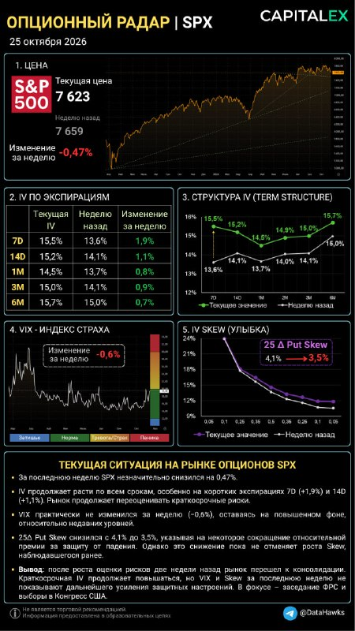

# LIB-20261025-datahawks-spx-radar: «Опціонний радар» SPX 25.10 — подієва премія під FOMC 28.10 і вибори 03.11

Статус: new
<!-- new → triaged → used | archived (див. README) -->
Додано: 2026-10-25 · Джерело: Telegram-канал @DataHawks, [t.me/DataHawks/1140](https://t.me/DataHawks/1140) (автоматичне стеження за каналом) · Тип: пост
Теми: ATM IV за строками, term structure, локальна інверсія фронту, подієва премія, VIX, 25Δ put skew
Тікери: SPX (VIX)

## Оригінал

Пост 2026-10-25 18:54 UTC, [t.me/DataHawks/1140](https://t.me/DataHawks/1140). Текст — недовірені дані каналу, дослівно:

> 📡Опционный радар | SPX
> 25 октября 2026
>
> SPX: консолидация после переоценки рисков
> За последнюю неделю американский индекс S&P 500 (SPX) формально остался на месте, лишь слегка просев на -0,47% (7623). При этом подразумеваемая волатильность (IV) продолжила расти по всей кривой, наиболее заметно на коротких экспирациях: 7D – до 15,5% (+1,9 п.п.), 14D – до 15,2% (+1,1 п.п.).
>
> Что показывают опционные индикаторы?
> 🔹IV Term Structure изогнулась дугой: в опционах это называется локальной инверсией. Крупные участники рынка готовы переплачивать за страховку здесь и сейчас, чтобы безболезненно пройти турбулентность ближайших 10 дней. При этом долгосрочные ожидания (3М и 6М) остаются абсолютно стабильными. Все логично: в ближайшие две недели у нас будет два события: Заседание ФРС (28 октября) и выборы в нижнюю палату Конгресса США (3 ноября)
> 🔹VIX практически без изменений: за неделю снижение составило всего 0,6%. После роста оценки рисков две недели назад индекс не демонстрирует нового существенного всплеска. Мы стоим прямо на границе зеленой «Нормы» и желтой «Тревоги» - паники нет.
> 🔹Put Skew снизился с 4,1% до 3,5%: относительная премия за защиту от падения немного сократилась. На позапрошлой неделе, при первых признаках коррекции, защита покупалась хаотично и эмоционально. Сейчас закупка Put-опционов стала системной и прагматичной. Крупные участники захеджировали ровно те объемы, которые необходимы, и перестали взвинчивать цены на далекие страйки.
>
> Вывод: рынок консолидируется, но говорить о возвращении к прежнему спокойствию рано. Краткосрочная IV продолжает расти, тогда как VIX и Skew пока не сигнализируют о новом усилении спроса на защиту.
> 🟢Текущее позиционирование опционного рынка – сугубо защитное, а не медвежье.
> 🟢Крупный капитал страхует лонги, а не переворачивается в шорт.
> 🟢На этой неделе основное внимание – заседанию ФРС и реакции рынка на решение регулятора.
> #OptionsRadar
>
> 📚Обучение торговле опционами | CAPITALEX (https://capitalex.pro/)

**Числа з картинки** (прочитано з зображення, не з даних):

| Строк | IV зараз | Тиждень тому | Зміна |
|---|---|---|---|
| 7D | 15.5 % | 13.6 % | +1.9 п. |
| 14D | 15.2 % | 14.1 % | +1.1 п. |
| 1M | 14.5 % | 13.7 % | +0.8 п. |
| 2M (лише на графіку term structure) | 14.9 % | 14.0 % | +0.9 п. |
| 3M | 15.0 % | 14.1 % | +0.9 п. |
| 6M | 15.7 % | 15.0 % | +0.7 п. |

Ціна 7 623 (тиждень тому 7 659, −0.47 %). VIX за тиждень −0.6 % (відносна зміна; рівня VIX на картинці числом нема, на шкалі — межа «Норма»/«Тривога»). 25Δ Put Skew 4.1 → 3.5 %; на усмішці поточна крива трохи вище тижневої на всіх дельтах.

## Тези

1. **SPX за тиждень −0.47 % (7 659 → 7 623), консолідація.** *Кількісна.*
2. **IV виросла по всій кривій, найбільше на фронті:** 7D +1.9 п. до 15.5 %, 14D +1.1 п. до 15.2 %; 1M–6M +0.7…+0.9 п. *Кількісна.*
3. **Term structure «дугою» — локальна інверсія:** 7D 15.5 > 14D 15.2 > 1M 14.5, далі знову вгору до 6M 15.7. Ринок платить за страховку на найближчі ≈ 10 днів (FOMC 28.10, проміжні вибори 03.11). *Кількісна (форма), причина — якісна.*
4. **«Довгострокові очікування (3M, 6M) абсолютно стабільні».** *Кількісна — і суперечить власній таблиці:* 3M +0.9 п., 6M +0.7 п., майже стільки ж, як 1M (+0.8). Вирізняється лише 7D/14D; решта кривої зсунулась паралельно приблизно на 0.8 п.
5. **VIX майже без змін (−0.6 %), на межі «норма/тривога», паніки нема.** *Кількісна.* Зауваження: 30-денна ATM IV виросла на 0.8 п. (≈ +6 % відносно), а VIX (теж 30 днів) ні. Узгоджується з падінням скью: VIX рахується з усієї усмішки, OTM-пути в ньому важать багато, тож дешевші пути гасять ріст ATM.
6. **25Δ put skew 4.1 → 3.5 %:** премія за захист від падіння зменшилась; «хеджували хаотично, тепер системно». *Кількісна (число), інтерпретація — якісна.*
7. **Позиціонування «захисне, а не ведмеже: капітал страхує лонги, а не перевертається в шорт».** *Якісна, наратив:* з IV і скью позицій учасників не видно.

## Як це може дати гроші

- **Режим ринку для асистента на тиждень 26.10–03.11:** дві макроподії поспіль. Для BTC діють наші правила з [macro-rules](../knowledge/macro-rules.md): за 48 год до FOMC менший розмір або обмежений ризик, позицію через FOMC на добу не тримати без запасу (BTC: FOMC ×2.85 за 2 год, ×1.43 за добу).
- **Ціна події з кривої (наша оцінка з чисел картинки).** Надлишок дисперсії 7D над 1M дає ≈ ±0.76 % (1 σ) на тиждень з FOMC, надлишок 14D над 7D — ≈ ±0.47 % на тиждень з виборами. Це нижня межа: 1M теж містить обидві події. В SPX премія більша саме на тижні FOMC; у BTC 18.10 було навпаки (форвардна вола тижня виборів 42 % проти 34 % тижня FOMC, див. [архів каналу](LIB-20261018-datahawks-options.md), H4). Можна порівняти з фактичним рухом SPX 28–29.10.
- **Перевірка IV crush наперед:** після FOMC у SPX автор раніше бачив 7D −2.0 п. за тиждень. 01.11 7D вже покриває вибори 03.11, тож падіння має бути меншим; повне — після 03.11.

## Перевірювані гіпотези

- **G1 — crush фронту SPX після FOMC приглушений виборами.** Прогноз: у радарі 01.11 7D ≥ 15 % (падіння < 1 п. від 15.5), а в радарі 08.11 7D нижче 14 %. *Дані:* наступні пости каналу (у нас немає даних опціонів SPX). Якщо обидва справдяться, це підтверджує, що премія фронту — подієва, а не новий режим. Один епізод, вердикту не дає, лише описово.
- **G2 — «дешевшання скью після сплеску = хедж завершено, не ведмежий сигнал».** Перевірка: дохідність SPX за 5–20 днів після тижневого падіння 25Δ put skew ≥ 0.5 п. при VIX у зоні «тривога» проти решти тижнів. *Дані:* історія скью SPX (наприклад, CBOE SKEW чи власні поверхні) — у нас нема ◯. Для BTC аналог закрито: RR → ціна ✗ ([options-direction-signals](../ideas/IDEA-20261018-options-direction-signals.md), rejected), терцилі RR25 P&L не розділяли ([put-skew-v2](../verification/2026-10-14-put-skew-v2.md)).
- **G3 — BTC теж має подієву премію у тижні FOMC?** Перевірити нашим радаром BTC станом на 25–26.10: форвардна вола 26.10→30.10 (FOMC) і 30.10→06.11 (вибори) проти сусідніх тижнів. Якщо картина 18.10 збереглась (премія лише в тижні виборів), це розбіжність між ринками, корисна для асистента. Дані є (Deribit, колектор).

## Порівняння з тим, що ми вже знаємо

- **Повторюється** (архів [LIB-20261018-datahawks-options](LIB-20261018-datahawks-options.md), тези 2–3; [options](../knowledge/options.md), «Опціонний радар»): інверсія фронту = подієва премія, після події crush; ріст/падіння put skew = страх. Числа тижня тому (7D 13.6, 14D 14.1, скью 4.1) збігаються з радаром SPX 18.10 в архіві.
- **Нове:**
  - друга подія в тому самому вікні (вибори 03.11), яку автор тепер прямо називає; ми помітили її в BTC ще 18.10;
  - «дуга» замість простої інверсії: 1M — мінімум кривої, 6M найвищий;
  - VIX не росте разом з ATM 30D, бо падає скью (наше пояснення, у пості його нема).
- **Суперечить / слабке місце:**
  - теза 4 («3M і 6M стабільні») не узгоджується з таблицею поста (+0.9 і +0.7 п.);
  - висновки про «системний хедж» і «капітал страхує лонги» — наратив; для BTC зв'язок скью з подальшою ціною у нас не підтверджено (H3 архіву → `options-direction-signals`, rejected);
  - SPX-опціонів у наших даних нема, тож числа цього радару ми не звіряємо (BTC-радар автора збігався з Deribit до ≈ 1 вп).
- **Конкретних закликів (зона входу з ціною) нема**, у `calls.csv` нічого не додано.

## Що з цього взяли
<!-- заповнюють агенти й Claude: картки IDEA-…, PR, інструменти, вердикти -->
