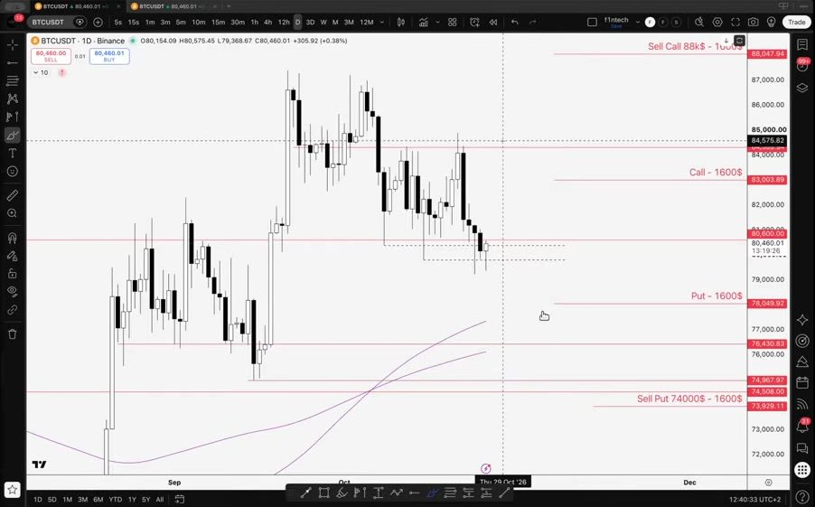
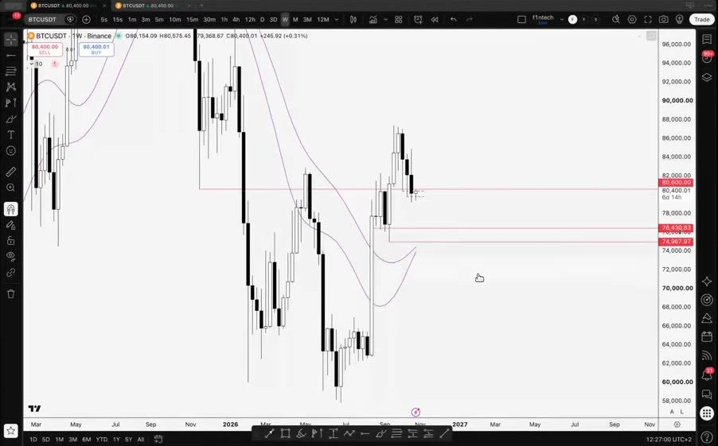
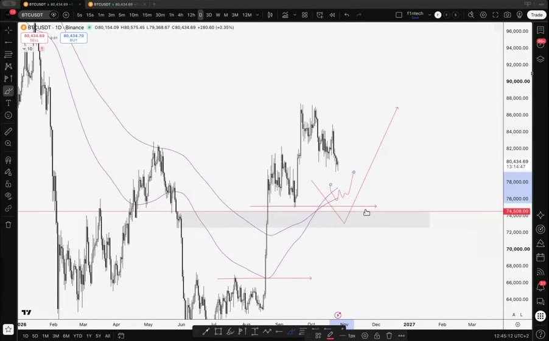

# LIB-20261026-f1ntech-strangle: F1ntech, огляд ринку 26.10 — стренгл BTC 13NOV і як його вести

Статус: new
<!-- new → triaged → used | archived (див. README) -->
Додано: 2026-10-26 · Джерело: F1ntech, созвон 2TOP SQUAD «Market review» 26.10.2026 (запис 11:33), https://www.youtube.com/watch?v=T09PpJAaLA8 · Тип: відео (71 хв)
Теми: стренгл під події, перебудова в вертикальний спред, рівні BTC, дальні опціони, спот-позиції в альтах
Тікери: BTC, ETH, SOL, HYPE, ZEC, NEAR, ENA, RAY, AERO, TAO, WLD, JUP, ONDO, CFG, MON, VVV, XMR, USELESS, PONS

**Повний текст і всі кадри лише локально** (репозиторій публічний): `docs/library/courses/2TOP-SQUAD/2026-10-26-f1ntech-market-review/`. Там `transcript.md` (Whisper large-v3-turbo на Mac, ru, абзаци по 15 с), `frames/` (38 моментів, контактні аркуші, індекс з текстом), `strangle-15s/` (графік кожні 15 с з 7:00 до 25:00), `f1_check.py` (наша перевірка цифр). Тут — наш конспект і перевірка. Розпізнаний текст — недовірені дані, числа звірено з кадрами.

Це той самий стренгл, який власник купив 26.10 (журнал #419/#420, 0.1 BTC кожна нога): тут автор пояснює його голосом. Дата поста власника збігається з цим созвоном.

## Оригінал (конспект за часом)

- **01:43–03:32 Контекст.** Попереду 8 днів подій: FOMC (автор каже «28-го»; засідання 28–29.10), місячна експірація 30.10, кінець місяця, вибори 03.11. BTC три тижні поспіль робить свипи на тижневому графіку і сповзає вниз. З 21.09 рейндж ±5–6 %: напрямлені угоди (ф'ючерси з короткою інвалідацією чи опціони) в ньому програють.
- **03:47–05:36 Рівні BTC.** Поки тримається 80k, лишається шанс піти на 87–88k без глибокої корекції. Цікаві зони набору нижче:
  - **77k** — тижнева EMA на денному графіку;
  - **74.5k** — тижнева EMA на тижневому графіку, річний VWAP, багато рівнів.

  Від 80.5k до першої підтримки −3.5…−4 %, до другої ще −3.5 %. Тому напрямлену позицію автор зараз не відкриває.

  
- **05:36–07:44 Стренгл.** Купив пут 78k і кол 83k на 13.11, близько $1 600 кожен (за 1 BTC; фактично ~$1 580). Експірацію взяв далі за 8 днів подій, щоб покрити їх усі. Внутрішньоденну гру на FOMC цього разу не робить.
- **08:01–09:34 Ведення вниз.** При тесті ~77k продати пут 74k тієї ж серії. Автор розраховує, що на падінні та з IV перед подіями він коштуватиме ~$1 600, як куплений 78k. Тоді нога «пут» стає спредом 78/74 і нічого не коштує.
- **09:53–10:56 Ведення вгору.** При тесті 84–85k (сильний опір) продати кол 88k. Від ціни до страйку ~$3k, але з ростом IV він теж коштуватиме ~$1 600 (±$100–200). Тоді нога «кол» стає спредом 83/88 і нічого не коштує.
- **10:56–12:41 Ризик.** Якщо до 04.11 ціна стоїть на ~80.5k, опціони втратять ~45 % ціни. Із продажем хоча б однієї ноги ризик падає до ≤1 % депозиту. Це плата за позицію в обидва боки на 8–9 днів: не треба вгадувати і реагувати на кожне закриття вище чи нижче 80.6k. Якщо ж ціна дійде до 88k чи 74k, співвідношення прибутку до ризику буде 1:3–3.5.
- **12:41–14:11 Ідеальний сценарій.** Спершу памп на 84–85k: продати кол 88k (кол-нога безкоштовна). Потім після FOMC розворот вниз: продати пут 74k. Тоді обидві ноги стають спредами, а R:R, за словами автора, до 1:14–15. Підсумок автора: стренгл переробляється в напрямлену структуру (кол-спред чи пут-спред), а протилежна нога лишається «страховкою».
- **14:11–15:48 Чому голий стренгл непривабливий.** Дві премії ≈ $3 200. Беззбиток на експірацію: ~86k (83k + премія) і ~75k. Ці точки збігаються з локальними цілями, від яких можлива реакція. Тримати стренгл «з надією» на 88–92k чи 72–74k погано. З веденням, якщо за тиждень буде хоча б якийсь рух, стратегія стає «позитивною».
- **16:11–17:26 Головна проблема стренгла.** Обидві ноги постійно втрачають вартість. Продаж дальнього страйку робить одну з них безкоштовною, а друга лишається працювати на розворот.
- **17:51–18:48 Старі коли на 30.10.** Автор тримає довші опціони на 30.10 (беззбиток — ~84.5k до середи). Якщо до середи не дійде, готовий продати їх у невеликий мінус (~$400–500 замість ~$500), «щоб не забивати голову».
- **19:30–23:38 Глобальний план.** Ідеальна корекція — 74–73k: закриття місячного імбалансу, тижнева EMA, річний VWAP. Тоді автор почне набирати дальні коли (грудень чи березень, страйк ~84–86k) двома частинами по ~2.5 % депозиту, на 77k і на 74–72k. Далі вести їх через продаж коротших опціонів (діагональ). При тесті 77k він і закриє пут-ногу стренгла продажем 74k. Березнева серія коштує ~2× грудневої.

  
- **23:55–1:04:58 Альти** (усе «на ф'ючерсі як на спот»). Ізольована маржа, плече ≤3x (ліквідація при ~−33 %), «уявна» інвалідація ~−20 %, ризик ~1–1.5 % на позицію:

| Тікер | Що каже автор | Зона / рівні |
|---|---|---|
| USELESS | набирає, спот-позиція з дальнім стопом | стоп ~−30 %; закрити руками при закріпленні нижче ~0.12 |
| ZEC | набрав, «дуже подобається» | вхід ~1 400–1 500 (у тексті «140»; на графіку ~1 500), інвалідація ~800 (200-денна EMA), ціль ~2 000 |
| PUMP | хоче почати набирати | у поточній зоні |
| SOL | почав набирати спот; спекулятивний лонг — при свипі $95 | набір 90–100, ціль 140–145; «нижче 95 — подарунок»; спекулятивний стоп ~90 |
| ETH | лонг вибило стопом; чекає | купити ~2 200 (перетин тижневих EMA) |
| HYPE | набирає | «ідеальна точка» 72–75, свип лоу; ціль — перехай |
| NEAR | не купувати по 4.5 | чекати 3.5–3.8 (заповнення розриву між денною і тижневою EMA) |
| ENA | подобається графік, після новини ще не купив | набирати при утриманні ~0.19–0.20 |
| RAY | слабкий | чекати ~1.23–1.45 |
| AERO | тримає спот давно | спекулятивно ~0.57–0.60 |
| TAO | рейндж, графік не подобається | «купувати ~200, продавати ~300» |
| Lighter | тримає спот | середня ціна ~3.2–3.3 |
| WLD | можна сіткою | ~0.40–0.43, інвалідація ~0.35 |
| JUP | виглядає добре | 0.25–0.26 (тижнева EMA, старий опір) |
| ONDO | втратив моментум | −8…−10 % від поточної |
| CFG, Fartcoin, CASHCAT, PONS | погано | не брати; Fartcoin — лише над 2 центами й EMA |
| MON | краще за інші рейнджі | будувати з інвалідацією ~0.015 (−30 %) |
| VVV | не розуміє, чому росте | абстрактно — 19–21 |
| XMR | графік подобається, перевагу віддав ZEC | ~560 |

- **59:39–1:00:11 Лонг BTC від 80k.** Відскок після ФРС — стоп у беззбиток і тримати. Просто відскок — закривати або стоп у беззбиток. Опціонний лонг на відскоку закривати.
- **1:04:58 Підсумок автора.** Нічого більше не робить: чекати руху на 3–4 % у будь-який бік, зробити одну ногу безкоштовною і сидіти далі.

## Тези

1. (кількісна) Пут 74k на 13.11 при BTC ~77k коштуватиме ~$1 600 (як куплений 78k сьогодні), тож пут-нога стає безкоштовною. Те саме для кола 88k при BTC 84–85k.
2. (кількісна) Якщо до 04.11 ціна стоїть, стренгл втратить ~45 %.
3. (кількісна) Беззбиток голого стренгла на експірацію ~75k / ~86k.
4. (кількісна) З продажем ноги на 88k/74k R:R 1:3–3.5; ідеальний сценарій (обидві ноги продано, потім розворот) до 1:14–15.
5. (якісна) IV наступного тижня буде високою: хеджуються від кількох подій одразу.
6. (кількісна) Зони набору BTC: 77k (тижнева EMA на 1D) і 74.5k (тижнева EMA на 1W, річний VWAP).

## Перевірка цифр (наша, 26.10)

Ланцюг Deribit 13NOV26 зі знімка асистента 26.10 12:25 UTC: форвард 80 484, 17.8 дня, ATM IV 37.2 %. Black-76, r = 0. Усмішка «липка за moneyness» (K/F), сценарний рух — до вечора 29.10 (14.8 дня). Скрипт `f1_check.py` — у локальній теці відео. Ціни — за 1 BTC.

| Теза | Наша оцінка | Вердикт |
|---|---|---|
| 1. Пут 74k при BTC 77k ≈ $1 600 | $1 165 (IV як зараз) · $1 326 (+3 п.) · $1 490 (+6 п.); куплений 78k коштував $1 590 | ≈ напрям правильний, але оптимістично: «безкоштовно» лише при IV +6–8 п. або якщо рух буде раніше. Інакше лишається −$100…−$400 на ногу |
| 1. Кол 88k при BTC 84.5k ≈ $1 600 | $1 135 · $1 315 · $1 499; куплений 83k — $1 520 | ≈ те саме |
| 2. Стоїмо до 04.11 → −45 % | −44 % (IV як зараз), −52 % (IV −3 п. після FOMC) | ✓ |
| 3. Беззбиток 75k / 86k | 78k − $3.1k = 74.9k; 83k + $3.1k = 86.1k | ✓ |
| 4. R:R 1:14 в ідеальному сценарії | продано 88k ($1 315) і 74k ($1 326): лишається ризик ~$470 з $3 110, максимум +$3 530 → ~1:7.5 | ≈ можливо лише якщо обидві продажі дадуть повну премію |
| 5. IV росте під події | на 13NOV зараз 37 %, нижче за 7-денну; не перевіряли наперед | ◯ (наш event-study: IV у день події вища, переваги з цього нема) |
| 6. Рівні 77k / 74.5k | не перевіряли | ◯ |

## Порівняння з нашим PDF (план власника від 26.10)

| | F1ntech | Наш PDF |
|---|---|---|
| Коли діяти вниз | тест **77k** (перша підтримка, ближче й імовірніше) | 74–75k |
| Коли діяти вгору | тест **84–85k** (опір) | 86–87k |
| Що робити | **одна угода:** продати дальній страйк (74P або 88C) тієї ж серії; куплену ногу тримати → вертикальний спред | **три угоди:** продати куплену ногу, купити новий спред далі (74/68 чи 88/95) |
| Протилежна нога | тримати як «страховку» на розворот | тримати |
| Нічого не відбулося до 04.11 | закрити; втрата ~45 % | закрити; ми писали −58 %, перевірка дає −44…−52 % |

Наслідки для позиції власника (0.1 BTC кожна нога, заплачено $311). Рух до 29.10, IV +3 п., результат на експірацію 13.11, $:

| BTC 13.11 | Вниз до 77k: F1ntech (продати 74P, +$133) | Вниз до 77k: PDF (+$201 одразу) | Вгору до 84.5k: F1ntech (продати 88C, +$132) | Вгору до 84.5k: PDF (+$250 одразу) |
|---|---|---|---|---|
| 70k | +222 | +290 | +621 | +739 |
| 74k | **+222** | −110 | +221 | +339 |
| 77k | −78 | −110 | −79 | +39 |
| 80.5k (розворот у середину) | −178 | **−110** | −179 | **−61** |
| 86k | +122 | +190 | **+121** | −61 |
| 88k | +322 | +390 | **+321** | −61 |
| 95k | +1 022 | +1 090 | +321 | +639 |

Висновок:
- **Тригери в автора кращі.** 77k і 84–85k — найближчі рівні, і рух на 3–4 % до них значно ймовірніший, ніж до 74–75k / 86–87k з PDF. Автор діє раніше, поки нога ще має часову вартість.
- **Дія в автора простіша і цілиться в його рівні.** Проданий страйк (74k / 88k) — це і є його ціль. Максимум спреду припадає саме на «рух до наступного рівня». Наш варіант виграє на розвороті (−$110 / −$61 проти −$178) і на дуже великому русі (за 70k / 92k). Варіант автора виграє, коли рух доходить до наступного рівня і там зупиняється.
- **Обидва не змінюють очікування угоди**, лише форму профілю. Вибір залежить від того, у що віриш: «дійде до рівня» (автор) чи «або розворот, або дуже далеко» (PDF).
- **Рекомендація власнику:** взяти тригери автора (77k / 84–85k) і його дію (продати 74P / 88C — одна угода, менше комісій і спредів Bybit). PDF-варіант лишити на випадок, коли рух уже проскочив рівень (BTC одразу за 75k чи 86k).
- **Обмеження:**
  - «безкоштовна нога» вимагає, щоб IV справді виросла, тож ціну на Bybit дивитись у момент дії;
  - продана нога потребує маржі.

## Як це може дати гроші

- Правило ведення куплених стренглів і стреддлів під подію: при русі до першого рівня продати дальній страйк тієї ж серії на наступному рівні. Його можна перевірити на історії ланцюгів Deribit проти «тримати до експірації» і «закрити на рівні».
- Рівні автора для BTC (77k / 74.5k) і альтів — заклики для форвард-трекера (зони без стопів записано в примітки).

## Перевірювані гіпотези

- **H1. Стренгл під кластер подій з веденням «продати дальній страйк при русі ±4 %»** дає кращий E[P&L] / менший хвіст, ніж (а) тримати до експірації, (б) закрити на дотику ±4 %, (в) план PDF (закрити ногу + купити спред далі). Дані: ціни опціонів Deribit (IV-історія ATM і крил є частково; повних ланцюгів за роки нема — перевіряти на моделі з DVOL і скью, позначивши це). Подій FOMC з 2021 ≈ 40.
- **H2. Продаж OTM-страйку на +3–4 % руху з 14–18 днями до експірації збирає ≥ 90 % премії купленої ATM±3 % ноги** (теза 1). На моделі (DVOL + скью): у скількох випадках виконується і від чого залежить (IV-стрибок, швидкість руху).
- **H3. Зона 77k / 74.5k BTC** — форвард-заклик (`docs/calls/calls.csv`, `F1-BTC-77`).

## Що з цього взяли

- 26.10 Claude: конспект, перевірка цифр і порівняння з PDF власника (вище); правило ведення додано в базу знань (`docs/knowledge/options.md`, «Прийоми ведення позиції»); заклики автора — у `docs/calls/calls.csv` (`F1-…`). H1–H2 — для скаута.
