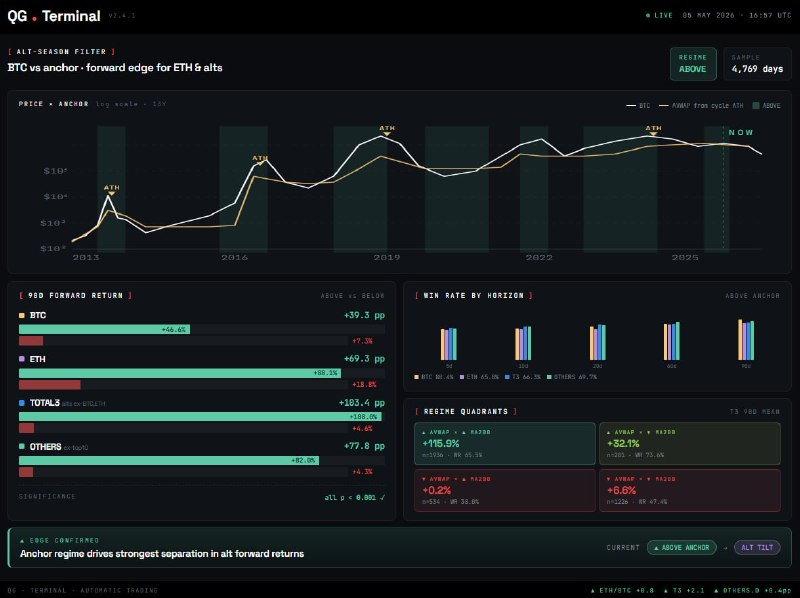
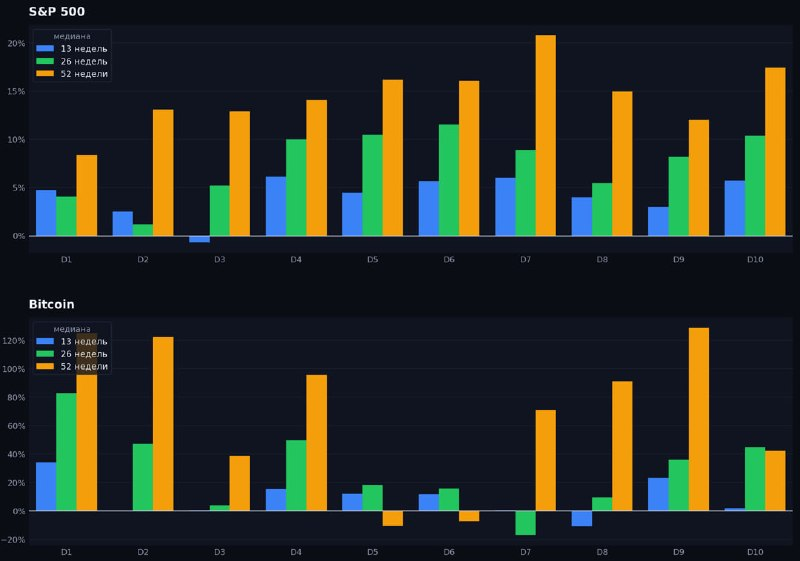
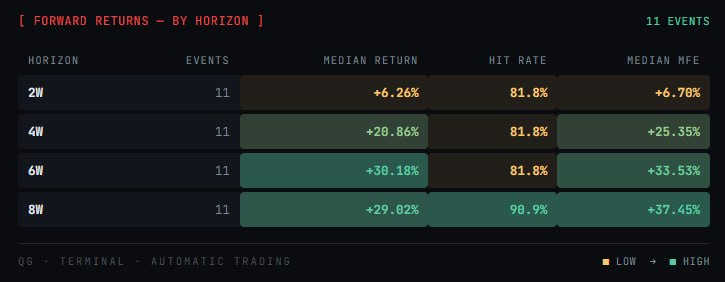
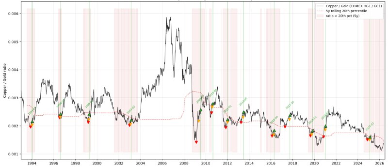
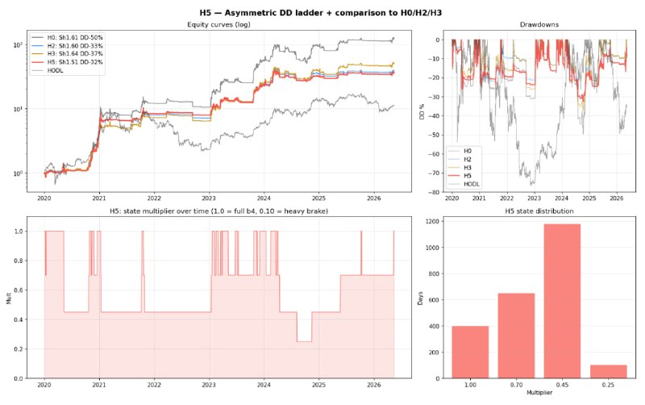
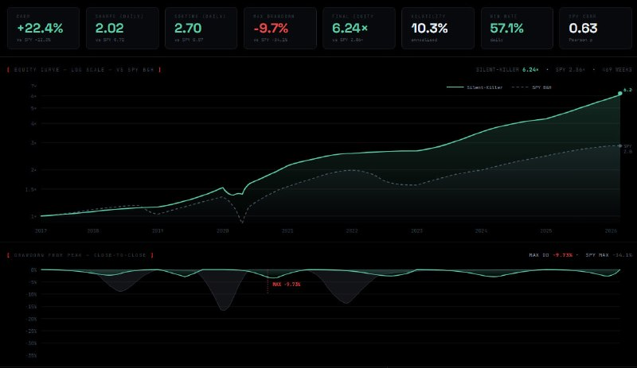
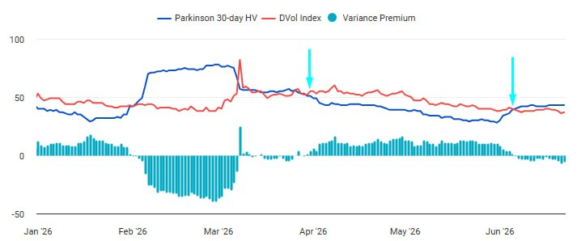
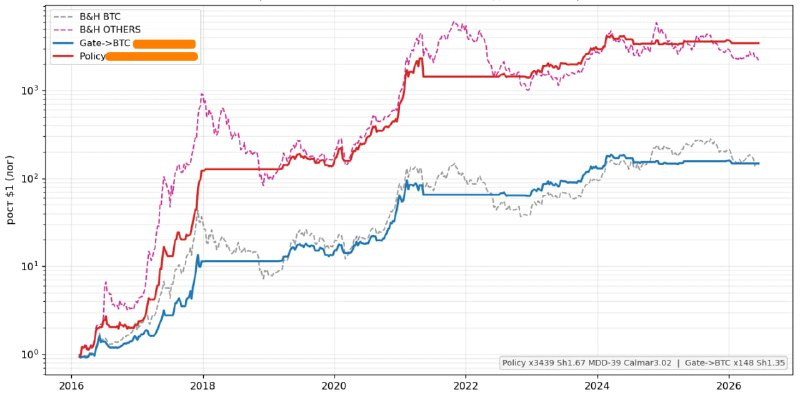
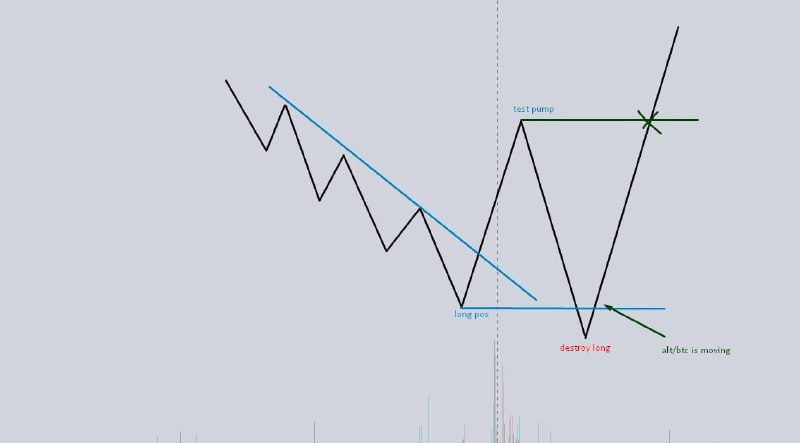
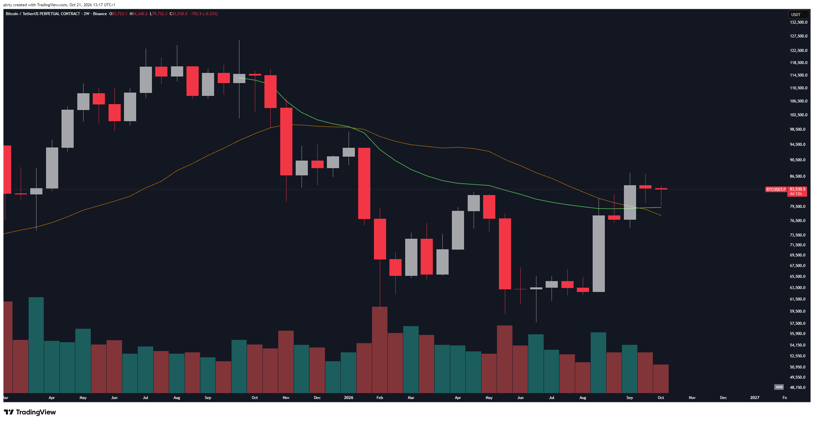

# LIB-20261026-qivty-channel: канал QG «Financial Diary» (t.me/qivty) — повний архів 2020–2026

Статус: new
<!-- new → triaged → used | archived (див. README) -->
Додано: 2026-10-26 · Джерело: публічний Telegram-канал [t.me/qivty](https://t.me/qivty) («QG», «FINANCIAL DIARY», ~4.7 тис. підписників, платний журнал qgdiary.com і Discord «QG Terminal»); надіслав власник з проханням «дослідити від А до Я» · Тип: пости (архів)
Теми: рівні відкриття періодів, девіація і повернення, інвалідація за закриттям, SMA 200/360, позиціонування деривативів (OI, funding, ліквідації), домінація й OTHERS/BTC, мідь/золото, ліквідність ФРС, DXY, AVWAP від ATH циклу, variance premium, режимні системи (APEX, Silent Killer, NAUTILUS), сигнал #GAME для альтів, сайзинг за просадкою, перевірка стратегій
Тікери: BTC, ETH, OTHERS (альти без топ-10), SOL, HYPE, XAU, XAG, мідь, нафта, SPX, NDX, DXY, EURUSD, USDJPY, MSTR

## Оригінал

- **Архів поза git** (обсяг і авторське право): `~/private/library/courses/qivty/`, вивантажено 26.10 скриптом `scripts/channel_backfill.py` з прев'ю t.me/s:
  - `posts.json` / `posts.md` — 5432 пости з #1 (23.10.2020) по #6182 (26.10.2026); `parts/<рік-квартал>.md`;
  - `photos/` — 2086 фото постів і 1704 графіки TradingView, які автор дає посиланнями `tradingview.com/x/…`;
  - `notes/<період>.md` — розбір 11 періодів (читачі-субагенти, бриф `notes/BRIEF.md`): мова автора, індикатори, сетапи, таблиці закликів з цінами (~600 рядків разом), кількісні твердження з планом перевірки. **Двоє читачів (2021Q2, 2021H2) частину цін і «результатів» доповнили з пам'яті** — у нотатках це позначено, тут такі числа не використано.
- Ключові картинки — у [`img/LIB-20261026-qivty-channel/`](img/LIB-20261026-qivty-channel/).
- **Чого немає:** основний зміст з 2023 року — у платному журналі (qgdiary, «Instant Insights») і в Discord; формул систем автор не розкриває («как моделируются сигналы не покажу», #5580), на скрінах назви підстратегій замазані (S1…S12). Пробіл постів 13.09–01.11.2023.
- **Стеження з 26.10:** нові пости розбирає `scripts/channel_watch.py` раз на добу дайджестом (`LIB-…-qivty-digest`, PR #368).

## Ключові картинки

| | |
|---|---|
|  | #5622 «Alt-season filter»: BTC над AVWAP від ATH циклу → 90-денна дохідність BTC/ETH/TOTAL3/OTHERS (4769 днів, вікна перекриваються) |
|  | #5842 медіани 13/26/52 тижнів за децилями його метрики ліквідності: для SPX майже рівно, для BTC немонотонно |
|  | #6165 дивергенція BTC/SPX: 11 подій, 8 тижнів медіана +29 % |
|  | #5677 мідь/золото нижче 20-го перцентиля 5 років + HL: 13 сигналів з 1994 |
|  | #5647 «Asymmetric DD ladder»: множник розміру 1.0 / 0.70 / 0.45 / 0.25 за просадкою |
|  | #5794 звіт Silent Killer 2017–2026 (бектест): формат звіту стратегії |
|  | #5812 DVOL проти Parkinson HV 30d |
|  | #5866 ончейн «Policy» і «ворота» OTHERS проти BTC buy & hold |
|  | #1196 (2021) схема «bottom swept» для альтів |
|  | #6164 BTC 2W: «зона конвергенції попиту» 79–80k (MA 21/50) |

## Хто автор і як змінювався

Рос. мовою, стиль — щоденник; багато «🫡», зверхність до «ведмедів», але й публічне визнання помилок («ошибаться — буквально моя работа, и я это делаю лучше большинства», #4867).

| Епоха | Що робив | Інструменти |
|---|---|---|
| **2020-10 – 2021** (≈2000 постів) | Спекулянт альтами: інтрадей на Binance-перпах (5–15 хв) і спот-«сумки» лоу-капів | ICT/SMC-мова (OTE 0.62–0.79, order block, «полки», SFP, «Дракон» — як у курсі DoubleTop, [`smc.md`](../knowledge/smc.md) S27), ричліст топ-20 гаманців, власний скринер монет, `#bubble` |
| **2022 – 2025** | Свінг від рівня до рівня на старших ТФ, BTC/ETH + макро (DXY, FX, метали, SPX) | Відкриття року/кварталу/місяця/тижня, SMA 200/360, інвалідація за тижневим закриттям, OI/funding/ліквідації, BTC.D+USDT.D/OTHERS, пари BTC/золото, BTC/срібло |
| **2026** | Будує системи і продає доступ: дашборд «QG Terminal», ETF-ротація Silent Killer, крос-активна APEX(O), особиста NAUTILUS, сигнал #GAME, ончейн «Policy», ансамбль «13+4» | Режимні моделі, AVWAP від ATH циклу, мідь/золото, «ліквідність системи», variance premium, DD-ladder, чек-лист перевірки стратегій |

## Що проходить крізь усі роки (ядро методу)

1. **Кожна ідея — «якщо X → Y, скасовується при Z»** (#5977), інвалідація до входу і майже завжди за **закриттям** (день/тиждень/місяць), а не за дотиком: «буду неправий, якщо закриття тижня нижче X».
2. **Відкриття періодів як «лінія на піску»**: річне (2022 Open 46 211; 2025 Open 93 530; 2026 — ~88–89k), квартальне, місячне, тижневе. «Acceptance above/below» — закриття по той бік відкриття.
3. **Девіація і повернення (sweep + reclaim)**: прокол межі діапазону чи свінг-мінімуму і закриття назад → рух до протилежної межі; «внутрішній тиждень + failure» (#1990); «bottom swept» для альтів (схема #1196, стоп під новим мінімумом, ціль — вершина попереднього пампа, тригер — тижневе закриття над рівнем).
4. **SMA 200 / 360 на 1D–1W**: закриття BTC нижче 360-денної — вхід у ведмежу фазу (#5147); «перше закриття над 200MA з серпня 2025» (#5805) — ключ розвороту 2026. Скринер «перше закриття над SMA200 після ≥ 300 днів нижче + просадка ≥ 90 %» (2023).
5. **Позиціонування деривативів контрарно**: дно = OI падає + каскад ліквідацій + funding від'ємний (#2993); ліквідації > $1 млрд за добу — ранній сигнал середньострокового дна (#4782); OI росте при торгівлі нижче WO/WL і funding від'ємний → паливо шорт-сквізу (#4566); «OI/MCap знищено» → чистий перезапуск (#6103).
6. **Ризик**: часткова фіксація (20/50/60/75 %), стоп у беззбиток перед вихідними; **знижувати плече перед FOMC/NFP/звітністю**; спот BTC не продає без ознак «справжнього ведмежого ринку»; альти — «дорогий лотерейний квиток», фіксований 1–3 % на ставку.
7. **Контрарний сентимент**: опитування каналу, «консенсус майже гарантує протилежне» (#5039), «дозволь тривозі купувати» (#5933) — але «бути проти натовпу заради принципу — дурість» (#5160).

## Індикатори й метрики

| Індикатор | Що це і як читає | Відтворити | Що вже знаємо |
|---|---|---|---|
| Відкриття періодів (DO/WO/MO/QO/YO) | S/R; закриття по той бік = підтвердження/інвалідація | OHLC, тривіально | ✗ реакція на DO/WO/MO не сильніша за випадковий рівень ([IDEA-20261021-open-levels-dowomo](../ideas/IDEA-20261021-open-levels-dowomo.md), rejected). QO/YO не тестували |
| SMA 200 / 360 (1D) | 360 — «лінія бичачого ринку»; OTHERS ~30 % під SMA360 = мінімум (Aug'24, Apr'25, Nov'25, #5173) | OHLC; OTHERS — свій кошик з CoinGecko | ◯ |
| `#bubble` (2021–2024) | капіталізація 100-ї монети (пізніше — сума топ-100) у USD і BTC проти піку 2018 (23 450 BTC); > 23 500 BTC — жорсткий ризик | CoinGecko history; методика плавала | ◯ |
| BTC.D + USDT.D (+USDC.D) / OTHERS / OTHERS-BTC | «безпечна домінація» проти решти; зона розвороту 60–62 %; OTHERS/BTC 2.93–3.0 млн — кінець ведмежого ALT/BTC | CoinGecko global | ◯ |
| Alt OI / BTC OI | > 1 і «закручується» — перегрів (#4973) | Coinalyze / колектор | ◯ форвард ([regime-indicators](../knowledge/regime-indicators.md)) |
| Ричліст топ-20 (2020–21) | нетто-приплив топ-20 гаманців за 30–60 днів + «неактивні» → накопичення біля підтримки; відтік на ралі → вершина (#487–#489) | Etherscan `tokenTopHolders` (лише ERC-20) | ◯ |
| Скринер монет (2021) | NVT 30d, bid-ліквідність ±10 % від ціни, обсяг/капа > 2 %, total/circulating ≤ 2:1, покриття емісії | ccxt стакан + CoinGecko | ◯ |
| SPHB/SPLV, XLY/XLP, IWM, мікрокапи / захисні | крива ризику TradFi; ростуть усі — risk-on (#5145, #5169) | ціни ETF | ◯ |
| **Мідь/золото HL** (#5665, #5677) | HG/GC нижче 20-го перцентиля 5-річного вікна, потім розворот і вищий мінімум; 13 сигналів з 1994 — SPX краще на 30–365 д; BTC 90 д +71.7 % (n = 5) | HG=F/GC=F з 2000 | ◯ n = 13 (визнає сам) |
| **AVWAP від ATH циклу** (#5622) | BTC над AVWAP від останнього ATH → 90-денна дохідність BTC +46.6 % vs +7.3 %, ETH +88 % vs +19 %, OTHERS +82 % vs +4 % (4769 днів, «p < 0.001») | Binance OHLCV + CoinGecko | ◯. Дні перекриваються (90-денні вікна), тож «p < 0.001» завищене; по суті це фільтр «бичачий режим» |
| «Ліквідність системи», децилі D1–D10 (#5842, #6181) | власний композит; медіани 13/26/52 тижнів SPX і BTC за децилями | FRED: WALCL, TGA, RRP, M2, T5YIE, ставки | ✗ лаг чистої ліквідності ([IDEA-20261024-net-liquidity-lag](../ideas/IDEA-20261024-net-liquidity-lag.md), rejected). **На його ж картинці для BTC децилі немонотонні**: 52 т. найвищі в D1, D2, D9, а не в D10 — «D10 → +42 %» з графіка не випливає |
| Variance premium (#5812) | DVOL проти Parkinson HV 30d: ринок «дешево оцінює рух» | Deribit DVOL + Binance OHLC — є | DVOL важить для продажу волатильності ([IDEA-20261017-vrp-real-marks](../ideas/IDEA-20261017-vrp-real-marks.md), [звіт](../verification/2026-10-18-vrp-real-marks.md)); премія DVOL − Parkinson як фільтр ◯ |
| «Справедлива ціна» BTC з σ-каналом (#5360) | дотики нижньої межі: 12.2018, 03.2020, 06.2022, 02.2026 | зважена за обсягом середня + σ; параметри приховані | ◯, 4 події |
| Сезонність і календар | президентський цикл (жовтень міжвиборчого → червень — «найсильніші 9 місяців», #6180), «вихідні задають тиждень» 17/20 (#4419) | OHLC | ◯; n мале |

## Системи 2026 (усі цифри — самозвіт, формули закриті)

- **Silent Killer** — місячна класифікація макрорежиму → набір ETF, лише лонг, без плеча. Бектест 2017–2026: CAGR 22.4 %, Sharpe 2.02, max DD −9.7 % (SPY −34 %), 2022 +3.2 % (#5794). Реальний рахунок — з 30.04.2026. Приклад розподілу на травень: рівні частки BTC, SMH, XLK, IWM, DBC (режим Expansion). «Macro Pulse»: Expansion / Prices / Flows → режими SURGE / PRIME / STALL / SLUMP (#5681).
- **APEX / APEX(O)** — ротація режимів між класами активів, у версії (O) лонг/шорт з плечем і місячною ротацією. Бектест APEX: CAGR 44.9 %, Sharpe 1.39, DD −25 %; покращена: Sharpe 1.82, **найгірший з 2000 бутстреп-шляхів 1.21**, DD −10.7 %, експозиція 0.4–1.5× за режимом волатильності й кореляцій, враховано funding (до −11 % річних) і 30 bps проковзування (#5627). Живе: 30.04 → 04.08 +27.2 % при BTC −17.8 %.
- **NAUTILUS** — особиста, концентрований лонг + постійні шорти: ~6 міс. +22.4 % vs SPY +14.4 %, beta 0.29 (#6153); BTC-рукав «скільки ризику тримати в BTC сьогодні» YTD +49 % vs BTC −7 %.
- **Сигнальна 24-год модель «альти проти BTC»** — активна ~30 % часу, утримання 4–5 днів, 71 % влучань на 63 угодах (#5671).
- **#GAME (ALT)** — сигнал для альтів: 10–11 спрацювань за історію, 2 збитки (2018, Q1 2022), медіанна MAE −5.7 %, медіанний максимум +38.9 % за 6–8 тижнів (#6107, #6165). З'явився знову 23.09 і 26.10.2026 («звіримось у листопаді»).
- **Ончейн «Policy»** — лише ончейн-оцінки, «ворота» вмикають OTHERS у бичачих фазах; автор радить **викинути NUPL і MVRV** — застаріли (#6042); 138 ончейн-метрик перевірив, стійкої переваги не дала жодна (#5828), PCA: 4 компоненти пояснюють ~90 % (#5771).
- **DD-ladder** — множник розміру 1.0 / 0.70 / 0.45 / 0.25 за станом просадки стратегії (#5647); «система регулює не напрямок, а ступінь присутності».
- **Human vs Machine** — рахунок «дискреційна ідея проти системи» (2-0, потім 2-1 на користь машини).
- **Чек-лист перевірки стратегії** (#5868): IS/OOS, walk-forward 1/2/3 роки, стабільність за епохами, White Reality Check, Deflated Sharpe і PSR, permutation з «канаркою» lookahead, витрати 30 bps, block bootstrap 3500 шляхів, CPCV/PBO, placebo (лаг/інверсія/фаза), збурення ваг ±20 %, викидання топ-K тижнів, Sharpe з поправкою Ло.

**Що з цього правда — невідомо.** Живої історії 2–6 місяців проти 9-річних бектестів; рахунків і коду не показує; заклики «звіт з 2017 р. 20.6×» — бектест. Він сам: «якщо почну наводити кілька місяців як доказ 9-річного бектесту — називайте клоуном» (#6153). Цінність для нас — **ідеї й стандарт перевірки**, а не цифри.

## Погляд на ринок станом на 26.10.2026

- BTC: циклічне дно 60k у лютому 2026, «це бичачий ринок»; 4-річний цикл — «зламаний компас»; ціль 200k у 2027. Жовтень: діапазон 79–88k, лонг з ~80.4k (20 % зафіксовано, ціль 85.4k), інвалідація — тижневе закриття нижче 79k, тоді 88k обмежує Q4 і шлях ~72k.
- ETH: спот з ~1800; 2500 — підтримка (на 26.10 ETH ≈ 2315, тобто нижче — його ж умова не виконується).
- Альти: #GAME знову увімкнувся; OTHERS 212–222 млрд (пік 255 млрд 27–28.09).
- SPX: 7524 — «точне дно» Q3, ціль 8000; стоп лонгу ~7670. DXY: вершина Q4 сформована, нижче 100 бичаче для ризику на 13 тижнів; інвалідація — закриття вище 101.
- Золото: поступовий шорт біля 4453, ціль 3700 (інвалідація вище 4736); срібло — частину спота біля 50.
- Макро: інфляція нижче консенсусу, «пік яструбності позаду», підвищення ставки у вересні «найголубіше», ліквідність м'яка.

## Трек-рекорд: що можна сказати чесно

- **Сильне**: структура й інвалідація. Рівні часто точні (DXY 111–114 як зона продажу долара 29.08.2022 при піку 114.78; GBPUSD від ~1.04; 7524 по SPX; вихід BTC-моделей біля 80k у травні 2026).
- **Слабке**: строки й цілі. BTC 80k у травні і 100k влітку 2024 — ні; ETH 5000 тричі — ні; після 11.10.2025 — серія промахів (ATH до листопада, 150k до грудня); DXY 93–97 — ні; срібло/золото — кілька передчасних шортів.
- **Упередження вибірки**: свої «ікси» (ONE 23×, DEC 17×, VRA 35×) показує частіше за збитки; 2021 — промоція мікрокапів, які тримає (DEOR з інструкцією «slippage 1 %, gas 200»); довгі розбори 2021 схожі на переклади з англійської — авторство аналітики невідоме.
- Механічної перевірки закликів ще нема — гіпотеза H1 нижче.

## Що вже перевірено у нас (його ідеї з іншими авторами)

- Реакція на відкриття дня/тижня/місяця — ✗ ([IDEA-20261021-open-levels-dowomo](../ideas/IDEA-20261021-open-levels-dowomo.md)).
- Девіація під рейнджем і повернення — inconclusive, переваги не видно ([IDEA-20261017-deviation-weekly-trend](../ideas/IDEA-20261017-deviation-weekly-trend.md)).
- Лаг чистої ліквідності США до BTC — rejected як тест без потужності ([IDEA-20261024-net-liquidity-lag](../ideas/IDEA-20261024-net-liquidity-lag.md)).
- Відскок після ліквідаційного каскаду — не перевага ([setups S9](../knowledge/setups.md)); funding-натовп — S8.
- Отже, **його ядро «рівні + девіації + закриття» як механічна перевага в нас не підтвердилось**; як правила ризику й інвалідації — так.

## Як це може дати гроші

1. **Режимний шар над нашими сетапами**, а не нові входи: AVWAP від ATH, мідь/золото, SMA360, крива ризику TradFi → множник розміру (0 / 0.5 / 1), як «ступінь присутності» у нього.
2. **DD-ladder для демо-трейдера**: зменшувати розмір після просадки стратегії (1.0 → 0.70 → 0.45 → 0.25) — пряма перевірка на наших угодах.
3. **Опціонний вимір** (близько до профілю власника): variance premium DVOL − Parkinson HV як фільтр «купувати чи продавати волатильність».
4. **Сигнал альтів** (аналог #GAME / AVWAP-фільтра) для кошика альтів у перпах.
5. **Стандарт перевірки**: його чек-лист і «найгірший Sharpe з 2000 шляхів» — у сито й звіти кванта.
6. **Журнал Human vs Machine**: тег `human`/`system` у нашому журналі, підсумок раз на квартал.

## Перевірювані гіпотези

- **H1. Аудит закликів автора.** ~600 закликів з цінами в `notes/*.md` (розділ 5): чи краща його зона входу за вхід одразу і чи вищий хіт-рейт рівнів за наївний (момент 30 днів), окремо 2020–21 (альти), 2022–25 (BTC/ETH/FX), 2026. Дані: Binance/Bybit денні (крипта), FX/метали частково. Ризик: читачі записали не всі угоди, заклики умовні.
- **H2. AVWAP-фільтр альт-сезону.** BTC над AVWAP від ATH циклу → 30/60/90-денна дохідність BTC, ETH, кошика альтів вища, ніж під ним; **головне — на неперекритих вікнах і з входом у день зміни режиму**, block bootstrap. Дані: Binance з 2017, CoinGecko. Його цифри (+46.6 vs +7.3 п.п.) — еталон для звірки.
- **H3. Мідь/золото HL як режим ризику.** Правило #5677 дослівно; forward SPX/BTC 30/90/180 днів. n = 13 (SPX з 2000 — менше), BTC n ≈ 5 — очікувано inconclusive; дешево.
- **H4. DD-ladder поверх наших сетапів** на угодах демо-трейдера і бектесту: Sharpe і max DD з ladder проти без. Дані є (demo_trade, бектести сита).
- **H5. Variance premium DVOL − Parkinson HV30** як фільтр купівлі/продажу опціонів: дохідність продажу стренгла (наша методика `vrp-real-marks`) у терцилях премії. Дані є (Deribit).
- **H6. SMA360 і «OTHERS на 30 % під SMA360».** BTC: закриття нижче 360-денної → 90/180-денна дохідність; кошик альтів 30 % під SMA360 → 90 днів. Епізодів мало (3 для OTHERS) — форвард-монітор, не картка.
- **H7. Місяць BTC > +20 %** → наступні 1–3 місяці (#6033: у 13 випадках середнє +44.8 %, падінь ≥ 20 % 0/13). Binance/Bitstamp з 2013 місячні.
- **H8. Дивергенція BTC проти SPX** (#6165: 11 подій, 8 тижнів +29 %, 10/11 у плюсі) — потрібне власне визначення; n мале.
- **H9. Президентський цикл і міжвиборчий рік** (#6126, #6180): BTC/SPX у вікні жовтень міжвиборчого → червень проти решти. n = 3–4 для BTC.
- **H10. Weekend → тиждень** (#4419: 17/20): знак суботи+неділі передбачає знак пн–пт. Дані є (Binance годинні з 2017), сотні тижнів — потужність є.
- **H11. Квартальне й річне відкриття** (не DO/WO/MO, які вже ✗): закриття тижня по той бік QO/YO → дохідність 2–4 тижні.
- **H12. Чек-лист #5868 для сита** — не гіпотеза ринку, а доробка методики: додати DSR/PSR, placebo, drop-top-K, block bootstrap до звітів кванта.

## Що з цього взяли

- 2026-10-26: архів 5432 пости + 3790 картинок, 11 нотаток періодів (`~/private/library/courses/qivty/notes/`); цей запис; 4 поточні заклики в трекер (`QG-…`); база знань — розділ «Канал QG (qivty)» у [`regime-indicators.md`](../knowledge/regime-indicators.md) і [`risk-management.md`](../knowledge/risk-management.md); гіпотези H1–H12 для скаута; щоденне стеження за каналом (PR #368).
