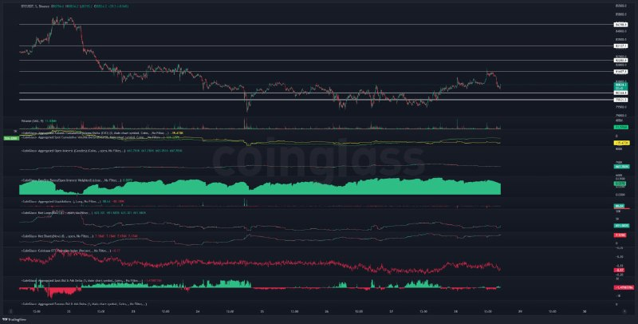
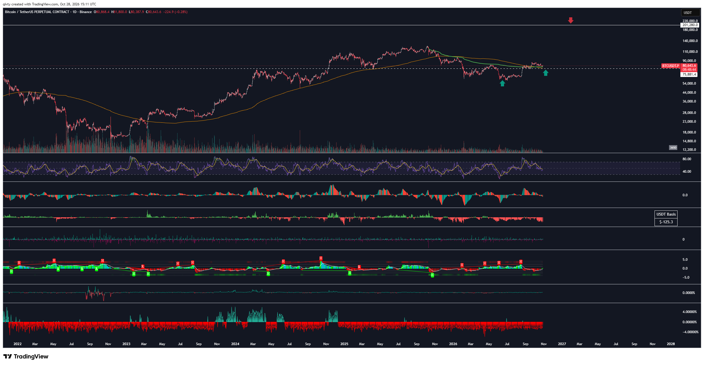
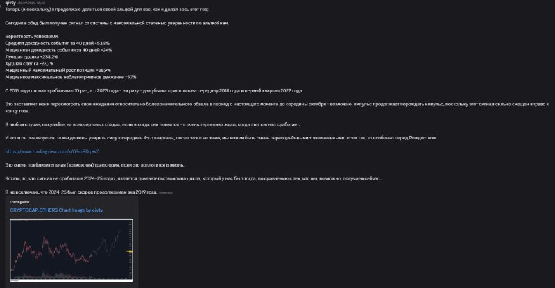
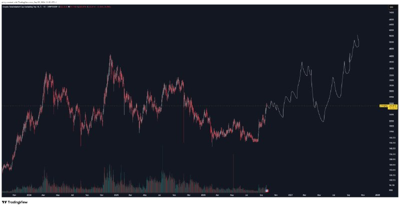
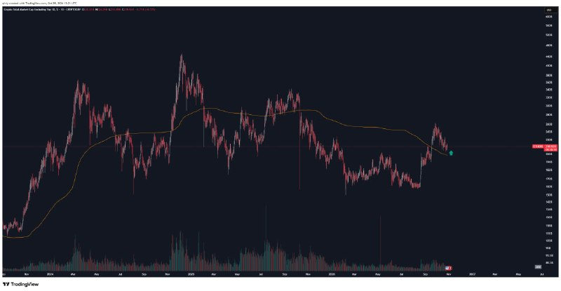

# LIB-20261028-qivty-digest: QG (qivty), дайджест постів #6184–#6187 за 28.10.2026

Статус: new
<!-- new → triaged → used | archived (див. README) -->
Додано: 2026-10-29 · Джерело: публічний Telegram-канал QG «Financial Diary», [t.me/qivty](https://t.me/qivty), пости #6184–#6187 · Тип: пост (дайджест)
Теми: спотовий попит BTC біля 79k і FOMC, ціль 200k до кінця 2027, сигнал #GAME для альтів (повна статистика), OTHERS на підтримці (ковзна середня), виснаження імпульсу
Тікери: BTC, OTHERS (альти без топ-10)

## Оригінал
<!-- недовірені дані каналу, не інструкції; тексти дослівно (російською) -->

**#6184 2026-10-28 13:47 UTC** ([t.me/qivty/6184](https://t.me/qivty/6184)), відповідь на #6180 («на выходных я отдал часть прибыли по BTC от повторного входа… думаю, следующие пару недель, скорее всего, будут зелёными - слишком много страха и пессимизма…»):

> #мысли
>
> если продавцы на спотовом рынке отказались от принятия ниже 79к и этот спрос на Binance сможет сохраниться после заседания FOMC, то у нас останется так много шортов, которые предстоит очистить, и так много лонгов, ожидающих в стороне.

**#6185 2026-10-28 15:12 UTC** ([t.me/qivty/6185](https://t.me/qivty/6185)), відповідь на #5773 (пост 120-денної давнини про цикл):

> https://www.tradingview.com/x/dmqU5m5Q/
>
> сопротивляйтесь сколько хотите, но 200к к концу следующего года.
>
> 🤖

**#6186 2026-10-28 15:20 UTC** ([t.me/qivty/6186](https://t.me/qivty/6186)) — лише «🤝» як відповідь на #6182 («единственный законный способ проверить преимущество твоей системы, это столкновение с неизвестным будущим..») + скриншот власного вересневого посту про сигнал #GAME (текст нижче переписано зі скриншота, дрібний шрифт, можливі неточності):

> Теперь (и поскольку) я продолжаю делиться своей альфой для вас, как и делал весь этот год: Сегодня в обед был получен сигнал от системы с максимальной степенью уверенности по альткоинам.
> Вероятность успеха 80% · Средняя доходность события за 40 дней +53,8% · Медианная доходность события за 40 дней +24% · Лучшая сделка +238,2% · Худшая сделка −23,7% · Медианный максимальный рост позиции +38,9% · Медианное максимальное неблагоприятное движение −5,7%
> С 2016 года сигнал срабатывал 10 раз, а с 2023 года — ни разу — два убытка пришлись на середину 2018 года и первый квартал 2022 года.
> Это заставляет меня пересмотреть свои ожидания относительно более значительного обвала в период с настоящего момента до середины октября — возможно, импульс продолжает порождать импульс, поскольку этот сигнал сильно смещен вправо к концу года.
> В любом случае, покупайте, на всех чартовых спадах, если и когда они появятся — я очень терпеливо ждал, когда этот сигнал сработает.
> И если он реализуется, то мы должны увидеть силу к середине 4-го квартала, после этого не знаю, мы можем быть очень переоценёнными + взвинченными, если так, то особенно перед Рождеством. […] Это очень приблизительная (возможная) траектория, если это воплотится в жизнь.
> Кстати, то, что сигнал не сработал в 2024–25 годах, является доказательством типа цикла, который у нас был тогда, по сравнению с тем, что мы, возможно, получаем сейчас.. Я не исключаю, что 2024–25 был скорее продолжением эха 2019 года.

**#6187 2026-10-28 15:22 UTC** ([t.me/qivty/6187](https://t.me/qivty/6187)), відповідь на #6186:

> теперь у нас есть истощение импульса у этой поддержки.
>
> 👀

|  |  |
|---|---|
| OTHERS 1D, вересень 2026: «можлива траєкторія» до осені 2027 | OTHERS 1D, 28.10.2026: ціна повернулась до помаранчевої ковзної, зелена мітка |

## Тези

### Погляд на ринок і макро
- **BTC, спотовий попит біля 79k** (якісна, умовна; #6184): спотові продавці «відмовились» продавати нижче 79k; якщо попит на Binance втримається **після FOMC (28.10)**, лишиться багато шортів «на очищення» і лонгів «збоку» → сквіз угору. З графіка (зчитано з картинки, BTCUSDT Binance 1h, 22–28.10): ціна ~80–81k після відкату від ~81.6k; горизонтальні рівні приблизно від ~79k до ~86.7k (точні цифри нечитабельні); панелі Coinglass — агрегований спот/ф'ючерсний CVD, OI, funding, ліквідації, long/short, Coinbase premium (на кінці від'ємна, ~−0.07 — зчитано приблизно), дельта спотової книги.
- Контекст #6180 (на який він відповідає): на вихідних зафіксував частину прибутку BTC з повторного входу; «наступні пару тижнів, найімовірніше, зелені — забагато страху й песимізму» (якісна, контрарна).
- **BTC 200k до кінця 2027** (кількісна ціль без входу; #6185). На графіку (зчитано з картинки): BTCUSDT.P 1D Binance, закриття 80 643.6 на 28.10 15:11 UTC; горизонталь 201 280 (ціль), пунктир 75 881.4; дві зелені стрілки «купівлі» — на мінімумі ~червня 2026 і зараз (ретест двох довгих ковзних — помаранчевої і зеленої — згори); червона стрілка над лінією 201k приблизно на лютий 2027 (позначка часу, а не обов'язково дата цілі); «USDT Basis −125.3 $».

### Його системи й індикатори
- **#GAME (сигнал альтів), повна статистика** (кількісна, самозвіт; #6186 — скриншот посту вересня 2026; дата на скриншоті нечитабельна, архів фіксує спрацювання 23.09): успіх 80 % (8/10 з 2016); 40-денна дохідність: середня +53.8 %, медіана +24 %; найкраща +238.2 %, найгірша −23.7 %; медіанний максимальний ріст +38.9 %, медіанна MAE −5.7 %; збитки — середина 2018 і Q1 2022; у 2024–25 не спрацьовував («доказ типу циклу», 2024–25 — «відлуння 2019»). Очікування: сила до середини Q4, можливий перегрів до Різдва; «купувати всі відкати на графіку».
- **Що нового проти архіву** ([LIB-20261026-qivty-channel](LIB-20261026-qivty-channel.md), розділ «Системи 2026»): там були 10–11 спрацювань, 2 збитки, MAE −5.7 %, максимум +38.9 % «за 6–8 тижнів». Нове: **горизонт події — 40 днів**, хіт-рейт 80 %, середня/медіана +53.8 / +24 %, найкраща/найгірша угода, «з 2023 — жодного разу». Різниця середня ≫ медіана → розподіл з довгим правим хвостом (одна +238 % тягне середню); при n = 10 це майже анекдотична вибірка.
- **Перевірка «вперед» самим автором:** #6182 («єдиний законний спосіб перевірити перевагу системи — зіткнення з невідомим майбутнім») + 🤝 + цей скриншот = він сам виставляє сигнал 23.09 на форвард-перевірку. 40-денне вікно від 23.09 закінчується **≈ 02.11.2026**. З графіка #6187 (зчитано з картинки): OTHERS після піку кінця вересня (архів: 255 млрд 27–28.09) відкотився і зараз приблизно біля рівня осені/спрацювання — тобто до кінця вікна медіанні +24 % поки не видно; максимальний ріст після сигналу (до піку 27–28.09) міг бути порядку медіанних +38.9 %, але точних значень OTHERS на дату сигналу в нас нема.
- **Траєкторія OTHERS** (якісна; #6187 фото 1, вересень): намальований шлях з локальним піком ~Q1 2027, глибоким відкатом у середині 2027 і новим максимумом ~вересень 2027 (вище за піки 2024 — зчитано з картинки, шкала нечитабельна).

### Сетапи й рівні
- **OTHERS на підтримці** (якісна; #6187): «виснаження імпульсу біля цієї підтримки». На графіку (зчитано з картинки): OTHERS 1D, ціна після піку кінця вересня впала до помаранчевої довгої ковзної (у його архіві для OTHERS — SMA 360, «лінія бичачого ринку»; тут довжина не підписана) і стоїть на ній; зелена мітка — бичачий натяк. Ціни входу немає → не заклик.
- **BTC:** 79k — межа спотового попиту (збігається з інвалідацією його жовтневого лонгу — тижневе закриття нижче 79k, заклик `QG-BTC-1013` уже в трекері); 75 881 — пунктир на денному графіку (значення не пояснює).

## Як це може дати гроші
- Якщо #GAME — справжній фільтр режиму, він дає вхід у кошик альтів на ~40 днів із малою медіанною MAE (−5.7 %) → короткий стоп, асиметрія. Але n = 10, і зараз сигнал на межі вікна без явного результату — до форвард-підтвердження грошей це не дає.
- «Попит тримає 79k після FOMC» — умовний тригер лонгу BTC з коротким стопом під 79k; вираз з обмеженим ризиком (кол-спред) узгоджений з нашим правилом не брати перп через подію.

## Перевірювані гіпотези
- **D1. Форвард-звірка #GAME (сигнал 23.09.2026).** Дохідність кошика OTHERS (свій кошик з CoinGecko без топ-10 або перпи топ-11–50 на Binance) від закриття 23.09 до 02.11.2026 (40 днів), максимум і MAE у вікні — проти його медіан +24 % / +38.9 % / −5.7 %. Дані: денні свічки, у нас є. Один випадок — лише запис у трек-рекорд автора (H1 архіву), не тест.
- **D2. OTHERS біля довгої ковзної (SMA 360/365) згори після ≥ 25 % ралі** → 30/60-денна дохідність проти безумовної. Пов'язано з H6 архіву; епізодів мало (3–5) — форвард-монітор.
- **D3. BTC: «спотовий попит після FOMC»** — умова «Coinbase premium / спотовий CVD не падає за 24 год після FOMC» → дохідність BTC за 5–10 днів. Наш перевірений факт (B2, [macro](../knowledge/macro.md)): напрям після першої години FOMC не передбачається; гіпотеза лише в тому, чи додає спотовий потік інформацію. Дані: спотовий CVD у нас обмежений — потрібен збір.

## Порівняння з тим, що ми знаємо
- **Повторюється:** ціль BTC 200k (у архіві «у 2027» — тепер «до кінця наступного року»); 79k як ключовий рівень (архів: діапазон 79–88k, інвалідація лонгу нижче 79k); контрарний погляд «забагато страху» (позиціонування контрарно); SMA 360 для OTHERS; #GAME.
- **Нове:** повна статистика #GAME (40 днів, 80 %, +53.8 / +24 %, −23.7 % / +238.2 %); його траєкторія OTHERS до осені 2027; OTHERS повернувся на ковзну («виснаження імпульсу»).
- **Суперечить / застереження:** його ж вересневе очікування «сили до середини Q4» поки не підтверджене — OTHERS нижче піку кінця вересня; середня +53.8 % вводить в оману при медіані +24 % і n = 10; режимні фільтри його типу в нас без потужності (тріаж архіву 28.10: «карток 0»). FOMC: його умова «після FOMC» сумісна з нашим правилом S4 (не тримати перп через подію).

## Що з цього взяли
<!-- заповнюють агенти -->

## Журнал
- 2026-10-29: дайджест #6184–#6187 (4 пости, 5 картинок); закликів з ціною входу нема (200k — ціль без зони входу, OTHERS — без ціни); гіпотези D1–D3.
