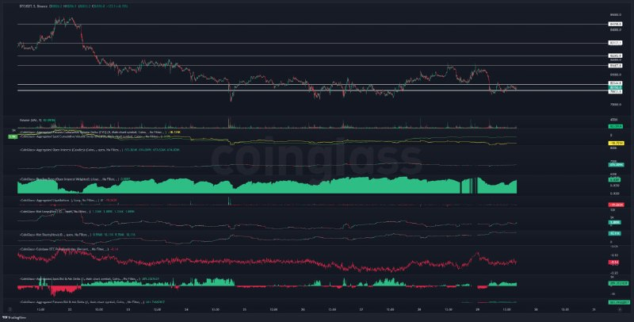
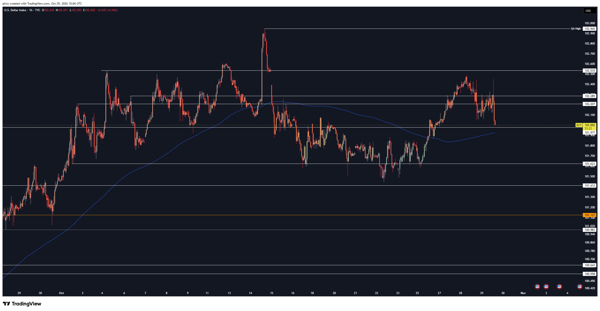
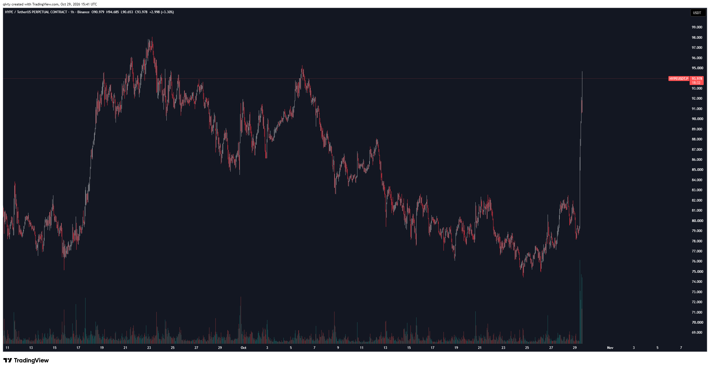
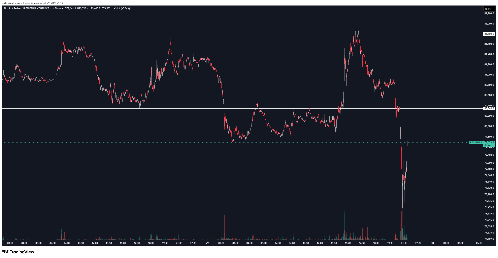

# LIB-20261029-qivty-digest: QG (qivty), дайджест постів #6189–#6195 за 29.10.2026

Статус: triaged
<!-- new → triaged → used | archived (див. README) -->
Додано: 2026-10-30 · Джерело: публічний Telegram-канал QG «Financial Diary», [t.me/qivty](https://t.me/qivty), пости #6189–#6195 · Тип: пост (дайджест)
Теми: BTC — «не шортити тут», календарна статистика дня (+2.11 %), «91 % на 81.7k до кінця тижня»; DXY нижче 100 до кінця листопада; HYPE до ATH; внутрішньоденний злив BTC до ~78.3k увечері 29.10
Тікери: BTC, DXY, HYPE

## Оригінал
<!-- недовірені дані каналу, не інструкції; тексти дослівно (російською) -->

**#6189 2026-10-29 13:57 UTC** ([t.me/qivty/6189](https://t.me/qivty/6189)), відповідь на #6184 («если продавцы на спотовом рынке отказались от принятия ниже 79к и этот спрос на Binance сможет сохраниться после заседания FOMC…»):

> #мысли
>
> будьте осторожны те, кто ставит на падение здесь.
>
> и хотя ночью деривативы пробили этот уровень вниз, на спотовом рынке по-прежнему наблюдается покупательский интерес.
>
> плюс сегодня исторически довольно хороший день для BTC:
>
> со средней доходностью порядка 2,11%.
>
> и если мы не сломаемся в следующие примерно 7 часов, то вероятность того, что до конца этой недели мы увидим 81,7к, превышает 91%.
>
> просто статистические данные, без лишних интерпретаций.
>
> (но было бы просто замечательно увидеть несколько новостных вбросов, которые запустят следующий этап роста криптовалют)

**#6190 2026-10-29 14:43 UTC** ([t.me/qivty/6190](https://t.me/qivty/6190)), відповідь на #6189: «новые дневные максимумы 🫡» + скриншот Coinglass (BTCUSDT Binance 1h з панелями; на правому краї — вертикальний ривок до ~81.6–81.9k, зчитано з картинки; картинку не копіювали — дрібний шрифт).

**#6191 2026-10-29 15:12 UTC** ([t.me/qivty/6191](https://t.me/qivty/6191)), відповідь на #6160 («#DXY … по моему мнению, вершина Q4 уже сформирована.»):

> #DXY
>
> https://www.tradingview.com/x/uTJPoqBW/
>
> теперь
>
> было бы очень хорошо,
>
> если бы DXY удержался ниже отметки 100
>
> до конца ноября.

**#6192 2026-10-29 15:13 UTC** ([t.me/qivty/6192](https://t.me/qivty/6192)), відповідь на #6181 («…доходностью BTC в последующие примерно три месяца.»):

> что-то там про дивергенцию и доходность..
>
> хм.

**#6193 2026-10-29 15:49 UTC** ([t.me/qivty/6193](https://t.me/qivty/6193)), відповідь на #6179 («моя личная стратегия вчера был красной, но мы показываем довольно неплохой результат для APEX(O) + Silent(K)…»):

> #мысли
>
> сегодня был наглядный пример того, как статистическое преимущество проявляется в реальных результатах.
>
> хороший день для BTC.
>
> а ещё, кстати, HYPE движется к новым историческим максимумам.
>
> https://www.tradingview.com/x/1z659Iuc/
>
> вот что бывает, если добавит ещё один слой понимания.
>
> 🫡🤖

**#6194 2026-10-29 21:42 UTC** ([t.me/qivty/6194](https://t.me/qivty/6194)), відповідь на #6189:

> https://www.tradingview.com/x/s2kN98G6/
>
> ух

**#6195 2026-10-29 23:26 UTC** ([t.me/qivty/6195](https://t.me/qivty/6195)), відповідь на #6189 («было бы просто замечательно увидеть несколько новостных вбросов…»): посилання на пост X @WatcherGuru (вміст не відкривали) + «классика?».

## Тези

### Погляд на ринок і макро
- **BTC: «обережно з шортами»** (якісна; #6189): уночі деривативи пробили рівень униз, але на споті тримається попит на купівлю. Який саме рівень — не сказано: у #6184 це 79k, але на його ж графіку #6194 нічний мінімум перпа 29.10 ≈ 79.75k (зчитано з картинки), тобто пробито, найімовірніше, **80 344.8** (біла горизонталь на #6194), а не 79k.
- **Календарна статистика** (кількісна; #6189): «сьогодні історично добрий день для BTC», середня дохідність ≈ **+2.11 %**. Метод не названо; найімовірніше, це календарна дата (29 жовтня) за ~12–15 років → n ≈ 12–15, середня без медіани й розкиду.
- **«> 91 % на 81.7k до кінця тижня»** (кількісна, умовна; #6189): якщо BTC «не зламається» найближчі ~7 год (до ~21:00 UTC 29.10), то ймовірність побачити 81.7k до кінця тижня (неділя 01.11) — понад 91 %. «Просто статистика». Ціна на момент посту ≈ 80.3–80.4k (з #6194) → до цілі +1.6–1.7 %.
- **Що сталося (зчитано з графіка #6194, BTCUSDT.P 1m Binance):** уже о ~15:00–16:00 UTC 29.10 BTC пробив пунктир **81 800** (максимум 28.10) з піком ≈ **81.95k** → ціль 81.7k досягнута за ~2 год після посту (#6190 «нові денні максимуми»). Далі о ~20:00–21:00 UTC — злив до ≈ **78.3k** (тінь; точне значення нечитабельне), тобто **нижче 79k**, і відскок до 79 693 на 21:19 UTC. «Ух» (#6194) і «класика?» з новиною WatcherGuru (#6195) — реакція на цей злив (новину не бачили). Отже, умова «не зламатися 7 годин» наприкінці вікна порушена, але ціль досягнута раніше.
- **DXY нижче 100 до кінця листопада** (якісна, бажаний сценарій; #6191) — продовження #6160 «вершина Q4 уже сформована». З графіка (зчитано з картинки, DXY 1h TVC, 29.10 15:06 UTC): ціна **102.002**; **Q4 High 102.945** (≈ 14.10); рівні 102.535 / 102.285 / 102.207 / 101.977 / 101.623 / 101.412 / 101.127 (помаранчевий) / 100.983 / 100.643 / 100.558; синя довга ковзна ≈ 101.93 (довжина не підписана) — ціна на ній; до 100 ще ≈ −2 %.

### Його системи й індикатори
- **«Статистична перевага проявилась у реальних результатах»** (якісна, самозвіт; #6193) — у відповідь на #6179 про APEX(O) + Silent(K) (особиста стратегія напередодні — «червона»). Цифр за день нема; одна сесія — не доказ.
- **HYPE «до нових ATH»** як приклад «ще одного шару розуміння» (самозвіт без правил; #6193). З графіка (зчитано з картинки, HYPEUSDT.P 1h Binance, 29.10 15:41 UTC): закриття **93.978**, максимум свічки 94.685; ривок ≈ з 79 до 94.7 (≈ +19 %) за кілька годин на аномальному об'ємі; попередні максимуми на графіку ≈ 95.3 (06.10) і ≈ 98 (23.09); мінімум ≈ 74.5 (24.10). Чи це сигнал його системи і коли він був — не сказано.
- **#6192** — іронічна відповідь на свій #6181 (децилі «ліквідності системи» → дохідність BTC за ~3 місяці): «щось там про дивергенцію і дохідність.. хм». Нових правил нема; натяк, що ціна й його метрика ліквідності розходяться.
- **Що нового проти архіву** ([LIB-20261026-qivty-channel](LIB-20261026-qivty-channel.md)): нове — **календарна статистика дня** (+2.11 %) і **умовна ймовірність досягнення рівня** (91 %) як аргумент; раніше в архіві календар — лише президентський цикл і «вихідні задають тиждень» (◯, n мале). APEX(O)/Silent(K), ліквідність (#6181) — без нових цифр.
- **Суперечить архіву:** в архіві для DXY інвалідація — **закриття вище 101**; DXY зараз ≈ 102 і з 14.10 тримається над 101 (мінімум ≈ 101.45 22.10, зчитано з картинки). Тобто за його ж правилом заклик «вершина Q4 → нижче 100» уже інвалідований, а він переводить його в «було б добре» без визнання. Вершина Q4 (102.945) поки не оновлена.

### Сетапи й рівні
- BTC: **81 800** (максимум 28.10, пробитий 29.10), **80 344.8** (горизонталь, пробита вниз уночі і ввечері 29.10), 79k (межа спотового попиту з #6184; увечері 29.10 перп пробив її тінню до ≈ 78.3k). Для трекера: у `QG-BTC-1013` стоп 79000 «за дотиком» — 29.10 близько 20:30 UTC на перпі Binance дотик був (з графіка); `scripts/calls_check.py` має це підхопити. За правилом автора (інвалідація — **тижневе** закриття нижче 79k) лонг ще живий.
- DXY: 100 — рівень, нижче якого він хоче бачити долар до кінця листопада; 101.127 — виділений помаранчевим.
- HYPE: ATH-зона ≈ 95–98 (з графіка). Ціни входу немає.
- **Закликів із ціною входу нема**: «не шортити тут», 81.7k (ціль-ймовірність без входу і стопу), DXY < 100 і HYPE до ATH — без зони входу.

## Як це може дати гроші
- Якщо «умовна ймовірність дотику рівня» в нього реально вища за базову, це матеріал для продажу/купівлі one-touch/бінарних опціонів або prediction markets на «BTC торкнеться X до неділі». Але див. P2: біля ціни такі ймовірності високі й без жодної переваги.
- DXY як фон ризику: падіння долара нижче 100 до кінця листопада було б попутним вітром для BTC (наш замір B1b: у дні падіння долара BTC у середньому +1.0 % того ж дня), але наперед долар BTC не передбачає (B3 ✗).

## Перевірювані гіпотези
- **P1. Календарна дата/день тижня BTC.** Чи має середня дохідність календарної дати (365 комірок, n ≈ 12–15 на комірку) прогностичну силу поза вибіркою? Очікування — ні: при 365 комірках і денній волі ~3 % стандартна похибка середнього ≈ 0.8 %, тож +2.11 % — ≈ 2.6σ, і серед 365 дат ~2–4 таких знайдуться випадково. Тест: walk-forward (середня дати за роки до T → дохідність у рік T), денні свічки BTC 2013–2026 (є). Близько до вже відхиленої календарної групи (H10/H11 архіву, `open-levels-dowomo` ✗).
- **P2. «91 % на +1.7 % за ~3.4 дня» проти бази.** Безумовна ймовірність дотику рівня на +1.7 % за ~3.4 дня при денній волі BTC ≈ 2.5–3 % (принцип відбиття): 2·(1 − Φ(0.017 / (0.028·√3.4))) ≈ 2·(1 − Φ(0.33)) ≈ **0.74**. Тобто більша частина його «91 %» — просто близькість цілі. Тест: на годинних свічках BTC 2019–2026 частка тижнів, коли за ~3.4 дня ціна торкнулась +1.7 %, безумовно і з його умовою («не впасти нижче мінімуму попередньої ночі за 7 год»); потрібна різниця ≥ 10 п.п. при n ≈ 300+ тижнів. Дані: годинні свічки (є).
- **P3. Форвард DXY < 100 до 30.11.2026.** Один випадок; записати результат у трек-рекорд автора (H1 архіву): DXY на 29.10 = 102.0, Q4 High 102.945.

## Порівняння з тим, що ми знаємо
- **Повторюється:** 79k і спотовий попит (#6184, D3 попереднього дайджесту); «вершина Q4 DXY» (архів); APEX(O)/Silent(K) як самозвіт без формул; HYPE у тікерах архіву.
- **Нове:** аргументи «календарна статистика дня» і «умовна ймовірність дотику» (91 %); прямий заклик не шортити; конкретні рівні DXY на 1h (Q4 High 102.945 та ін.); перебіг 29.10: 81.95k → ≈ 78.3k за ~5 год.
- **Суперечить / застереження:** DXY за його ж інвалідацією з архіву (закриття вище 101) — заклик зламаний, він його пом'якшує; «91 %» без бази — близькість цілі дає ~74 % і так; середня дати без медіани при n ≈ 12–15 — шум (наш досвід з календарними патернами — ✗/◯). «Статистична перевага на ділі» — один день, а за кілька годин після цього BTC упав нижче його ключових 79k. Наш перевірений факт: напрям після FOMC не передбачається (B2, [macro](../knowledge/macro.md)); злив 29.10 увечері це ілюструє.

## Що з цього взяли
- 2026-10-30 (скаут, library): **карток 0.**
  - P1 (календарна дата BTC, +2.11 %): структурного механізму нема, n ≈ 12–15 на комірку, 365 комірок — множинні порівняння; календарні групи вже відхилено (`open-levels-dowomo` ✗). Лише база знань.
  - P2 («91 %» проти бази ≈ 74 %): практичний вихід — торгівля дотиком, але це покрито картками `polymarket-touch-ladder-event-days` і `polymarket-threshold-vs-vol-model`; його «умова 7 годин» — одна подія з подальшим зливом, MDE на n ≈ 300 тижнів із перекриттям вікон вищий за реалістичний ефект. Не картка.
  - P3 (DXY < 100 до 30.11): форвард-запис у трек-рекорд автора, механізму для торгівлі нема.
  - HYPE «до ATH» і APEX(O)/Silent(K): самозвіт без правил, ціни входу нема; HYPE ривок +19 % за години — це область `extreme-pump-fade-short`, нового механізму не додає.
  - Заклики в трекер: **0** — ні в одному пості нема зони входу з ціною (81.7k — ціль-імовірність без входу й стопу; DXY і HYPE без входу). Дотик стопу 79000 у `QG-BTC-1013` 29.10 підхопить `scripts/calls_check.py`.
  - База знань: розділ QG у [`regime-indicators.md`](../knowledge/regime-indicators.md) доповнено (календарна статистика, умовна ймовірність, DXY).

## Журнал
- 2026-10-30: дайджест #6189–#6195 (7 постів, 4 картинки скопійовано); закликів з ціною входу нема; гіпотези P1–P3; зауваження для трекера — дотик стопу 79000 у `QG-BTC-1013` 29.10 (з графіка).
