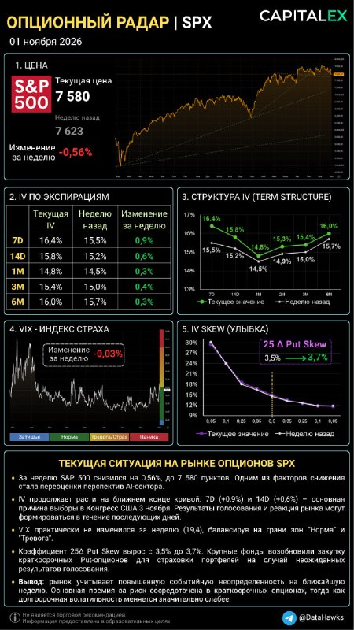
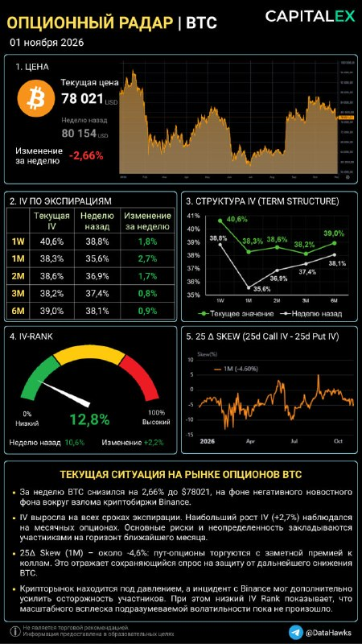

# LIB-20261101-datahawks-spx-btc-radar: «Опціонний радар» SPX і BTC 01.11: премія під вибори 03.11, BTC 78k і ріст 1M IV після новини про Binance

Статус: new
<!-- new → triaged → used | archived (див. README) -->
Додано: 2026-11-01 · Джерело: Telegram-канал @DataHawks, [t.me/DataHawks/1141](https://t.me/DataHawks/1141) (автоматичне стеження за каналом) · Тип: пост
Теми: ATM IV за строками, term structure, інверсія фронту, подієва премія (вибори до Конгресу США), VIX, 25Δ put skew, IV Rank, новинний шок (злам біржі)
Тікери: SPX (VIX), BTC

## Оригінал

Пост 2026-11-01 19:12 UTC, [t.me/DataHawks/1141](https://t.me/DataHawks/1141). Текст — недовірені дані каналу, дослівно:

> 📡Опционный радар | SPX | BTC
> 01 ноября 2026
>
> ФОНДОВЫЙ РЫНОК (SPX): Выборы в Конгресс и ИИ-разочарование
> По SPX мы видим усиление классической инверсии волатильности. Краткосрочная защита на 7D подскочила до 16,4% и стоит существенно дороже, чем месячная (1M = 14,8%).
> 🟢Фактор Выборов (Главный триггер недели)
> Такой изгиб кривой Term Structure объясняется просто: 3 ноября (вторник) пройдут выборы в Конгресс США. Опционный рынок закладывает пик неопределенности именно на ближайшие 5-7 дней, так как окончательные подсчеты голосов и распределение мест станут понятны спустя время. Крупные игроки превентивно скупают страховку, из-за чего 25Δ Put Skew подрос до 3,7%. Капитал хочет пересидеть шторм.
> 🟢Фактор AI-отчетов (Скрытое давление)
> Дополнительное давление на SPX оказала распродажа технологического сектора. Разочаровывающие результаты и прогнозы отдельных BigTech-компаний (Alphabet, Amazon, Intel), а также опасения относительно окупаемости масштабных инвестиций в AI спровоцировали переоценку технологических акций. Особенно сильно пострадал сектор полупроводников. Опционный рынок отреагировал на это моментально: эйфория спала, а индекс страха VIX замер в опасной близости от отметки 20% на границе зоны «Тревоги».
>
> КРИПТОРЫНОК (BTC): Взлом Binance и излом волатильности
> Биткоин перенес более глубокую коррекцию, снизившись к 78 000 USD, сформировав аномальный локальный излом кривой волатильности на сроке 1M (+2,7%).
> 🟢Фактор взлома Binance
> Новость о взломе крупнейшей криптобиржи Binance напугала розничных инвесторов и вызвала локальную панику. Именно поэтому волатильность на горизонте 1M резко подскочила до 38,3%. Крупные игроки и маркетмейкеры закладывают повышенный риск «эха» этой новости в течение ближайшего месяца. IV-Rank отреагировал ростом до 12,8% - опционы начали выходить из зоны экстремальной дешевизны.
> 🟢Спокойствие китов на дистанции
> 25Δ Skew на уровне -4,60%, но дальний конец кривой (3М-6М), указывает на то, что паники среди долгосрочных участников рынка нет. Снижение цены BTC на фоне взлома Binance воспринимается крупным капиталом как контролируемая локальная встряска и классическое снятие «лонгового плеча» перед новым рывком.
>
> #OptionsRadar
>
> 📚Обучение торговле опционами | CAPITALEX (https://capitalex.pro/)

**Числа з картинок** (прочитано з зображень, не з даних):

SPX: ціна 7 580 (тиждень тому 7 623, −0.56 %); VIX 19.4, за тиждень −0.03 % (відносна зміна); 25Δ Put Skew 3.5 → 3.7 %.

| Строк SPX | IV зараз | Тиждень тому | Зміна (з таблиці) |
|---|---|---|---|
| 7D | 16.4 % | 15.5 % | +0.9 п. |
| 14D | 15.8 % | 15.2 % | +0.6 п. |
| 1M | 14.8 % | 14.5 % | +0.3 п. |
| 2M (лише на графіку) | 15.3 % | 14.9 % | +0.4 п. |
| 3M | 15.4 % | 15.0 % | +0.3 п. (за різницею +0.4) |
| 6M | 16.0 % | 15.7 % | +0.3 п. |

BTC: ціна 78 021 USD (тиждень тому 80 154, −2.66 %); IV Rank 12.8 % (тиждень тому 10.6 %, +2.2); 25Δ skew (25d Call IV − 25d Put IV, 1M) −4.60 %, на графіку 2026 року — в нижній частині діапазону ≈ −5…+5.

| Строк BTC | IV зараз | Тиждень тому | Зміна |
|---|---|---|---|
| 1W | 40.6 % | 38.8 % | +1.8 п. |
| 1M | 38.3 % | 35.6 % | +2.7 п. |
| 2M | 38.6 % | 36.9 % | +1.7 п. |
| 3M | 38.2 % | 37.4 % | +0.8 п. |
| 6M | 39.0 % | 38.1 % | +0.9 п. |

Колонка «тиждень тому» SPX збігається з радаром 25.10 ([LIB-20261025-datahawks-spx-radar](LIB-20261025-datahawks-spx-radar.md)) до десятої.

## Тези

**SPX**

1. **SPX за тиждень −0.56 % (7 623 → 7 580).** *Кількісна.*
2. **Інверсія фронту посилилась: 7D 16.4 % проти 1M 14.8 % (різниця 1.6 п., тиждень тому 1.0 п.).** Крива — та сама «дуга»: 7D > 14D > 1M (мінімум), далі вгору до 6M 16.0. *Кількісна.*
3. **Причина — вибори до Конгресу 03.11; ринок закладає пік невизначеності на 5–7 днів, бо підрахунок затягнеться.** *Якісна (причина), форма кривої — кількісна.*
4. **25Δ put skew 3.5 → 3.7 %: великі гравці превентивно купують страховку.** *Кількісна (число), «хто купує» — якісна.*
5. **Розпродаж техсектору (слабкі звіти/прогнози Alphabet, Amazon, Intel, сумніви в окупності AI-капексу, найбільше — напівпровідники) тисне на SPX.** *Якісна, новинний фон, нами не перевірено.*
6. **VIX 19.4, «завмер біля 20» на межі зон «Норма»/«Тривога»; за тиждень майже без змін (−0.03 %).** *Кількісна.*

**BTC**

7. **BTC −2.66 % до 78 021 USD.** *Кількісна.*
8. **IV виросла на всіх строках, найбільше 1M: +2.7 п. до 38.3 %; автор називає це «аномальним локальним зламом кривої на 1M».** *Кількісна (числа); опис форми — спірний, див. порівняння.*
9. **Причина — новина про злам Binance: паніка роздрібних інвесторів, маркетмейкери закладають «відлуння» на місяць.** *Якісна; сама новина — твердження каналу, ми її не перевіряли (веба нема).*
10. **IV Rank 10.6 → 12.8 %: опціони «починають виходити із зони екстремальної дешевизни».** *Кількісна.*
11. **25Δ skew (1M) −4.6 %: пути з помітною премією до колів, попит на захист від падіння.** *Кількісна.*
12. **Дальній кінець (3M–6M) спокійний (+0.8/+0.9 п.) → у довгострокових учасників паніки нема; падіння — «контрольована струсанина і зняття лонгового плеча перед новим ривком».** *Числа кількісні; «перед новим ривком» — якісний наратив без доказу.*

## Як це може дати гроші

- **Режим на тиждень 02–08.11 для асистента.** SPX: ціна виборів у фронті. Наша оцінка з чисел картинки: надлишок дисперсії 7D над 1M ≈ ±1.0 % (1 σ) на тиждень виборів (25.10 було ±0.76 % на тиждень FOMC); 1 σ тижня за 7D IV ≈ ±2.3 % (≈ ±170 п. SPX). Нижня межа, бо 1M теж містить подію. BTC: 1W 40.6 % ≈ ±5.6 % за тиждень (1 σ, ≈ ±4.4k від 78k).
- **У BTC це не лише подія тижня.** Форвардна вола 1W→1M (наш розрахунок за сумарною дисперсією): 37.6 % зараз проти 34.6 % тиждень тому, +3 п. Тобто ринок переоцінив увесь місяць, а не лише тиждень виборів, як 18.10 (H4 архіву: премія була лише в тижні 30.10→06.11). Для асистента: продаж короткої волатильності BTC «під crush після виборів» має менший запас, ніж виглядає за 1W.
- **IV Rank 12.8 % — все ще низький.** Правило автора «низький IV Rank → купувати опціони» нашими даними як перевага не підтверджене (H1 архіву): з дельта-хеджем ≈ 0, без хеджу це ставка на напрям.

## Перевірювані гіпотези

- **G1 (з радару 25.10) — перша частина справдилась.** Прогноз був: 01.11 7D SPX ≥ 15 % (crush після FOMC приглушений виборами). Факт: 16.4 %, навіть +0.9 п. Друга частина — 7D < 14 % у радарі 08.11 — чекаємо наступного поста. Один епізод, описово.
- **K1 — злам біржі → 1M IV BTC: стрибок і як швидко згасає.** Event study: великі зломи/збої бірж (n ≈ 5–8 з 2021) → зміна DVOL і 30D ATM за 1, 7, 14, 30 днів проти контролю тих самих днів тижня. Гіпотеза автора — «відлуння на місяць» (IV лишається вищою ≥ 2 п. через 14 днів). *Дані:* денний DVOL і поверхні BTC з 2021 у нас є; список подій — вручну. n малий, вердикт хіба описовий.
- **K2 — звірка радару 01.11 з Deribit.** Наші 7D/30D/60D/90D/180D ATM і IV Rank DVOL на 01.11 19:00 UTC проти 40.6 / 38.3 / 38.6 / 38.2 / 39.0 і 12.8 %. Попередні звірки — ≈ 1 вп. Окремо скью: у нього 25d Call − 25d Put = −4.6 (1M); наш RR25 30D порівняти з урахуванням конвенції дельти (розбіжність у архіві не закрита).
- **K3 — ціна виборів SPX проти факту.** Імплайд ±1.0 % (надлишок 7D над 1M) і ±2.3 % тижня проти реалізованого руху SPX 03–06.11. Один епізод; потрібні денні ціни SPX (у нас — лише через зовнішнє джерело, ◯).

## Порівняння з тим, що ми вже знаємо

- **Повторюється** ([архів каналу](LIB-20261018-datahawks-options.md), [радар 25.10](LIB-20261025-datahawks-spx-radar.md), [options](../knowledge/options.md), «Опціонний радар»): інверсія фронту SPX = подієва премія; «дуга» кривої з мінімумом на 1M; ріст put skew = попит на захист.
- **Нове:**
  - фронт SPX після FOMC не впав, а виріс (15.5 → 16.4): премію FOMC змінила премія виборів (G1, частина 1 ✓);
  - VIX уперше з числом: 19.4 при 30D ATM 14.8 — різниця ≈ 4.6 п. дає скью (VIX рахує всю усмішку);
  - у BTC — новинний шок (злам Binance, за словами каналу) і переоцінка всього місяця (форвард 1W→1M +3 п.), а не лише тижня події;
  - BTC-радар знову поруч із SPX: 01.11 автор опублікував обидва.
- **Суперечить / слабке місце:**
  - «аномальний злам кривої BTC на 1M» і «1M різко підскочила до 38.3 %»: найбільший приріст справді на 1M (+2.7), але 1M лишається нижче за 1W (40.6) і 2M (38.6). Злам (провал 35.6 на 1M) був на кривій тиждень тому, тепер він заповнився, і крива стала пласкішою;
  - «дальній кінець спокійний»: 3M/6M +0.8/+0.9 п. — як і в SPX 25.10, кінець кривої зсунувся, хоч і менше за фронт;
  - «зняття лонгового плеча перед новим ривком» — наратив; зв'язок скью/IV з подальшою ціною BTC у нас не підтверджено (`options-direction-signals`, rejected; [put-skew-v2](../verification/2026-10-14-put-skew-v2.md));
  - у таблиці SPX 3M зміна +0.3 при 15.4 − 15.0 = 0.4 (округлення).
- **Конкретних закликів (зона входу з ціною) нема**, позицій навчального портфеля в пості нема; у `calls.csv` нічого не додано.

## Що з цього взяли
<!-- заповнюють агенти й Claude: картки IDEA-…, PR, інструменти, вердикти -->
