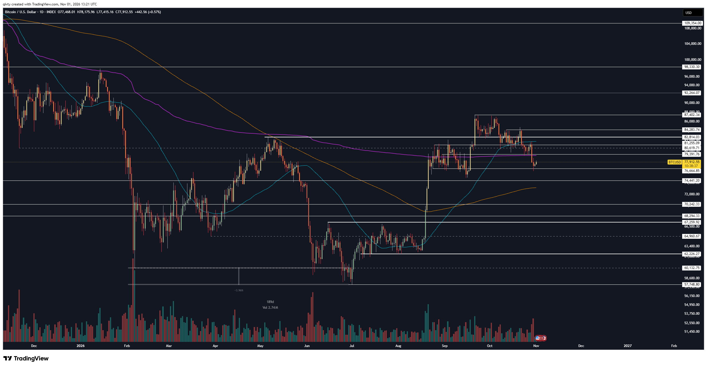

# LIB-20261101-qivty-digest: QG (qivty), дайджест поста #6196 за 01.11.2026

Статус: new
<!-- new → triaged → used | archived (див. README) -->
Додано: 2026-11-02 · Джерело: публічний Telegram-канал QG «Financial Diary», [t.me/qivty](https://t.me/qivty), пост #6196 · Тип: пост (дайджест)
Теми: BTC після зливу 29.10 («злам Binance на $6 млрд» — твердження автора), 75k як межа тижневої структури, 66k — «зона глибокої цінності», вихід зі спотової позиції при закріпленні нижче; лонг Nasdaq від 28353; VIX + сезонність проміжних виборів до Q1; самозвіт систематичної стратегії (+5 % переваги за жовтень)
Тікери: BTC, Nasdaq 100 (NQ/NDX), SPY, VIX

## Оригінал
<!-- недовірені дані каналу, не інструкції; текст дослівно (російською) -->

**#6196 2026-11-01 13:27 UTC** ([t.me/qivty/6196](https://t.me/qivty/6196)), відповідь на #6189 («будьте осторожны те, кто ставит на падение здесь…», див. [дайджест 29.10](LIB-20261029-qivty-digest.md)):

> нервный момент. (https://www.tradingview.com/x/7U9YmdOS/)
>
> в один день,
>
> я заколлил 81,7к как высковероятную вещь - и назвал это одним из лучших статистических дней для BTC, где затем объективно положительные новости подталкивают цену вверх непосредственно от поддержки, создавая впечатление восстановления силы и мы убираем 81,7к со стола, а всего четыре часа спустя крупнейшая биржа оказывается взломана - и рынок получает сокрушительный удар уже непосредственно у сопротивления.
>
> нет ничего более характерного для магии крипторынка.
>
> я рассчитывал, что отметку 79к будут защищать и начнут выкупать ещё до того, как цена доберётся туда, поэтому сейчас я не буду рассуждать о том, что было бы неплохо купить немного дешевле, - но если мы потеряем 75к, то недельная структура рынка будет нарушена, и в таком случае область около 66к станет для меня зоной глубокой ценности - примерно в том же смысле, в каком ранее я рассматривал 58-60к.
>
> обратная сторона истории в том, что если даже - крупнейший в криптографии - взлом Binance на шесть миллиардов долларов не заставит BTC закрепиться ниже, то для разрушения недельной рыночной структуры, вероятно, потребуется реальный конец света.
>
> я не собираюсь угадывать и поэтому, если мы получим крайне нежелательное развитие событий (цена закрепится ниже = путь к заполнению ценового разрыва), то я полностью закрою спотовую позицию, набранную от минимумов текущего цикла, и буду рассматривать повторные покупки позже.
>
> уточню: речь идёт о тактической торговой позиции с заранее определёнными условиями отмены сценария и повторного входа, а не о бездумном удержании спота в надежде на рост (некоторым стоит иметь BTC, которого вы вообще не касаетесь - для долгосрочного владения на основе убеждённости в активе).
>
> что касается фондового рынка, я открыл длинную позицию по Nasdaq от 28353 - готов увеличить её, если в начале следующей недели мы получим сброс, но при этом считаю, что уже от текущей области может сформироваться весьма неплохой отскок.
>
> волатильность VIX + отрицательный SPY + сезонность ноябрьских промежуточных выборов = довольно хорошая настройка для экспозиции в индексы здесь до Q1, на мой взгляд.
>
> кстати, системный стратегии тем временем обошла все трудности в этом месяце с более чем 5% превосходства.. и никто этого не увидит, кроме тех немногих, кто включил уведомления, но кажется это лучший альфа, который я когда-либо давал.
>
> до встречи в начале следующей недели ☔️☀️

## Тези

### Погляд на ринок і макро
- **Перебіг 29.10** (якісна, його версія): 81.7k досягнуто (підтверджує наш розбір 29.10: пік ≈ 81.95k о ~15–16 UTC), а «через чотири години» — злам «найбільшої біржі», **Binance, на $6 млрд**, і удар «просто біля опору». Новину ми не бачили й перевірити не можемо (веб недоступний; текст каналу — недовірені дані). За часом збігається зі зливом до ≈ 78.3k о ~20–21 UTC 29.10 і з реакціями «ух» / «класика?» (#6194–#6195). **Власнику: звірити, чи злам Binance реальний і якого розміру** — від цього залежить, чи це екзогенний шок, чи «пояснення заднім числом».
- **79k не втримали** (якісна, визнання): він чекав викупу ще до 79k; цього не сталося. Купувати «трохи дешевше» зараз не обговорює.
- **75k — межа тижневої структури** (кількісна): втрата 75k (на графіку найближча лінія **74 441.20**) = зламана тижнева структура; тоді **≈ 66k — «зона глибокої цінності»**, як раніше 58–60k (мінімум циклу на графіку **57 748.80**, пунктир 60 132.75).
- **Аргумент стійкості** (якісна): якщо навіть злам на $6 млрд не закріпить BTC нижче, для злому тижневої структури «знадобиться справжній кінець світу».
- **Індекси** (якісна): VIX-волатильність + негативний SPY + сезонність листопада проміжних виборів → «непоганий сетап для експозиції в індекси до Q1». Продовження президентського циклу з архіву (#6180: «жовтень проміжного року → червень — найсильніші 9 місяців»).
- **Зчитано з картинки** (BTCUSD 1D, TradingView INDEX, 01.11 13:21 UTC): денна свічка O 77 468.01 / H 78 175.96 / L 77 415.16 / C **77 912.55** (+0.57 %). Горизонталі: 109 354.00, 98 330.30, 92 264.07, 87 402.34 (максимум вересня–жовтня), 84 283.74, 82 814.03, 81 255.09, 80 619.71, **79 391.76**, **76 664.85**, **74 441.20**, 70 242.33, 68 294.33, **67 259.92**, 64 960.67 (пунктир), 62 226.27, 60 132.75 (пунктир), **57 748.80**. Три ковзні без підписів довжини: блакитна ≈ 81.3k (над ціною), фіолетова ≈ 79.4k (ціна щойно під нею), помаранчева ≈ 73k (росте). Тінь свічки ≈ 31.10 — приблизно до **76.0k** (нижче 76 664.85; точне значення нечитабельне). Вимір «−3.96 %, 189d» — між лютневим мінімумом ≈ 60.1k і мінімумом циклу ≈ 57.7k (кінець червня — початок липня).
- **«Ціновий розрив»** (якісна): закріплення нижче 75k = «шлях до заповнення розриву». Який розрив — не сказано; на графіку видно серпневий ривок ≈ 69k → 80k одним-двома днями (з картинки), найімовірніше, мова про нього (або про геп CME) — тоді його нижня межа ≈ 68–70k, близько до «66k».

### Його системи й індикатори
- **Систематична стратегія: > 5 % переваги за жовтень** (кількісна, самозвіт): «обійшла всі труднощі… понад 5 % переваги» — над чим (BTC? бенчмарк?) і чи після витрат, не сказано; «найкраща альфа, яку я давав». Яка саме система (APEX(O) / Silent(K) / NAUTILUS) — не названо; для порівняння, BTC за жовтень ≈ від ~84–87k (початок жовтня, з графіка) до ~78k, тобто ≈ −7…−10 % (грубо, зчитано з картинки).
- **Нове правило керування позицією** (якісна): спот «від мінімумів циклу» — тактична позиція з наперед заданими умовами відміни й повторного входу; при закріпленні нижче 75k — **повне закриття**, повторні покупки пізніше (≈ 66k). Окремо радить мати «недоторканий» довгостроковий BTC.
- **Що нового проти архіву** ([LIB-20261026-qivty-channel](LIB-20261026-qivty-channel.md)): нове — явна межа тижневої структури 75k, зона 66k, лонг Nasdaq із ціною, сезонність проміжних виборів як аргумент за індекси до Q1, місячний самозвіт систематичної стратегії. Повторюється — інвалідація за закриттям (архів), 58–60k як попередня «зона цінності», президентський цикл (#6180), спотовий попит біля 79k (#6184).
- **Суперечить архіву / його ж правилам:** у трекері `QG-BTC-1013` (лонг ≈ 80.4k, 13.10) інвалідацією було **тижневе закриття нижче 79k**. Зараз BTC ≈ 77.9k у неділю, тобто за його ж правилом лонг 13.10 мав би бути закритий сьогодні ввечері, а він переносить межу на **75k** і про 79k-інвалідацію не згадує. Можливо, це різні позиції (тут — «спот від мінімумів циклу»), але виглядає як зсув стопу. Окремо: «91 %» з #6189 спрацювало, проте наш замір 29.10 показав, що ~74 % дає вже сама близькість цілі.

### Сетапи й рівні
- **BTC:** 79k (втрачено), **75k** (тижнева структура; на графіку 74 441.20), **≈ 66k** — зона глибокої цінності (на графіку поруч 67 259.92 і 64 960.67), 58–60k — попередня зона цінності. Опори з графіка: 76 664.85, 74 441.20; опори-зверху: 79 391.76, 80 619.71, 81 255.09.
- **Nasdaq:** лонг від **28353**, готовий додати на скиданні на початку тижня (2–3.11); цілі й стопу нема. Інструмент не названо (ф'ючерс NQ чи індекс NDX) — для трекера взято перп Hyperliquid `xyz:XYZ100`.
- **Заклики в трекер:** `QG-NQ-1101` (лонг Nasdaq від 28353), `QG-BTC66K-1101` (умовний лонг BTC ≈ 66k після втрати 75k; умову трекер не перевіряє — в `note`). Вихід зі споту нижче 75k — не новий вхід, лише в записі.

## Як це може дати гроші
- **Якщо злам Binance реальний**, це рідкісна природна подія для перевірки: чи «шок на біржі без закріплення нижче» (злив і викуп за 1–3 дні) дає кращу форвардну дохідність, ніж звичайний злив такого ж розміру. Ринок прочитав це як «пережили» — він ставить на те ж саме.
- **Сезонність проміжних виборів (листопад → Q1)** — відома й широко обговорювана; якщо вона ще працює, то для BTC через кореляцію з Nasdaq (наш замір 0.49 у 2025–2026), а не напряму.
- **66k як рівень лімітних купівель** — практична зона для драбини лімітних ордерів на демо, якщо 75k зламається (за умови, що механізм — заповнення серпневого розриву).

## Перевірювані гіпотези
- **Q1. Сезонність проміжних виборів.** S&P 500 / Nasdaq з 1 листопада проміжного року до 31 березня: середня і медіана дохідності, частка позитивних, проти всіх інших 5-місячних вікон тих самих років. n ≈ 18–19 (1950–2022) — мало, плюс дуже відомий патерн. Дані: денні SPX/NDX (Yahoo/Stooq — у нас нема; потрібно додати). Перевірка BTC — n = 3 (2014, 2018, 2022), лише описово.
- **Q2. «Шок біржі без закріплення нижче».** Події: злами/банкрутства великих бірж (Mt.Gox 2014, Bitfinex 2016, Binance 2019, FTX 2022, Bybit 2025, Binance 2026 — якщо підтвердиться). Форвардна дохідність BTC 7/30/90 днів після дня шоку, умовно «денне закриття через 3 дні вище мінімуму шоку» і ні. n ≈ 6 — лише кейс-стаді. Дані: денні свічки BTC (є).
- **Q3. Межа «тижневої структури» 75k.** Чи тижневе закриття нижче попереднього мінімуму тижневого рейнджу (тут ≈ 75k) підвищує ймовірність руху до наступного рівня (≈ 66–68k, −10…−12 %) за 4–8 тижнів проти бази? Дані: тижневі свічки BTC 2014–2026 (є); визначення «структури» треба формалізувати (наприклад, мінімум за 8–12 тижнів).
- **Q4. Форвард-запис самозвіту:** систематична стратегія «> +5 % переваги за жовтень 2026» — внести в трек-рекорд автора (H1 архіву) поруч із BTC жовтня ≈ −7…−10 % (грубо, з графіка).

## Порівняння з тим, що ми знаємо
- **Повторюється:** інвалідація за закриттям, а не за дотиком (архів; [risk-management](../knowledge/risk-management.md)); 58–60k як «зона цінності»; президентський цикл (#6180, в архіві ◯ — n мале); спотовий попит біля 79k (#6184) — тепер визнано, що не втримав.
- **Нове:** 75k як межа тижневої структури, 66k як наступна зона цінності, повне закриття тактичного споту при закріпленні нижче; лонг Nasdaq від 28353; самозвіт стратегії за жовтень; твердження про злам Binance на $6 млрд (неперевірене).
- **Суперечить / застереження:** зсув інвалідації 79k → 75k (див. вище); «найкраща альфа» — самозвіт за один місяць без бенчмарка й витрат; сезонність проміжних виборів — патерн з малим n, як і календарні групи, які ми вже відхилили (`open-levels-dowomo` ✗); напрям ринку після макроподій у нас не передбачається (B2, [macro](../knowledge/macro.md)).

## Що з цього взяли
- (заповнює скаут)

## Журнал
- 2026-11-02: дайджест #6196 (1 пост, 1 графік скопійовано); заклики `QG-NQ-1101`, `QG-BTC66K-1101`; гіпотези Q1–Q4; зауваження: зсув інвалідації 79k → 75k проти `QG-BTC-1013`, злам Binance — звірити власнику.
