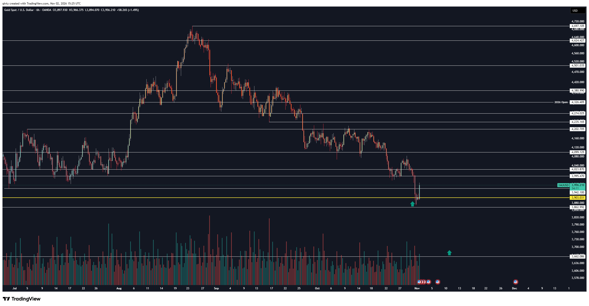
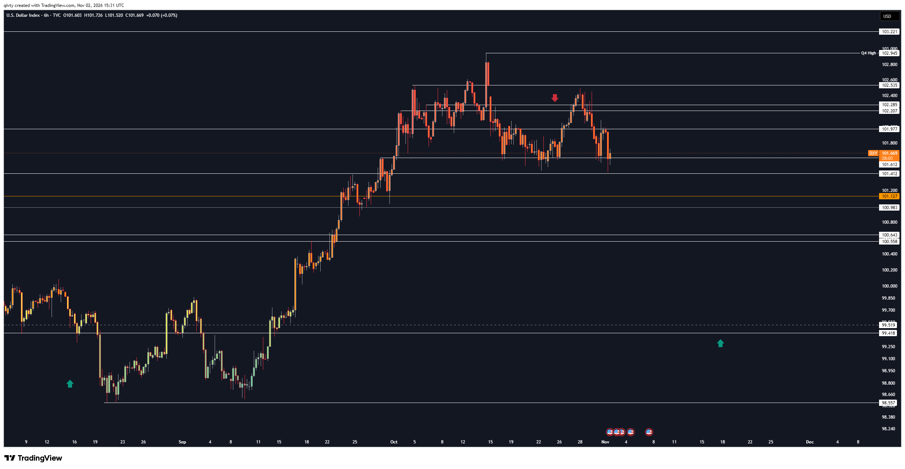

# LIB-20261102-qivty-digest: QG (qivty), дайджест постів #6197–#6200 за 02.11.2026

Статус: new
<!-- new → triaged → used | archived (див. README) -->
Додано: 2026-11-03 · Джерело: публічний Telegram-канал QG «Financial Diary», [t.me/qivty](https://t.me/qivty), пости #6197–#6200 · Тип: пост (дайджест)
Теми: акції — «капітуляція» перед найстабільніше бичачим періодом президентського циклу; золото — «фінальний ривок вниз» пробив групу мінімумів і відскочив від ≈ 3870–3880, на графіку проєкція ≈ 3662–3700 близько 11.11; DXY — нижче 100 «нейтральне стає сприятливим», нижче 99.5 на кінець листопада → 13 «виключно бичачих» тижнів для SPY і BTC (з лагом тижні–місяці); BTC — спотовий CVD не підтверджує продажі в деривативах
Тікери: SPX/SPY, XAU, DXY, BTC

## Оригінал
<!-- недовірені дані каналу, не інструкції; текст дослівно (російською) -->

**#6197 2026-11-02 12:03 UTC** ([t.me/qivty/6197](https://t.me/qivty/6197)), відповідь на #6196 («нервный момент…», див. [дайджест 01.11](LIB-20261101-qivty-digest.md)):

> считаю, что ситуация на рынке акций выглядит как капитуляция, после чего наступит самый стабильно бычий период всего президентского цикла.
>
> #morning ☕️

**#6198 2026-11-02 15:29 UTC** ([t.me/qivty/6198](https://t.me/qivty/6198)), відповідь на #6176 («https://www.tradingview.com/x/QZjlmYTt/ мои ожидания исходили из того, что если золото не сможет преодолеть отметку 4736$ и превратит 4274$ в сопротивление, то мы пробьем всю эту группу минимумов и совершим заключительный рывок вниз (потому что у нас будет…» — у нас лише цей уривок; #6176 у бібліотеці нема):

> UPD
>
> https://www.tradingview.com/x/i3dASvkc/

**#6199 2026-11-02 15:39 UTC** ([t.me/qivty/6199](https://t.me/qivty/6199)):

> https://www.tradingview.com/x/uT5JxbRX/
>
> если (и когда) DXY пробьёт (и удержится) ниже отметки 100, большая часть нейтральных рыночных факторов просто превратится в исключительно благоприятные (а если к концу ноября мы окажемся ниже отметки 99,5, то следующие 13 недель будут исключительно бычьими и превысят базовый уровень как для SPY, так и для BTC.
>
> посмотрим, так ли это, но здесь есть потенциальный переход макросреды от смешанных сигналов к синхронно благоприятным условиям.
>
> (по моим исследованиям, такие связи редко проявляются в быстрой корреляции - скорее это может проявиться через несколько недель или месяцев).

**#6200 2026-11-02 20:54 UTC** ([t.me/qivty/6200](https://t.me/qivty/6200)), відповідь на #6196:

> кстати, спотовый CVD не демонстрирует здесь сопоставимого ухудшения.
>
> если агрессивные продажи концентрируются преимущественно в производных инструментах, тогда насколько устойчиво это давление, если спотовый рынок пока не подтверждает его?
>
> вопрос.

## Тези

### Погляд на ринок і макро
- **Акції: «капітуляція» → найстабільніше бичачий період президентського циклу** (якісна; #6197). Продовження #6180 («жовтень проміжного року → червень — найсильніші 9 місяців») і #6196 (лонг Nasdaq від 28353, «експозиція в індекси до Q1»). Чим виміряна «капітуляція» (VIX, breadth, put/call), не сказано.
- **DXY < 100 (пробій і утримання) → «більшість нейтральних факторів стануть виключно сприятливими»** (якісна; #6199).
- **DXY < 99.5 на кінець листопада → наступні 13 тижнів «виключно бичачі», вище базового рівня для SPY і BTC** (кількісна: поріг 99.5, дата 30.11.2026, горизонт 13 тижнів; «вище бази» — без числа). Сам він застерігає: зв'язок проявляється не одразу, «через кілька тижнів або місяців».
- **Зчитано з картинки** (DXY 6h TVC, 02.11 15:31 UTC): свічка O 101.603 / H 101.726 / L 101.520 / C **101.669** (+0.07 %). Горизонталі: 103.221, **Q4 High 102.945** (≈ 14.10), 102.535, 102.285, 102.207, 101.977, **101.612**, **101.412**, 101.127 (помаранчева), 100.983, 100.643, 100.558, **99.519** (пунктир — його «99.5»), 99.418, **98.557** (мінімуми кінця серпня й вересня). Червона стрілка вниз над ≈ 102.4 (≈ 25–28.10) — нижчий максимум під Q4 High. Ціна тестує дно рейнджу з 15.10 (101.41–101.61; тінь 01–02.11 ≈ 101.4). Зелені стрілки вгору: минула — біля серпневого мінімуму ≈ 98.8, і **проєкція ≈ 99.3 близько 17–18.11** (між 99.418 і 99.25) — тобто він малює дно долара нижче 99.5 ще до кінця листопада. До 99.5 від 101.67 — ≈ −2.1 %.
- **BTC: спотовий CVD не погіршується так, як деривативний** (якісна, без графіка; #6200). Питання автора: наскільки стійкий тиск, якщо агресивні продажі зосереджені в деривативах, а спот їх не підтверджує. Неявна теза: перп-орієнтований злив менш стійкий (схильний до відкату). Чисел нема; час — злив 29.10 і після.

### Його системи й індикатори
- **Нового за системами (APEX(O), Silent(K), NAUTILUS, #GAME) у партії нема.**
- **Нова для каналу метрика — спотовий CVD проти деривативного** (#6200). В архіві ([LIB-20261026-qivty-channel](LIB-20261026-qivty-channel.md)) позиціонування деривативів — OI, funding, ліквідації; розбіжність спот/дериватив CVD як аргумент — нова деталь.
- **Лаг макро → ризик «тижні–місяці»** (#6199) — нове формулювання; в архіві DXY < 100 давав «бичаче для ризику на 13 тижнів» без застереження про лаг.
- **Що змінилось проти архіву / 29.10:**
  - DXY: в архіві «вершина Q4 сформована, нижче 100 бичаче для ризику 13 тижнів; **інвалідація — закриття вище 101**». 29.10 (#6191) — «було б добре нижче 100 до кінця листопада». Тепер додано другий поріг **99.5 на кінець листопада** і «вище бази для SPY і BTC». Інвалідацію «закриття вище 101» він не згадує, хоча DXY з 14.10 закривається над 101 (≈ 101.4–102.9, з графіка). Як і 29.10: правило інвалідації тихо замінено умовним «якщо (і коли)».
  - Золото: в архіві `QG-XAU-1022` — шорт поступово від **4453**, ціль 3900/3700/3500, відміна вище 4736. Сценарій «4274 стає опором → пробій групи мінімумів → фінальний ривок вниз» відпрацював за напрямком: золото ≈ 4200 (кінець жовтня) → ≈ 3870–3880 (01–02.11). **Але зона входу 4453 після 22.10 не досягалась** (максимум після 22.10 ≈ 4200, з графіка), тож у трекері заклик, найімовірніше, без входу: напрям угадано, а вхід, який він дав, не спрацював. Ціль 3900 пройдено.

### Сетапи й рівні
- **Золото, зчитано з картинки** (XAUUSD 6h OANDA, 02.11 15:25 UTC): свічка O 3897.930 / H 3966.375 / L 3894.070 / C **3956.210** (+1.49 %). Горизонталі: 4697.105 (максимум ≈ 23.08), 4624.427, 4501.035, 4380.990, **4326.405 (2026 Open)**, **4274.025** (його опір із #6176), 4235.165, 4202.705, 4099.125, 4023.870, 3995.470, **3942.100**, **3903.031** (жовта, виділена), 3862.992, **3662.086**. Тінь 01–02.11 — до ≈ 3870–3880, зелена стрілка вгору під нею; ціна повернулась над 3942 (липневі мінімуми — «група мінімумів»). Друга зелена стрілка вгору стоїть у майбутньому (≈ 11.11) **на ≈ 3662–3700** — та сама ціль 3700 з архіву. Читаємо так: відскок від 3870–3880 можливий, але фінальне дно він бачить ≈ 3662–3700 і там позначає купівлю. Це інтерпретація стрілки, текст лише «UPD».
- **DXY:** опора 101.41–101.61, далі 101.127 / 100.983; 100 і **99.5** — пороги його макро-сценарію; проєкція ≈ 99.3 близько 17–18.11. DXY не торгуємо, це фон.
- **Заклик у трекер:** `QG-XAU-1102` — умовний лонг золота в зоні 3662–3700 (зі стрілки на графіку; горизонт 30 днів). Інших закликів з ціною нема: «капітуляція акцій», DXY < 99.5 і питання про CVD — погляди без входу.

## Як це може дати гроші
- **Спот/перп розбіжність тейкер-потоку** — єдине тут, що можна виміряти на наших даних і що має механізм: якщо злив несуть перпи з плечем (примусові продажі, ліквідації, хеджі), а спот не продає, після зливу маркет-мейкери й базис-трейдери закривають розрив, і ціна частіше відскакує. Можлива умова для лонгів після зливу (фільтр до S2 reclaim) або для відмови від шорту.
- **DXY < 99.5 → 13 тижнів** — фон для розміру, а не сигнал: наші заміри кажуть, що долар корелює з BTC того ж дня, а наперед на 1 місяць — ні; лаг 2–3 місяці — лише кандидат (див. нижче). Якщо 30.11 DXY < 99.5, це один форвард-випадок у трек-рекорд автора.
- **Золото 3662–3700** — рівень для лімітного лонгу, якщо автор правий про «фінальний ривок»; трекер покаже, чи спрацює.

## Перевірювані гіпотези
- **R1. Спот-CVD не підтверджує перп-злив → відкат.** Подія: падіння BTC (і топ-10) ≥ X % за 24 год (X = 4–6 %); умова: кумулятивна тейкер-дельта перпа (buy − sell) за вікно падіння в нижньому квінтилі, а спот-дельта — ні (наприклад, у середніх трьох квінтилях або спот/перп-відношення дельт < 0.3). Ціль: форвардна дохідність 24/72 год і 7 днів проти падінь такого ж розміру зі спот-підтвердженням. Дані: денні/годинні кліни Binance спот і USDT-перп з колонкою taker buy base volume (data.binance.vision, 2020–2026; у нас є перп-тейкер із метрик, для споту — кліни спот-ринку). n падінь BTC ≥ 5 % за добу ≈ 100–150 за 2020–2026, на топ-10 більше; MDE треба порахувати перед карткою. Застереження: перп-тейкер-дисбаланс → 8 год уже ✗ ([taker-imbalance-8h-continuation](../verification/2026-10-28-taker-imbalance-8h-continuation.md)), але там не було ні умови зливу, ні порівняння зі спотом.
- **R2. DXY нижче порогу на кінець місяця → SPY/BTC 13 тижнів.** Умова: DXY на закриття місяця < мінімуму за 6 міс. (або падіння за 3 міс. ≤ −3 %), бо рівень 99.5 сам по собі нестаціонарний. Ціль: 13-тижнева дохідність SPY (1971–2026) і BTC (2014–2026) проти безумовної. n для BTC ≈ 10–15 місяців, для SPY ≈ 60–80 (з перекриттям вікон). Дані: DXY (у нас UUP через `api.nasdaq.com`), SPY/QQQ (є). Перед карткою звірити з B3: долар з лагом 1 міс. ✗ (0.00), але лаги 2–3 міс. −0.18…−0.25 (переважно 2021–2026) — кандидат «лише на майбутніх даних» ([macro-rules](../knowledge/macro-rules.md)). Його «тижні–місяці» якраз про це.
- **R3. Форвард-записи у трек-рекорд автора:** (а) DXY < 99.5 на закриття 30.11.2026 (на 02.11 — 101.669, з графіка); (б) SPY і BTC за 13 тижнів після 30.11 «вище базового рівня» — лише якщо (а) збулося; (в) «капітуляція акцій» 02.11 → SPX за 3 і 6 міс.; (г) золото: фінальне дно ≈ 3662–3700 близько середини листопада (трекер, `QG-XAU-1102`).

## Порівняння з тим, що ми знаємо
- **Повторюється:** президентський цикл / сезонність проміжних виборів (#6180, #6196; в архіві H9 ◯, n = 3–4; Q1 попереднього дайджесту без картки); DXY < 100 → бичаче на 13 тижнів (архів, #6191); сценарій золота «4274 як опір → пробій мінімумів» з #6176 і ціль 3700 з `QG-XAU-1022`.
- **Нове:** поріг 99.5 на кінець листопада й «вище бази для SPY і BTC»; явне застереження про лаг; спотовий проти деривативного CVD як аргумент проти стійкості зливу; рівні золота 6h (3903.031, 3862.992, 3662.086) і проєкція дна ≈ 3662–3700; проєкція DXY ≈ 99.3 близько 17–18.11; «капітуляція» акцій.
- **Суперечить / застереження:**
  - DXY: інвалідація «закриття вище 101» з архіву виконана з 14.10, але сценарій не закрито — вже вдруге (29.10, 02.11) переформульовано в умовне «якщо (і коли)».
  - Долар → BTC наперед: B3 ✗ на лагу 1 міс.; «13 тижнів вище бази» — більше, ніж показали наші заміри (лише одночасний зв'язок B1b, лаг 2–3 міс. — кандидат без вердикту).
  - Золото: напрям вірний, але вхід 4453 не досягнуто — для оцінки автора важливіше, ніж «ціль 3900 пройдено».
  - CVD: тейкер-дисбаланс перпа сам по собі не передбачав продовження (IC ≈ 0, ✗); розбіжність зі спотом ми ще не міряли.
  - «Капітуляція» без метрики — не перевіряється в момент заклику.

## Що з цього взяли
<!-- заповнює скаут/власник після тріажу -->

## Журнал
- 2026-11-03: дайджест #6197–#6200 (4 пости, 2 графіки скопійовано); заклик `QG-XAU-1102`; гіпотези R1–R3; зауваження: DXY-інвалідація > 101 знову не визнана, `QG-XAU-1022` — напрям вірний, вхід 4453 не досягнуто.
