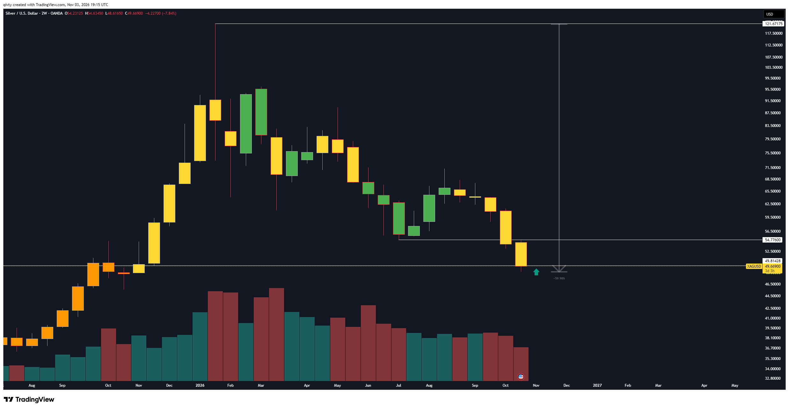
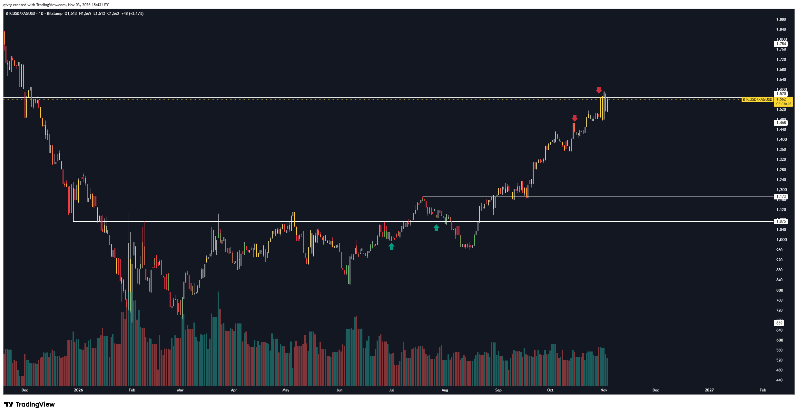
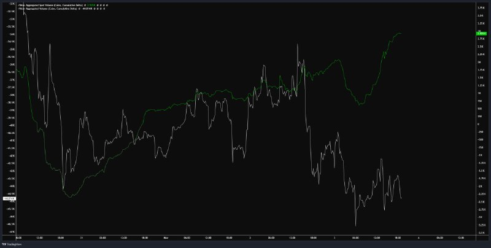

# LIB-20261103-qivty-digest: QG (qivty), дайджест постів #6201–#6204 за 03.11.2026

Статус: triaged
<!-- new → triaged → used | archived (див. README) -->
Додано: 2026-11-04 · Джерело: публічний Telegram-канал QG «Financial Diary», [t.me/qivty](https://t.me/qivty), пости #6201–#6204 · Тип: пост (дайджест)
Теми: срібло — купівля споту біля ≈ 49.7 після −60 % від ATH 121.67 («найпривабливіша область за 9 місяців»); BTC/XAG — фіксація: лишилось < 30 % позиції, відношення ≈ 1562 проти входів ≈ 1000–1080; BTC — ранковий і вечірній графіки спотового й агрегованого CVD (Velo): спот купує, агрегований потік продає
Тікери: XAG, BTC/XAG, BTC

## Оригінал
<!-- недовірені дані каналу, не інструкції; текст дослівно (російською) -->

**#6201 2026-11-03 08:19 UTC** ([t.me/qivty/6201](https://t.me/qivty/6201)): `#morning ☕️` + графік CVD (див. #6204, той самий тип; окремо не копіювали).

**#6202 2026-11-03 19:20 UTC** ([t.me/qivty/6202](https://t.me/qivty/6202)), відповідь на #5874 («https://www.tradingview.com/x/wB5PRM0r/ быки по серебру - не переживайте, я выкуплю вашу ликвидацию позже, ближе к 50$ - но это будет не прямолинейное падение, а скорее волатильное снижение с постепенным истощением покупателей, формированием дна и последующим…» — уривок; це заклик `QG-XAG-1014` з архіву):

> https://www.tradingview.com/x/npgjyGcD/
>
> покупаю немного спота здесь.
>
> за последние 9 месяцев сложно найти более привлекательную область для формирования долгосрочной позиции.

**#6203 2026-11-03 19:45 UTC** ([t.me/qivty/6203](https://t.me/qivty/6203)), відповідь на #5909 («https://www.tradingview.com/x/Jh3roZ1s/ логика сделки не меняется: это ставка на относительную силу BTC против серебра, а не на абсолютное направление рынка, и если первоначальный тезис верен, то после выхода из многомесячного диапазона подобные откаты…» — уривок; #5909 у бібліотеці як окремий заклик не записаний):

> https://www.tradingview.com/x/ofJBsjzC/
>
> осталось менее 30% от первоначальной позиции.
>
> соотношение риска к потенциальной прибыли здесь было чертовски ассиметрично.

**#6204 2026-11-03 20:12 UTC** ([t.me/qivty/6204](https://t.me/qivty/6204)), відповідь на #6201: `👀` + графік:

## Тези

### Погляд на ринок і макро
- **Срібло: «за 9 місяців важко знайти привабливішу область для довгої позиції»** (якісна; #6202). Він купує «трохи споту» — поступовий набір, як і обіцяв у #5874 («виснаження покупців, формування дна»), без цілі й стопу.
- **Зчитано з картинки** (XAGUSD 2W OANDA, 03.11 19:15 UTC): двотижнева свічка O 54.231 / H 54.635 / L **48.617** / C **49.669** (−4.227, **−7.84 %**), до закриття 3 д 3 год. Горизонталі: **121.672** (ATH, тінь ≈ кінець січня 2026), **54.776** (мінімум липня, пробитий у жовтні — тепер опір), **49.814**. Вимір від ATH до лоу — **−59.98 %**. Зелена стрілка вгору одразу праворуч від поточної свічки (≈ 49) — позначка купівлі. Обсяги двотижневих барів знижуються з березня (за кольором — переважно червоні).
- **Відношення BTC/срібло: тезу «відносна сила BTC проти срібла» він вважає відпрацьованою** (#6203): лишилось < 30 % початкової позиції. Ставка була на відношення, не на напрям ринку (#5909).
- **Зчитано з картинки** (BTCUSD/XAGUSD 1D Bitstamp, 03.11 18:43 UTC): O 1513 / H 1569 / L 1513 / C **1562** (+3.17 %). Горизонталі: 1784, **1570**, **1468** (пунктир), 1173, **1075**, 669 (мінімум лютого). Зелені стрілки вгору (входи) ≈ **1000** (початок липня) і ≈ **1080** (кінець липня, ретест 1075); червоні вниз (фіксації) ≈ **1468** (≈ 15.10) і ≈ **1590** (≈ 31.10). Від входів 1000–1080 до 1562 — **≈ +45…+56 %** за відношенням. Перевірка: 1562 × 49.67 ≈ 77.6k — збігається з ціною BTC 03.11.
- **BTC: спот купує, агрегований потік продає** (без тексту, лише «👀»; #6201, #6204). Продовження #6200 («спотовий CVD не підтверджує продажі в деривативах»).
- **Зчитано з картинки** (#6204, Velo, монети, ≈ 30.10–03.11 20:00 UTC; підписи дрібні, числа приблизні): зелений — Aggregated **Spot** Volume, cumulative delta (права шкала) — з ≈ +0.6K о ранку 03.11 до **≈ +1.9K** увечері, новий максимум вікна; білий — Aggregated Volume (весь ринок, де переважають перпи), cumulative delta (ліва шкала) — від ≈ −36.5K (02.11) до мінімуму ≈ −46.5K і **≈ −44.8K** на кінець. На ранковому #6201 (08:19 UTC) зелений ще падав від піку ≈ +3.6K до ≈ +2.0K, білий ≈ −41K. Тобто за день 03.11 розбіжність посилилась: спот +≈ 1.3K BTC тейкер-купівель, агрегований потік −≈ 4K. Монету не підписано — найімовірніше BTC.

### Його системи й індикатори
- **Нового за APEX(O), Silent(K), NAUTILUS, #GAME у партії нема.**
- **Спот- проти агрегованого CVD (Velo) — тепер уже з графіком** (#6201, #6204); 02.11 (#6200) було лише текстом. Метрика та сама, нова лише візуалізація й розмір розриву.
- **Пара BTC/срібло** — в архіві ([LIB-20261026-qivty-channel](LIB-20261026-qivty-channel.md), 2022–2025) серед його інструментів («пари BTC/золото, BTC/срібло»); тут — перший звіт про результат такої угоди: входи ≈ 1000–1080 (липень), > 70 % зафіксовано ≈ 1468–1590. Формули немає, лише рівні на графіку.
- **Що змінилось проти архіву / попередніх дайджестів:**
  - Срібло: `QG-XAG-1014` («частину спота біля 50») за трекером ([REPORT](../calls/REPORT.md)) увійшов **30.10 за 50**; тепер він докуповує ≈ 49.7 — нижче першого входу. Це узгоджується з «не прямолінійним падінням»: дно ще не сформоване, набір поступовий. Стопу так і нема — у його ж методі (інвалідація за закриттям) рівнем для реклейму був би 54.776, а не підтримка знизу.
  - Метали разом: золото він чекає нижче (`QG-XAU-1102`, ≈ 3662–3700), а срібло купує вже зараз. Явно він цього не каже, але це по суті ставка на падіння відношення золото/срібло (≈ 3950 / 49.7 ≈ 79, ціни з графіків 02–03.11).
  - BTC/XAG: фіксація відносної угоди збіглась із купівлею срібла — закриття ноги «шорт срібла» відносно BTC і відкриття лонгу срібла в один вечір.

### Сетапи й рівні
- **Срібло:** вхід ≈ 49.67 (спот, «трохи»); опора 49.81 / 48.62 (лоу свічки); опір 54.776; ATH 121.67. Ціль і стоп не названо.
- **BTC/XAG:** 1570 — опір (тут фіксує), 1468 — перша підтримка, далі 1173 / 1075. Залишок < 30 % позиції.
- **Заклик у трекер:** `QG-XAG-1103` — лонг срібла 48.62–49.81 (купівля «тут» за 49.669, межі зони — лоу свічки й лінія 49.814 з графіка; горизонт 90 днів). BTC/XAG у трекер не записано: це вихід, а не вхід, і трекер відношень не рахує. CVD-графіки — погляд без рівня.

## Як це може дати гроші
- **Срібло після −60 % від ATH** — поступовий набір споту з горизонтом у місяці; трекер покаже, чи правий він щодо зони. Для нас — лише фон для XAG-перпа (Binance/Hyperliquid), не сигнал.
- **Відносний моментум BTC проти металів** — якщо вихід відношення з багатомісячного діапазону справді продовжується (як у його угоді: пробій 1075 → +45 %), це ринково-нейтральна угода «лонг BTC / шорт XAG-перп», яку можна зібрати на перпах однієї біржі.
- **Спот купує, перпи продають** — контекст для розміру лонгів BTC, не сигнал: наш тест розбіжності ✗ (див. нижче).

## Перевірювані гіпотези
- **S1. Пробій багатомісячного діапазону відношення BTC/метал → продовження.** Подія: денне закриття BTC/XAG (і BTC/XAU) вище максимуму за N днів (N = 90/120), після діапазону з шириною ≤ X %. Ціль: дохідність відношення за 30/60/90 днів проти безумовної й проти пробоїв самого BTCUSD. Дані: BTC (2014–2026), XAU/XAG денні (у нас XAU/XAG-перпи лише з 2025; для історії потрібні спот-ряди металів, напр. Stooq/FRED LBMA). n пробоїв ≈ 10–20 за 12 років — потужність мала, спершу MDE.
- **S2. Срібло після просідання ≥ 55 % від ATH → форвард 6/12 міс.** n крихітний (1980–82, 2008, 2011–15, 2026): лише описово, без вердикту.
- **S3. Форвард-записи у трек-рекорд автора:** (а) `QG-XAG-1103` (зона 48.62–49.81, трекер); (б) «найпривабливіша область за 9 міс.»: XAG через 3/6 міс. від 49.67; (в) BTC 24/72 год після 03.11 20:00 UTC за розбіжності «спот +1.3K / агрегований −4K» (BTC ≈ 77.6k, з відношення) — один епізод, лише контекст.

## Порівняння з тим, що ми знаємо
- **Повторюється:** срібло біля 50 (`QG-XAG-1014`, «викуплю вашу ліквідацію ближче до 50$»); спотовий CVD проти деривативного (#6200, R1 попереднього дайджесту); пари BTC/метали (архів, 2022–2025).
- **Нове:** реальний вхід у срібло ≈ 49.67 нижче першого (50); вимір −59.98 % від ATH 121.67; втрачений рівень 54.776; результат угоди BTC/XAG (входи ≈ 1000–1080, фіксації ≈ 1468/1590, лишилось < 30 %); числа CVD з графіка Velo (спот ≈ +1.9K, агрегований ≈ −44.8K).
- **Суперечить / застереження:**
  - CVD: «спот не підтверджує перп-злив → злив нестійкий» ми вже міряли — [`IDEA-20261024-spot-vs-perp-flow-divergence`](../ideas/IDEA-20261024-spot-vs-perp-flow-divergence.md) ✗ (різниця терцилів +0.005 п. п., 6 390 подій), тейкер-дисбаланс перпа → 8 год ✗. Графік 03.11 — той самий аргумент, нових доказів нема.
  - Срібло: купівля без стопу і без підтвердження («формування дна» з #5874 ще не видно — двотижнева свічка закривається на мінімумі). Перший вхід `QG-XAG-1014` 30.10 за 50 вже в мінусі (≈ −0.7 % на 49.67).
  - BTC/XAG: результат — самозвіт за стрілками на графіку; заклику з ціною в липні у нас не було (#5909 не в бібліотеці), тож перевірити трекером не можемо. Оцінка «чертовски асиметрично» — постфактум.
  - Імпліцитна ставка «золото/срібло вниз» — наша інтерпретація, не його слова.

## Що з цього взяли
<!-- заповнює скаут/власник після тріажу -->
Карток: 0 (тріаж 2026-11-04, фокус до 30.11: нових напрямів нема).

- **Заклик `QG-XAG-1103`** вже є в `docs/calls/calls.csv` (рядок від 03.11); дублікат не додавали. BTC/XAG у трекер не йде: це вихід (фіксація), а не вхід з ціною, заклику з липня в бібліотеці нема.
- **CVD спот проти агрегованого (#6201, #6204): картки нема, дубль закритого.** Це та сама метрика, що в [`IDEA-20261024-spot-vs-perp-flow-divergence`](../ideas/IDEA-20261024-spot-vs-perp-flow-divergence.md) ✗ (різниця терцилів +0.005 п. п., 6 390 подій) і в `taker-imbalance-8h` ✗. Графік з бо́льшим розривом не додає механізму; один епізод 03.11 лише контекст (S3в).
- **S1 (пробій діапазону відношення BTC/XAG, BTC/XAU): картки нема.** Механізму «хто платить» немає: це пробій рівня на відношенні, тобто технічний аналіз (рішення власника 2026-10-17). Потужність теж не дозволяє: ≈ 10–20 пробоїв за 12 років, довга історія металів — зовнішній ряд (Stooq/FRED), нових напрямів у фокусі нема. Автор сам подає результат як самозвіт за стрілками.
- **S2 (срібло після −55 % від ATH → форвард)**: n ≈ 4 епізоди, вердикту бути не може; лише спостереження.
- **S3 (форвард-записи)**: (а) уже в трекері; (б) «XAG через 3/6 міс. від 49.67» трекер покриє горизонтом 90 днів `QG-XAG-1103`; (в) BTC після 03.11 20:00 UTC — один епізод, без запису.
- **База знань:** нового методу нема (пара BTC/метали вже в архіві канлу, CVD-метрика в `regime-indicators`); окремої правки не потрібно. Сетапу для `setups.md` немає: купівля без стопу й цілі.

## Журнал
- 2026-11-04: дайджест #6201–#6204 (4 пости, 3 картинки скопійовано; #6201 — лише посилання, графік того ж типу, що в #6204); заклик `QG-XAG-1103`; гіпотези S1–S3; зауваження: `QG-XAG-1014` увійшов 30.10 за 50 і зараз у мінусі, CVD-аргумент уже ✗ у нашому тесті.
