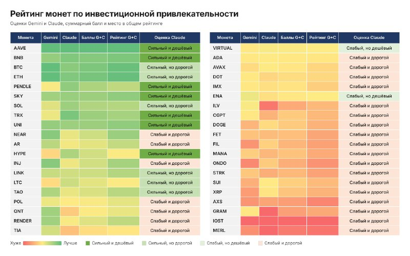

# LIB-20261104-datahawks-ai-coin-rating: рейтинг 40 монет «за інвестиційною привабливістю» від Gemini і Claude

Статус: new
Додано: 2026-11-04 · Джерело: @DataHawks, https://t.me/DataHawks/1145 · Тип: пост
Теми: фундаментальний скоринг токенів, виручка утримувачам, токеноміка, LLM-оцінки
Тікери: AAVE, BNB, BTC, ETH, PENDLE, SKY, SOL, TRX, UNI, NEAR, AR, HYPE, INJ, LINK, LTC, TAO, POL, QNT, RENDER, TIA, VIRTUAL, ADA, AVAX, DOT, IMX, ENA, ILV, CGPT, DOGE, FET, FIL, MANA, ONDO, STRK, SUI, XRP, AXS, GRAM, IOST, MERL

## Оригінал
Пост 2026-11-04 13:16 UTC, https://t.me/DataHawks/1145 (недовірені дані каналу, дослівно):

> 🔥Рейтинг монет по инвестиционной привлекательности
>
> ❗️Не инвестиционная рекомендация❗️
>
> Пообщался с ИИ на предмет оценки некоторых монет (криптопроектов) по инвестиционной привлекательности.
> Каждая из ИИ-шек проставляла баллы по своей методике, потом объединил их в общие баллы и в рейтинг по общему ранжированию. Может кому пригодится) что-то докупить или от чего-то избавиться.
>
> Gemini оценивал
> Экономический фундамент и спрос
> 🟢Захват ценности
> 🟢Обязательный спрос
> 🟢Сетевая активность
> Токеномика и защита от инфляции
> 🟢Монеты в обращении
> 🟢График разлоков
> 🟢Распределение и инфляционная модель
> Конкурентное преимущество и надежность
> 🟢Конкурентное преимущество
> 🟢Качество команды и безопасность
> Рыночные показатели
> 🟢Рыночная история и Капитализация
> 🟢Доступность на биржах и Ликвидность
> Социальный капитал и тренд
> 🟢Соответствие нарративу и сообщество
>
> Claude оценивал
> Реальный спрос
> 🟢Выручка протокола, динамика выручки 6–12 мес.
> 🟢Доля выручки держателям
> 🟢Обязательность токена
> 🟢Органическая активность
> Предложение и инфляция
> 🟢Коэффициент покрытия инфляции
> 🟢Разлоки 12 мес., % от обращения
> 🟢MC/FDV
> 🟢Концентрация (топ-10, инсайдеры)
> 🟢Реальная доходность стейкинга
> Оценка
> 🟢MC / holder revenue (аналог P/E)
> 🟢FDV / fees (аналог P/S)
> 🟢MC/TVL или MC/объём
> Качество и риски
> 🟢Moat
> 🟢Команда и прозрачность
> 🟢Безопасность
> 🟢Децентрализация и регуляторный риск
> Рынок и ликвидность
> Нарратив и сообщество

**Прочитано з картинки** (чисел на ній нема, лише теплова шкала «гірше → краще»; порядок рядків — загальний рейтинг G+C, ліва колонка місця 1–20, права 21–40; категорії — колонка «Оцінка Claude»):

| Місце | Монети | Оцінка Claude |
|---|---|---|
| 1–20 | AAVE, BNB, PENDLE, SKY, TRX, UNI, HYPE | сильний і дешевий (7) |
| | BTC, ETH, SOL, LINK, LTC, TAO | сильний, але дорогий (6) |
| | NEAR, AR, INJ, POL, QNT, RENDER, TIA | слабкий і дорогий (7) |
| 21–40 | VIRTUAL, ENA | слабкий, але дешевий (2) |
| | ADA, AVAX, DOT, IMX, ILV, CGPT, DOGE, FET, FIL, MANA, ONDO, STRK, SUI, XRP, AXS, GRAM, IOST, MERL | слабкий і дорогий (18) |

Порядок 1–20: AAVE, BNB, BTC, ETH, PENDLE, SKY, SOL, TRX, UNI, NEAR, AR, HYPE, INJ, LINK, LTC, TAO, POL, QNT, RENDER, TIA. 21–40: VIRTUAL, ADA, AVAX, DOT, IMX, ENA, ILV, CGPT, DOGE, FET, FIL, MANA, ONDO, STRK, SUI, XRP, AXS, GRAM, IOST, MERL. За кольором (оцінка на око): найзеленіші в обох моделей — BTC, ETH, AAVE, BNB; найчервоніші — IOST, MERL, GRAM, AXS. Помітні розбіжності моделей: HYPE і PENDLE у Gemini жовті, у Claude зелені; ILV, CGPT, GRAM у Claude червоні, у Gemini жовті; NEAR, INJ у Gemini зеленіші, ніж у Claude.

## Тези
1. **якісна.** Автор попросив дві LLM (Gemini і Claude) оцінити 40 монет за власними чек-листами, суму балів звів у загальний рейтинг. Сирих балів, ваг і дати даних моделей не наведено; методику «об'єднання» не описано.
2. **якісна (методика Gemini).** 5 груп: економічний фундамент і попит (захоплення вартості, обов'язковий попит, мережна активність), токеноміка (обіг, розлоки, інфляційна модель), конкурентна перевага й надійність, ринкові показники (історія, капіталізація, лістинги/ліквідність), наратив і спільнота.
3. **якісна, але з кількісними метриками (методика Claude).** Реальний попит: виручка протоколу і її динаміка за 6–12 міс., частка виручки утримувачам, обов'язковість токена, органічна активність. Пропозиція: коефіцієнт покриття інфляції (виручка/емісія), розлоки за 12 міс. у % від обігу, MC/FDV, концентрація топ-10/інсайдерів, реальна дохідність стейкінгу. Оцінка: **MC / holder revenue (аналог P/E)**, **FDV / fees (аналог P/S)**, MC/TVL або MC/обсяг. Якість: moat, команда, безпека, децентралізація/регуляторика.
4. **кількісна (з картинки, категоріальна).** З 40 монет лише 7 «сильні і дешеві» (AAVE, BNB, PENDLE, SKY, TRX, UNI, HYPE), 6 «сильні, але дорогі» (BTC, ETH, SOL, LINK, LTC, TAO), 2 «слабкі, але дешеві» (VIRTUAL, ENA), 25 «слабкі і дорогі» — зокрема великі L1 (ADA, AVAX, DOT, SUI, XRP) і DOGE.
5. **якісна.** Ужиток за автором — «щось докупити або від чогось позбутися»; «не інвестиційна рекомендація». Цін входу, цілей, горизонту нема — **закликів нема**.

## Як це може дати гроші
- Сама таблиця — знімок думки LLM на невідомих даних (зріз навчання моделі, можливі вигадані числа), тож як сигнал вона слабка. Цінна **методика Claude-частини**: це майже готова специфікація фундаментального фільтра токенів, яку ми можемо порахувати самі на DefiLlama (fees, holders revenue, TVL) + CoinGecko (MC, FDV, обіг) — без LLM і з датою.
- Категорія «сильний і дешевий» = низький MC/holder revenue + покриття інфляції. Це той самий фактор, що в картці `IDEA-20261015-holders-revenue-yield-net-supply` (H1: `dS90` ≤ 0 проти ≥ +5 %; H2: yield ≥ 5 %). Кандидати картки (HYPE, AAVE, UNI, ENA, PENDLE, SKY) майже збігаються з «сильними і дешевими» цього рейтингу — незалежне (хоч і слабке) підтвердження, що фільтр вибирає ті самі імена.
- Практичне застосування в асистенті: «фундаментальний паспорт» токена (P/E за holder revenue, P/S за fees, MC/FDV, розлоки 12 міс. % обігу) як контекст до сетапів у перпах — не сигнал входу.

## Перевірювані гіпотези
- **R1 (форвард, дешево):** рівноважений кошик «сильний і дешевий» (7 монет, з них з перпами всі) обганяє кошик «слабкий і дорогий» (25 монет) щонайменше на 5 п.п. за 90 днів від 2026-11-04 закриття (до 2027-02-02), бета-нейтрально до BTC. Дані: денні закриття перпів Bybit/Binance (є через ccxt/колектор). Одна точка, n = 1 період: лише ілюстрація, не доказ; зате даром і без lookahead.
- **R2 (історична, вже є в черзі):** кількісна частина методики Claude (MC/holder revenue, FDV/fees, MC/FDV, розлоки 12 міс./обіг) як кросс-секційний фактор на 90 днів — це розширення `holders-revenue-yield-net-supply`; тепер, коли з'явилась платна історія CoinGecko (`~/private/data/coingecko/weekly.csv`, 2026-11-02), картка є кандидатом на перегляд критиком. Пост додає дві ознаки, яких у картці нема: **FDV/fees** і **розлоки 12 міс. у % обігу**. Поріг той самий: ≥ 5 п.п. спреду за 90 днів після витрат.
- **R3 (якість LLM-оцінки):** чи узгоджуються «зелені» оцінки LLM з нашими порахованими метриками (рангова кореляція Спірмена ≥ 0.5 між рейтингом G+C і нашим MC/holder revenue для монет з ненульовою виручкою). Потрібні DefiLlama holders revenue (безкоштовно) і MC (CoinGecko). Якщо ні — LLM-рейтинги такого типу ігнорувати.

## Порівняння з тим, що знаємо
- **Архів каналу** (`LIB-20261018-datahawks-options`): канал досі давав опціонний радар і портфель; фундаментального скорингу монет у ньому не було — **нова тема** для каналу, не пов'язана з H6–H13.
- **`docs/knowledge/regime-indicators.md`:** теза Clausen «токени з дохідністю утримувачам > 1 %/кв. обганяють BTC на 7 %/кв.» — у нас не перевірено (картка `holders-revenue-collapse-lag` ✗, `holders-revenue-yield-net-supply` rejected через дані). Цей пост — та сама ідея в LLM-обгортці; **підтвердження нема ні в нього, ні в нас**.
- **`docs/knowledge/news-reaction.md`:** «шорт перед анлоком» у нас ✗ (`2026-10-15-token-unlock-short-drift`) — тож критерій «розлоки 12 міс.» як подієвий сигнал не працював; як повільний фільтр (частина `dS90`) — не перевірено.
- **`docs/knowledge/defi.md`:** чек-лист токеноміки з курсу (обіг, інфляція, розлоки, байбеки) збігається з Gemini-частиною; новизна поста — оцінні мультиплікатори P/E і P/S за виручкою.
- Суперечностей з нашими підтвердженими результатами нема (підтверджених результатів у цій темі в нас немає).

## Що з цього взяли
<!-- заповнюють агенти й Claude: картки IDEA-…, PR, інструменти, вердикти -->
