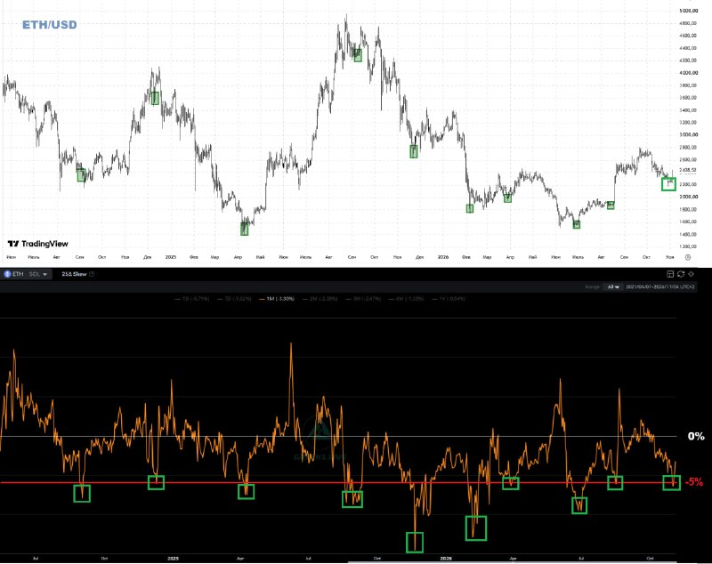

# LIB-20261104-datahawks-eth-skew-bottom: «25ΔSkew ETH нижче −5 % і розворот угору = локальне дно»

Статус: new
<!-- new → triaged → used | archived (див. README) -->
Додано: 2026-11-04 · Джерело: Telegram-канал @DataHawks, [t.me/DataHawks/1146](https://t.me/DataHawks/1146) (автоматичне стеження за каналом) · Тип: пост
Теми: 25Δ skew / risk reversal як контріндикатор настрою, локальне дно, ETH
Тікери: ETH

## Оригінал

Пост 2026-11-04 15:21 UTC, [t.me/DataHawks/1146](https://t.me/DataHawks/1146). Текст — недовірені дані каналу, дослівно:

> 🤑25ΔSkew говорит о формировании локального дна
>
> Индикатор 25ΔSkew – находится как разница между IV30  Put опционов и IV30 Call опционов с 25-й дельтой. Сильнее этот индикатор опускается в отрицательную зону, тем панические настроения на рынке усиливаются. А мы все знаем, что «Покупай, пока льется кровь».
> Всякий раз, когда индикатор 25ΔSkew опускался ниже -5-6%, т.е. на рынке пессимистов становилось все больше, а потом разворачивался вверх, на криптопаре ETH/USD формировалось локальное дно. Вот и сейчас мы пытаемся оттолкнуться вверх :)
>
> Лучше всего это работает после коррекционного снижения актива.
>
> #eth

**Що зчитано з картинки** (зчитано з зображення, точність ≈ ±0.5 п. і ±100 $):
- Верх: ETH/USD, денні свічки, ≈ 06.2024 – 04.11.2026; позначено зеленим 10 точок: ≈ 08.2024 (~2 300), 12.2024 (~3 700), 04.2025 (~1 550), 09.2025 (~4 300), 11.2025 (~2 900), 02.2026 (~1 850), 03–04.2026 (~2 000), 07.2026 (~1 600), 08.2026 (~1 850), 11.2026 (~2 250, зараз). Мітка поточної ціни ≈ 2 440 (читається погано).
- Низ: 25Δ Skew ETH, лінія 1M (у легенді «1M (−3.30 %)»; значення інших строків 1W…1Y нерозбірливі), горизонталі 0 % і −5 % (червона). Ті самі 10 епізодів позначено там, де лінія торкалась ≈ −5 % або пробивала нижче; два найглибші — ≈ 11.2025 і ≈ 01–02.2026 (≈ −10…−12 %). Остання точка: мінімум ≈ −5…−6 % наприкінці жовтня, зараз відскок до ≈ −3.3 %.

## Тези

1. **Визначення: 25ΔSkew = IV30 25Δ пута − IV30 25Δ кола; чим глибше в мінус, тим більша паніка.** *Якісна, і внутрішньо суперечлива:* якщо рахувати «пут мінус кол», паніка дає **плюс**, а не мінус. Знак на графіку відповідає RR25 = кол − пут (так автор і подавав скью BTC/ETH у радарі, див. архів, п. 5 формату). Отже, реально це **25Δ risk reversal** 1M (30 днів).
2. **Правило: RR25 1M < −5…−6 %, потім розворот угору → локальне дно ETH/USD «щоразу».** На картинці 10 позначених епізодів за ≈ 2.4 року. *Кількісна, неперевірена*: епізоди відібрані автором; «розворот угору» і горизонт «локального дна» не визначені.
3. **Зараз сигнал спрацьовує:** RR 1M опускався до ≈ −5…−6 % і повертається (≈ −3.3 % за легендою); «пытаемся оттолкнуться вверх». *Кількісна (з картинки).* Ціни входу, цілі й стопу нема — **не заклик**.
4. **Найкраще працює після коригувального падіння активу.** *Якісна*: величину падіння не названо. Зараз ETH ≈ 2 250–2 440 після ≈ 2 800 на початку жовтня (≈ −15…−20 %, з картинки).

**Застереження з самої картинки.** Частина позначених «днів» була лише паузою в падінні: 12.2024 (~3 700) → квітень 2025 ~1 550; 09.2025 (~4 300) і 11.2025 (~2 900) → лютий 2026 ~1 850. «Локальне дно» тут означає відскок на дні–тижні, а не вхід на місяці.

## Порівняння з тим, що ми знаємо

- **Повторює:** архів [LIB-20261018-datahawks-options](LIB-20261018-datahawks-options.md), теза 3 і H3 («стрибок скью = страх»); там напрям розглядали як попит на захист, тут — **контріндикатор** (екстремум страху → купувати).
- **Нове:** конкретне подієве правило для **ETH** (поріг −5 %, перетин і розворот), а не зміна скью за тиждень і не рівень у децилях. Раніше канал про це правило не писав.
- **Перетин із закритим:**
  - [`options-direction-signals`](../ideas/IDEA-20261018-options-direction-signals.md) (rejected): ΔRR25 → дохідність **BTC** на 1–3 доби; відхилено через потужність (MDE 0.12 проти очікуваних 0.06) і слабшання сигналу після 2024 у єдиному джерелі. ETH і подієвий поріг там не розглядали.
  - H7 архіву (відхилено): «новий максимум при RR25 < 0 → пастка» — дзеркальне правило; n_eff ≈ 8, та сама проблема малої вибірки, що й тут (≈ 10 епізодів).
  - [put-skew-v2](../verification/2026-10-14-put-skew-v2.md): рівень RR25 не розділяв P&L **торгівлі скью** (H2 ✗); прогноз ціни ETH не тестували.
- **Рівні скью автора ≠ наші:** у звірці архіву RR BTC 04.10 у нього +0.23, у нас −1.0 (інша експірація або конвенція дельти). Поріг −5 % у його шкалі може відповідати іншому числу в нашій — перед тестом звірити на ETH (`deribit_skew_term`).

## Як це може дати гроші

- **Фільтр для лонгів ETH на відкаті:** дозволяти вхід лише після екстремуму страху (RR25 1M ≤ −5 %) і його розвороту; закрити шорти ETH у цей момент (за духом правила «виснаження продавців забороняє шорти» у сетапах демо).
- **Опціонний варіант:** у момент сигналу пути дорогі відносно колів — risk reversal (продати 25Δ пут, купити 25Δ кол) отримує скью на свою користь; але продаж путу після паніки — це той самий ризик, що й у тезі 1 архіву (премія за ризик падіння не безкоштовна).
- Для асистента: ще одна позначка режиму «страх на максимумі» у тижневому огляді ETH.

## Перевірювані гіпотези

- **E1 — подія «RR25 1M ETH ≤ −5 %, потім ріст ≥ 1 п. від мінімуму за ≤ 3 доби»** → дохідність ETH на 7 / 14 / 30 днів уперед проти безумовної і проти контролю «ETH упав ≥ 15 % за 30 днів без сигналу скью» (щоб відділити скью від простого mean reversion після падіння). Успіх: різниця ≥ +3 п.п. на 14 днях, CI без 0, той самий знак у 2021–2023 і 2024–2026.
  - **Дані:** поверхні ETH з угод Deribit — у нас лише з 10.2025 (`build_day(product="ETH")`), цього мало (≈ 3–4 епізоди). Потрібно докачати угоди ETH з 2021 (кеш BTC `put_skew/trades24` є, ETH нема). Плюс спот ETH (Binance, є).
  - **Потужність:** ≈ 4 епізоди на рік, перекривні вікна → n_eff ≈ 15–20 за 2021–2026. MDE на 14 днях при σ ETH ≈ 18 % за 14 днів буде ≈ 8 п.п. — тест потрібен лише як грубий фільтр; без цього чекати ≥ 2 років колектора.
- **E2 — те саме на BTC** (дані є з 2021): чи працює правило поза ETH; якщо на BTC ✗ — ETH-результат найімовірніше вибірковий.
- **E3 — «працює краще після корекції»:** розділити події E1 за просадкою ETH від 30-денного максимуму (< 10 % / ≥ 10 %).

**Що з цим робити зараз:** для свіжого сигналу (жовтень–листопад 2026) записати форвард: ETH на 04.11 ≈ 2 250–2 440 (з картинки), перевірити дохідність через 14 і 30 днів (≈ 18.11 і 04.12) — один епізод, не доказ.

## Що з цього взяли
<!-- заповнюють агенти й Claude: картки IDEA-…, PR, інструменти, вердикти -->
