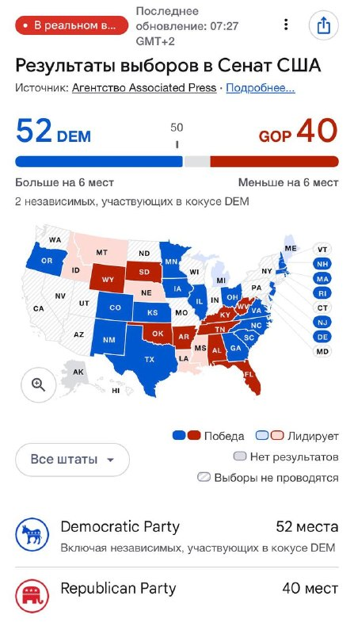
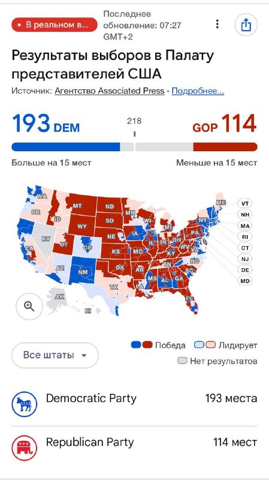

# LIB-20261104-datahawks-midterms: проміжні вибори США 03.11 — демократи беруть Сенат, у Палаті ведуть (проміжні дані AP)

Статус: new
<!-- new → triaged → used | archived (див. README) -->
Додано: 2026-11-04 · Джерело: @DataHawks, https://t.me/DataHawks/1143 · Тип: пост
Теми: проміжні вибори до Конгресу США, розв'язання події (вибори 03.11), подієва премія фронту SPX/BTC, IV crush після події, сезонність проміжних виборів
Тікери: SPX (VIX), BTC (опосередковано)

## Оригінал

Пост від 2026-11-04 05:31 UTC, https://t.me/DataHawks/1143 (недовірені дані каналу, мова оригіналу):

> Сенат:
> Демократы уже обеспечили контроль над Сенатом, который ранее контролировали республиканцы!
>
> Палата представителей: демократы перехватили как минимум 7 мест у республиканцев, подсчет голосов еще не закончен.

Скриншоти (Google, джерело — Associated Press, «в реальному часі», оновлення 07:27 GMT+2 = 05:27 UTC 04.11):

## Тези

Числа прочитано з картинок.

1. **Сенат: DEM 52 (разом з 2 незалежними, що входять до кокусу демократів), GOP 40; поріг 50; «більше на 6 місць» / «менше на 6 місць».** Тобто демократи мають ≥ 51 і контроль Сенату, решта 8 місць ще не оголошено. *Кількісна (проміжний підрахунок AP).*
2. **Сенат раніше контролювали республіканці; тепер він переходить до демократів.** *Якісна (факт зі слів автора; ми не перевіряли).*
3. **Палата представників: DEM 193, GOP 114, поріг 218; «більше на 15 місць» / «менше на 15 місць»; ≈ 128 місць без результату.** Більшість не визначено. *Кількісна (проміжний підрахунок).*
4. **У тексті «демократи перехопили щонайменше 7 місць у республіканців», а на картинці «+15 місць».** Розбіжність: можливо, 7 — підтверджені переходи, а +15 — різниця з урахуванням тих, де лише лідирують. *Кількісна, внутрішня суперечність поста.*
5. **Підрахунок ще не завершено.** Це збігається з тезою радару 01.11: «ринок закладає пік невизначеності на 5–7 днів, бо підрахунок затягнеться». *Якісна.*

Автор не робить ринкових висновків, рівнів і угод теж нема. Пост — новинна фіксація результату події, яку два попередні радари каналу закладали в ціну.

## Як це може дати гроші

- **Подія розв'язана частково.** Сенат відомий, Палата ні. Премія фронту (SPX 7D 16.4 % проти 1M 14.8 % у радарі 01.11, BTC 1W 40.6 %) має сходити в міру того, як ясніє результат Палати. Для асистента: продаж короткої волатильності «на crush» до оголошення більшості в Палаті має залишковий ризик. У BTC ще й переоцінено весь місяць (форвард 1W→1M +3 п. після новини про Binance), тому crush може бути слабшим.
- **Наслідки для політики (наше прочитання, не автора).** Якщо обидві палати Конгресу відійдуть демократам при президентові-республіканцеві, це розділений уряд: менше шансів на нові податкові й фіскальні ініціативи президента, більше на «глухий кут». Для крипти: під питанням темп профільного законодавства. Напрям ринку після макроподій ми не передбачаємо (B2, [macro](../knowledge/macro.md)), тож це контекст, а не сигнал.
- **Сезонність проміжних виборів.** QG (qivty) 01.11 називав її аргументом за індекси до Q1 (див. [LIB-20261101-qivty-digest](LIB-20261101-qivty-digest.md), Q1, без картки). Відлік патерну починається з цієї дати.

## Перевірювані гіпотези

- **M1 — IV crush BTC після виборів (G1/K3 у BTC-версії).** Прогноз: 1W ATM BTC у радарі 08.11 < 38 % (−2.6 п. від 40.6 % 01.11), а 30D змінився менше, ніж 1W (бо місяць переоцінено через Binance). *Дані:* колектор Deribit (знімки поверхні 01.11 і 04–08.11) — є. Один епізод, лише описово.
- **G1 (ч. 2) і K3 (з попередніх радарів) — тепер можна закрити.** 7D SPX у радарі 08.11 < 14 %? Реалізований рух SPX 03–06.11 проти імплайду ±1.0 % (подієвий надлишок) і ±2.3 % (тиждень)? Ціни SPX у нас лише ззовні (◯), 7D — з наступного радару каналу.
- **M2 — сезонність проміжних виборів:** уже Q1 у [LIB-20261101-qivty-digest](LIB-20261101-qivty-digest.md) (n ≈ 18, без картки). Нового тут лише точка відліку (03.11.2026) для forward-спостереження: SPX і BTC 04.11 → 31.03.2027.

## Порівняння з тим, що ми вже знаємо

- **Повторюється:** вибори 03.11 як подія, яку канал закладав у фронт SPX з 25.10 ([LIB-20261025-datahawks-spx-radar](LIB-20261025-datahawks-spx-radar.md): «дуга» кривої) і 01.11 ([LIB-20261101-datahawks-spx-btc-radar](LIB-20261101-datahawks-spx-btc-radar.md): 7D 16.4 % > 1M 14.8 %, «підрахунок затягнеться»). Те, що підрахунок Палати 04.11 ще триває, цю тезу підтверджує.
- **Нове:** сам результат (зміна контролю Сенату, перевага демократів у Палаті) і час розв'язання. Для BTC ми ще 18.10 бачили премію саме в тижні виборів ([архів каналу](LIB-20261018-datahawks-options.md), H4). Тепер її сходження можна перевірити на наших даних (M1).
- **Суперечностей з нашими перевіреними результатами нема.** Премію в дні подій ми не вважаємо доведеною перевагою ([news-reaction](../knowledge/news-reaction.md): event-day straddle ◯, [fomc-front-iv-crush](../ideas/IDEA-20261021-fomc-front-iv-crush.md) rejected). Тож M1 — спостереження для асистента, а не торгова гіпотеза.
- **Застереження:** дані проміжні (AP, 05:27 UTC 04.11). Карта на скриншоті частково суперечить звичній географії голосування (наприклад, TX синій у Сенаті), тож остаточні числа варто звірити, перш ніж посилатися на них.

## Що з цього взяли
<!-- заповнюють агенти й Claude: картки IDEA-…, PR, інструменти, вердикти -->
