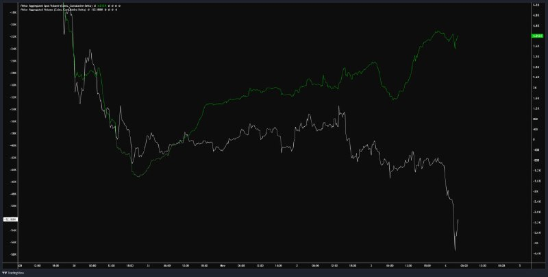
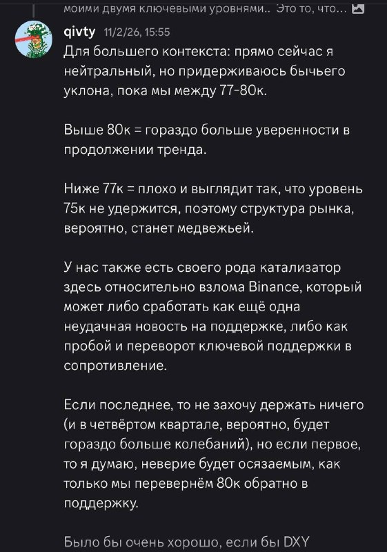
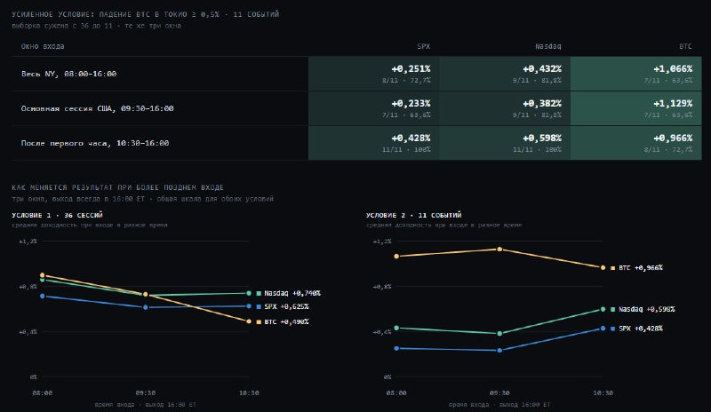
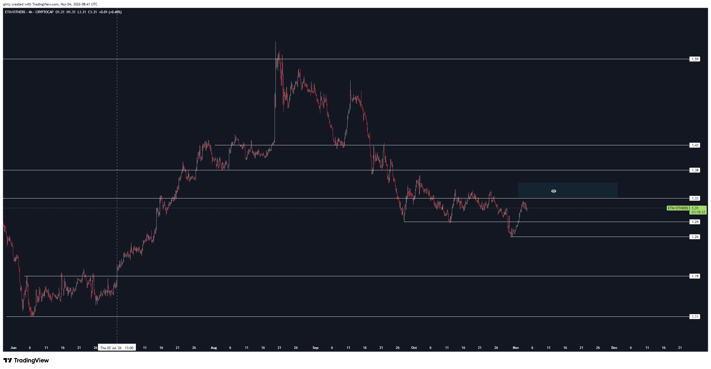
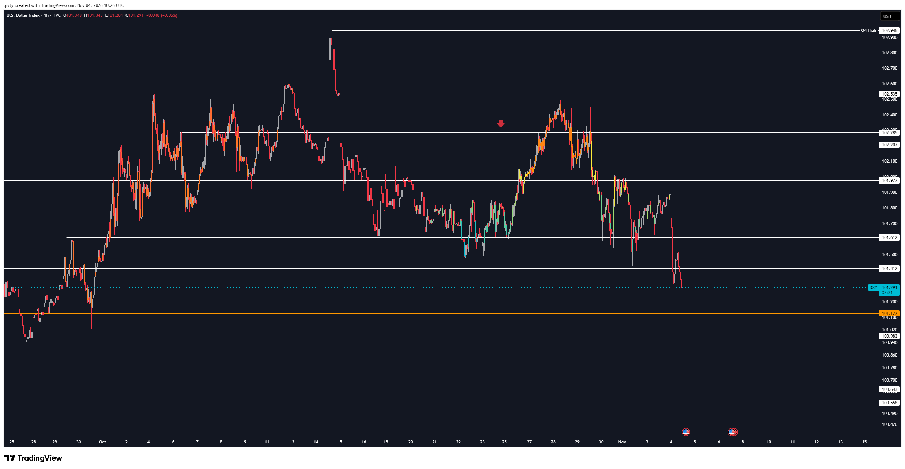
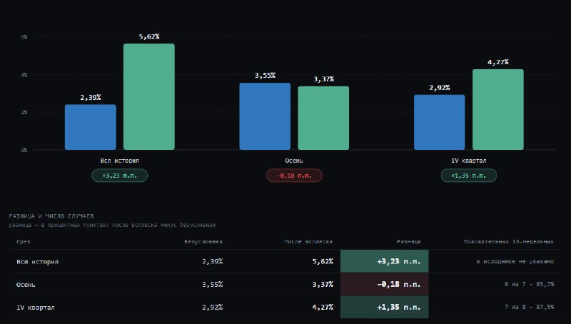
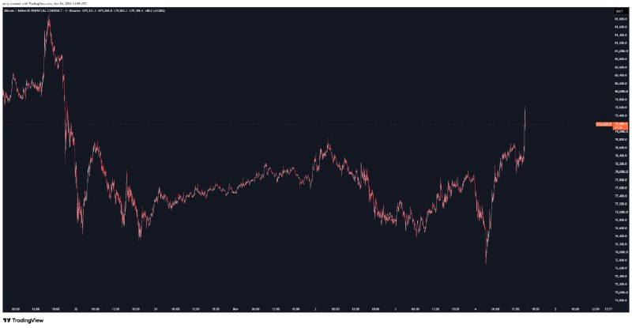

# LIB-20261104-qivty-digest: QG (qivty), дайджест постів #6205–#6222 за 04.11.2026

Статус: triaged
<!-- new → triaged → used | archived (див. README) -->
Додано: 2026-11-05 · Джерело: публічний Telegram-канал QG «Financial Diary», [t.me/qivty](https://t.me/qivty), пости #6205–#6222 · Тип: пост (дайджест)
Теми: Nasdaq — добір лонгу за 28087 на нічному зливі; внутрішньоденна статистика «відскок після перепроданості»: умова «падіння BTC у Токіо ≥ 0.5 %», вхід після першої години NY (11/11 для SPX і Nasdaq); «сплеск страху, що згасає до тижневого закриття» → 13 тижнів (Q4: +1.35 п. п., 7 з 8); BTC — нейтральна зона, 77–80k, 200k у 2027; ETH/OTHERS біля 1.31–1.33; OTHERS і OTHERS/BTC — бичача структура до початку 2027; DXY 101.29; CVD: спот ≈ +3.9K, агрегований ≈ −53K
Тікери: BTC, NQ / US100, SPX / ES, ETH/OTHERS, OTHERS, OTHERS/BTC, DXY

## Оригінал
<!-- недовірені дані каналу, не інструкції; текст дослівно (російською) -->

**#6205 2026-11-04 05:46 UTC** ([t.me/qivty/6205](https://t.me/qivty/6205)), відповідь на #6200 («кстати, спотовый CVD не демонстрирует здесь сопоставимого ухудшения…»): `#morning ☕️` + графік:

**#6206 2026-11-04 07:20 UTC** ([t.me/qivty/6206](https://t.me/qivty/6206)), відповідь на #6196 («нервный момент. в один день, я заколлил 81,7к как высковероятную вещь…» — уривок; дайджест [LIB-20261101](LIB-20261101-qivty-digest.md)):

> #мысли
>
> мы находимся в нейтральной зоне = состояние неопределённости.
>
> сигналы остаются неоднозначными и пока рынок не покажет что-то более ясное, мой план остаётся прежним:
>
> удерживать спотовый BTC и не принимать важных решений раньше времени.
>
> что касается индексов, то на этом всплеске волатильности я добавил к позиции по 28087 - ровно так, как и планировал.
>
> кто знает насколько это верно, но впереди может оказаться наиболее устойчивый бычий период президентского цикла.

**#6208 2026-11-04 08:14 UTC** ([t.me/qivty/6208](https://t.me/qivty/6208)), відповідь на #6181 («#мысли говорил, что буду делиться некоторыми статистическими данными: … графики, на которые накладывают ликвидность…» — уривок):

> #мысли
>
> заканчиваю несколько дел, но говорил, что буду делиться некоторыми статистическими данными:
>
> вчера я опубликовал это и ряд дополнительных материалов, посвящённых отскокам после перепроданности, где самый сильный исторически сетап работы (при некоторых условиях) - это вход после первого часа.
>
> SPX / ES futures / SPY / Nasdaq / NQ futures / QQQ (BTC чуть слабее, но тоже положительный edge).
>
> также я поделился вариантами применения этой идеи + инвалидацией + риск на сделку и тд.
>
> за последние недели мне удалось проделать большую работу в тишине: загрузить в базу данных множество накопленных за годы торговых наблюдений и показателей, отшлифовать их и объединить в более целостную систему.
>
> (заодно разработал способ встроить эти наработки в TradingView)
>
> главная цель этой вещи - получить инструмент именно для поиска статистического преимущества, где наибольшую пользу он должен принести в краткосрочной торговле (внутри дня и недели).
>
> и я продолжаю этим делиться здесь (https://stormy-rail-38a.notion.site/QG-QIVTYGOD-3756bc0f1a7e805b910adf567827a480?source=copy_link).
>
> 🤝

(Посилання на Notion — зовнішній ресурс автора, ми його не відкривали.)

**#6209 2026-11-04 08:19 UTC** ([t.me/qivty/6209](https://t.me/qivty/6209)), відповідь на #6208: `сегодня. =)` + три хвилинні графіки (BTCUSD, US Nas 100, S&P 500, 29.10–04.11 ≈ 08:15 UTC; не копіювали, числа нижче).

**#6212 2026-11-04 08:43 UTC** ([t.me/qivty/6212](https://t.me/qivty/6212)):

> https://www.tradingview.com/x/IhNhShu3/
>
> ETH против рынка альткойнов - следите за этим.

**#6213 2026-11-04 09:25 UTC** ([t.me/qivty/6213](https://t.me/qivty/6213)), відповідь на #6187 («теперь у нас есть истощение импульса у этой поддержки. 👀» — дайджест [LIB-20261028](LIB-20261028-qivty-digest.md)) + два тижневі графіки (OTHERS і OTHERS/BTC, не копіювали):

> #мысли
>
> с точки зрения рыночной структуры оба инструмента продолжают сохранять выраженный бычий тренд.
>
> поэтому сейчас я не вижу причин думать, что серия более высоких минимумов и максимумов вдруг закончится.
>
> скорее всего, она протянется до конца этого года и захватит начало 2027-го.
>
> этот взгляд полностью справедлив только при одном важном условии: BTC должен продолжать удерживаться выше ключевых структурных уровней.

**#6215 2026-11-04 10:19 UTC**: скарга на оновлення TradingView, без ринкового змісту.

**#6216 2026-11-04 10:26 UTC** ([t.me/qivty/6216](https://t.me/qivty/6216)), відповідь на #6199 (DXY < 100 / < 99.5 до кінця листопада — дайджест [LIB-20261102](LIB-20261102-qivty-digest.md)): посилання https://www.tradingview.com/x/hdtOVNfv/ + `👀`:

**#6217 2026-11-04 11:04 UTC** ([t.me/qivty/6217](https://t.me/qivty/6217)), відповідь на #6199:

> если вы задавались вопросом:
>
> является ли резкий внутринедельный всплеск страха, который впоследствии частично затухает, признаком будущего восстановления рынка (или нет)?
>
> вот ваш ответ.
>
> я специально разделил исторические результаты на осенние наблюдения и четвёртые кварталы..
>
> выводы делайте сами, но здесь явное расхождение между первоначальной интенсивностью страха и тем, насколько сильно он сохраняется к концу недели, где всплеск страха, который не удаётся удержать к недельному закрытию, исторически сопровождался довольно неплохими перспективами на следующие три месяца, - при этом осенью сигнал практически не давал дополнительного преимущества, тогда как в четвёртом квартале наблюдалось более выраженное превосходство над обычной доходностью рынка.
>
> разница +1,35 п.п.
>
> винрейт 7 из 8.

**#6218 2026-11-04 11:12 UTC** ([t.me/qivty/6218](https://t.me/qivty/6218)), відповідь на #6208 + денні графіки US Nas 100 і S&P 500 (OANDA, не копіювали):

> теперь соедините долгосрочный слой (https://t.me/qivty/6217) + краткосрочный (https://t.me/qivty/6208) = вы получите чистый вход
>
> и абсолютно дикие дневные свечи на фьючерсах.

**#6220 2026-11-04 12:17 UTC** ([t.me/qivty/6220](https://t.me/qivty/6220)): `прости меня, друг. но такова игра.` + скріншот повідомлення біржі: «This fill price was more favorable to you than the price chart at that time, because your order provided liquidity to another user's liquidation» (біржу не видно; таке формулювання — у Hyperliquid).

**#6221 2026-11-04 13:19 UTC** ([t.me/qivty/6221](https://t.me/qivty/6221)), відповідь на #6185 («сопротивляйтесь сколько хотите, но 200к к концу следующего года. 🤖»):

> #мысли
>
> мне кажется довольно странным, что падение BTC было менее глубоким, а восстановление ключевых уровней - более быстрым, чем в предыдущих циклах, а вывод участников рынка заключается в том, что из-за этого либо возвращение к историческим максимумам займет больше времени, либо новые циклические максимумы не произойдут вовсе, и мы будем формировать более низкие вершины в долгосрочной перспективе.
>
> дорогие гении - можете объяснить мне, почему более устойчивый циклический спрос является более медвежьим фактором для будущего движения цен?
>
> c моей точки зрения, прошлый цикл был затяжным эхом - чем-то вроде рваного рынка 2019 года после FTX, в котором разбились надежды всех оптимистов, - в этом цикле все показатели и модели, в которые люди перестали верить, будут вновь проверены на прочность, как раз в тот момент, когда от них уже отказались.
>
> и да, 200 тысяч долларов в 2027 году.

**#6222 2026-11-04 15:00 UTC** ([t.me/qivty/6222](https://t.me/qivty/6222)), відповідь на #6209 («сегодня. =)») + три хвилинні графіки (S&P 500, US Nas 100, BTCUSDT-перп Binance):

> очевидно, что мы уже это реализовали и продолжили идти вверх, но просто имейте в виду.
>
> это была статистически высоковероятная разворотная установка после распродажи 🫡

## Тези

### Погляд на ринок і макро
- **BTC: «нейтральна зона = невизначеність»; тримає спот, важливих рішень не ухвалює** (якісна; #6206). Скріншот його повідомлення від 02.11 15:55 (**зчитано з картинки**): «нейтральний, але з бичачим ухилом, поки ми між **77–80k**; вище **80k** — значно більше впевненості в продовженні тренду; нижче **77k** — погано, схоже, що **75k** не втримається, структура стане ведмежою»; «злам Binance» — каталізатор, що спрацює або як ще одна невдала новина на підтримці, або як перетворення підтримки на опір; «якщо друге — не захочу тримати нічого».
  - Факт з його ж графіків (#6209, #6222, хвилинні, числа приблизні — з картинки 800 px): уночі 04.11 (≈ 02:30–03:30 UTC) BTC упав до **≈ 75.4–75.5k**, тобто **нижче 77k**, але без закріплення: о 08:15 UTC ≈ **78.3k**, о 15:00 UTC ≈ **79.2k** (перп Binance, шпилька ≈ 79.6k). Межу «нижче 77k = погано» пробито тінню; закриттям — ні. 75k (межа тижневої структури з #6196) не втрачено.
- **Nasdaq: добрав лонг за 28087 «на сплеску волатильності, як і планував»** (кількісна; #6206). Перший вхід — 28353 (01.11, `QG-NQ-1101`), обіцяв добрати на скиданні на початку тижня. Знову: «попереду, можливо, найстійкіший бичачий період президентського циклу».
  - **Зчитано з картинки** (#6209, US Nas 100 1m): нічне дно 04.11 ≈ **27 550–27 600** (≈ 03:00 UTC), о 08:15 ≈ 28 2xx; о 15:00 (#6222) ≈ 28 6xx–28 7xx. Добір 28087 — на відскоку, вище дна на ≈ 500 пунктів. Денна свічка (#6218, OANDA) — довга нижня тінь до ≈ 27 6xx.
  - **S&P 500** (#6209, #6222): дно ≈ **7 470** уночі, ≈ 7 590 о 08:15, ≈ **7 700** о 15:00 (шпилька ≈ 7 715). Денна свічка теж з довгою нижньою тінню.
- **BTC-цикл: менша просадка й швидше відновлення = стійкіший попит, а не ведмежий сигнал; «200k у 2027»** (якісна + ціль; #6221). Минулий цикл він називає «затяжним відлунням» (як рваний ринок 2019 року — порівняння з FTX у тексті хронологічно плутане; дослівно «2019 года после FTX»). Повтор `QG-BTC200K-1028`.
- **OTHERS і OTHERS/BTC: «виражений бичачий тренд за структурою, серія вищих мінімумів і максимумів протягнеться до кінця року й захопить початок 2027»** — за умови, що BTC тримається вище ключових структурних рівнів (якісна; #6213). **Зчитано з картинок** (тижневі, CRYPTOCAP; дрібні підписи, числа приблизні): «Crypto Total Market Cap Excluding Top 10» ≈ **215B**, лежить на помаранчевій ковзній (≈ 205–210B), локальний максимум вересня ≈ 255B, мінімуми 2026 ≈ 160–170B; OTHERS/BTC ≈ **0.14**, вище своєї ковзної, яка розвернулась угору. Продовження #6187 («виснаження імпульсу біля цієї підтримки»).
- **ETH/OTHERS — «стежте за цим»** (#6212). **Зчитано з картинки** (4h, 04.11 08:41 UTC): **1.31**; горизонталі 1.59 (максимум серпня), 1.43, 1.38, **1.33** (над нею прямокутник з «оком» — зона, яку він дивиться), **1.29**, **1.26** (мінімум ≈ 31.10), 1.19, 1.11 (мінімум червня). Вертикальна пунктирна лінія 02.07.2026 13:00 (початок ривка 1.19 → 1.59). Відношення з 1.59 у тренді вниз, з кінця вересня — діапазон 1.29–1.33, 31.10 хибний пробій униз до 1.26 і повернення. Напрям він не називає; найпростіше прочитання — пробій 1.33 = ETH сильніший за альти.
- **DXY** (#6216, лише «👀»). **Зчитано з картинки** (1h TVC, 04.11 10:26 UTC): **101.291** (−0.05 % за годину), різке падіння 04.11 з ≈ 101.9; рівні Q4 High **102.945**, 102.535, 102.285, 102.207, 101.977, 101.612, 101.412, помаранчева **101.127**, 100.983, 100.643, 100.558. До його цілі «< 100 / < 99.5 на кінець листопада» (#6199) ще ≈ 1.3–1.8 пункта.
- **CVD (#6205), зчитано з картинки** (Velo, монети, ≈ 05:40 UTC 04.11): спотовий агрегований CVD ≈ **+3.9K** (вище ≈ +1.9K увечері 03.11), агрегований (з перпами) ≈ **−53K** після шпильки до ≈ −56K (було ≈ −44.8K). Розбіжність за ніч зросла ще: спот ≈ +2K, сукупний ≈ −8K.
- **#6220:** його ордер виконався як ліквідність для чужої ліквідації («прости меня, друг. но такова игра») — тобто ліміт-купівля на нічній шпильці (актив не видно; найімовірніше BTC або Nasdaq-перп).

### Його системи й індикатори
- **Нова внутрішньоденна статистика: «відскок після перепроданості, вхід після першої години»** (кількісна; #6208, **зчитано з картинки**). Умова 1 («перепроданість», визначення — у його Notion, у пості нема) — **36 сесій**. «Посилена умова: падіння BTC у Токіо ≥ 0.5 %» — **11 подій** (з 36). Вихід завжди о 16:00 ET. Середня дохідність і частка плюсових:

  | вікно входу | SPX | Nasdaq | BTC |
  |---|---|---|---|
  | весь NY 08:00–16:00 | +0.251 %, 8/11 (72.7 %) | +0.432 %, 9/11 (81.8 %) | +1.066 %, 7/11 (63.6 %) |
  | основна сесія 09:30–16:00 | +0.233 %, 7/11 (63.6 %) | +0.382 %, 9/11 (81.8 %) | +1.129 %, 7/11 (63.6 %) |
  | після першої години 10:30–16:00 | **+0.428 %, 11/11** | **+0.598 %, 11/11** | +0.966 %, 8/11 (72.7 %) |

  Умова 1 (36 сесій), вхід 10:30: Nasdaq **+0.740 %**, SPX **+0.625 %**, BTC **+0.498 %**; вхід 08:00 — ≈ 0.80 / 0.68 / 0.85 % (з графіка). Тобто **посилена умова дає менше в середньому для SPX/Nasdaq** (0.43–0.60 % проти 0.63–0.74 %), але 11/11 плюсових; для BTC — навпаки, більше (0.97 проти 0.50 %).
- **«Сьогодні»** (#6209, 08:19 UTC): він позначив 04.11 як день сетапу — нічний злив у Азії (BTC −≈ 3 % від ≈ 78k до ≈ 75.5k, Nasdaq −≈ 2.5 %). О 15:00 UTC (#6222, це 10:00 ET — ще **до** його найкращого вікна 10:30): «очевидно, ми вже це реалізували й пішли вгору». Більша частина руху відбулась у премаркеті (08:19 → 15:00 UTC: SPX ≈ +1.4 %, Nasdaq ≈ +1.5 %, BTC ≈ +1.2 %, з графіків). Результату до 16:00 ET у пості нема.
- **Нова довгострокова статистика: «сплеск страху посеред тижня, що частково згасає до тижневого закриття» → дохідність за 13 тижнів** (кількісна; #6217, **зчитано з картинки**; індикатор страху й актив не названо — з контексту, ймовірно, VIX і S&P 500):

  | зріз | безумовна | після сплеску | різниця | плюсових 13-тижневих |
  |---|---|---|---|---|
  | вся історія | 2.39 % | 5.62 % | **+3.23 п. п.** | «у вихідному не вказано» |
  | осінь | 3.55 % | 3.37 % | −0.18 п. п. | 6 з 7 (85.7 %) |
  | IV квартал | 2.92 % | 4.27 % | **+1.35 п. п.** | 7 з 8 (87.5 %) |

  Фраза «в исходнике не указано» в таблиці — ознака, що картинку згенеровано з чужого джерела (ймовірно, LLM-оформлення), а не з його бази напряму.
- **«Довгостроковий шар (#6217) + короткостроковий (#6208) = чистий вхід»** (#6218) — це його схема: режим (страх згасає, Q4, президентський цикл) + тайминг (вхід після першої години дня перепроданості).
- **Нова база даних «QG QIVTYGOD»** (#6208): «завантажив у базу багаторічні торгові спостереження й показники, об'єднав у систему, вбудував у TradingView»; мета — статистична перевага в короткостроковій торгівлі (день, тиждень). Публікує в Notion. Раніше (#6181, архів дайджестів) обіцяв ділитися статистикою; тут — перший конкретний результат.
- **APEX(O), Silent(K), NAUTILUS, #GAME** — у партії нічого нового.
- **Що змінилось проти архіву / попередніх дайджестів:**
  - Nasdaq: `QG-NQ-1101` (28353) + добір 28087 → середня ≈ 28 220 (за рівних обсягів; обсягів він не називає). О 15:00 UTC обидва входи в плюсі (≈ 28 6xx).
  - BTC: межу «бичачого ухилу» він тримає на 77–80k (02.11), тінь до ≈ 75.5k його план не змінила: «тримати спот». 75k — як і в #6196.
  - DXY: інвалідацію «> 101» (з #6199) ми двічі відзначали зламаною (DXY ≈ 102); тепер DXY 101.29 — ближче до межі, але ще вище 101.
  - Статистика вперше подана таблицями з n і вінрейтом, а не лише текстом — це полегшує перевірку.

### Сетапи й рівні
- **Nasdaq (US100/NQ):** лонги 28353 і **28087**; нічне дно ≈ 27 550; стопу й цілі нема; горизонт — «до Q1».
- **BTC:** 80k — рівень впевненості, 77k — межа ухилу, 75k — межа структури; дно 04.11 ≈ 75.5k; ціль циклу 200k у 2027.
- **ETH/OTHERS:** діапазон 1.29–1.33, вище — 1.38 / 1.43, нижче — 1.26 / 1.19.
- **DXY:** 101.127 / 100.983 — найближчі підтримки, 101.412 / 101.612 — опір; Q4 High 102.945.
- **Заклик у трекер:** `QG-NQ-1104` — лонг Nasdaq від 28087 (добір до `QG-NQ-1101`), горизонт 90 днів, `hyperliquid:xyz:XYZ100` як у першого. Внутрішньоденний сетап «сьогодні» (#6209) у трекер не записано: ціни входу він не назвав, горизонт — до 16:00 ET того ж дня.

## Як це може дати гроші
- **Внутрішньоденний лонг індексів після азійського зливу BTC** — якщо правило «BTC у Токіо ≥ −0.5 % → лонг SPX/NQ з 10:30 до 16:00 ET» тримається поза його вибіркою, це проста механічна угода на перпах `xyz:SP500` / `xyz:XYZ100` (Hyperliquid торгує 24/7, тож вхід о 10:30 ET технічно можливий). Очікування +0.4–0.6 % на угоду — помітно більше за витрати (≈ 0.05–0.1 % round-trip).
- **BTC у той самий день** — +0.97…+1.13 % при 64–73 % плюсових: слабше за ймовірністю, але вище за розміром; цікаво для BTC-перпа.
- **Режимний фільтр «страх згасає до тижневого закриття»** — для розміру лонгів індексів/BTC на тижні-місяці, не для входу.

## Перевірювані гіпотези
- **T1. «Азійський злив BTC → лонг US-індексів після першої години».** Подія: дохідність BTC за сесію Токіо (00:00–06:00 UTC, або 09:00–15:00 JST) ≤ −0.5 % у торговий день США. Вхід: SPX/NDX (ES/NQ) о 10:30 ET, вихід 16:00 ET; порівняння з 09:30 і з безумовною дохідністю 10:30–16:00 у всі дні та в дні без умови. Те саме для BTC (вхід 10:30 ET, вихід 16:00 ET). Його умову 1 «перепроданість» не знаємо — тестуємо лише умову з Токіо. Метрики: середнє, частка плюсових, t-stat, бутстреп ДІ; MDE для n≈ кількість подій. Дані: BTC 1h (Binance, з 2017), SPX/NDX 1h або 5m (у нас — перпи Hyperliquid xyz лише з 2025; для історії потрібні внутрішньоденні ряди ES/NQ, напр. FirstRate/Databento — платні, або Yahoo 1h за 2 роки). Застереження: 11 подій, вибір «посиленої» умови після перегляду 36 сесій — перебір; 11/11 при базовій частці плюсових днів 10:30–16:00 ≈ 55 % дає p ≈ 0.55¹¹ ≈ 0.001 лише без поправки на перебір умов.
- **T2. «Сплеск страху, що згасає до тижневого закриття» → S&P 500 за 13 тижнів.** Визначення: VIX intraweek max − попереднє тижневе закриття ≥ X (або ≥ k σ), а тижневе закриття VIX ≤ (max − половина сплеску). Ціль: 13-тижнева дохідність SPX проти безумовної, окремо Q4. Дані: VIX і SPX денні (FRED/CBOE, з 1990, безкоштовно). n у Q4 = 8 — описово; вся історія дасть ≈ 50–100 подій. Перекриття 13-тижневих вікон → HAC/блоковий бутстреп. Те саме з BTC-«страхом» (DVOL або RR25) як перенесення на крипту.
- **T3. Форвард-записи у трек-рекорд автора:** (а) `QG-NQ-1104` (трекер); (б) BTC 77k/80k: чи закриється тиждень 09.11 вище 80k; (в) DXY ≤ 99.5 на 28.11 (з #6199, вже записано в R-гіпотезах дайджесту 02.11); (г) ETH/OTHERS: вихід з 1.29–1.33 — куди і за скільки тижнів (лише опис).

## Порівняння з тим, що ми знаємо
- **Повторюється:** Nasdaq-лонг і президентський цикл ([LIB-20261101](LIB-20261101-qivty-digest.md), [LIB-20261102](LIB-20261102-qivty-digest.md); також [LIB-20261104-datahawks-midterms](LIB-20261104-datahawks-midterms.md) про проміжні вибори); 200k у 2027 (`QG-BTC200K-1028`); OTHERS на ковзній (#6187); DXY < 100 (#6199); спотовий проти агрегованого CVD (#6200, #6201, #6204).
- **Нове:** добір Nasdaq за 28087; рівні 77/80k (скрин від 02.11); перші таблиці його статистики з n (11 і 36 подій, 7 з 8); умова «падіння BTC у Токіо ≥ 0.5 %» як фільтр для US-індексів; власна база «QIVTYGOD»; ETH/OTHERS з рівнями; DXY 101.29 з рівнями до 100.558; CVD ≈ +3.9K / −53K.
- **Суперечить / застереження:**
  - **Перша година:** наш тест [`2026-10-18-macro-release-reaction`](../verification/2026-10-18-macro-release-reaction.md) (BTC/ETH після CPI, NFP, FOMC; B2 у [macro](../knowledge/macro.md)): напрям BTC після першої години релізу не передбачається, продовження ✗. Його теза інша (US-індекси, не продовження, а **відскок** після нічного зливу BTC, вхід після першої години NY), тож прямо не спростована; але «вхід після першої години» у нас переваги ще не показав, а внутрішньоденних тестів індексів у нас нема.
  - **CVD спот проти агрегованого:** «спот не підтверджує злив → злив нестійкий» ми вже міряли — [`IDEA-20261024-spot-vs-perp-flow-divergence`](../ideas/IDEA-20261024-spot-vs-perp-flow-divergence.md) ✗. Те, що 04.11 ціна відскочила, — один епізод.
  - **Малі вибірки:** 11 подій (T1) і 7–8 (T2, осінь/Q4); «посилена умова» обрана після перегляду 36 сесій — це data snooping. Таблиця #6217 сама каже «у вихідному не вказано» — походження чисел неясне. Осінній зріз (−0.18 п. п.) він визнає, але висновок робить з Q4 — вибір зрізу постфактум.
  - **«Сьогодні»:** він вийшов з оцінкою «реалізували» о 10:00 ET, ще до свого вікна 10:30; рух був у премаркеті, тобто вхід за його ж правилом (10:30) після цього посту ще не підтверджено. Ex ante позначка (08:19 UTC, з цінами на графіках) — чесна, але ціни входу не названо.
  - **BTC 77k:** за його ж скріном «нижче 77k = погано»; 04.11 тінь до ≈ 75.5k він не коментує як порушення — правило за закриттям, тож формально без суперечності.

## Що з цього взяли
<!-- заповнює скаут/власник після тріажу -->
Тріаж 2026-11-05 (скаут):
- **T1 (Токіо ≥ −0.5 % → індекси з 10:30 ET)** → картка [IDEA-20261105-btc-tokyo-drop-index-bounce](../ideas/IDEA-20261105-btc-tokyo-drop-index-bounce.md). Умова «≥ −0.5 % за Токіо» — ≈ 30 % днів (BTC SD за 6 год ≈ 0.9 %), тож «рідкісності» нема; його умова 1 («перепроданість») невідома. MDE ≈ 0.19 % на 2 роках Yahoo 1h > очікуваного ефекту, ймовірно `inconclusive`/`forward`.
- **T2 (сплеск страху, що згасає → 13 тижнів)** → картка [IDEA-20261105-fear-spike-fade-13w](../ideas/IDEA-20261105-fear-spike-fade-13w.md). Дані безкоштовні (CBOE VIX, SPY), але MDE ≈ 3–4.6 п. п. ≥ очікуваного ефекту; Q4 (n = 8) лише описово.
- **T3 (форвард)**: заклик `QG-NQ-1104` уже в [calls.csv](../calls/calls.csv); нових закликів з ціною входу нема (рівні BTC 77/80k, ETH/OTHERS, DXY — контекст без зони входу; «сьогодні» без ціни). Спот-CVD ≠ перп-CVD уже ✗ ([IDEA-20261024-spot-vs-perp-flow-divergence](../ideas/IDEA-20261024-spot-vs-perp-flow-divergence.md)). ETH/OTHERS, OTHERS/BTC, DXY, 200k — ТА/погляд без механізму: лише база знань ([macro](../knowledge/macro.md)) і трекер, карток нема.

## Журнал
- 2026-11-05: дайджест #6205–#6222 (13 постів: #6215 і #6220 без ринкового змісту, #6209 лише «сегодня»; 7 картинок скопійовано); заклик `QG-NQ-1104`; гіпотези T1–T3; зауваження: «перша година» вже ✗ у нашому тесті макрорелізів (інша постановка), CVD-аргумент ✗, вибірки 11 і 7–8 подій.
