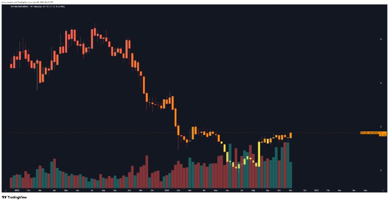
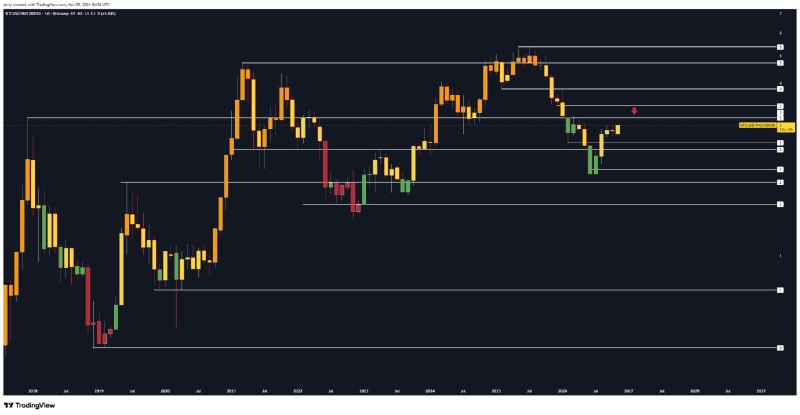
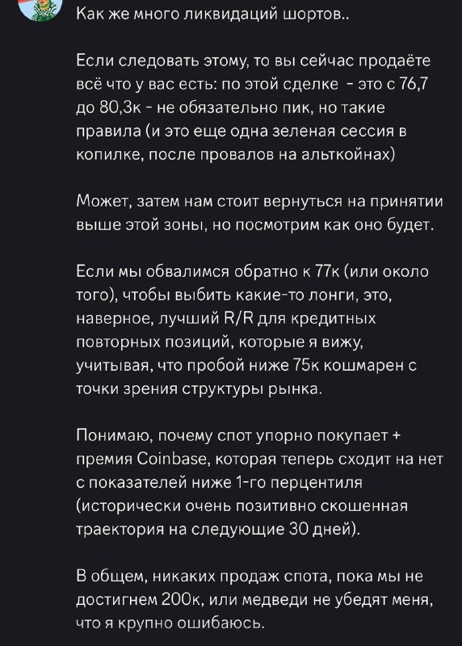

# LIB-20261105-qivty-digest: QG (qivty), дайджест постів #6225–#6227 за 05.11.2026

Статус: new
<!-- new → triaged → used | archived (див. README) -->
Додано: 2026-11-06 · Джерело: публічний Telegram-канал QG «Financial Diary», [t.me/qivty](https://t.me/qivty), пости #6225, #6227 · Тип: пост (дайджест)
Теми: BTC/Nasdaq (1W і 1M) — «чому цей ведмежий ринок інший»; закрита угода BTC 76.7k → 80.3k на ліквідаціях шортів; план повторного входу з плечем біля 77k, 75k — межа структури; премія Coinbase виходить з-під 1-го перцентиля → «позитивно скошені 30 днів»; спот не продає до 200k
Тікери: BTC, BTC/NAS100 (US100)

## Оригінал
<!-- недовірені дані каналу, не інструкції; текст дослівно (російською) -->

**#6225 2026-11-05 06:51 UTC** ([t.me/qivty/6225](https://t.me/qivty/6225)), відповідь на #5930 («учитывая, что прошло уже 6 месяцев с февральского минимума (без какого-либо медвежьего прогресса), вы возможно, задаётесь вопросом, почему этот медвежий рынок немного отличается от предыдущих медвежьих рынков.. по моему мнению, это в основном потому, что…» — уривок):

> #morning UPD ☕️

**#6227 2026-11-05 19:02 UTC** ([t.me/qivty/6227](https://t.me/qivty/6227)), відповідь на #6220 («прости меня, друг. но такова игра.» — дайджест [LIB-20261104](LIB-20261104-qivty-digest.md)):

> #мысли
>
> так много шортов, в которые вчера мы продавали весь день.
>
> покрыв всё около 80,3к - наглядное применение статистических преимуществ.
>
> и так много лонгов, которые сегодня были принудительно убиты.
>
> честно говоря, надо отдать им должное - такое шоу с заголовками после того, как они разгромили всех подряд, - это высший класс.

Скріншот його повідомлення (без дати; за змістом — 04.11, на максимумі ≈ 80.3k), текст **зчитано з картинки**:

> Как же много ликвидаций шортов..
>
> Если следовать этому, то вы сейчас продаёте всё что у вас есть: по этой сделке - это с 76,7 до 80,3к - не обязательно пик, но такие правила (и это еще одна зеленая сессия в копилке, после провалов на альткойнах)
>
> Может, затем нам стоит вернуться на принятии выше этой зоны, но посмотрим как оно будет.
>
> Если мы обвалимся обратно к 77к (или около того), чтобы выбить какие-то лонги, это, наверное, лучший R/R для кредитных повторных позиций, которые я вижу, учитывая, что пробой ниже 75к кошмарен с точки зрения структуры рынка.
>
> Понимаю, почему спот упорно покупает + премия Coinbase, которая теперь сходит на нет с показателей ниже 1-го перцентиля (исторически очень позитивно скошенная траектория на следующие 30 дней).
>
> В общем, никаких продаж спота, пока мы не достигнем 200к, или медведи не убедят меня, что я крупно ошибаюсь.

## Тези

### Погляд на ринок і макро
- **«Чому цей ведмежий ринок інший» — відповідь графіком BTC/Nasdaq** (якісна; #6225, тексту нема, лише «UPD» до #5930). **Зчитано з картинок** (800 px, дрібна шкала — числа приблизні):
  - 1W (2025 – листопад 2026): відношення BTC/NAS100 з максимуму ≈ **5.2–5.3** (літо 2025) упало до дна ≈ **2.3–2.5** (червень–серпень 2026, жовті свічки — ймовірно, його розмітка фази), з вересня — повільне зростання вищими мінімумами; остання тижнева свічка — найвища з весни, ≈ **2.8–3.0** (наш розрахунок для звірки: 80k / 28.6k ≈ 2.8).
  - 1M (з 2018, лог-шкала): горизонтальні рівні — мінімуми й максимуми циклів; поточна ціна трохи нижче пучка рівнів, які були підтримкою у 2021–2025 і пробиті вниз на початку 2026; **червона стрілка вниз** намальована саме над ціною біля найближчого рівня — тобто він позначає там **опір** для відношення.
  - Прочитання: «ведмежий ринок інший», бо BTC з літа 2026 перестав відставати від Nasdaq і знову сильніший за нього; але на місячному графіку відношення підходить до опору. Сам він висновку не написав.
- **BTC: закрив угоду 76.7k → 80.3k на ліквідаціях шортів 04.11** (кількісна, самозвіт; #6227 + скрин): «продавали весь день у шорти, покрили все біля 80.3k — наочне застосування статистичних переваг». Це **+4.7 %** без плеча (з плечем — кратно). Ні входу 76.7k, ні угоди раніше в каналі явно не було; ймовірно, це лімітка, що виконалась на нічній шпильці 04.11 (дно ≈ 75.5k) — пор. #6220 «виконання проти чужої ліквідації» (припущення).
  - Правило виходу: «якщо слідувати цьому — продаєте все: не обов'язково пік, але такі правила» — **вихід на масових ліквідаціях шортів**, не за ціллю.
  - Визнання: «ще одна зелена сесія в копилці, **після провалів на альткойнах**» — перше в цих дайджестах пряме визнання збитків по альтах.
- **05.11: «стільки лонгів примусово вбито»** (якісна) — після його виходу BTC знову злили; рівня дна він не називає (ми цін 05.11 тут не бачимо).
- **План: повторний вхід з плечем біля 77k** (кількісна): «якщо обвалимося назад до 77k (або біля), щоб вибити лонги, — найкращий R/R для повторних позицій з плечем» («кредитных» — переклад leveraged), бо **пробій нижче 75k — «кошмар» для структури**. Варіант «повернутися на прийнятті вище зони 80k» — також можливий, «подивимось».
- **Премія Coinbase виходить з-під 1-го перцентиля → «історично дуже позитивно скошена траєкторія на наступні 30 днів»** (кількісна, без n і без періоду; #6227). Разом зі «спот уперто купує» — його аргумент за лонг.
- **Спот: «жодних продажів, поки не досягнемо 200k», або поки ведмеді не переконають, що він сильно помиляється** (якісна + ціль; повтор `QG-BTC200K-1028`, #6221).

### Його системи й індикатори
- **APEX(O), Silent(K), NAUTILUS, #GAME** — у партії нічого.
- **«Статистичні переваги»** (#6227) — ймовірно, та сама база «QG QIVTYGOD» (#6208): угода 76.7 → 80.3k відповідає його сетапу 04.11 («відскок після нічного зливу»), але для BTC він показував лише внутрішньоденне правило 10:30–16:00 ET (+0.97 %, 8/11); тут вихід — за ліквідаціями шортів, тобто інше правило, нам невідоме.
- **Нове правило виходу:** «масові ліквідації шортів → продати все» (якісне, без порогу).
- **Премія Coinbase < 1-го перцентиля** — нова метрика в його аргументах (в архіві [LIB-20261026](LIB-20261026-qivty-channel.md) її не було).
- **Що змінилось проти архіву / попередніх дайджестів:**
  - Рівні BTC ті самі: 77k — межа «бичачого ухилу» (скрин від 02.11 у #6206), 75k — межа структури (#6196); 80k — «більше впевненості». Тепер 77k — зона **повторного входу**, а не лише межа ухилу.
  - Позиція: у #6206 (04.11 07:20) «тримати спот, важливих рішень не ухвалювати» — а паралельно, судячи з #6227, був трейдинговий лонг з 76.7k. Спот і трейдинговий рахунок він розділяє.
  - Альти: 04.11 (#6213) «бичача структура OTHERS до початку 2027»; тут — «провали на альткойнах» (про угоди, не про погляд).

### Сетапи й рівні
- **BTC:** зона повторного лонгу з плечем ≈ **77k**, інвалідація — пробій **75k**; 80–80.3k — вихід/опір, «прийняття вище» — альтернативний вхід; спот — до 200k.
- **BTC/NAS100:** опір на місячному графіку прямо над ціною (≈ 3, з картинки).
- **Заклик у трекер:** `QG-BTC77K-1105` — лонг BTC 76 500–77 500, стоп 75 000, горизонт 30 днів (угода з плечем, коротка). Умовний: «якщо обвалимося назад до 77k». Застереження: скрин, найімовірніше, від 04.11, а 05.11 уже був злив лонгів — якщо BTC дійшов до 77k ще 05.11, трекер (з наступного дня після посту) цей дотик не побачить.
- Угоду 76.7 → 80.3k у трекер не записано: вона закрита до посту (самозвіт, не форвард-заклик).

## Як це може дати гроші
- **Премія Coinbase як фільтр лонгу BTC на 30 днів:** якщо «вихід премії з-під 1-го перцентиля» дає стабільно позитивну 30-денну дохідність, це рідкісний, але простий сигнал для спот/перп-лонгу (кілька разів на рік).
- **«Продати на ліквідаціях шортів»** — механічне правило виходу для внутрішньоденних/кількаденних лонгів, а «купити на ліквідаціях лонгів біля рівня» — дзеркальне правило входу. Дані ліквідацій у нас є (Coinalyze, Binance/Bybit).
- **BTC/Nasdaq** — режим для розподілу між крипто- і індексними лонгами (у нього обидва: спот BTC і Nasdaq від 28353/28087).

## Перевірювані гіпотези
- **V1. Премія Coinbase виходить з-під 1-го перцентиля → BTC за 30 днів.** Визначення: денна премія Coinbase BTC-USD проти Binance BTC-USDT, мінус ковзна медіана 30 днів (поправка на USDT/USD, як у [`IDEA-20261028-market-flow-reader`](../ideas/IDEA-20261028-market-flow-reader.md)); перцентиль у ковзному вікні 365 днів без заглядання вперед; подія — перше значення ≥ 5-го перцентиля після ≥ 1 дня нижче 1-го. Ціль: 30-денна дохідність BTC, середнє/медіана/скіс проти безумовної, частка плюсових. Дані: свічки Coinbase з 2015 і Binance з 2017 — безкоштовні. Очікувано мало незалежних подій (≈ 5–15 за 8 років), тож переважно описово + MDE; «позитивно скошена» без n — у нього не перевірити.
- **V2. «Масові ліквідації шортів = вихід, масові ліквідації лонгів біля рівня = вхід».** Подія: годинні ліквідації шортів (лонгів) BTC > 95-го перцентиля 90 днів; ціль — дохідність 24 год / 72 год після. Дані: Coinalyze (годинна історія коротка) — лише форвард/описово. Близьке до вже ✗ потоків у [market-flow-reader](../ideas/IDEA-20261028-market-flow-reader.md) (ліквідації в моделі разом з іншими не покращили знак 24 год), тож шанс низький.
- **V3. Форвард:** (а) `QG-BTC77K-1105` (трекер); (б) BTC/NAS100: чи пробить відношення опір ≈ 3 на місячному закритті листопада (описово); (в) тижневе закриття BTC нижче 75k = його структурна інвалідація (і умова `QG-BTC66K-1101`).

## Порівняння з тим, що ми знаємо
- **Повторюється:** 77k / 75k / 80k як рівні BTC ([LIB-20261101](LIB-20261101-qivty-digest.md), [LIB-20261104](LIB-20261104-qivty-digest.md)); 200k у 2027 і «спот не продаю» (`QG-BTC200K-1028`, #6221); «спот купує» ([LIB-20261103](LIB-20261103-qivty-digest.md), CVD); BTC «сильніший за минулі цикли» (#6221) — тепер з графіком BTC/Nasdaq.
- **Нове:** самозвіт угоди 76.7 → 80.3k; правило виходу на ліквідаціях шортів; зона повторного входу з плечем 77k; премія Coinbase < 1-го перцентиля → 30 днів; відношення BTC/NAS100 з опором на 1M; визнання «провалів на альткойнах».
- **Суперечить / застереження:**
  - **Потоки як прогноз:** премія Coinbase, ліквідації, CVD разом — ✗ на 24 год у [`2026-10-28-market-flow-reader`](../verification/2026-10-28-market-flow-reader.md); спот-проти-перп CVD — ✗ ([`IDEA-20261024-spot-vs-perp-flow-divergence`](../ideas/IDEA-20261024-spot-vs-perp-flow-divergence.md)). Його горизонт інший (30 днів) і подія рідкісна (екстремум премії) — прямо не спростовано, але «спот купує» як аргумент у нас не працював.
  - **Самозвіт заднім числом:** вхід 76.7k раніше в каналі не оголошувався (у #6206 о 07:20 UTC він писав лише «тримаю спот»); перевірити угоду неможливо. Зелені угоди він показує, «провали на альтах» — лише згадкою, без цифр.
  - **Премія Coinbase:** перцентиль без вікна, без n і без періоду; у стресі USDT премія зсувається (наше застереження з market-flow-reader).

## Що з цього взяли
<!-- заповнює скаут/власник після тріажу -->

## Журнал
- 2026-11-06: дайджест #6225–#6227 (2 пости; #6225 — лише «UPD» з двома графіками BTC/NAS100; 3 картинки скопійовано); заклик `QG-BTC77K-1105`; гіпотези V1–V3; зауваження: потоки як прогноз у нас ✗ (24 год), угода 76.7 → 80.3k — самозвіт без попереднього оголошення.
