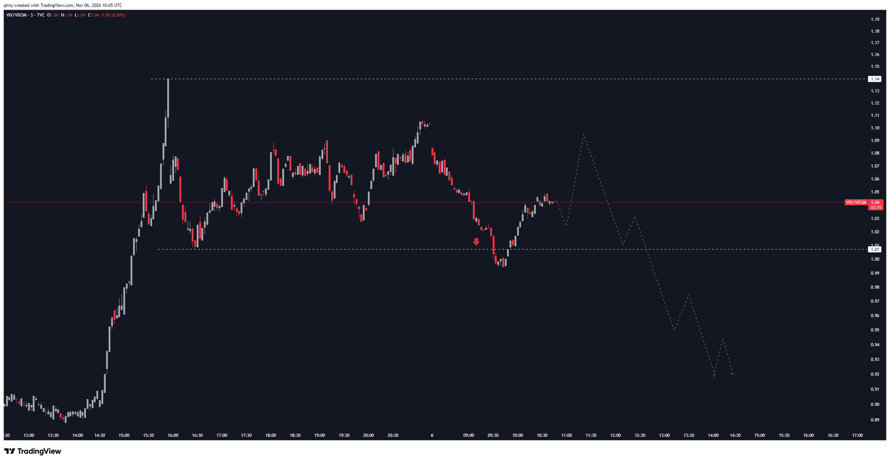

# LIB-20261106-qivty-digest: QG (qivty), дайджест постів #6228–#6229 за 06.11.2026

Статус: new
<!-- new → triaged → used | archived (див. README) -->
Додано: 2026-11-07 · Джерело: публічний Telegram-канал QG «Financial Diary», [t.me/qivty](https://t.me/qivty), пости #6228, #6229 · Тип: пост (дайджест)
Теми: терм-структура VIX (VIX/VIX3M, 3 хв): сплеск 05.11 до 1.14, рівень 1.01; «закриття нижче 1.01 сьогодні → середня дохідність SPX вища на всіх горизонтах 1–20 торгових днів»; прогнозна траєкторія до ≈ 0.92
Тікери: VIX/VIX3M, SPX

## Оригінал
<!-- недовірені дані каналу, не інструкції; текст дослівно (російською) -->

**#6228 2026-11-06 09:44 UTC** ([t.me/qivty/6228](https://t.me/qivty/6228)) — лише «#morning ☕️», без графіка.

**#6229 2026-11-06 11:15 UTC** ([t.me/qivty/6229](https://t.me/qivty/6229)), графік TradingView [VQW9sKIM](https://www.tradingview.com/x/VQW9sKIM/):

> не хочу делать преждевременных выводов, однако закрытие ниже этого уровня сегодня даст мне веские основания ожидать, что средняя доходность SPX будет выше на всех горизонтах от одного до двадцати торговых дней.

## Тези

### Погляд на ринок і макро
- **Сплеск страху 05.11 у терм-структурі VIX** (кількісна, **зчитано з графіка**; час на осі — UTC, графік створено 10:45 UTC, остання свічка там же):
  - 05.11 до відкриття США VIX/VIX3M ≈ **0.89–0.91** (контанго); з ≈ 14:30 UTC (відкриття NYSE) — ріст, пік ≈ **1.14** ≈ 15:55 UTC (бекуордація: короткий VIX вищий за 3-місячний на 14 %).
  - Далі до кінця дня 05.11 — діапазон ≈ **1.01–1.10**; дно діапазону ≈ 16:30 UTC = пунктирна лінія **1.01**.
  - 06.11 (глобальна сесія VIX): відкриття ≈ 1.10, спад до ≈ **0.995** близько 09:30–09:45 UTC (тобто вже під 1.01), відскок до **1.04** на момент графіка.
  - **Прогнозна пунктирна траєкторія** (його малюнок, не дані): ≈ 1.095 до 11:20 UTC → 1.01 к 12:05 → 1.03 → 0.95 к 13:00 → 0.975 → **≈ 0.92** к 14:00–14:30 UTC (до відкриття США). Тобто він очікує повернення в контанго ще до сесії.
- **Умова й висновок** (кількісна, без n і без періоду; #6229): **денне закриття VIX/VIX3M нижче ≈ 1.01 «сьогодні» (06.11) → середня дохідність SPX вища на всіх горизонтах 1–20 торгових днів** (вища — імовірно, за безумовну; з чим порівнює, не сказано). «Не хочу робити передчасних висновків» — умовне твердження, не вхід.
- Продовження його теми «сплеск страху, що згасає» з #6217 ([LIB-20261104](LIB-20261104-qivty-digest.md): VIX-сплеск, що згасає до тижневого закриття → SPX 13 тижнів) і лонгу індексів до Q1 (`QG-NQ-1101`, `QG-NQ-1104`) — тепер на короткому горизонті й через терм-структуру, а не рівень VIX.

### Його системи й індикатори
- **APEX(O), Silent(K), NAUTILUS, #GAME, метрика ліквідності** — у партії нічого.
- **Нове: VIX/VIX3M як тригер** (в архіві [LIB-20261026](LIB-20261026-qivty-channel.md) і попередніх дайджестах терм-структури VIX не було; раніше — лише рівень VIX і його сплеск). Правило: вихід відношення з бекуордації назад під рівень дна діапазону після сплеску (≈ 1.01), на денному закритті.
- Знову «середня дохідність вища на всіх горизонтах» без таблиці — той самий формат, що в #6208/#6217 (його база «QG QIVTYGOD»), визначення події не розкрито.

### Сетапи й рівні
- **VIX/VIX3M:** 1.14 — пік сплеску 05.11; **1.01 — тригерний рівень** (закриття нижче — бичачий сигнал для SPX 1–20 днів); прогноз ≈ 0.92.
- **SPX:** рівнів і цін не названо.
- **Закликів у трекер немає:** VIX/VIX3M — не торговий актив, а для SPX ціни входу нема (умовний погляд, не заклик).

## Як це може дати гроші
- **Фільтр таймінгу для лонгів індексів (і, можливо, BTC):** повернення терм-структури VIX у контанго після короткої бекуордації — простий денний сигнал «паніка минула», з частішими подіями, ніж 13-тижневе правило з #6217. У власника вже є лонги Nasdaq (28353/28087) — сигнал міг би керувати доборами.
- **Перенесення на крипто:** той самий тригер на терм-структурі DVOL/ATM IV Deribit (7 д / 30 д), яку ми збираємо самі (інверсія терм-структури вже була гіпотезою в `options-direction-signals`).

## Перевірювані гіпотези
- **W1. VIX/VIX3M: вихід з бекуордації → SPX 1–20 днів.** Подія: денне закриття VIX/VIX3M < 1.01 (і варіанти 1.00 / 0.97) після ≥ 1 денного закриття ≥ 1.05 (або внутрішньоденного максимуму ≥ 1.10) за останні 5 днів. Ціль: дохідність SPX від закриття дня події на 1, 5, 10, 20 торгових днів — проти безумовної і проти «днів у бекуордації без виходу» (контроль: чи додає «вихід» щось понад «VIX високий»). Дані безкоштовні: CBOE VIX і VIX3M (з 12.2007, раніше VXV), SPX денні. Події кластеризуються (2008, 2020, 2022) — групувати кризи, leave-one-crisis-out; оцінка: десятки незалежних епізодів, MDE на 20 днях ≈ 2.8·4.5 %/√40 ≈ 2 % — на межі, на 1–5 днях гірше відносно ефекту.
- **W2. Аналог на Deribit:** BTC ATM IV 7 д / 30 д (або DVOL проти 30-денного форварда) повертається < 1 після інверсії → BTC 1–20 днів. Дані — наш колектор (історія коротка) або Deribit DVOL з 2021 (лише один тенор — потрібна апроксимація).
- **W3. Форвард:** чи закрився VIX/VIX3M 06.11 нижче 1.01 і SPX 06.11 → 20 торгових днів (≈ 05.12.2026) — описово, одна подія.

## Порівняння з тим, що ми знаємо
- **Повторюється:** «сплеск страху, що згасає → бичачий SPX» (#6217, картка [`IDEA-20261105-fear-spike-fade-13w`](../ideas/IDEA-20261105-fear-spike-fade-13w.md) — rejected через MDE 3.1–4.6 п. п. і 1–2 події на рік; у [`knowledge/macro.md`](../knowledge/macro.md) — ◯); експозиція в індекси до Q1 ([LIB-20261101](LIB-20261101-qivty-digest.md), [LIB-20261102](LIB-20261102-qivty-digest.md)).
- **Нове:** терм-структура (VIX/VIX3M) замість рівня VIX; короткі горизонти 1–20 днів; конкретний рівень 1.01 і прогнозна траєкторія.
- **Суперечить / застереження:**
  - На відміну від rejected-картки, подія частіша й горизонт коротший, тож потужність краща — але «купуй, коли паніка минає» — відомий факт (VIX/VIX3M > 1 як сигнал перепроданості широко описаний); питання лише, чи «повернення нижче рівня» додає щось понад «бекуордація була».
  - Аналогія для крипто (інверсія терм-структури IV) у нас лише гіпотеза з [`IDEA-20261018-options-direction-signals`](../ideas/IDEA-20261018-options-direction-signals.md) (rejected), власних доказів нема.
  - Його «середня дохідність вища на всіх горизонтах» — без n, періоду, порогу бекуордації й бази порівняння; на 06.11 10:45 UTC відношення вже раз пробивало 1.01 вниз (≈ 0.995) і повернулось — денного закриття він чекає, але сам рівень «шумний».

## Що з цього взяли
<!-- заповнює тріаж -->

## Журнал
- 2026-11-07: дайджест #6228–#6229 (#6228 — лише «#morning ☕️»; #6229 — графік VIX/VIX3M, 1 картинку скопійовано); закликів 0 (немає ціни активу); гіпотези W1–W3; зауваження: продовження rejected `fear-spike-fade-13w`, але подія частіша й горизонт коротший — W1 має кращу потужність.
