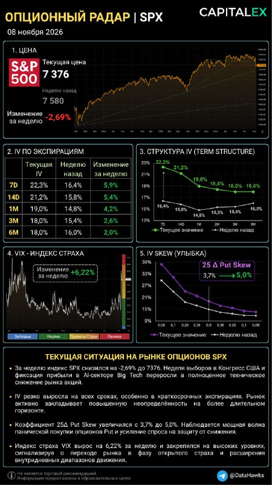
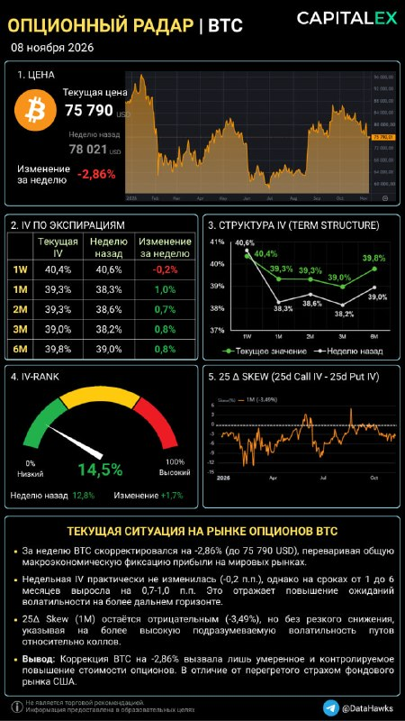

# LIB-20261108-datahawks-spx-btc-radar: «Опціонний радар» SPX і BTC 08.11: шок SPX 05.11 (−4.4 %), повна інверсія кривої; BTC спокійний

Статус: new
<!-- new → triaged → used | archived (див. README) -->
Додано: 2026-11-08 · Джерело: Telegram-канал @DataHawks, [t.me/DataHawks/1147](https://t.me/DataHawks/1147) (автоматичне стеження за каналом) · Тип: пост
Теми: ATM IV за строками, term structure, інверсія кривої після шоку, VIX, 25Δ put skew, IV Rank, розбіжність SPX і BTC, ставка ФРС, регулювання AI
Тікери: SPX (VIX, Nasdaq), BTC

## Оригінал

Пост 2026-11-08 18:36 UTC, [t.me/DataHawks/1147](https://t.me/DataHawks/1147). Текст — недовірені дані каналу, дослівно:

> 📡ОПЦИОННЫЙ РАДАР | SPX & BTC
> 8 ноября 2026
>
> Главные события прошлой недели
> Победа демократов на выборах в Конгресс. Рынок опасается, что усиление позиций демократов приведет к более жесткому регулированию AI-индустрии, в частности строительства дата-центров. Это вызвало распродажу акций компаний, связанных с AI-инфраструктурой и полупроводниками.
> Резкое падение технологического сектора. В четверг, 5 ноября, S&P 500 потерял около 4,4% – это худшая дневная динамика с апреля 2025 года. Nasdaq снизился на 5,5%. Особенно сильно пострадали производители чипов и компании, связанные со строительством дата-центров.
> Дополнительное давление со стороны макростатистики. В пятницу данные по рынку труда США оказались сильнее ожиданий: безработица снизилась до 4,1%. Это усилило ожидания повышения ставки ФРС уже в декабре. Впрочем, в пятницу технологический сектор частично отыграл предыдущее падение.
>
> Интересно посмотреть, как на это отреагировали рынки опционов SPX и BTC по итогам недели.
> Фондовый рынок | SPX
> S&P 500 снизился на 2,69% до 7 376 пунктов.
> На этом фоне произошел существенный рост подразумеваемой волатильности на всех сроках:
> 🟢7D: +5,9 п.п.
> 🟢14D: +5,4 п.п.
> 🟢1M: +4,2 п.п.
> 🟢3M: +2,6 п.п.
> 🟢6M: +2,0 п.п.
> VIX вырос на 6,22%, а 25Δ Put Skew увеличился с 3,7% до 5,0%.
> 👉Это говорит не только о росте ожиданий волатильности, но и об усилении спроса на защиту от дальнейшего снижения. Причем повышенная IV сохраняется и на дальних экспирациях, что говорит о более широком горизонте неопределенности.
>
> Крипторынок | BTC
> Биткоин за неделю потерял 2,86%, опустившись до $75 790. Однако реакция опционного рынка оказалась значительно сдержаннее:
> 🟢Недельная IV практически не изменилась: -0,2 п.п.
> 🟢На сроках от 1 до 6 месяцев IV выросла на 0,7-1,0 п.п.
> 🟢IV Rank поднялся с 12,8% до 14,5%, но остается на низком уровне.
> 🟢25Δ Skew сохраняет отрицательное значение (-3,49%), но без усиления падения.
> 👉Таким образом, несмотря на снижение BTC, рынок пока не закладывает резкого всплеска краткосрочной волатильности. При этом небольшой рост IV на более дальних сроках указывает на постепенное увеличение ожиданий неопределенности.
> #OptionsRadar (?q=%23OptionsRadar)
>
> 📚Обучение торговле опционами | CAPITALEX (https://capitalex.pro/)

**Числа з картинок** (прочитано з зображень, не з даних; 450×800, дрібне прочитано наближено):

SPX: ціна 7 376 (тиждень тому 7 580, −2.69 %); VIX за тиждень +6.22 % (відносна зміна; рівня числом на картинці нема); 25Δ Put Skew 3.7 → 5.0 %; усмішка вища за тижневу на всіх дельтах.

| Строк SPX | IV зараз | Тиждень тому | Зміна |
|---|---|---|---|
| 7D | 22.3 % | 16.4 % | +5.9 п. |
| 14D | 21.2 % | 15.8 % | +5.4 п. |
| 1M | 19.0 % | 14.8 % | +4.2 п. |
| 2M (лише на графіку) | 18.4 % | 15.3 % | +3.1 п. (за різницею) |
| 3M | 18.0 % | 15.4 % | +2.6 п. |
| 6M | 18.0 % | 16.0 % | +2.0 п. |

BTC: ціна 75 790 USD (тиждень тому 78 021, −2.86 %); IV Rank 14.5 % (тиждень тому 12.8 %, +1.7); 25Δ skew (25d Call IV − 25d Put IV, 1M) −3.49 % (01.11: −4.60 %).

| Строк BTC | IV зараз | Тиждень тому | Зміна |
|---|---|---|---|
| 1W | 40.4 % | 40.6 % | −0.2 п. |
| 1M | 39.3 % | 38.3 % | +1.0 п. |
| 2M | 39.3 % | 38.6 % | +0.7 п. |
| 3M | 39.0 % | 38.2 % | +0.8 п. |
| 6M | 39.8 % | 39.0 % | +0.8 п. |

Колонки «тиждень тому» обох таблиць, ціни, IV Rank і put skew збігаються з радаром 01.11 ([LIB-20261101-datahawks-spx-btc-radar](LIB-20261101-datahawks-spx-btc-radar.md)) до десятої. Арифметика змін у таблицях точна.

## Тези

**Макрофон (усе — зі слів автора, ми не перевіряли)**

1. **Перемога демократів на виборах до Конгресу → ринок боїться жорсткішого регулювання AI, зокрема будівництва дата-центрів → розпродаж AI-інфраструктури й напівпровідників.** *Якісна, причинно-наслідковий наратив.*
2. **Четвер 05.11: S&P 500 ≈ −4.4 %, найгірший день з квітня 2025; Nasdaq −5.5 %.** Найбільше постраждали виробники чипів і компанії, пов'язані з будівництвом дата-центрів. *Кількісна.*
3. **П'ятниця 06.11: ринок праці сильніший за очікування, безробіття знизилось до 4.1 % → зросли очікування підвищення ставки ФРС уже в грудні.** Того ж дня техсектор частково відіграв падіння. *Кількісна (4.1 %); «підвищення в грудні» — якісна, ймовірність не названа.*

**SPX**

4. **SPX за тиждень −2.69 % (7 580 → 7 376).** *Кількісна.*
5. **IV виросла на всіх строках, найбільше на фронті:** 7D +5.9 п. до 22.3 %, 14D +5.4 п. до 21.2 %, 1M +4.2 п. до 19.0 %, 3M +2.6 п., 6M +2.0 п. *Кількісна.*
6. **VIX +6.22 % за тиждень; на картинці — «закріпився на високих рівнях», «фаза відкритого страху».** *Кількісна (зміна), опис — якісний; див. суперечність нижче.*
7. **25Δ put skew 3.7 → 5.0 %: посилення попиту на захист; на картинці — «потужна хвиля панічної купівлі Put».** *Кількісна (число), «панічна» — оцінка.*
8. **Висока IV зберігається і на дальніх строках → ширший горизонт невизначеності.** *Числа кількісні (3M 18.0 %, 6M 18.0 %), висновок якісний.*

**BTC**

9. **BTC −2.86 % до 75 790 USD.** *Кількісна.*
10. **Реакція опціонів значно стриманіша: 1W −0.2 п., 1M–6M +0.7…+1.0 п.** *Кількісна.*
11. **IV Rank 12.8 → 14.5 %, лишається низьким.** *Кількісна.*
12. **25Δ skew (1M) −3.49 %, «без посилення падіння».** *Кількісна.* Точніше: за тиждень скью став менш від'ємним (−4.60 → −3.49, +1.11 п.), хоч ціна падала.
13. **Ринок не закладає різкого сплеску короткострокової волатильності, невеликий ріст дальніх строків = поступове зростання невизначеності.** На картинці: корекція спричинила «лише помірне й контрольоване подорожчання опціонів, на відміну від перегрітого страхом фондового ринку». *Числа кількісні, висновок якісний.*

Конкретних закликів (зона входу з ціною) і позицій навчального портфеля в пості нема.

## Як це може дати гроші

Усі розрахунки — наші, з чисел картинки (сумарна дисперсія, T = дні/365).

- **Режим на тиждень 09–15.11 для асистента.** SPX: 7D 22.3 % ≈ ±3.1 % за тиждень (1 σ, ≈ ±228 п. від 7 376), 1M ≈ ±5.4 %. BTC: 1W 40.4 % ≈ ±5.6 % (≈ ±4.2k від 75 790). Наш календар: **CPI 10.11, 13:30 UTC**, FOMC 09.12. Діють [macro-rules](../knowledge/macro-rules.md): за 48 год до CPI менший розмір або обмежений ризик (BTC за 2 год після CPI ×1.79).
- **Форма кривої SPX змінилась.** Тиждень тому — «дуга» з мінімумом на 1M; тепер монотонне падіння 22.3 > 21.2 > 19.0 > 18.4 > 18.0 = 18.0. 7D − 1M = 3.3 п. (було 1.6), 7D − 3M = 4.3 п. (було 1.0). Надлишок 7D над 1M ≈ ±1.6 % (1 σ, було ±1.0 %). Форвард 7D→1M ≈ 17.9 % проти 14.3 %, тобто переоцінено весь місяць, а не лише тиждень.
- **BTC відносно SPX подешевшав.** Відношення IV BTC/SPX: 1M 2.07 (було 2.59), 7D 1.81 (було 2.48). Форвард BTC 1W→1M ≈ 39.0 % (було 37.6 %), 1W − 1M звузився до 1.1 п. (було 2.3). Це не сигнал: правило «низький IV Rank → купувати» в нас ≈ 0 після хеджу (H1 архіву), а SPX ми не торгуємо.
- **Заклики в трекері поруч із ринком** (ціни — з цього поста, рух перевірить трекер): BTC 75 790 — нижче зони `QG-BTC77K-1105` (76 500–77 500) і на ≈ 1 % вище її стопу 75 000; пробій 75k активує умову `QG-BTC66K-1101`. Лонги Nasdaq `QG-NQ-1101` (28353) і `QG-NQ-1104` (28087) набрано перед днем −5.5 %.

## Перевірювані гіпотези

**Закриті прогнози попередніх записів (один епізод, описово):**

- **G1, ч. 2 (радар 25.10): 7D SPX у радарі 08.11 < 14 %.** Факт: 22.3 %, ✗. Crush виборчої премії не вдалося побачити: новий шок 05.11 його перекрив.
- **M1 ([midterms](LIB-20261104-datahawks-midterms.md)): 1W ATM BTC < 38 %, а 30D змінився менше за 1W.** Факт: 1W 40.4 % (−0.2 п.), 1M +1.0 п., ✗ обидві частини. Числа каналу; нашим колектором не звірено.
- **K3 (радар 01.11): рух SPX проти імплайду.** За підсумком тижня −2.69 % ≈ −1.18 σ проти 7D 16.4 % (±2.27 %): у межах норми. Але день 05.11 −4.4 % ≈ −4.3 σ денного руху (16.4 %/√252 ≈ 1.03 %) і у 4 рази більше за подієвий надлишок ±1.0 %. Решта чотирьох сесій разом ≈ +1.8 %. За словами автора, причина — не підрахунок голосів, а AI-регулювання і напівпровідники. Сам BTC за тиждень −0.51 σ (±5.6 %).

**Нові:**

- **R1 — BTC-вола відстає від шоку SPX?** Подія: тиждень SPX ≤ −2.5 % зі стрибком VIX. Вимір: зміна DVOL за 7 і 14 днів проти контролю (ті самі тижні без шоку SPX). Прогноз із поста («стримана реакція»): BTC-вола не наздоганяє (DVOL +≥ 3 п. за 14 днів не частіше, ніж у контролі). *Дані:* DVOL з 2021 є, VIX/SPX денні (CBOE) — зовнішні. n оцінково кілька десятків тижнів, кластери (2022, 2025); точне n порахувати перед тестом.
- **R2 — звірка VIX 06.11.** VIX закриття 06.11 проти 19.4 × 1.0622 ≈ 20.6 і VIX/VIX3M цього дня. Якщо VIX ≥ 22, то +6.22 % у радарі — неузгодженість даних або часу зрізу. *Дані:* CBOE, ззовні (◯ локально).
- **R3 — згасання інверсії SPX.** Без нового шоку радар 15.11: 7D − 1M ≤ 1.5 п. (зараз 3.3) і 7D < 20 %. Один епізод, описово, CPI 10.11 — перешкода.
- **K2 на цю дату.** Наші 7D/30D/60D/90D/180D ATM BTC на 08.11 19:00 UTC проти 40.4 / 39.3 / 39.3 / 39.0 / 39.8, IV Rank 14.5 % і RR25 −3.49 (конвенція дельти в архіві лишається нерозв'язаною).

## Порівняння з тим, що ми вже знаємо

- **Повторюється** ([архів каналу](LIB-20261018-datahawks-options.md), [радар 01.11](LIB-20261101-datahawks-spx-btc-radar.md), [options](../knowledge/options.md), «Опціонний радар»): інверсія фронту, ріст put skew як страх, IV Rank як міра дешевизни, BTC-радар поряд із SPX.
- **Нове:**
  - повна інверсія кривої SPX після шоку (не подієва «дуга»): усі строки від 7D до 3M спадають;
  - макродвигун — регулювання AI і напівпровідники, а не AI-звіти, як 01.11;
  - сильний ринок праці → очікування **підвищення** ставки в грудні; у `knowledge/macro*` і листопадових записах бібліотеки такої теми досі не було, перевірити за ф'ючерсами на ставку;
  - розбіжність реакції SPX і BTC (BTC/SPX 1M 2.07 проти 2.59);
  - шок збігається з терм-структурою VIX у QG: VIX/VIX3M пік 1.14 05.11 ([LIB-20261106-qivty-digest](LIB-20261106-qivty-digest.md), W1–W3); цей запис дає рівні ATM, яких там нема.
- **Суперечить / слабке місце:**
  - **VIX не узгоджується зі своєю кривою.** Якщо рівень 01.11 був 19.4, то зараз ≈ 20.6 (наш розрахунок), різниця VIX − 1M ATM ≈ 1.6 п. проти 4.6 п. тиждень тому, тоді як 1M ATM зріс на 28 %, а put skew — на 1.3 п. VIX рахується з усієї усмішки, тому мав би зрости сильніше. За QG VIX/VIX3M 06.11 о 10:45 UTC (до сесії США) ще був 1.04, а 3M ATM тут 18.0 %, що також натякає на вищий VIX принаймні до відскоку. Можлива причина — різний час зрізу (після відскоку 06.11) або інша база; перевірка — R2. Рівня VIX на картинці числом нема, висновки про «високі рівні» й «відкритий страх» ≈ 20.6 не підтверджуються: це межа «норма/тривога», як і 01.11;
  - **«Потужна хвиля панічної купівлі Put»:** +1.3 п. менше, ніж 18.10 (2.4 → 4.1, +1.7 п.), хоч тиждень значно гірший. Слова сильніші за число;
  - **BTC, «без посилення падіння»:** скью фактично звузився на 1.11 п. Причини автор не дає. Зв'язок скью з подальшою ціною BTC у нас не підтверджено (`options-direction-signals`, rejected; [put-skew-v2](../verification/2026-10-14-put-skew-v2.md));
  - **«Обвал через регулювання AI»** — наратив; 01.11 той самий розпродаж канал пояснював звітами AI, а 04.11 результат виборів не супроводжував ринковими висновками. Причини ми не вимірюємо (B2, [macro](../knowledge/macro.md));
  - прогнози G1 і M1 не справдились (вище): подієва модель не враховує новий шок. Премії в дні подій ми й так не вважаємо доведеною перевагою ([news-reaction](../knowledge/news-reaction.md), [fomc-front-iv-crush](../ideas/IDEA-20261021-fomc-front-iv-crush.md) rejected);
  - SPX-опціонів у наших даних нема: SPX-радар не звіряємо. BTC-радар автора раніше збігався з Deribit до ≈ 1 вп (архів), цей зріз ще не звірений.
- **Закликів нема**, у `calls.csv` нічого не додано.

## Що з цього взяли
<!-- заповнюють агенти й Claude: картки IDEA-…, PR, інструменти, вердикти -->
