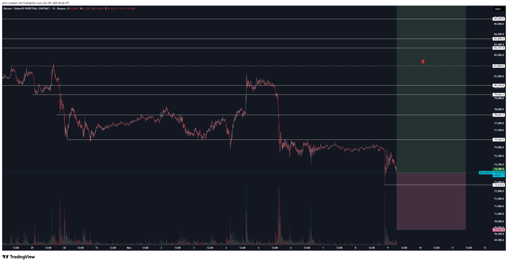
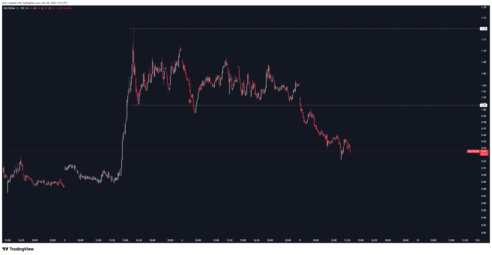
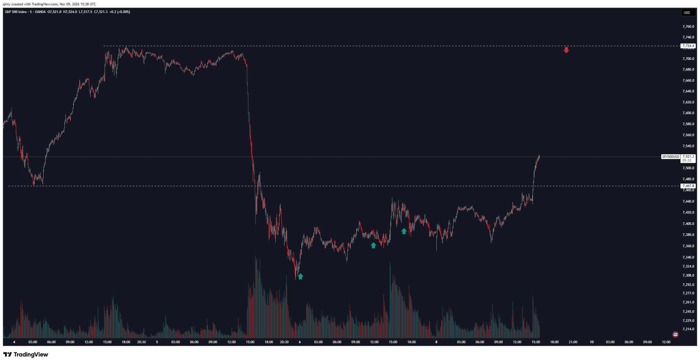

# LIB-20261109-qivty-digest: QG (qivty), дайджест постів #6230–#6232 за 09.11.2026

Статус: triaged
<!-- new → triaged → used | archived (див. README) -->
Додано: 2026-11-10 · Джерело: публічний Telegram-канал QG «Financial Diary», [t.me/qivty](https://t.me/qivty), пости #6230, #6231, #6232 · Тип: пост (дайджест)
Теми: BTC — лонг-позиція 74 181 зі стопом 70 382 після нічного зливу лонгів (рівні 73.3k–85.4k, червона стрілка на 81.8k); VIX/VIX3M — вихід з бекуордації 09.11 (0.93, мінімум ≈ 0.92) — продовження умови з #6229; SPX +1–2 % за день, повернення над 7 467.8, «реакція» з посиланням на медіану й частку успіхів
Тікери: BTC, VIX/VIX3M, SPX

## Оригінал
<!-- недовірені дані каналу, не інструкції; текст дослівно (російською) -->

**#6230 2026-11-09 06:49 UTC** ([t.me/qivty/6230](https://t.me/qivty/6230)), відповідь на #6227 («#мысли так много шортов, в которые вчера мы продавали весь день. наглядное применение статистических преимуществ. и так много лонгов, которые сегодня были принудительно убиты…» — дайджест [LIB-20261105](LIB-20261105-qivty-digest.md)), графік TradingView [yecAKjpR](https://www.tradingview.com/x/yecAKjpR/):

> что, если начать это утро так?
>
> #morning ☕️

**#6231 2026-11-09 13:55 UTC** ([t.me/qivty/6231](https://t.me/qivty/6231)), відповідь на #6229 (умова «закриття VIX/VIX3M нижче 1.01 → SPX вищий на 1–20 днів», [LIB-20261106](LIB-20261106-qivty-digest.md)), графік [k7ah0FVx](https://www.tradingview.com/x/k7ah0FVx/) — лише «👀».

**#6232 2026-11-09 15:39 UTC** ([t.me/qivty/6232](https://t.me/qivty/6232)), відповідь на #6229, графік [0W9wyntZ](https://www.tradingview.com/x/0W9wyntZ/):

> а вот и реакция, ребята.
>
> (особенно примечательна здесь не только медианная доходность относительно базового уровня, но и коэффициент успеха)

## Тези

### Погляд на ринок і макро
- **BTC: нічний злив 08→09.11** (кількісна, **зчитано з графіка** #6230): після тижня в діапазоні ≈ 75.0–76.4k (з 05.11) — шпилька вниз ≈ 21:30–22:00 UTC 08.11 до **≈ 73 333** (лінія на графіку) з об'ємним сплеском, відскок до ≈ 75.4k, на 06:40 UTC 09.11 — **74 167.5**. Контекст — його ж #6227 «стільки лонгів примусово вбито»: він читає це як ліквідацію лонгів, у яку варто купувати.
- **SPX відновлюється після обвалу 05.11** (кількісна, **з графіка** #6232): 05.11 з ≈ 7 710 (12:00 UTC) до ≈ **7 300** (06.11 ≈ 00:30 UTC) = **−5.3 %** за CFD OANDA; 06.11 — ≈ 7 330–7 440; 09.11 ранок ≈ 7 368 → ≈ 7 440 до 14:30 UTC → ривок на відкритті США до **7 521.3** (15:38 UTC): ≈ **+1.1 %** за годину, ≈ **+3.0 %** від дна 06.11. Повернувся над пунктиром **7 467.8** (мінімум 04.11, пробитий 05.11). До верхнього пунктиру **7 724.4** (максимум 04–05.11) лишається ≈ +2.7 %; червона стрілка вниз біля нього — імовірно, очікуваний опір / зона фіксації (інтерпретація).
- **Терм-структура VIX повернулась у контанго** (кількісна, **з графіка** #6231): 05.11 пік **1.14**, далі 1.01–1.10; 06.11 провал до ≈ 0.995 (≈ 09:30 UTC) і повернення — **закриття 06.11 ≈ 1.04, тобто умова #6229 у п'ятницю не виконалась**; 09.11 (понеділок) відкриття ≈ 1.02, пробій 1.01 одразу, мінімум ≈ **0.922** ≈ 12:45 UTC, **0.93** на 13:53 UTC. Його прогноз з #6229 (≈ 0.92) збувся за рівнем, але на 3 торгові дні пізніше намальованого (малював на 06.11 до відкриття США).
- **«Ось і реакція»** (якісна + посилання на кількісне без чисел, #6232): SPX вгору в день виходу VIX/VIX3M з бекуордації; він підкреслює «не лише медіанну дохідність відносно бази, а й коефіцієнт успіху» — тобто в нього є таблиця (медіана проти безумовної, частка позитивних), яку він не показує.
- Збігається з радаром [@DataHawks 08.11](LIB-20261108-datahawks-spx-btc-radar.md) (SPX 7 376, крива IV інвертована, put skew 3.7 → 5.0): тоді страх був на піку, QG ставив на його згасання.

### Його системи й індикатори
- **APEX(O), Silent(K), NAUTILUS, #GAME, метрика ліквідності** — у партії нічого.
- **VIX/VIX3M-тригер (#6229) — продовження:** нового правила немає; нове — **згадка метрик «медіана відносно бази» і «коефіцієнт успіху»** (раніше лише «середня дохідність вища на всіх горизонтах»). Визначення події, n і період досі не розкрито (той самий формат, що #6208/#6217 — його база «QG QIVTYGOD»).
- **Інструмент позиції TradingView з входом і стопом** (#6230) — у дайджестах з 01.11 він уперше малює повну позицію (вхід/стоп) на BTC; раніше — стрілки і рівні (#6176, #6201) або самозвіт після угоди (#6227). Горизонт коробки — до ≈ 11.11 12:00 UTC, тобто внутрішньотижнева угода, не спот.
- **Логіка входу (#6227 → #6230):** «ми продавали в шорти весь день, поки інші купували; сьогодні примусово вбили лонги — починаємо ранок з лонга» — контрарна угода проти чужої ліквідації, як у #6220 («виконання проти чужої ліквідації») і угоді 76.7 → 80.3k.

### Сетапи й рівні
- **BTC (#6230, з графіка):** лонг **74 180.9**, стоп **70 381.9** (ризик −5.1 %); зона прибутку коробки виходить за верх графіка (≥ ≈ 86k, точно не зчитується). Рівні: 73 333 (нічне дно), 76 444, 78 203.7, 79 666.2, 80 344.8, **81 800** (пунктир — подвійна вершина 28–29.10, червона стрілка вниз: імовірна зона фіксації), 83 157.9, 83 858.6, 85 399.5. Від 74 181 до 81 800 — +10.3 % (R:R ≈ 2.0); до ≈ 86.4k — +16.5 % (R:R ≈ 3.2).
- **SPX (#6232):** 7 467.8 — повернутий рівень (підтримка), 7 724.4 — опір / ціль (червона стрілка). Зелені стрілки вгору біля ≈ 7 300 (06.11 ≈ 00:30 UTC), ≈ 7 365 (06.11 ≈ 12:00) і ≈ 7 390 (06.11 ≈ 16:00) — імовірно, його покупки чи сигнали заднім числом; у тексті не названо → **не заклик**.
- **VIX/VIX3M:** 1.01 пробито вниз; 0.92 — досягнуто.
- **Заклики:** 1 — `QG-BTC74K-1109` (лонг 74 181, стоп 70 382; ціль не записано — коробка за межами графіка, 81 800 лише в примітці).

## Як це може дати гроші
- **Лонг BTC після нічного зливу лонгів** — та сама контрарна логіка, що у виграшній (за самозвітом) угоді 04.11; з повним входом/стопом її можна чесно відстежити в трекері.
- **Фільтр «паніка минула» для індексних лонгів власника** (NQ 28353/28087): день виходу VIX/VIX3M з бекуордації 09.11 збігся з +1–2 % SPX — якщо його статистика правдива, тримати/добирати до 20 торгових днів.

## Перевірювані гіпотези
- **X1. Лонг BTC від відкриття європейського ранку після нічного (Азія, 20:00–06:00 UTC) падіння ≥ 2 % з шпилькою ліквідацій лонгів** → дохідність на 1–3 дні проти безумовної; стоп −5 %. Дані: 1m/15m Binance перпи, ліквідації/OI (є з 2021). Близько до нашого ✗ `2026-10-14-liquidation-flush` і ◯ `oi-confirmed-liquidation-flush` (не пройшли ворота потужності) — нового механізму не видно, лише інший час входу (через 8–9 год після шпильки, а не одразу).
- **X2. VIX/VIX3M — вимір «одночасності»:** у #6232 «реакція» SPX відбулась **у той самий день, до денного закриття VIX/VIX3M** (тригер з #6229 — закриття нижче 1.01; VIX закривається о 21:15 UTC, графік — 15:38 UTC). Падіння VIX і ріст SPX механічно одночасні, тож це не підтвердження прогнозу. Перевірка W1 з [LIB-20261106](LIB-20261106-qivty-digest.md) має рахувати дохідність **від закриття дня події**, плюс окремо медіану й частку позитивних (його метрики) проти безумовних.
- **X3. Форвард:** закриття VIX/VIX3M 09.11 (не 06.11!) як подія; SPX від закриття 09.11 на 1/5/10/20 торгових днів (до ≈ 08.12.2026) — описово, одна подія.

## Порівняння з тим, що ми знаємо
- **Повторюється:** контрарні входи проти ліквідацій (#6220, #6227 — [LIB-20261104](LIB-20261104-qivty-digest.md), [LIB-20261105](LIB-20261105-qivty-digest.md)); межа структури BTC 75k з `QG-BTC77K-1105` («пробій нижче 75k кошмарний») — **тепер ціна під 75k (≈ 74.2k), а він купує, не продає**; стоп 70.4k нижче його «кошмарної» межі — неявно визнає, що 75k не втримано. Також зона глибокої цінності 66k (`QG-BTC66K-1101`) — умова «втратимо 75k» формально настала (на 15 хв), але він купує вище, на 74k.
- **Нове:** повна позиція (вхід/стоп) на BTC; метрики «медіана проти бази» і «коефіцієнт успіху» для VIX/VIX3M-правила; фактичне виконання умови #6229 лише 09.11.
- **Суперечить нашим результатам:** відскок після каскаду ліквідацій у нас ✗ (`2026-10-14-liquidation-flush`, [knowledge/README](../knowledge/README.md) → «Ліквідації»), з підтвердженням OI — ◯. Терм-структура VIX у [`knowledge/macro.md`](../knowledge/macro.md) — ◯ (картки немає, ефект менший за MDE). «Реакцію» в #6232 не можна зарахувати як підтвердження: вона одночасна з тригером (X2).

## Що з цього взяли
<!-- заповнюють агенти після тріажу -->
Тріаж 2026-11-11: **карток 0.**
- X1 (лонг BTC після нічного зливу): механізм той самий, що в ✗ `2026-10-14-liquidation-flush` і ◯ `oi-confirmed-liquidation-flush`; відмінність лише в часі входу (через 8-9 год), нового «хто платить» немає; угода з графіка — ТА/дискреційна, у картку не йде. Лише трекер.
- X2/X3 (VIX/VIX3M): ідея вже покрита rejected-карткою `IDEA-20261105-fear-spike-fade-13w` і W1 з [LIB-20261106](LIB-20261106-qivty-digest.md); «реакція» SPX одночасна з тригером, тож не доказ. Нового механізму немає; подія VIX/VIX3M лишається в [`knowledge/macro.md`](../knowledge/macro.md) як ◯ і фокус до 30.11 не розширюємо. Форвард X3 (SPX від закриття 09.11, до ≈ 08.12) — описово, одна подія.
- Заклик `QG-BTC74K-1109` уже в `docs/calls/calls.csv` (рядок 65), дубліката не додано.

## Журнал
- 2026-11-10: дайджест #6230–#6232 (#6230 — лонг BTC з графіка, #6231 — «👀» з VIX/VIX3M, #6232 — SPX «реакція»; 3 графіки скопійовано); заклик `QG-BTC74K-1109`; гіпотези X1–X3; зауваження: «реакція» SPX одночасна з тригером, а не після закриття; купівля під 75k проти власної «кошмарної» межі з #6227.
