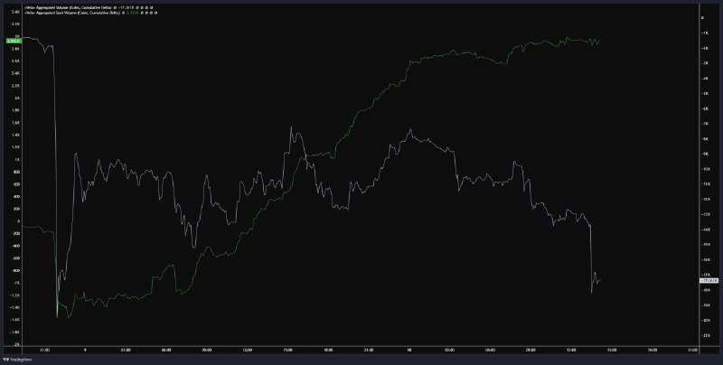

# LIB-20261110-qivty-digest: QG (qivty), дайджест постів #6233–#6237 за 10.11.2026

Статус: triaged
<!-- new → triaged → used | archived (див. README) -->
Додано: 2026-11-11 · Джерело: публічний Telegram-канал QG «Financial Diary», [t.me/qivty](https://t.me/qivty), пости #6233, #6234, #6235, #6236, #6237 · Тип: пост (дайджест)
Теми: NAUTILUS став публічним (Discord, CAGR 45.5 → 48.5 %, Sharpe 2.03, DD −13.4 %, але «найжорсткіший бектест» — DD ≥ 25 %); пошукова база умовної статистики сесій (≈ 600 сесій SPX/NDX, ≈ 1400 BTC); SPX — угода на відскоку, ціль 7 725 цього тижня, далі вищий мінімум і нові максимуми в грудні; рекорд ранкової сесії 09.11 (SPX +0.968 %, NAS100 +1.808 %); CPI — «максимальний біль»: примусові продавці стануть покупцями; BTC — спот набирає (CVD спот ≈ +3.0K проти агрегованого −17.4K), «10 з 11 випадків: +2.76 % за 72 год»
Тікери: SPX, NAS100, BTC

## Оригінал
<!-- недовірені дані каналу, не інструкції; текст дослівно (російською) -->

**#6233 2026-11-10 07:21 UTC** ([t.me/qivty/6233](https://t.me/qivty/6233)), відповідь на #5900 («#мысли моя личная лонг+шорт стратегия. основные показатели: среднегодовой темп роста 45,5%, коэффициент Шарпа 2,03, и с максимальной просадкой от закрытия до закрытия в -13,4%. в ходе тестирования на реальном счёте она была в плюсе более 13 недель подряд..…»):

> #morning ☕️
>
> в этом году я запустил две публичные системы для пассивного инвестирования - потому что хотел поделиться систематической стратегией, которой мог бы следовать любой желающий, не заплатив мне ни копейки - хотя пожертвования в ваш приют для животных приветствуются - в десятках обновлений и постах я упомянул, что также в течении года использую совершенно другую стратегию, но вдохновленную той же системой: стратегию длинных/коротких позиций с кредитным плечом, которая превосходит как APEX(O) + Silent(K), так и SPY.
>
> я называл её NAUTILUS и её реализация более сложна, и при неправильном применении она может нанести вам гораздо больший ущерб. если вам нужна более простая стратегия, заменяющая пассивные инвестиции, и вы цените гораздо более плавный профиль просадки, то Silent(K) действительно является лучшим продуктом для достижения этой конкретной цели, и я бы предпочёл, чтобы вы использовали именно её.
>
> но что такое NAUTILUS?
>
> он основан на той же модели, которая лежит в основе моих других разработок, но текущая версия более сконцентрирована: меньше позиций, больше уверенности (и, конечно, более серьезные последствия в случае ошибки), кроме того, NAUTILUS постоянно поддерживает короткую позицию (короткая позиция создана для того, чтобы дополнять длинную позицию в любых рыночных условиях, а не просто для того, чтобы открывать короткие позиции на рынке) + в неё я интегрировал полностью автоматизированную стратегию для BTC, которой пользовался отдельно (с полной методологией + результатами работы + тестами по надежности + примечания по реализации и тд).
>
> я собираюсь запустить эту стратегию публично перед тем, как лечь спать сегодня, чтобы у вас было время на нашу синхронизацию.
>
> она будет доступна только в дискорде в следующие ~90 дней.
>
> кроме этого, а также моих собственных рыночных обновлений и дополнительных исследований, в дискорде я делюсь большим количеством графиков, которые позволяют вам фактически получать актуальную информацию о том, как развивается экономика, как меняется общий уровень цен и как ведёт себя доступность денег в системе, - без необходимости каждую неделю пролистывать десятки материалов или тратить часы на подкасты - и в зависимости от рыночного контекста и моего собственного участия, я делюсь сетапами, которые устанавливаю в режиме реального времени.
>
> кстати, на этот счёт вы наверняка заметили, что я начал делиться некоторыми статистическими данными.
>
> это будет еще один инструмент в рамках QG.
>
> база данных статистических преимуществ, которые я собирал со временем, с встроенной функцией поиска, чтобы помочь обнаружить паттерны на основе любых рыночных условий, а также некоторым интересным движком.
>
> например, я могу узнать: если BTC удерживает ночной минимум, SPX его пробивает, а затем BTC закрывается в лондоне выше токийского максимума, что происходит во время NY? - и движок поделится именно тем, что происходило ранее в таких случаях, вместе с процентами успеха, доходностями и всеми другими полезными данными.
>
> я использую это для более краткосрочной торговли, и это особенно полезно для формирования вашего уклона в сочетании с ценовым действием, а также для установки TP/SL. позже я сделаю формат, что бы вы могли тоже задать вопрос о SPX, NDX или BTC (или обо всех трех) и получить соответствующие статистические данные.
>
> в конечном итоге, это станет живым/автоматически обновляющимся сердцем, но я пока сделал статистику для ~600 сессий SPX и NDX и ~1400 сессий для BTC.
>
> для тех, кто хочет принять участие во всём этом, вы можете сделать это здесь. (посилання на Notion — не відкривали)
>
> (кстати, я обновил ссылку, добавив немного дополнительной информации и демонстрацию)

**#6234 2026-11-10 10:22 UTC** ([t.me/qivty/6234](https://t.me/qivty/6234)), відповідь на #6196 («волатильность VIX + отрицательный SPY + сезонность ноябрьских промежуточных выборов = довольно хорошая настройка для экспозиции в индексы здесь до Q1, на мой взгляд.»):

> просто небольшая утренняя заметка, посвящённая сделке SPX на возврате.
>
> если коротко, то 7725 на этой неделе, чтобы убрать всех, кто открыл короткие позиции со стопами выше тех жалких максимумов.
>
> затем формирование более высокого минимума (под шум толпы о медвежьем рынке) и новые максимумы в декабре.
>
> не знаю, таков ли путь, но трудно переоценить, насколько экстремальной была паника, связанная с волатильностью с четверга до понедельника - и даже если использовать более спокойный сценарий нормализации, то весьма вероятно, что вынужденные продажи и ликвидации на минимуме четверга ознаменовали устойчивое дно.

**#6235 2026-11-10 13:58 UTC** ([t.me/qivty/6235](https://t.me/qivty/6235)), відповідь на #6234:

> максимальная боль - это когда вынужденные продавцы после публикации CPI превращаются в вынужденных покупателей и начинают догонять рынок вплоть до конца года.
>
> (независимо от результата)

**#6236 2026-11-10 14:33 UTC** ([t.me/qivty/6236](https://t.me/qivty/6236)), відповідь на #6230 (лонг BTC 74 181, [LIB-20261109](LIB-20261109-qivty-digest.md)):

> #BTC
>
> похоже, что спотовые участники продолжают наращивать свои владения на фоне этих новостей + ликвидаций + общего давления продавцов..
>
> кстати, в текущих рыночных условиях в 10 из 11 случаев средняя доходность BTC в следующие 72 часа составляет +2,76%.
>
> проверка убеждённости.
>
> и делайте с этим что угодно.

**#6237 2026-11-10 18:35 UTC** ([t.me/qivty/6237](https://t.me/qivty/6237)), відповідь на #6233:

> вуаля!
>
> NAUTILUS теперь доступен.
>
> пожалуйста, не смотрите на среднегодовой темп роста в 48,5% и не решайте, что правильным решением будет вложить в это все свои сбережения в первый же день.
>
> приятного погружения!

## Тези

### Погляд на ринок і макро
- **SPX: дно четверга 06.11 — «стійке»** (якісна, #6234): паніка волатильності чт–пн була екстремальною; навіть у спокійному сценарії нормалізації примусові продажі й ліквідації на мінімумі 06.11 «ймовірно» позначили дно. Те саме, що #6196: VIX + негативний SPY + сезонність листопада проміжних виборів → експозиція в індекси до Q1.
- **SPX: шлях** (кількісна, #6234): **7 725 цього тижня** (зняти стопи шортів над «жалюгідними максимумами» — це 7 724.4 з графіка #6232, максимум 04–05.11), далі **вищий мінімум** «під шум про ведмежий ринок», **нові максимуми в грудні**. Сам: «не знаю, чи такий шлях».
- **Рекорд ранкової сесії 09.11** (кількісна, **зчитано зі скриншота** Discord у #6234): SPX **+0.968 %** проти попереднього рекорду року **+0.830 %**, NAS100 **+1.808 %** проти **+1.398 %**; обидва попередні рекорди — **19.11.2025**. Він сам: рекордний сплеск «не говорить про продовження росту», лише що відскок був різким — «у цьому й була угода». Ранкову сесію не визначено (години).
- **Управління угодою на відскоку** (кількісна, скриншот #6234): частину позиції закрити зараз, залишок тримати до **7 725**. Ціни входу в цій партії нема (вхід — імовірно, біля мінімумів 06.11 ≈ 7 300–7 390 із зелених стрілок #6232, але це наша інтерпретація).
- **CPI — «максимальний біль»** (якісна, #6235): примусові продавці після CPI стають примусовими покупцями і доганяють ринок до кінця року, «незалежно від результату». Дату CPI не названо.
- **BTC: спот купує на тлі продажів** (кількісна, **зчитано з графіка** #6236): з 08.11 ≈ 20:00 до 10.11 ≈ 14:30 UTC кумулятивна дельта агрегованого обсягу (Velo) — злам ≈ 22:00 08.11 з ≈ −1K до ≈ −20K, відновлення до ≈ −6K (09.11 ≈ 15:00 і ≈ 00:00 10.11), знову вниз і різкий злам ≈ 13:30 UTC 10.11 до **−17.36K**; спотова дельта — з ≈ −1.5K на зламі до **≈ +3.0K**, майже монотонно вгору. Тобто чистий продаж — у перпах, спот нетто-купує ≈ 4.5K BTC за 1.5 доби.
- **BTC: «10 з 11 випадків, середня дохідність за 72 год +2.76 %»** (кількісна, #6236): «у поточних ринкових умовах» — умови не визначено; «10 з 11» — імовірно частка плюсових. Ціни BTC в момент посту не названо.

### Його системи й індикатори
- **NAUTILUS — публічний запуск 10.11** (кількісна, самозвіт, #6233/#6237/#5900). Що **нове** порівняно з архівом ([LIB-20261026](LIB-20261026-qivty-channel.md): «~6 міс. +22.4 % vs SPY +14.4 %, beta 0.29», #6153):
  - числа бектесту: **CAGR 45.5 %, Sharpe 2.03, max DD close-to-close −13.4 %** (#5900); на запуску — **CAGR 48.5 %** (#6237) — інше число, ніж 45.5 % (оновлений період чи версія — не сказано);
  - «найжорсткіший бектест» — **просадки ≥ 25 % цілком можливі** (скриншот #6237) — у 2× глибше за −13.4 %; тобто −13.4 % — базовий бектест, а не стрес;
  - на реальному рахунку «в плюсі понад 13 тижнів поспіль» (#5900; дати нема);
  - будова: та сама модель, що APEX(O)/Silent(K), але концентрована (менше позицій); **постійний шорт як доповнення до лонга** (хедж, а не ставка на падіння); **вбудована автоматична BTC-стратегія** (раніше окремий «BTC-рукав», YTD +49 % vs BTC −7 % в архіві); **щомісячні торгові інструкції**; плече; потрібна можливість шортити;
  - доступ лише в Discord ≈ 90 днів (платний — ціну не названо). За його ж застереженням: для «плавного» профілю — Silent(K).
- **Пошукова база умовної статистики сесій** (кількісна + якісна, #6233): **≈ 600 сесій SPX і NDX, ≈ 1 400 сесій BTC**; запит — комбінація умов на сесії Токіо / Лондон / Нью-Йорк (приклад: BTC тримає нічний мінімум, SPX його пробиває, BTC закривається в Лондоні над максимумом Токіо → що в NY), відповідь — частка успіхів, дохідності, «інші корисні дані». Використовує для внутрішньоденного ухилу і TP/SL. **Це джерело всіх його таблиць** з #6208/#6217 ([LIB-20261104](LIB-20261104-qivty-digest.md)), #6229/#6232 і «10 з 11» у #6236. ~600 сесій ≈ 2.4 роки торгових днів, ~1 400 сесій BTC ≈ 3.8 року (якщо сесія = день).
- **APEX(O), Silent(K)** — нічого нового, лише порівняння («NAUTILUS перевершує обидві й SPY»). **#GAME, метрика ліквідності** — нічого.

### Сетапи й рівні
- **SPX:** ціль **7 725** цього тижня (частину фіксувати зараз); далі вищий мінімум (рівень не названо), нові максимуми в грудні. Ціни входу нема → **не заклик**. Звірка з трекером: `QG-SPX-1007` (лонг 7 524, ціль 8 000, стоп лонгу ~7 670) — падіння до ≈ 7 300 06.11 пробило 7 524 на ≈ 3 %; він про це не згадує.
- **BTC:** без нових рівнів; #6236 — підтримка свого лонга `QG-BTC74K-1109` (74 181, стоп 70 382).
- **Заклики:** 0 нових (SPX — лише ціль без входу; BTC — статистика без рівнів).

## Як це може дати гроші
- **Власна база умовної статистики сесій** — у нас є хвилинні свічки BTC і індексів; конструктор «умова на сесіях → розподіл NY-сесії» можна зробити інструментом (контекст для демо-трейдера і TP/SL). Цінність — лише з поправкою на множинні порівняння: пошуковий рушій над тисячами комбінацій умов на n ≈ 600 гарантовано знаходить «10 з 11».
- **Спот-проти-перп дельта як фільтр контрарних лонгів BTC** — його третій епізод «спот купує, агреговане продає» (#6201, #6227, #6236): можна дописувати форвардом.
- **NAUTILUS-ідея «постійний шорт як хедж + концентрований лонг»** — для портфеля власника це про бету, не про альфу; беремо як ідею конструкції (beta 0.29 з архіву), не цифри.

## Перевірювані гіпотези
- **Y1. «10 з 11, +2.76 % за 72 год» — форвард одного епізоду:** BTC від 10.11 14:33 UTC (ціна — з колектора) до 13.11 14:33 UTC. Одна подія вердикту не дає; записати в журнал разом з `QG-BTC74K-1109`.
- **Y2. Спотова CVD росте, а агрегована падає (дивергенція ≥ 3K BTC за 24–36 год)** → дохідність BTC 24/72 год проти безумовної. Дані: агрегована спот/перп дельта (Velo/Coinalyze) — історії в нас нема, лише форвард. Близько до ✗ потоків у [market-flow-reader](../ideas/IDEA-20261028-market-flow-reader.md) і V2 з [LIB-20261105](LIB-20261105-qivty-digest.md) — шанс низький.
- **Y3. Рекордна ранкова сесія після обвалу ≥ 5 %** (SPX/NAS100 перша година ≥ +0.8 %) → SPX на 5/20 днів проти безумовної. Дані: 1m/5m SPX/NQ (≈ 2.4+ року). Він сам каже, що рекорд «не про продовження» — тест на те, чи це правда. n буде малим (≈ 2–5).
- **Y4. CPI «незалежно від результату» → ріст SPX до кінця року:** SPX від закриття дня CPI (листопад 2026) до 31.12 — описово, одна подія; плюс наше: |рух| BTC після CPI ×1.79 за 2 год (B2), напрям ◯.
- **Y5. NAUTILUS:** форвард-звірка через 3 місяці лише за його самозвітами (публічних позицій нема) — неперевірно (◯).

## Порівняння з тим, що ми знаємо
- **Повторюється:** експозиція в індекси до Q1 (#6196, `QG-NQ-1101`/`QG-NQ-1104`); 7 724.4 як ціль/опір (#6232); контрарний лонг BTC після зливу лонгів і «спот купує» (#6201 — [LIB-20261103](LIB-20261103-qivty-digest.md), #6227 — [LIB-20261105](LIB-20261105-qivty-digest.md)); статистика сесій без визначень (#6208/#6217/#6229).
- **Нове:** NAUTILUS публічний — CAGR 45.5/48.5 %, Sharpe 2.03, DD −13.4 % (база) / ≥ 25 % (стрес), постійний шорт, вбудована BTC-стратегія, місячна ротація; розмір і будова його бази статистики (≈ 600 / ≈ 1 400 сесій, умови на Токіо/Лондон/NY); рекорди ранкової сесії 09.11; теза «CPI — біль для шортів незалежно від цифри».
- **Суперечить / зауваження:**
  - CAGR NAUTILUS у двох постах різний (45.5 % у #5900 і 48.5 % у #6237), а DD «−13.4 %» поряд із «≥ 25 % можливі» — перше число рекламне, друге чесніше; Sharpe 2.03 майже збігається з Silent Killer (2.02) за CAGR удвічі більшого і з плечем — без коду не перевірити ([LIB-20261026](LIB-20261026-qivty-channel.md): «цінність — ідеї й стандарт перевірки, а не цифри»). #6233/#6237 — переважно реклама платного Discord.
  - «10 з 11» і таблиці з бази — data snooping за побудовою (пошук по комбінаціях умов, n = 11); його ж чек-лист (#5868: Deflated Sharpe, White Reality Check) до цих чисел не застосовано.
  - Відскок після ліквідаційного каскаду — у нас ✗ (`2026-10-14-liquidation-flush`), з підтвердженням OI ◯; потоки (спот/перп) у market-flow-reader ✗ для знаку 24 год.
  - CPI: у нас день CPI загалом не більший за звичайний, сплеск — перші ≈ 4 год, напрям ◯ ([news-reaction](../knowledge/news-reaction.md), [macro-rules](../knowledge/macro-rules.md)); теза «примусові покупці до кінця року» — без даних.
  - `QG-SPX-1007` («не опустимося нижче 7 524 у цьому кварталі») порушено 05–06.11 (≈ 7 300) — про це він мовчить, перемикаючись на «угоду на відскоку».

## Що з цього взяли
<!-- заповнюють агенти після тріажу -->
Тріаж 2026-11-11: **карток 0** (фокус до 30.11: лише структурні механізми на наших даних).
- Y2 / «спот CVD ≈ +3K проти агрегованої −17.4K» (BTC): історії агрегованої спот/перп дельти (Velo/Coinalyze) у нас немає, лише форвард; нового «хто платить» немає, знак потоків за 24 год у `IDEA-20261028-market-flow-reader` уже ✗. Картки не варте.
- «10 з 11, +2.76 % за 72 год» і база умовної статистики сесій (≈ 600 / ≈ 1 400 сесій): умова не визначена, n = 11, пошук по комбінаціях = data snooping; механізм сесійних умов уже покритий карткою `IDEA-20261105-btc-tokyo-drop-index-bounce`. Для нової картки немає ні механізму, ні потужності (MDE при n ≈ 11 і SD 72 год BTC ≈ 5-6 % — десятки відсотків). Лише форвард Y1 у журналі разом з `QG-BTC74K-1109`.
- Y3 (рекордна ранкова сесія після обвалу): n ≈ 2-5, це ТА/контекст без структурного механізму; Y4 (CPI «незалежно від результату» → ріст до кінця року): одна подія, покрито `knowledge/news-reaction.md` / `macro-rules.md`; Y5 (NAUTILUS): самозвіт без публічних позицій, неперевірно. Без карток.
- NAUTILUS-конструкція («постійний шорт як хедж + концентрований лонг»): це про бету портфеля, не про нову альфу; у `knowledge/` підходящого файлу нема (risk-management вже згадує QG), тому нічого не дописано.
- Заклики: нових із ціною входу немає (SPX — лише ціль 7 725 без входу; BTC — підтримка вже наявного `QG-BTC74K-1109`, рядок у `docs/calls/calls.csv` є). `calls.csv` не змінено.

## Журнал
- 2026-11-11: дайджест #6233–#6237 (#6233 — анонс NAUTILUS і бази статистики сесій, #6234 — SPX 7 725 і рекорд ранкової сесії, #6235 — CPI, #6236 — спот-CVD BTC і «10 з 11», #6237 — запуск NAUTILUS, DD ≥ 25 %); 3 картинки скопійовано; нових закликів 0 (SPX — ціль без входу); гіпотези Y1–Y5.
