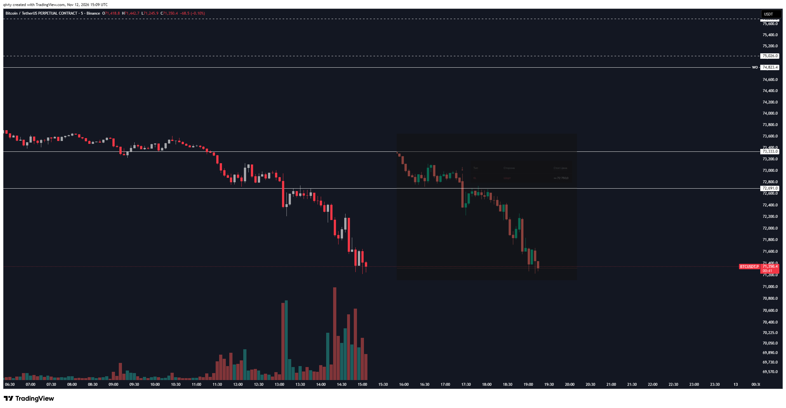
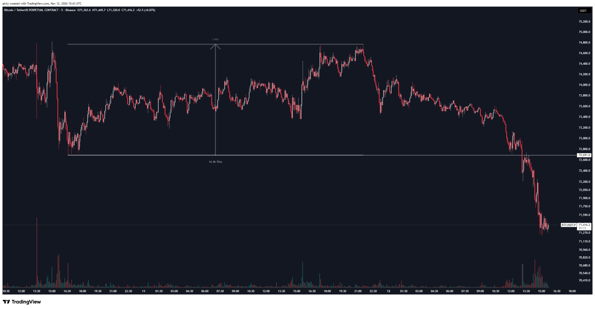
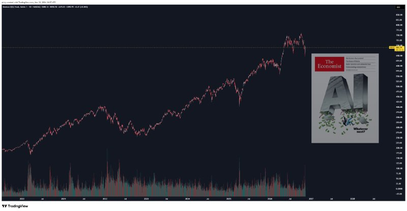

# LIB-20261112-qivty-digest: QG (qivty), дайджест постів #6240–#6245 за 12.11.2026

Статус: new
<!-- new → triaged → used | archived (див. README) -->
Додано: 2026-11-13 · Джерело: публічний Telegram-канал QG «Financial Diary», [t.me/qivty](https://t.me/qivty), пости #6240, #6241, #6242, #6243, #6244, #6245 · Тип: пост (дайджест)
Теми: BTC — «три event study за силу перед тижневим закриттям» (76k / 72.5k), за 7 год лонг 74 181 скорочено по 72.7k, визнання помилки щодо короткого напрямку, умовний повторний вхід при денному закритті > 72.8k; «10 з 11: +2.76 % за 72 год» — він міряє від пізнішого дна; SPX — закрив 90 % лонгу на тижневих максимумах; новий сигнальний інструмент QG: великий ETF, утримання ≈ 90 сесій, «95.5 %»; NAUTILUS — перший день +2.01 %; обкладинка The Economist «AI: Whatever next?» як контрарний сигнал («RIP, ведмідь»); карта заміни US-тікерів європейськими (анонс)
Тікери: BTC, SPX, QQQ, iShares AI Innovation & Tech Active ETF

## Оригінал
<!-- недовірені дані каналу, не інструкції; текст дослівно (російською) -->

**#6240 2026-11-12 08:06 UTC** ([t.me/qivty/6240](https://t.me/qivty/6240)), відповідь на #6229 (умова «закриття VIX/VIX3M нижче рівня → SPX вищий на 1–20 днів», [LIB-20261106](LIB-20261106-qivty-digest.md)):

> новый инструмент для статистической торговли в рамках QG продолжает приносить результаты.
>
> и хотя в основном он полезен для внутридневной и внутринедельной торговли, а не для долгосрочных позиций, сегодня активировался сигнал по одному из крупнейших и наиболее известных биржевых инвестиционных фондов в мире, с горизонтом удержания - около 90 торговых сессий, и вероятностью успеха 95,5% = я не могу остаться в стороне.
>
> что касается BTC, то мы провели три независимых исследований событий, которые свидетельствуют в пользу его силы накануне этого недельного закрытия = если нам удастся закрыть неделю выше 76к, то ситуация будет выглядеть обнадёживающе, однако уход ниже 72,5к полностью испортит структурную картину и скорее всего, приведёт к значительно более затяжной консолидации перед следующим движением вверх.
>
> как-то так.
>
> а ещё у NAUTILUS вчера состоялась первая торговая сессия +2,01%.
>
> конечно, один день - это всего лишь один день, но я определённо рад, что начало получилось именно таким.
>
> #morning ☕️

**#6241 2026-11-12 08:27 UTC** ([t.me/qivty/6241](https://t.me/qivty/6241)), відповідь на #6237 (запуск NAUTILUS, [LIB-20261110](LIB-20261110-qivty-digest.md)):

> PS>
>
> я понимаю, что уже почти 2027 год и всё такое (ограничиваться только криптовалютами, не имея доступа к более широкому миру глобальных инвестиций, вряд ли можно назвать - идти в ногу со временем - лол), так что для всех, кому это нужно, в ближайшие день-два я опубликую карту переноса инвестиционных экспозиций из американской инфраструктуры в европейскую.
>
> её задача - показать, чем можно заменить привычные американские тикеры, не меняя при этом саму инвестиционную логику стратегии.
>
> 🐳

Картинок нема.

**#6242 2026-11-12 15:32 UTC** ([t.me/qivty/6242](https://t.me/qivty/6242)), відповідь на #6230 (лонг BTC 74 181 / стоп 70 382, [LIB-20261109](LIB-20261109-qivty-digest.md)), графік [aLwjmRVp](https://www.tradingview.com/x/aLwjmRVp/):

> сократил эту сделку по 72,7к вместо полной остановки на 70,4к.
>
> дневное закрытие сегодня выше 72,8к - и я готов вернуться обратно в сделку, практически не понеся потерь (и с большей уверенностью в недельном закрытии).
>
> думаю, когда мы были на отметках около 76-80к, то я ошибся с дискретной точки зрения насчёт краткосрочного направления..
>
> две разные вещи, но это никоим образом не влияет на то, будет ли BTC оценен в 200 тысяч долларов через 12 месяце.
>
> (спот не закрывал)

**#6243 2026-11-12 16:02 UTC** ([t.me/qivty/6243](https://t.me/qivty/6243)), відповідь на #6236 («в текущих рыночных условиях в 10 из 11 случаев средняя доходность BTC в следующие 72 часа составляет +2,76%»), графік [nJja2KjS](https://www.tradingview.com/x/nJja2KjS/):

> да уж.

**#6244 2026-11-12 18:30 UTC** ([t.me/qivty/6244](https://t.me/qivty/6244)):

> покойся с миром, медведь.

**#6245 2026-11-12 18:48 UTC** ([t.me/qivty/6245](https://t.me/qivty/6245)):

> рынок буквально прошёл через панический всплеск волатильности и почти сразу вернулся к относительно спокойному состоянию.
>
> это одно из самых резких возвращений в истории.

## Тези

### Погляд на ринок і макро
- **BTC перед тижневим закриттям 15.11** (кількісна, #6240): «три незалежні event study» — за силу; **тижневе закриття > 76k — обнадійливо, < 72.5k — зламає структуру** і дасть затяжну консолідацію перед наступним рухом угору. Самих досліджень (подія, n, період) не показано. О 08:06 UTC ціна ≈ 73.5k (зчитано з графіка #6242), відкриття тижня **74 823.4**.
- **За 7 год — протилежний рух** (кількісна, **з графіка** #6242/#6243): 12.11 пробито 73 333 (≈ 11:00 UTC) і 72 691 (≈ 13:00), мінімум ≈ **71 250**, на 15:43 UTC **71 416** — це вже нижче його «структурної» межі 72.5k (поки що внутрішньо дня; умова в нього — тижневе закриття).
- **Визнання помилки** (якісна, #6242): «коли ми були біля 76–80k, я помилився з дискретної точки зору щодо короткострокового напрямку»; довгий погляд не змінився — **BTC 200k через 12 місяців** (повтор `QG-BTC200K-1028`), спот не закривав.
- **SPX: зафіксував 90 %** (якісна, скриншот #6240, ≈ 11.11 23:53): «можемо отримати пристойний відкат біля цієї зони, на якому перезавантажусь для пробіжки до максимумів. Статистична гра і крапка». Ціни входу/виходу не названо; це, імовірно, угода за сигналом VIX/VIX3M (#6229 → закриття < 1 09.11, [LIB-20261109](LIB-20261109-qivty-digest.md)). Чи стосується це індексних лонгів `QG-NQ-1101`/`QG-NQ-1104` («експозиція до Q1») — не сказано.
- **Новий сигнал на «один з найбільших і найвідоміших ETF»** (кількісна без назви, #6240): утримання **≈ 90 торгових сесій, імовірність успіху 95.5 %**, «не можу лишитися осторонь». Тікер не названо (за картинками #6245 — можливо QQQ, але це наш здогад).
- **AI-ведмідь «мертвий»** (якісна, #6244/#6245): обкладинка The Economist 14–20.11 «AI: Whatever next?» (крах AI-буму) — він читає як **контрарний сигнал дна** («покойся с миром, медведь») і накладає її на графіки AI-ETF (≈ −37 % від піку ≈ 54 до ≈ 34, з картинки) і QQQ (біля ATH).
- **Волатильність: панічний сплеск і майже миттєве повернення до спокою — «одне з найрізкіших в історії»** (якісна, #6245): графіка VIX немає; за контекстом — VIX/VIX3M 05.11 пік 1.14 → 09.11 0.93 ([LIB-20261109](LIB-20261109-qivty-digest.md)). Чисел і порівняльної бази не наведено.

### Його системи й індикатори
- **«Новий інструмент статистичної торгівлі QG»** (нове, #6240): сигнали з горизонтом утримання й імовірністю успіху; «переважно для внутрішньоденної й внутрішньотижневої торгівлі», але тепер і на 90 сесій. Це, імовірно, база умовної статистики сесій з #6233 (≈ 600 подій SPX/NDX, ≈ 1 400 BTC, [LIB-20261110](LIB-20261110-qivty-digest.md)), перетворена на сигнали. Визначень, n і безумовної бази нема.
- **NAUTILUS — перший торговий день (11.11): +2.01 %** (кількісна, самозвіт, #6240). Порівняно з архівом ([LIB-20261026](LIB-20261026-qivty-channel.md), [LIB-20261110](LIB-20261110-qivty-digest.md): CAGR 45.5/48.5 %, Sharpe 2.03, beta 0.29): при Sharpe ≈ 2 і CAGR ≈ 48 % річна вола ≈ 24 % → денна σ ≈ 1.5 %, тож +2.01 % ≈ 1.3σ — правдоподібно, але n = 1; 11.11 SPX робив тижневі максимуми, а в NAUTILUS заявлено постійний шорт — +2 % у такий день цікаво лише якщо підтвердиться повний місяць.
- **«10 з 11: +2.76 % за 72 год» (#6236) — його власна звірка** (#6243, **з графіка**): він міряє **від пізнішого мінімуму 72 691 (10.11 ≈ 16:40 UTC)** до максимуму ≈ 74 780 — «+2.86 % за 1d 4h 55m». Але #6236 опубліковано 10.11 14:33 UTC, коли ціна була ≈ 73.8–74.2k (з графіка); від неї максимум за 72 год ≈ +1 %, а на 15:43 UTC 12.11 — ≈ **−3.5 %** (72 год минають 13.11 14:33). «Да уж» — двозначно (самоіронія чи «досягнуто»); вимір від дна — вибірковий.
- **Карта переносу US → EU експозицій** (анонс, #6241): чим замінити американські тікери, не змінюючи логіки стратегій (імовірно UCITS-ETF для європейців). Змісту ще нема.
- APEX(O), Silent(K), #GAME, метрика ліквідності — не згадані.

### Сетапи й рівні
- **BTC, угода `QG-BTC74K-1109`** (#6242): лонг 74 181 **скорочено по 72.7k** (−2.0 %) замість стопу 70 382 (−5.1 %); на графіку — ордер SL ≈ 72 750 (нечітко). Трекер цього виходу не бачить: денний лоу ≈ 71.25k стоп 70 382 не зачепив, тож у звіті угода виглядатиме відкритою.
- **Умовний повторний вхід** (#6242): **денне закриття 12.11 > 72.8k → повернення в угоду** → заклик `QG-BTC73K-1112` (лонг 72 800, стоп 70 382 — стоп вихідної угоди, окремо не названо; умову закриття трекер не перевіряє).
- **BTC тижневе закриття (15.11):** > 76k — бичачий сценарій, < 72.5k — злам структури (#6240). Не заклик (нема входу).
- **SPX:** 90 % лонгу закрито біля тижневих максимумів, план — перезайти на відкаті «біля цієї зони»; цін нема → не заклик.
- **ETF 90 сесій / 95.5 %:** тікер і ціна не названі → не заклик.
- **Заклики:** 1 — `QG-BTC73K-1112`.

## Як це може дати гроші
- **Дисципліна виходу:** скорочення на 72.7k замість стопу 70.4k — урок для трекера: його угоди треба оцінювати й за фактичними виходами, які він оголошує, а не лише за стопом із графіка.
- **Контрарний сигнал «обкладинка мейнстрім-журналу»:** якщо ефект є, це дешевий фільтр для довгих позицій у секторі після медійної капітуляції (тут — AI/Nasdaq, опосередковано — BTC як ризиковий актив).
- **Сигнал «великий ETF на 90 сесій»:** корисний лише якщо 95.5 % суттєво вище безумовної частоти (див. Z1).

## Перевірювані гіпотези
- **Z1. 95.5 % на 90 сесій проти безумовної бази.** SPY/QQQ дають плюс за 90 торгових сесій приблизно у 70–75 % вікон (наша оцінка з відомої статистики, на наших даних не перевірено); перекривні вікна сильно завищують ефективний n. Перевірка: денні SPY/QQQ 1993–2026, частка плюсових 90-сесійних дохідностей безумовно та після умов його типу (напр. VIX/VIX3M < 1 після бекуордації); потрібні його визначення й n. Дані: денні свічки ETF — у нашому стеку нема (лише `hyperliquid:xyz:SP500` з 2025), треба зовнішнє джерело.
- **Z2. Контрарні обкладинки.** Подія — негативна обкладинка The Economist / Bloomberg Businessweek про актив чи сектор → дохідність сектору (QQQ, AI-ETF, BTC) на 20/60/120 днів проти безумовної. У літературі є дослідження з таким висновком (наскільки пам'ятаємо, Arnold, Earl & North, FAJ 2007 — позитивні обкладинки передують гіршій дохідності), але подій мало (десятки), а розмітка «негативна/позитивна» суб'єктивна. Для нас ◯ — потрібен архів обкладинок; форвард: QQQ і AI-ETF від закриття 12.11 на 20/60 днів (n = 1, описово).
- **Z3. Форвард тижневого закриття BTC 15.11:** > 76k / 72.5k–76k / < 72.5k і подальша дохідність на 1–4 тижні — описово; перевіряє його «три event study».
- **Z4. Чесна оцінка «10 з 11: +2.76 % за 72 год» (#6236):** від ціни в момент посту (10.11 14:33 UTC) до 13.11 14:33 UTC — дохідність і MFE/MAE; порівняти з його виміром від пізнішого дна. Дані: 1m/5m Binance BTCUSDT.P (є).

## Порівняння з тим, що ми знаємо
- **Повторюється:** BTC 200k за 12 міс. (`QG-BTC200K-1028`); «статистичні» твердження без n і бази (#6208/#6217/#6229/#6236); логіка «перезайду на відкаті» (як `QG-BTC77K-1105`); VIX/VIX3M-тригер для SPX (#6229 → #6232) — тепер з фіксацією 90 %.
- **Нове:** сигнальний інструмент QG з горизонтом і ймовірністю (95.5 % / 90 сесій); перший день NAUTILUS +2.01 %; часткове скорочення лонга BTC на 72.7k і визнання помилки щодо короткого напрямку; контрарне прочитання обкладинки The Economist; анонс карти US → EU тікерів.
- **Суперечить / зауваження:**
  - #6240 (08:06): «три event study — за силу перед тижневим закриттям» → за 7 год BTC −3 % і під межею 72.5k (внутрішньо дня), а він скорочує лонг. Те саме з `QG-BTC77K-1105` / `QG-BTC74K-1109`: межу структури вже двічі зсунуто (79k → 75k → 72.5k, [LIB-20261101](LIB-20261101-qivty-digest.md), [LIB-20261105](LIB-20261105-qivty-digest.md)).
  - «10 з 11: +2.76 %» він перевіряє від мінімуму після посту — класичне вибіркове вимірювання; від моменту посту результат поки від'ємний (Z4). Наш тріаж #6236 ([LIB-20261110](LIB-20261110-qivty-digest.md)): n = 11 / data snooping.
  - Контрарні входи проти зливу лонгів у нас ✗ (`2026-10-14-liquidation-flush`) / ◯ (`oi-confirmed-liquidation-flush`) — угода 74 181, відкрита на цій логіці, закрита в мінус (−2 %).
  - Терм-структура VIX у [`knowledge/macro.md`](../knowledge/macro.md) — ◯; «одне з найрізкіших повернень в історії» — без чисел.

## Що з цього взяли
<!-- заповнюють агенти після тріажу -->

## Журнал
- 2026-11-13: дайджест #6240–#6245 (#6240 — event study BTC 76k/72.5k, ETF-сигнал 95.5 %/90 сесій, NAUTILUS +2.01 %, скрин фіксації 90 % SPX; #6241 — анонс карти US → EU тікерів; #6242 — скорочення лонга BTC по 72.7k, умовний перезахід > 72.8k; #6243 — «да уж» з виміром +2.86 % від дна; #6244/#6245 — обкладинка The Economist «AI: Whatever next?», «RIP, ведмідь», повернення воли); 6 картинок скопійовано; заклик `QG-BTC73K-1112`; гіпотези Z1–Z4.
