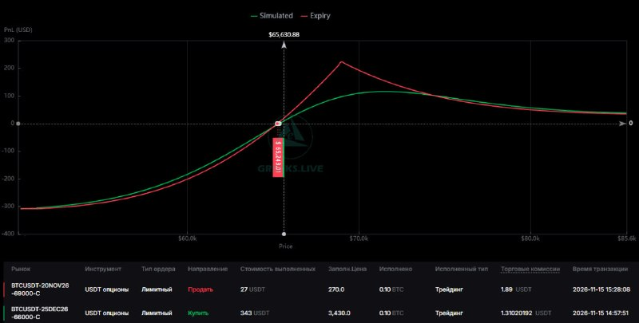
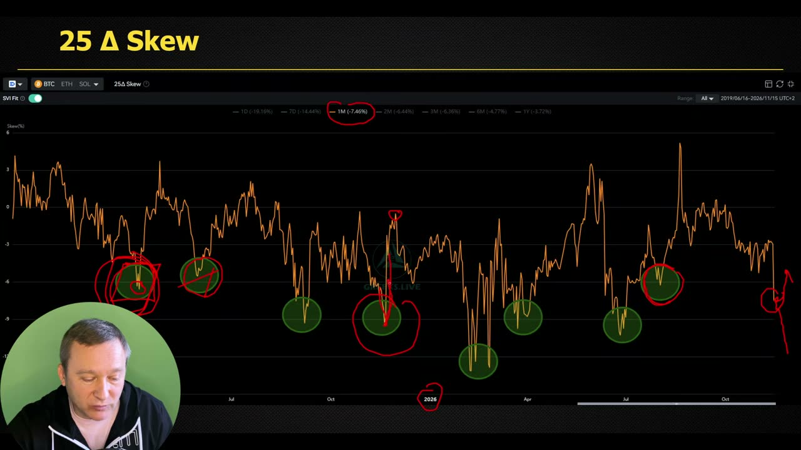
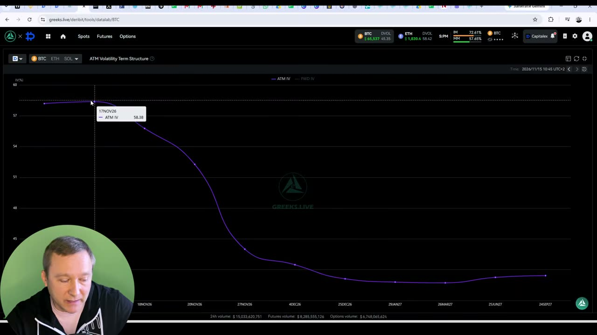
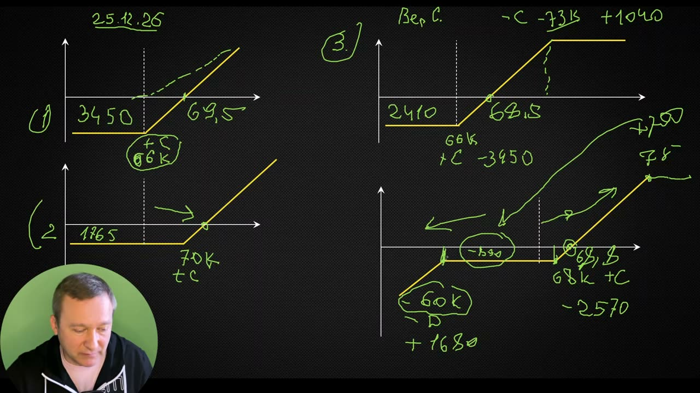

# LIB-20261115-datahawks-btc-diagonal: навчальний портфель 15.11 — діагональний кол-спред BTC 66k (25.12) / 69k (20.11) після падіння до ≈ 65.6k

Статус: new
<!-- new → triaged → used | archived (див. README) -->
Додано: 2026-11-15 · Джерело: Telegram-канал @DataHawks, [t.me/DataHawks/1149](https://t.me/DataHawks/1149) (угода) і [t.me/DataHawks/1150](https://t.me/DataHawks/1150) (анонс відео до неї) (автоматичне стеження за каналом) · Тип: пост
Теми: діагональний спред, продаж тижневих проти купленого місячного, профіль P&L, 25Δ skew (пут-бік), купівля після падіння через опціони
Тікери: BTC

## Оригінал

Пост 2026-11-15 13:32 UTC, [t.me/DataHawks/1149](https://t.me/DataHawks/1149). Текст — недовірені дані каналу, дослівно:

> 🔥Открыл Диагональный спред на BTC
>
> Сделки
> 1.  Покупка 0,1 BTC Call 66 000, exp. 25.12.26, цена $3430
> 2.  Продажа 0,1 BTC Call 69 000, exp. 20.11.26, цена $270
>
> Подробности в видео, которое уже монтируется!
>
> #btc_deals
>
> 📚Обучение торговле опционами | CAPITALEX (https://capitalex.pro/)

Зчитано з картинки (не з тексту поста):
- Профіль від Greeks.live: червона крива — «Expiry» (на експірацію короткої ноги 20.11), зелена — «Simulated» (на сьогодні).
- Позначки на осі: **$65 630.88** (вертикальна пунктирна лінія вгорі, імовірно ціна BTC у момент побудови) і **$65 249.01** (червона мітка, імовірно беззбитковість; обидві криві перетинають нуль біля неї).
- Червона крива: максимум ≈ **+$220** на $69 000, ліворуч на ≈ $55k ≈ **−$305…−310**, праворуч на $85.6k ≈ **+$35**. Зелена крива: максимум ≈ +$115 біля $71–72k.
- Таблиця виконання (формат Bybit, «USDT опціони», лімітні ордери): продаж `BTCUSDT-20NOV26-69000-C` 0.10 BTC за 270.0, вартість 27 USDT, комісія 1.89 USDT, 2026-11-15 15:28:08; купівля `BTCUSDT-25DEC26-66000-C` 0.10 BTC за 3 430.0, вартість 343 USDT, комісія 1.31 USDT, 2026-11-15 14:57:51 (час біржі, імовірно UTC+2, тобто ≈ 12:58 і 13:28 UTC, до поста).

### Анонс відео (#1150)

Пост 2026-11-15 13:40 UTC, [t.me/DataHawks/1150](https://t.me/DataHawks/1150), дослівно:

> Страшно покупать Bitcoin? | что показывает рынок опционов
>
> В новом видео (https://youtu.be/0L_UFtw02Rc):
> 🔹падение BTC, что показывает рынок опционов;
> 🔹как можно отыграть рост BTC;
> 🔹почему открыл диагональный спред.
>
> Поддержите видео лайком👍
>
> 📱 Смотреть видео (https://youtu.be/0L_UFtw02Rc)
>
> 📚Обучение торговле опционами | CAPITALEX (https://capitalex.pro/)

Сам по собі пост #1150 — анонс відео без чисел; окремого запису не створено. Транскрипту ще нема: коли з'явиться, додати сюди розділ «Відео (транскрипт)».

## Тези

1. **Угода** (*кількісна*): куплено 0.1 BTC Call 66 000 на 25.12.26 за $3 430 (за 1 BTC), продано 0.1 BTC Call 69 000 на 20.11.26 за $270. Чистий дебет **$3 160 за 1 BTC = $316 на позицію** (+ комісії ≈ $3.2, ≈ 1 % дебету лише на відкритті). Коротка нога покриває **7.9 %** вартості купленої.
2. **Строки і страйки** (*кількісна*, наш розрахунок): куплена нога ≈ 39.8 д, продана ≈ 4.8 д (експірації 08:00 UTC). Куплений страйк ≈ ATM (+0.6 % від $65 631), проданий +5.1 % OTM. **Співвідношення 1 : 1.**
3. **Оцінка IV ніг** (*кількісна*, наш ручний розрахунок Black-76, r = 0, на спот $65 631 з картинки, точність ≈ ±1 п.): куплена 66k ≈ **42 %** (Δ ≈ 0.51), продана 69k ≈ **43 %** (Δ ≈ 0.16). Чиста дельта ≈ +0.35 за 1 BTC (+0.035 BTC на позицію), тобто це бичача позиція з обмеженим ризиком.
4. **Профіль на 20.11** (*кількісна*, з картинки): максимум ≈ +$220 (≈ +70 % на дебет) при BTC = $69 000; беззбитковість ≈ $65 250; при падінні до $55k ≈ −$305 (майже весь дебет); при різкому рості до $85k прибуток зникає до ≈ +$35, бо продана 69k у грошах.
5. **Після 20.11** (*кількісна*, наш розрахунок): якщо продана нога згорить, лишається голий кол 66k на 25.12 з беззбитковістю на експірацію **$69 160** (66 000 + 3 160). За архівом автор зазвичай продає наступні тижневі проти купленого (ролл), тож дебет може зменшуватися.
6. **Контекст** (*якісна*, з анонсу й обкладинки): «падіння BTC, страшно купувати», ринок опціонів показує скью 25Δ на боці путів (страх). Ідея автора: «відіграти ріст» не спотом, а опціонами з обмеженим ризиком.
7. **Падіння** (*кількісна*, з порівняння з попереднім радаром): у радарі 08.11 BTC був 75 790, тепер ≈ 65 631, тобто **−13.4 % за тиждень**.

## Як це може дати гроші

- Шаблон «купити після паніки через опціони»: замість спота кол ≈ ATM на ≈ 40 д, тету частково компенсує продаж тижневого OTM-колу. Ризик обмежений дебетом (≈ 0.5 % спота на 1 BTC). Це правило входу після падіння з пут-скью, а не перевага, доки не перевірено (див. D2).
- Форвард-спостереження за конкретною угодою (D1) — дешево, дає ще одну точку для оцінки навчального портфеля автора.

## Перевірювані гіпотези

- **D1 (форвард, ця угода):** P&L позиції на 20.11 08:00 UTC (продана нога) і на 25.12 08:00 UTC. Очікування автора: BTC на 20.11 ≥ ≈ $65 250 дає плюс, максимум біля $69k. Дані: індекс BTC і ціни Bybit / Deribit — є. До `calls.csv` не внесено: пост не називає ціну входу базового активу (спот $65 631 лише на картинці).
- **D2 (правило):** після падіння BTC ≥ 10 % за 7 д і RR25 1M ≤ 10-го перцентиля купити кол ≈ ATM на ≈ 40 д і продати 5-денний кол 16Δ **1 : 1**, щотижневий ролл; порівняти з голим колом і з тією ж конструкцією без умови. Метрика: R на дебет, n, IS/OOS, з витратами Bybit. Дані: кеш поверхонь 09:00 BTC 2021–2026. Застереження: подій ≈ 4 на рік, як у `rr25-extreme-reversal-event` (відхилено через потужність), тож реалістично лише розвідка.
- **D3 (дешево, розширення P10):** до сітки P10 (об'єм фронту 0.5 / 0.75) додати **1.0**, як у цій угоді, і прогнати також без умови інверсії: чи 1 : 1 покращує R, чи лише зрізає апсайд.

## Порівняння з тим, що ми вже знаємо

- **Повторює** архів ([LIB-20261018-datahawks-options](LIB-20261018-datahawks-options.md), правило 7, H2) і [S29](../knowledge/setups.md): продаж тижневих проти купленого місячного; тижневий страйк не ближчий до ціни, ніж куплений (69k > 66k) — так.
- **Нове / суперечить архіву:** об'єм **1 : 1**, хоча в архіві й у S29 «проданих менше за куплені (≈ ½–¾), щоб лишився напрям». Також не видно умови «тижнева IV ≥ місячної»: за нашою оцінкою IV ніг майже рівні (43 % проти 42 %), але страйки різні. Пут-скью означає, що OTM-коли дешевші за ATM, тож ATM-фронт міг бути вищим за 43 %. Інверсію фронту (P10 ≥ +1.5 п.) з поста не встановити.
- **Наші результати:** [P10](../knowledge/options-playbook.md) — ◯ «не вимірюється на історії» ([звіт](../verification/2026-11-14-p10-calendar.md)). Діагональ 25Δ / ½ фронту дала −0.313 R лише на n = 2 (механічно ✗). Конструкція інша (стренгл, а не кол), але досвід автора не підтверджено. Пут-скью як сигнал дна: `rr25-extreme-reversal-event` і `options-direction-signals` — rejected (потужність), у плейбуку це лише тег режиму «страх на максимумі». Обкладинка відео «25Δ Skew → PUTS» якраз про цей тег.
- Грудневе засідання FOMC і CPI (за звичайним графіком — перша половина грудня; дати не звіряли з `macro_calendar`) припадають на куплену ногу, а не на продану. Це не схема S29 «продати подієву премію фронту». Радше «купити місячну вегу дешево (IV Rank BTC 14.5 % у радарі 08.11) і зменшити тету».

## Живий зріз нашими інструментами (15.11, ≈ 13:50 UTC, через 20–50 хв після угод)

Дані: `deribit_option_chain`, `deribit_skew_term`, `deribit_vrp`, `cycle_regime`, `macro_calendar` (марки Deribit; автор торгував на Bybit, ціни близькі). На 1 BTC:

| нога | марка Deribit | ціна автора | IV | Δ | θ / день | вега / 1 п. |
|---|---|---|---|---|---|---|
| куплено Call 66k 25DEC26 (39.8 д) | $3 405 | $3 430 | 40.2 % | +0.520 | −$43.8 | $86.6 |
| продано Call 69k 20NOV26 (4.8 д) | $260 | $270 | 43.5 % | −0.156 | +$81.9 | −$17.9 |
| **разом** | дебет $3 145 | дебет $3 160 | | **+0.36** | **+$38** | **+$68.7** |

- **Вхід чесний:** дебет автора на $15 (0.5 %) гірший за марки — у межах спреду. Ручна оцінка IV у «Тезах» (42 / 43 %) уточнюється: куплена 40.2 %, продана 43.5 %.
- **Профіль греків:** довга вега (+$6.9 на 1 п. на позицію 0.1), додатна тета (+$3.8 / день), **коротка гамма** (Γ −2.8·10⁻⁵ на 1 BTC). Це календар з бичачою дельтою. Він заробляє, якщо BTC повільно йде до 69k і IV грудня не падає. Різкий ривок угору (> 72k за тиждень) зрізає прибуток, різке падіння забирає дебет.
- **Інверсія фронту є, і велика:** ATM IV 20NOV 48.9 % проти 4DEC 41.3 % і 25DEC 40.3 % — **+7.6…+8.6 п.** (поріг P10 +1.5 п.). Але **без FOMC / CPI** на тиждень (лише виступ голови ФРС 16.11, роздрібні продажі 17.11, протокол FOMC 18.11). Інверсія **посткризова**: RV 7 д 65 % проти DVOL 43.6 %, RR25 фронту −16.6 п. (пут-скью, як на обкладинці). P10 перевіряв лише подієву інверсію, тож це **інший режим**. Висновок P10 (◯) на нього не переноситься.
- **Режим:** `cycle_regime` = «падіння» (BTC 64.2k на закритті 14.11; −33.8 % від річного максимуму; 15.6 % нижче SMA365; RSI14 19.7). Правило «дно» виконано на 2 з 4 умов (немає просадки ≥ 35 % і від'ємного funding). Отже, автор купує в падінні, ще до наших сигналів дна.
- **VRP:** DVOL у 64-му перцентилі за рік. У цьому кошику продаж хеджованого стреддла історично заробляв (88 % стартів у плюсі). Це не суперечить угоді: автор купує грудневу вегу дешевше за фронт, а продає саме фронт.

Рішення (Claude, 15.11): нову картку не відкриваю. Посткризова інверсія — це варіант P10, а в P10 історію обмежує покриття місячних марок (`no_month` 75 / 110), не умова. Тож перевіряти це на історії дорого і, найпевніше, теж ◯. Форвард D1 — дешевий: P&L угоди на 20.11 08:00 UTC і на 25.12 зведу в розділ «Відео», коли прийде транскрипт.

## Відео (транскрипт)

[youtu.be/0L_UFtw02Rc](https://youtu.be/0L_UFtw02Rc) «Страшно покупать Bitcoin? Что показывает рынок опционов», ≈ 30 хв, Олексій Бєляєв. Записано 15.11 при BTC ≈ 65.3–65.5k. Транскрипт з ru-автосубтитрів (`scripts/yt_local.sh`, локально в `~/private/yt-inbox/0L_UFtw02Rc/`). Нижче claim-и з вердиктами за [`VERIFICATION_PROTOCOL`](../VERIFICATION_PROTOCOL.md).

| # | claim (час) | тип | наша перевірка | вердикт |
|---|---|---|---|---|
| V1 | BTC падає другий тиждень, ≈ −20 %; від осінніх максимумів ≈ −30 %; третій тест мінімумів 2026: лютий ≈ 60k, липень ≈ 57.7k, зараз 65.4k (00:00–00:33) | кількісна | Кеш 09:00: макс. вересень–жовтень ≈ 86.2k → −24 %; мінімуми на 09:00 — 63.4k (24.02) і 58.7k (01.07), внутрішньоденні нижчі; `cycle_regime`: −33.8 % від річного максимуму 96.95k | ≈ DIRECTIONALLY RIGHT |
| V2 | RR25 1M зараз ≈ −7.5 п.; 25DEC: кол 25Δ 38.61 %, пут 25Δ 47.21 % → ≈ −8.6 п. (04:44–06:18) | кількісна | `deribit_skew_term` 13:50 UTC: 25DEC 37.5 / 45.5 → −8.0 п.; 27NOV −11.2 п., 4DEC −10.5 п. | ✓ CONFIRMED |
| V3 | **Правило:** RR25 1M нижче ≈ −6 п. і розворот угору = локальне дно, «8 разів за 2 роки», після чого ріст на 13–35 %; найкраще працює після затяжного або різкого падіння; чекати розвороту, бо може піти до −10…−12 (06:18–11:30) | кількісна | BTC 2021-01…2026-10, n = 40 подій: 14 д +0.5 %, 30 д +2.6 % проти безумовних +1.2 / +2.8 % і контролю з тією ж просадкою +2.1 / +3.9 %; медіанний максимум за 30 д +7.6 % проти +8.4 %; пороги −8 / −10 нічого не змінюють. «13–35 %» — максимуми, обрані на графіку після факту. [Звіт](../verification/2026-11-15-rr25-bottom-btc-explore.md) | **✗ NOT CONFIRMED** |
| V4 | Строкова структура сильно інвертована: 20NOV ATM 52 %, 27NOV 44, 4DEC 42, 25DEC 41, вирівнюється лише до березня; «короткострокова паніка» (23:30–25:03) | кількісна | `deribit_vol_surface` 13:50 UTC: 48.9 / 42.7 / 41.3 / 40.3 %, 26MAR27 40.2 %. Різниця з автором 1–3 п. — інший час і біржа | ✓ CONFIRMED |
| V5 | Ціни на 25.12 (за 1 BTC): кол 66k $3 450, 68k $2 570, 70k $1 765, 73k $1 040; пут 60k $1 680 (14:07–20:53) | кількісна | Марки Deribit 13:50 UTC: $3 405 / $2 463 / $1 719 / $961; пут 60k $1 540. Різниця відповідає зміні ціни за час запису | ✓ CONFIRMED |
| V6 | Варіанти: кол 66k (ризик $3 450, беззбитковість 69.5k), OTM-кол 70k ($1 765), вертикальний спред 66/73 ($2 410, беззбитковість 68.4k), «кол 68k + проданий пут 60k» ($890, беззбитковість ≈ 68.9k; «ризик < $1 000 у діапазоні 60–68k») (12:03–23:30) | кількісна + якісна | Арифметика правильна. **Але** «кол + проданий пут» — це risk reversal / синтетичний лонг нижче 60k: збиток під 60k такий самий, як у споті (−$1 000 на кожні −1k), а не «$890». Автор це називає «покритий пут»: так, якщо на рахунку є $60k на купівлю. Для депозиту власника ($10k) на 1 BTC це неприйнятно, на 0.1 BTC — ризик ≈ $6k при падінні до 0 | ≈ (арифметика ✓, рамка ризику неповна) |
| V7 | Опціони — фіксований ризик, «до експірації вас не виб'ють», не треба стопа (01:04–02:07, 11:32–12:03) | якісна | Правда для купленої премії. Діагональ має продану ногу, але покриту купленою (ризик = дебет). Для V6 з проданим путом — неправда | ≈ |
| V8 | Брати експірацію ≥ місяця (25.12, ≈ 40 д), бо дно формується не одразу (12:34–13:06) | якісна | Узгоджується з V3: медіанний «max ↓» за 30 д після сигналу −7 %, тож короткі опціони згорають до відскоку. Узгоджується і з P9 (не купувати коротку вегу) | ≈ |
| V9 | **Діагональ:** купити дешеву волу (25DEC ≈ 41 %), продати дорогу (тижневі ≈ 44–52 %), «10 % премії за тиждень»; ролл вгору, якщо ростемо; ширші страйки вниз, якщо падаємо (25:03–29:41) | кількісна + якісна | На відео 365 / 3 577 = 10.2 %, у виконаній угоді 270 / 3 430 = 7.9 %. Інверсію підтверджено (V4). **Але** фронт «дорогий» лише відносно грудня: RV 7 д = 65 %, тобто продана тижнева IV 43.5 % нижча за реалізовану волу останнього тижня. Продаж фронту після обвалу — продаж гамми, поки ринок рухається на 4 % за день. P10 на такій (посткризовій) інверсії не перевірено (див. «Живий зріз») | ◯ UNVERIFIABLE (форвард D1) |

**Що нового відносно архіву і бази:**
- V3 — та сама теза, що й у [LIB-20261104-datahawks-eth-skew-bottom](LIB-20261104-datahawks-eth-skew-bottom.md) (ETH, −5…−6 %), тепер на BTC. Раніше картку [`rr25-extreme-reversal-event`](../ideas/IDEA-20261104-rr25-extreme-reversal-event.md) відхилили через потужність без виміру. Тепер є вимір на BTC за 5.8 року: переваги нема. Картка лишається rejected, її «Умови повернення» не змінено.
- Нове: автор сам каже, що сигнал треба чекати (розворот), але **угоду відкрив на торканні**, без розвороту. Варіант «торкання» на історії ще гірший: 30 д +1.5 %, 22 / 44 у плюсі.
- V8 і структура угоди (місячний строк, обмежений ризик, без плеча) — розумна рамка для «спробувати купити дно», навіть якщо сам сигнал дна не працює. Для власника головне: це ставка на відскок з ризиком $316 на 0.1 BTC, а не на підтверджену перевагу.

## Що з цього взяли
<!-- заповнюють агенти й Claude: картки IDEA-…, PR, інструменти, вердикти -->
- 15.11 Claude: живий зріз (вище) — вхід за ринком, інверсія +8 п. без події (посткризова, поза умовою P10). Відео [youtu.be/0L_UFtw02Rc](https://youtu.be/0L_UFtw02Rc) сервер не бачить (YouTube блокує IP). Транскрипт — через `scripts/mac/yt_fetch.sh` власника, далі розділ «Відео (транскрипт)» з claim-ами за `docs/VERIFICATION_PROTOCOL.md`.
- 15.11 Claude: відео розібрано (розділ «Відео (транскрипт)», V1–V9). Головна теза V3 «RR25 ≤ −6 п. і розворот = дно» на BTC 2021–2026 ✗ (n = 40, не краще за безумовні дні й контроль з тією ж просадкою; [звіт](../verification/2026-11-15-rr25-bottom-btc-explore.md), `scripts/explore_rr25_bottom_btc.py`). Нових карток нема. Для скаута: V3 і D2 (правило входу за скью) повторно не брати; лишаються D1 (форвард угоди: 20.11 і 25.12) і D3 (об'єм фронту 1 : 1 у сітці P10).
