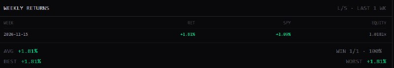
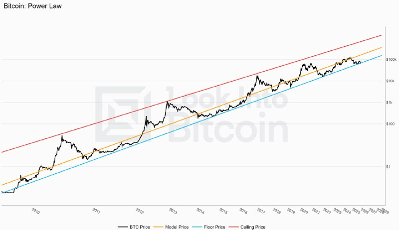

# LIB-20261116-qivty-digest: QG (qivty), дайджест постів #6254–#6259 за 16.11.2026

Статус: new
<!-- new → triaged → used | archived (див. README) -->
Додано: 2026-11-17 · Джерело: публічний Telegram-канал QG «Financial Diary», [t.me/qivty](https://t.me/qivty), пости #6254, #6255, #6256, #6257, #6259 · Тип: пост (дайджест)
Теми: NAUTILUS — перший повний тиждень +1.81 % проти SPY +1.09 % («альфа +0.72 %»); HYPE — «повернемось до ідеї, особливо якщо закріпиться вище 70 $»; BTC — «короткочасне полегшення, далі продовження падіння цього місяця», **купівля «власної крові» лише при капітуляції нижче 62k**, ансамбль і нова BTC-модель у кеші, ончейн-система «натякає, але не BUY»; IBIT/SPY — перевернута «голова й плечі» в діапазоні; домінація за OI і степеневий закон «для історії»; SPX — «важко уявити затяжний ведмежий ринок», нафта й сировина за 3/12 міс. негативні, DXY позитивний = дезінфляція; **BTC 13 тижнів: P(ріст) 25.9 %, P(падіння) 72.2 %, медіана −8.0 %**
Тікери: BTC, HYPE, IBIT, SPY, SPX, DXY

## Оригінал
<!-- недовірені дані каналу, не інструкції; текст дослівно (російською) -->

**#6254 2026-11-16 09:30 UTC** ([t.me/qivty/6254](https://t.me/qivty/6254)), відповідь на #6233 («#morning ☕️ в этом году я запустил две публичные системы для пассивного инвестирования…», анонс NAUTILUS, [LIB-20261110](LIB-20261110-qivty-digest.md)):

> #morning
>
> первая торговая неделя этого зверя после публичного запуска завершена.
>
> нам по-прежнему удаётся получать некоррелированную доходность даже в периоды повышенной волатильности, как это было на прошлой неделе.
>
> альфа относительно рынка: +0,72%.
>
> переходим ко второй 🫡

**#6255 2026-11-16 10:42 UTC** ([t.me/qivty/6255](https://t.me/qivty/6255)), відповідь на #6012 («#morning ☕️ … cпасибо за эту прекрасную игру HYPE.»), графік [LdMFL2EE](https://www.tradingview.com/x/LdMFL2EE/):

> #HYPE UPD
>
> и хотя большая часть капитала задействована в автоматизированных стратегиях, мне по-прежнему нравится использовать дискреционный подход для собственных сделок.
>
> в прошлый раз получилось неплохо, и думаю, что в скором времени мы снова вернёмся к этой идее.
>
> (в особенности если цена закрепится выше 70$)

**#6256 2026-11-16 11:29 UTC** ([t.me/qivty/6256](https://t.me/qivty/6256)), відповідь на #6251 (DXY, визнання помилки «вершина Q4», [LIB-20261115](LIB-20261115-qivty-digest.md)), графік [y4d7KOE5](https://www.tradingview.com/x/y4d7KOE5/):

> существует огромное количество традиционных и нетрадиционных графических моделей, но откровенно говоря, лишь некоторые из них действительно представляют практическую ценность - из всего этого многообразия я всегда уделяю особое внимание одной конкретной фигуре - перевёрнутой модели голова и плечи, поскольку её формирование может указывать на достижение рыночного дна.
>
> но есть и ещё одна особенность, которая мне особенно нравится: эта модель способна сформироваться внутри относительно узкого диапазона накопления = она может служить вполне самостоятельным сигналом для входа в позицию.
>
> теперь посмотри в каком состоянии находится график показывающий относительную силу криптовалют против традиционного рынка.
>
> конечно, масштаб недавнего падения BTC был значительным, но это само по себе не значит многого, если происходящее - это быстрое переоценка рыночных условий.
>
> сейчас у нас множество конкурирующих сил: сильные исторические уровни поддержки, 5-летнии значения приближающийся к дну 2022 года, дневная серия более низких максимумов, массовые ликвидации длинных позиций, сброс доминирования, потеря открытого интереса и тд.
>
> но параллельно у нас быстро ужесточается долларовая ликвидность и сильный негативный тренд, с множеством дополнительных накопившихся ликвидаций.
>
> думаю, наиболее вероятный сценарий - краткосрочное облегчение здесь.
>
> чисто на основе того, сколько последовательных негативных факторов мы уже нарисовали, за которым последует продолжение падения позже в этом месяце - и что следующее движение вниз, вероятно, станет тем местом, где все полностью откажутся от BTC.
>
> учитывая, что я полностью растерял прибыль по своей спотовой позиции и вернулся к исходной цене входа, я буду искать возможность купить собственную кровь, если (и когда) мы получим капитуляцию ниже 62к, поскольку я не считаю, что это начало долгосрочного медвежьего рынка.
>
> кроме того, с контрциклической точки зрения пятилетний показатель BTC сейчас находится на чрезвычайно привлекательных уровнях, а ужесточение условий ликвидности, на мой взгляд, будет временным явлением, а не структурной тенденцией вплоть до 2027 года.
>
> тем не менее, перспективы на следующие 13 недель сейчас выглядят довольно мрачно, несмотря на масштаб уже произошедшего падения.
>
> мой ансамбль по-прежнему находится вне рынка, а модель по BTC, которую я недавно разработал, также перешла в денежные средства по итогам закрытия пятницы. правда, в отличие от систематической стратегии (которая станет доступной на этой недели), это пока не действующая торговая модель, а скорее инструмент, с которым я в последнее время экспериментирую + отдельная ончейн система так же намекает на покупки, но пока ещё не подает сигнал ПОКУПАТЬ, как это было в феврале и июле.
>
> что именно я должен увидеть, прежде чем покупать кровь на рынке, и какое сочетание факторов будет для меня решающим, - вы сможете найти здесь (посилання на сторінку Notion «QG-QIVTYGOD»).
>
> рефлексивный итог такой:
>
> мои собственные дискреционные решения в итоге сыграли против меня - я прошёл путь от идеальной точки входа до упущенной возможности зафиксировать очень хорошую прибыль (такие сделки бывают у всех - и будут случаться дальше), - но особенно досадно, когда собственные системы говорят тебе одно, а ты их игнорируешь, полагая, что твоё субъективное мнение умнее..
>
> такие дела.
>
> 🤖😤

**#6257 2026-11-16 11:40 UTC** ([t.me/qivty/6257](https://t.me/qivty/6257)):

> зафиксируем здесь в качестве истории.

**#6259 2026-11-16 14:23 UTC** ([t.me/qivty/6259](https://t.me/qivty/6259)), відповідь на #6252 (SPX, «фондовий ринок стійкіший, ніж думають», [LIB-20261115](LIB-20261115-qivty-digest.md)), графік [WMn9nQJw](https://www.tradingview.com/x/WMn9nQJw/):

> #мысли
>
> очень сложно представить затяжной медвежий рынок для традиционных рынков: люди могут говорить о ценах на энергоносители, но динамика цен на нефть и сырьевые товары за 3 и 12 месяцев отрицательна, а индекс DXY - положительный, а это однозначно является дезинфляционным фактором.
>
> слишком много внимания уделяется абсолютным уровням и слишком мало - динамике.
>
> я считаю, что характерной чертой правления Трампа являются резкие и спорадические коррекции, сопровождающиеся паникой и V-образными разворотами.
>
> и сейчас я не вижу, чтобы это изменилось в ближайшие месяцы.
>
> что касается BTC, то вероятность положительной доходности в следующие 13 недель = 25,9%,
>
> а вероятность дальнейшего падения в следующие 13 недель = 72,2%.
>
> медианный результат в следующие 13 недель = -8,0%.
>
> держу в курсе.

## Тези

### Погляд на ринок і макро
- **BTC: «короткочасне полегшення тут», далі «продовження падіння пізніше цього місяця»** (якісна, #6256), і «наступний рух вниз — там, де всі повністю відмовляться від BTC» (капітуляція). Аргумент — «скільки поспіль негативних факторів ми вже намалювали».
- **BTC за 13 тижнів: P(додатна дохідність) = 25.9 %, P(подальше падіння) = 72.2 %, медіана −8.0 %** (кількісна, #6259). Умову (за якою вибіркою, від якої події), n і період не названо. 25.9 + 72.2 = 98.1 % — решта 1.9 %, імовірно, «≈ 0». 13 тижнів від 16.11 = ≈ 15.02.2027, тобто збігається з його «жорсткішанням до середини Q1 2027» з #6251.
- **Конкурентні сили** (якісна, #6256): «за» — сильні історичні підтримки, «5-річні значення наближаються до дна 2022», злив лонгів, скидання домінації, втрата OI; «проти» — швидке жорсткішання доларової ліквідності, сильний негативний тренд, денна серія нижчих максимумів, ще багато накопичених ліквідацій.
- **«5-річний показатель BTC — надзвичайно привабливий» з контрциклічної точки зору** (якісна; що це — 5-річна дохідність, z-скор чи перцентиль — не сказано; «близько до дна 2022»). Жорсткішання ліквідності — «тимчасове, не структурне аж до 2027»; «це не початок довгого ведмежого ринку».
- **IBIT/SPY** (кількісна з графіка, #6256): відносна сила крипти проти акцій 0.0516 (−7.13 % за 3-денну свічку, премаркет 0.0486), біля лоу лютого 0.0522; на думку автора, тут може формуватися **перевернута «голова й плечі» в «вузькому діапазоні накопичення»**, яку він вважає «самостійним сигналом входу». Рівнів фігури він не називає; з графіка: голова 0.0443, шия 0.0643.
- **Домінація за OI і степеневий закон — «для історії»** (#6257, без тексту): частка BTC в OI впала ≈ 47 → 40 %, «інші» ≈ 26 → 39 % (з картинки) — альти тримають майже стільки ж OI, скільки BTC; ціна BTC ближче до «підлоги» степеневої моделі LookIntoBitcoin.
- **SPX: «важко уявити затяжний ведмежий ринок»** (якісна з кількісним аргументом, #6259): нафта й сировина за 3 і 12 міс. — негативна динаміка, DXY — позитивна → «однозначно дезінфляційний чинник»; «забагато уваги абсолютним рівням, замало динаміці». **«Риса правління Трампа — різкі спорадичні корекції з панікою й V-подібними розворотами»**, найближчі місяці так само. SPX 7 518.4, лоу листопада ≈ 7 300, ATH ≈ 7 850 (з графіка).

### Його системи й індикатори
- **NAUTILUS — перший торговий тиждень після публічного запуску: +1.81 % проти SPY +1.09 %, «альфа +0.72 %»** (кількісна, самозвіт, #6254; з картинки «L/S», капітал 1.0181x, 1 тиждень з 1 у плюсі). Альфа = просто різниця, без поправки на бету. «Некорельована дохідність» — з одного тижня, де обидва в плюсі, це не випливає. Порівняння з попередніми самозвітами: 11.11 +2.01 % ([LIB-20261112](LIB-20261112-qivty-digest.md)), 12.11 +2.24 % проти SPY +1.49 % від входу ([LIB-20261113](LIB-20261113-qivty-digest.md)) → на кінець тижня +1.81 % / +1.09 %, тобто 13–14.11 обидва віддали ≈ 0.4 п. п.
- **Ансамбль («13 + 4») — поза ринком** (якісна, #6256). **Нова BTC-модель (експериментальна, не бойова) пішла в кеш на закритті п'ятниці 13.11.** Систематична BTC-стратегія («BTC ONLY», [LIB-20261115](LIB-20261115-qivty-digest.md)) — «стане доступною цього тижня» (Notion, продукт).
- **Окрема ончейн-система «натякає на покупки, але ще не дає BUY, як у лютому і липні»** (якісна; нове — дві дати попередніх сигналів 2026). В архіві [LIB-20261026](LIB-20261026-qivty-channel.md) ончейн «Policy» згадано без історії сигналів. Для звірки: лоу BTC 2026 — ≈ 58–60k у червні–липні (з #6247), тобто липневий сигнал біля дна.
- **Визнання помилки (вже втретє за тиждень)** (#6256): «від ідеальної точки входу до втраченої можливості зафіксувати дуже хороший прибуток», «власні системи кажуть одне, а ти їх ігноруєш». Повтор #6251.
- **Перевернута Г&П — «єдина фігура з практичною цінністю»** (якісна, метод): може вказувати на дно і сформуватися всередині вузького діапазону — тоді це самостійний сигнал входу. В архіві фігурні моделі як метод не виділялись (його рамки — рівні відкриття періодів, девіація і повернення, SMA 200/360, AVWAP).
- **HYPE — дискреційна угода** (#6255): «більшість капіталу в автоматичних стратегіях, але для власних угод люблю дискреційний підхід»; минула угода (#6012) — з графіка вхід ≈ 53–55 (кінець липня – початок серпня), вихід ≈ 72 і ≈ 82 (≈ 20–24.08), тобто ≈ +35…+50 %.
- APEX(O), Silent(K), #GAME, метрика ліквідності — не згадані.

### Сетапи й рівні
- **BTC: купівля «власної крові» при капітуляції нижче 62k** (#6256, умовний заклик) → `QG-BTC62K-1116`. Нижня межа зони 58 000 — наша (його зона «58–60k» з архіву й #6247), він сам називає лише «нижче 62k». Умова — капітуляція плюс набір факторів зі сторінки Notion (не розкрито).
- **HYPE: «повернемось до ідеї, особливо якщо закріпиться вище 70 $»** (#6255) → `QG-HYPE70-1116`. Ціна 66.63; рівні з графіка: опір 69.23 / 72.24 / 75.72–76.77, підтримки 65.80 / 61.58 / 58.79–57.95 / 54.08 / 51.15.
- **IBIT/SPY:** 0.0522 (ліве плече), 0.0443 (голова), 0.0643 (шия) — з графіка, фон для BTC, не заклик.
- **SPX:** рівнів входу нема; 7 300 — лоу листопада, лінія «365D» ≈ 7 210.
- **Заклики: 2** (`QG-BTC62K-1116`, `QG-HYPE70-1116`; обидва умовні).

## Як це може дати гроші
- **Сценарій QG для BTC на тижні:** відскок → новий лоу «пізніше в листопаді» → капітуляція < 62k → покупка. Для власника: якщо купувати, то не зараз, а частинами нижче 62k і лише з ознаками капітуляції (злив лонгів + funding/OI скинуті); його ж ймовірності (72 % падіння за 13 тижнів) — аргумент не поспішати. Наші заміри контрарних входів після зливу лонгів — ✗/◯, тому «капітуляція» — лише зона, а не сигнал.
- **Альти тримають ≈ 39 % OI** (з картинки) при падаючому BTC — ризик каскаду ліквідацій у альтах при наступній хвилі; для перпів власника — менше плеча на альтах.
- **HYPE > 70** — пробійний лонг; позиція з чітким стопом нижче 65.80 / 61.58 (наша інтерпретація рівнів, він стоп не називає).

## Перевірювані гіпотези
- **D1. «BTC 13 тижнів: P(+) 25.9 %, медіана −8 %».** Відтворити клас умов: BTC нижче SMA 200 / 360 і −30…−40 % від ATH, після тижня з −10 % і більше (або «ансамбль поза ринком» ≈ трендовий фільтр у кеші) → частка додатних 13-тижневих дохідностей і медіана проти безумовної (≈ 60 % додатних). Неперекриті вікна, кластери подій. Дані: денні BTC з 2013 (є). Ефективний n — ≈ 10–20 епізодів, тож лише описово.
- **D2. Перевернута Г&П на IBIT/SPY (або BTC/SPX) як сигнал входу.** Формалізувати фігуру (три лоу, голова нижче плечей на ≥ X %, шия — максимум між ними) на відношенні BTC/SPX з 2015 і заміряти 30/90-денну дохідність BTC після пробою шиї і після формування правого плеча. n мале (≈ 5–10), і формалізація фігури — головне джерело підгонки; кандидат лише для описової перевірки.
- **D3. Форвард-записи у трек-рекорд автора:** (а) «короткочасне полегшення, потім новий лоу пізніше в листопаді» — новий лоу BTC нижче мінімуму 14–16.11 до 30.11; (б) чи буде торкання < 62k до 15.02.2027 (трекер, `QG-BTC62K-1116`); (в) BTC 16.11 → 15.02.2027: знак і величина проти «медіана −8 %»; (г) SPX без закриття нижче ≈ 7 300 і новий ATH > 7 850 за 3 міс. (продовжує C3(в) з [LIB-20261115](LIB-20261115-qivty-digest.md)).
- **D4. NAUTILUS live:** накопичувати тижневі самозвіти (тиждень 1: +1.81 % / SPY +1.09 %), через 12 тижнів — перевищення, бета й кореляція з SPY (продовження A4 з [LIB-20261113](LIB-20261113-qivty-digest.md)).

## Порівняння з тим, що ми знаємо
- **Повторюється:** визнання помилок дискреційного виконання (#6242, #6247, #6251); «системи вийшли, а я ні» (#6250); DXY/ліквідність як головний чинник для BTC і «жорсткішання до середини Q1» (#6251) — тепер у формі 13-тижневих ймовірностей; «стійкість SPX, паніка → V-розворот» (#6196, #6234, #6252); степеневий закон як підтримка (#6247); NAUTILUS-самозвіти (#6240, #6248); продаж доступу до стратегії через Notion (#6250).
- **Нове:** 13-тижневі ймовірності BTC (25.9 / 72.2 / −8.0 %); **рівень купівлі зсунуто нижче: < 62k** (13.11 «друга найвигідніша точка» була 67.6–69.1k, `QG-BTC69K-1113`); ончейн-система з сигналами BUY у лютому й липні 2026; нова експериментальна BTC-модель (кеш з 13.11); перевернута Г&П як улюблена фігура; IBIT/SPY як міра відносної сили; домінація за OI; дезінфляційний аргумент «динаміка, а не рівні» для SPX; перший тижневий звіт NAUTILUS.
- **Суперечить / зауваження:**
  - **За три дні — від «друга найвигідніша точка входу» (13.11, 67.6–69.1k) до «перспективи на 13 тижнів похмурі, 72 % падіння» і купівлі лише нижче 62k.** Заклик `QG-BTC69K-1113` автор фактично відкликав, не кажучи цього прямо.
  - **Всередині #6256:** «5-річний показатель надзвичайно привабливий», «не ведмежий ринок» і водночас 72 % за падіння на 13 тижнів. Це можна узгодити (довгий горизонт — купувати, 13 тижнів — ні), але тоді його ж «13-тижнева» рамка (DXY < 99.5 → «13 бичачих тижнів», #6199) і тут, і там подається як сильний сигнал без n.
  - **Долар:** у #6259 позитивна динаміка DXY — «дезінфляція» і плюс для акцій, у #6251 — «різке жорсткішання фінансових умов». Для BTC він розводить це «іншою кореляцією». Наші заміри: долар з BTC — той самий день (−0.24 у 2026), наперед на 1 міс. — ✗ (B3), тож лагова частина («до середини Q1») у нас не підтверджена.
  - **«Некорельована дохідність» NAUTILUS** з одного тижня, де і портфель, і SPY в плюсі, не випливає; «альфа» = різниця без бети (у архіві beta 0.29).
  - **Контрарні входи після зливу лонгів** у нас ✗ (`2026-10-14-liquidation-flush`) / ◯ (`oi-confirmed-liquidation-flush`) — «капітуляція < 62k» як тригер купівлі не має нашої підтримки; фігурних моделей і степеневого закону в `docs/knowledge/` нема.
  - **HYPE:** «закріплення вище 70» — пробійна умова, а `F1-HYPE-1026` (інший автор) купував 72–75 як підтримку, і її вже пробито; `MR-HYPE` 75 — теж.

## Що з цього взяли
<!-- заповнюють агенти після тріажу -->

## Журнал
- 2026-11-17: дайджест #6254–#6259 (#6254 — NAUTILUS тиждень 1 +1.81 % vs SPY +1.09 %; #6255 — HYPE, «особливо якщо вище 70 $»; #6256 — IBIT/SPY, перевернута Г&П, сценарій «полегшення → нижче пізніше в листопаді», купівля при капітуляції < 62k, ансамбль і BTC-модель у кеші, ончейн «не BUY»; #6257 — домінація за OI і степеневий закон «для історії»; #6259 — SPX дезінфляція, «корекції Трампа з V-розворотами», BTC 13 тижнів P(+) 25.9 %, медіана −8 %); 6 картинок скопійовано; заклики `QG-BTC62K-1116`, `QG-HYPE70-1116`; гіпотези D1–D4. #6258 у партії не було.
