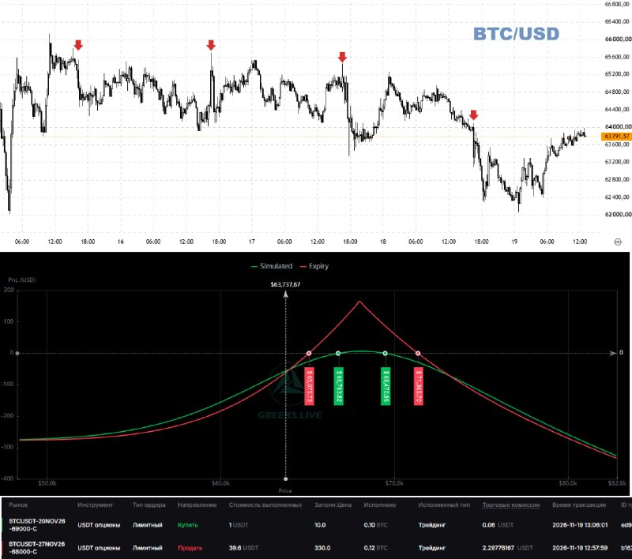

# LIB-20261119-datahawks-btc-diagonal-roll: навчальний портфель 19.11 — ролл короткої ноги діагоналі BTC: 69k 20.11 викуплено за $10, продано 0.12 Call 68k 27.11 за $330

Статус: new
<!-- new → triaged → used | archived (див. README) -->
Додано: 2026-11-19 · Джерело: Telegram-канал @DataHawks, [t.me/DataHawks/1151](https://t.me/DataHawks/1151) (відповідь на #1149) (автоматичне стеження за каналом) · Тип: пост
Теми: діагональний спред, ролл тижневої ноги, об'єм короткої ноги більший за куплену, тиск продавців ETF на відкритті США, падіння IV у п'ятницю
Тікери: BTC

## Оригінал

Пост 2026-11-19 11:10 UTC, [t.me/DataHawks/1151](https://t.me/DataHawks/1151), відповідь на угоду [#1149](https://t.me/DataHawks/1149) (розбір: [LIB-20261115-datahawks-btc-diagonal](LIB-20261115-datahawks-btc-diagonal.md)). Текст — недовірені дані каналу, дослівно:

> 📊Увеличиваю объем продаж Call
>
> В последнее время прослеживается четкая закономерность, с началом торгов в США, биткоин оказывается под давлением продавцов ETF-BTC, после чего пытается отыграть падение (пока вяленько).
>
> У нас экспирация недельных опционов будет завтра с утра, к этому времени мы можем еще раз сходить вниз с открытием торгов в США, а волатильность (IV), как это обычно бывает в пятницу, снизится.
> Поэтому, не дожидаясь завтрашнего дня, продаю опционы Call со страйком 68000 и экспирацией 27.11.26, объем немного увеличу (до 0,12 BTC), чтобы быстрее отбивать премию за купленный Сall со страйком 66К.
>
> Сделки
> 1.       Покупка (закрытие) 0,1 BTC Call 69 000, exp. 20.11.26, цена $10
> 2.       Продажа (открытие) 0,12 BTC Call 68 000, exp. 27.11.26, цена $330
> #btc_deals
>
> 📚Обучение торговле опционами | CAPITALEX (https://capitalex.pro/)

Зчитано з картинки (не з тексту поста; написи на мітках повернуті, точність ≈ ±$50):
- **Верхній графік BTC/USD**, 15.11 → 19.11 ≈ 12:30. Чотири червоні стрілки на денних локальних максимумах у другій половині дня: ≈ 65.9k, ≈ 66.0k, ≈ 65.6k, ≈ 65.2k (стрілки 15, 16, 17 і 18.11, за віссю). Після кожної — спад. Мінімум 18→19.11 ≈ **62.1k**, на лівому краю (початок 15.11) ≈ 62.0k. Поточна ціна **63 791.57**.
- **Профіль P&L** (Greeks.live): вертикальна лінія **$63 737.67** (спот у момент побудови). Червона «Expiry» — на експірацію 27.11: беззбитковості ≈ **$65 076** і ≈ **$71 366**, максимум ≈ **+$165** біля $68k, ліворуч на $50k ≈ **−$275**, праворуч на $82.8k ≈ **−$330** (крива падає далі). Зелена «Simulated» (сьогодні): беззбитковості ≈ $66 764 і ≈ $69 470, максимум ≈ +$5. На поточній ціні обидві ≈ **−$55…−60**.
- **Таблиця виконання** (Bybit, «USDT опціони», лімітні): купівля `BTCUSDT-20NOV26-69000-C` 0.10 BTC за 10.0, вартість 1 USDT, комісія 0.06 USDT, 2026-11-19 13:06:01; продаж `BTCUSDT-27NOV26-68000-C` 0.12 BTC за 330.0, вартість 39.6 USDT, комісія 2.29776167 USDT, 2026-11-19 12:57:59. Час біржі, імовірно UTC+2, як у #1149, тобто ≈ 10:58 і 11:06 UTC, до поста. Нову ногу продано **на 8 хв раніше**, ніж викуплено стару.

## Тези

1. **Ролл** (*кількісна*): викуплено 0.1 Call 69k 20.11 за $10 (продано 15.11 за $270), тобто зафіксовано **$26 = 96 % премії** за 4 дні. Відкрито 0.12 Call 68k 27.11 за $330: кредит **$39.6**.
2. **Об'єм 1.2 : 1** (*кількісна*): продано 0.12 проти купленого 0.10 Call 66k 25.12. Мета автора — «швидше відбивати премію». Наслідок (наш): **0.02 BTC короткого колу непокриті**. На різкому рості збиток не обмежений: на 27.11 нахил ≈ −0.02 BTC на $1, і на $82.8k профіль уже ≈ −$330, гірше, ніж на $50k (≈ −$275).
3. **Залишковий дебет** (*кількісна*, наш розрахунок): 343 − 27 + 1 − 39.6 = **$277.4** + комісії ≈ $5.6 (з них ≈ $2.3 на новому продажу, ≈ 5.8 % його премії) → ≈ **$283**. Сходиться з лівим краєм профілю (≈ −$275 без комісій). За 4 дні продані ноги повернули 65.6 / 343 = **19 %** вартості купленої (автор у відео обіцяв «≈ 10 % на тиждень»).
4. **Нова коротка нога** (*кількісна*, наш ручний Black-76, r = 0, спот $63 738 з картинки, 7.9 д): 68k на 27.11 — **+6.7 % OTM**, IV ≈ **43 %**, Δ ≈ 0.16 (±1 п.). Тобто ті ж «16Δ на тиждень», що й 15.11. Страйк знижено з 69k до 68k, бо спот впав з 65.6k до 63.7k. Він досі вище купленого 66k, правило «не ближче за куплений» виконано.
5. **Чиста дельта** (*кількісна*, оцінка): кол 66k 25.12 на 63.7k має Δ ≈ 0.45, отже 0.1·0.45 − 0.12·0.16 ≈ **+0.026 BTC** на позицію. 15.11 було +0.036. Позиція стала ближчою до нейтральної, з короткою гаммою.
6. **D1 (форвард 15.11) — перша нога** (*кількісна*): продана 69k згоріла б у нуль (спот 63.7k), але позиція загалом у мінусі ≈ **−$55…−60** (з картинки), бо BTC −2.9 % від входу (65.6k → 63.7k) і куплена нога подешевшала. Беззбитковість на 20.11 була ≈ 65.25k, тож на 20.11 08:00 UTC позиція, найімовірніше, була б у мінусі.
7. **«Тиск продавців ETF з початком торгів у США»** (*якісна*; на графіку чотири приклади): BTC слабшає з відкриттям США, потім «мляво» відіграє. Перша стрілка, за віссю, — **15.11, неділя**, коли ETF не торгуються. Тоді 3 з 4 прикладів, а не 4.
8. **«IV, як зазвичай у п'ятницю, знизиться»** (*якісна*): тому продає 27.11 у четвер, а не чекає експірації 20.11.
9. **«Ще раз сходити вниз з відкриттям США до експірації»** (*якісна*): продаж колу після падіння, а не перед ним, тобто автор не чекає швидкого відскоку вище 68k до 27.11.

## Як це може дати гроші

- Механіка ролу для навчального портфеля: короткий тижневик закривати за ≤ 5 % премії за день до експірації (тут $10 = 3.7 %) і одразу продавати наступний 16Δ. Ризик останньої доби (гамма в нулі) майже безкоштовно прибирається.
- Коротка нога «1.2 : 1» — **не** брати як шаблон: прискорює повернення дебету на ≈ $7 за тиждень, але відкриває необмежений ризик угору саме тоді, коли автор у #1149 ставив на відскок.
- Сезонність «відкриття США → слабкість BTC» і «IV у п'ятницю нижча» — дві дешеві гіпотези на наших даних (нижче), а не сигнали.

## Перевірювані гіпотези

- **D1 (форвард, продовження):** P&L позиції 0.1 Call 66k 25.12 / −0.12 Call 68k 27.11 на 27.11 08:00 UTC і на 25.12 08:00 UTC; зафіксовано +$26 на першій нозі. Дані: марки Deribit / Bybit — є. До `calls.csv` не внесено: пост не називає ціну входу в базовий актив (спот 63.7k лише на картинці), і це ролл опціонної ноги, а не новий вхід.
- **U1 (сесія США, режим відтоків):** у дні NYSE середня дохідність BTC 14:30→16:30 UTC (13:30 улітку) < 0 і гірша, ніж у те саме вікно у вихідні (плацебо). Окремо — у тижні з чистими відтоками з BTC-ETF. Метрика: середнє, t, IS/OOS за 2024-01…2026-11 (≈ 700 днів NYSE). Годинні свічки є. Щоденної історії потоків ETF у базі знань не знайшов: без неї лише безумовна частина. Перетин: [catalyst-option-scalp](../verification/2026-10-23-catalyst-option-scalp.md) (реверсія ранкового руху на відкритті США, 46.7 %, ✗) і `btc-intraday-momentum-us-hours` (rejected). Це інший сигнал: безумовний дрейф вікна, а не напрям за ранком. Чекаю, що ефект буде в межах шуму, як у тих двох. Повертатися, лише якщо з'явиться щоденна історія потоків.
- **U2 (п'ятнична IV):** ATM IV наступного тижневика BTC знижується з четверга 09:00 на п'ятницю 09:00 сильніше, ніж у інші пари днів. Дані: кеш поверхонь 09:00 UTC 2021–2026 (≈ 290 четвергів). Застереження: частина ефекту механічна (вихідні в T рахуються як повні дні, а реалізований рух у вихідні менший). Вимірювати слід саме те, що вигідно продавцю: ціну колу 16Δ на 8 д у четвер проти 7 д у п'ятницю за сталого спота.

## Порівняння з тим, що ми вже знаємо

- **Повторює** архів ([LIB-20261018-datahawks-options](LIB-20261018-datahawks-options.md), правило 7, H2) і [S29](../knowledge/setups.md): щотижневий ролл проданого колу проти купленого місячного, страйк короткої ноги не ближчий за куплений.
- **Нове і суперечить архіву:** об'єм уже **1.2 : 1** (15.11 був 1 : 1, в архіві й S29 — ≈ ½–¾). Частина проданого колу непокрита — у навчальному портфелі такого раніше не бачили.
- **Наші результати:** [розвідка діагоналі](../verification/2026-11-15-datahawks-diagonal.md): після «скью-дна» E[R] −0.22 на дебет (n = 31), а 1 : 1 гірше за голий кол на −0.19 R. Отже, збільшення короткої ноги ще далі від кращого варіанта (½ чи голий кол). 1.2 : 1 у сітці не було, тож за нашим результатом очікування нижче, ніж у 1 : 1. Сигнал «RR25 ≤ −6 п. = дно» (V3) на BTC ✗ ([звіт](../verification/2026-11-15-rr25-bottom-btc-explore.md)). Падіння BTC 65.6k → 62.1k за 4 дні після входу узгоджується з медіанним «max ↓» −7 % за 30 д після сигналу.
- **Сесія США:** наш шлюз [catalyst-option-scalp](../verification/2026-10-23-catalyst-option-scalp.md) напряму на відкритті не знайшов. Теза автора — про останній тиждень (3–4 епізоди), тобто це спостереження, а не правило.

## Що з цього взяли
<!-- заповнюють агенти й Claude: картки IDEA-…, PR, інструменти, вердикти -->
