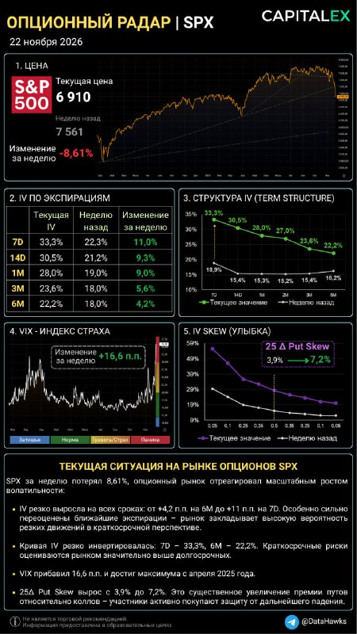
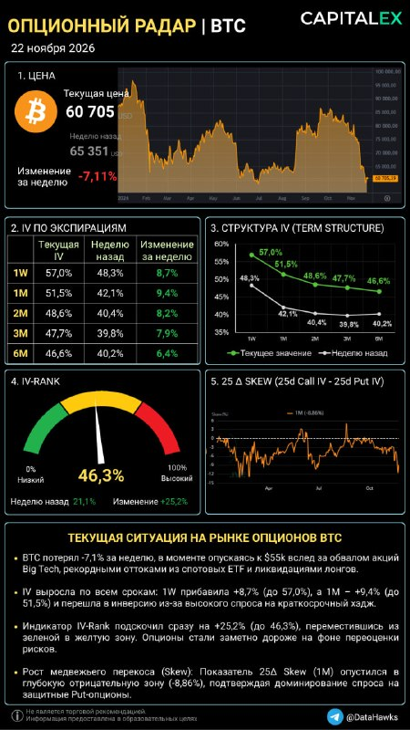

# LIB-20261122-datahawks-spx-btc-radar: «Опціонний радар» SPX і BTC 22.11: SPX −8.61 %, VIX > 30, крива інвертована; BTC 60.7k, IV Rank 21 → 46 %, RR25 −8.86 (мінімум ≈ −12)

Статус: triaged
<!-- new → triaged → used | archived (див. README) -->
Додано: 2026-11-22 · Джерело: Telegram-канал @DataHawks, [t.me/DataHawks/1152](https://t.me/DataHawks/1152) (автоматичне стеження за каналом) · Тип: пост
Теми: ATM IV за строками, term structure, інверсія кривої, VIX, 25Δ put skew, IV Rank, RR25 як «дно страху», відтоки ETF, ліквідації, ставка ФРС, AI-сектор
Тікери: SPX (VIX, SOX), BTC

## Оригінал

Пост 2026-11-22 20:55 UTC, [t.me/DataHawks/1152](https://t.me/DataHawks/1152). Текст — недовірені дані каналу, дослівно:

> 📡ОПЦИОННЫЙ РАДАР | SPX & BTC
> 22 ноября 2026
>
> Прошедшая неделя стала одной из самых напряженных для финансовых рынков за последнее время. Распродажа технологического сектора, усиление опасений вокруг AI-индустрии и ожидания более жесткой политики ФРС спровоцировали масштабное снижение фондовых индексов и криптовалют.
>
> 📉ФОНДОВЫЙ РЫНОК (SPX): Крах ИИ-эйфории и страх перед ФРС
> S&P 500 за неделю снизился на 8,61%, до 6 910 пунктов.
> Реакция опционного рынка оказалась очень резкой:
> 🟢IV ближайших недель достигла 33,3%, тогда как на горизонте 6 месяцев составляет 22,2%.
> 🟢Индекс страха VIX подскочил на +16,6% и пробил отметку 30%, ворвавшись в красную зону «Паники».
> 🟢Показатель перекоса Put Skew продемонстрировал аномальный рост почти в два раза (до 7,2%). Фонды скупают страховку от падения (Put-опционы) по любым ценам, а краткосрочная волатильность 7D (33,3%) в полтора раза выше полугодовой. Это очень похоже на рыночную капитуляцию.
>
> Причины обвала
> После ухода главы Nvidia Дженсена Хуанга и новых экспортных ограничений США бумаги чипмейкеров посыпались. За неделю индекс полупроводников SOX потерял 17,1%.
> Масла в огонь подлило долгожданное IPO компании Anthropic – после первого дня роста акции обвалились, заставив Уолл-стрит усомниться в окупаемости многомиллиардных трат на ИИ.
> Дополнительным фактором стали опасения относительно дальнейшего ужесточения политики ФРС. Глава регулятора Кевин Уорш и представители ФРС дали понять, что борьба с инфляцией не закончена. Рынок теперь закладывает более 90% вероятности повышения ставки в декабре и еще одно повышение в 2027 году.
>
> 💰КРИПТОРЫНОК: Ударная волна и выход институционалов
> Биткоин не смог устоять в стороне. Падение акций Big Tech спровоцировало рекордные однодневные оттоки из американских спотовых BTC-ETF (только из фонда BlackRock вывели более $540 млн за день) и волну ликвидаций плечевых лонгов на $1,5+ млрд.
>
> Что показывают опционы BTC?
> 🟢Взрывной рост IV-Rank (46,3%): Показатель за неделю взлетел сразу на +25,2 п.п. Период экстремально дешевых опционов закончился – рынок закладывает сильную болтанку.
> 🟢Недельная волатильность 1W (57,0%) резко превысила месячную (51,5%), рынок закладывает особенно высокую неопределенность в ближайшие недели.
> 🟢25Δ Skew ушел глубоко в минус (-8,86%). Стоит отметить, что в моменте показатель опускался до -12%, после чего начал восстанавливаться. Такие значения наблюдались ранее в феврале этого года, после чего следовал широкий боковик.
> #OptionsRadar (?q=%23OptionsRadar)
>
> 📚Обучение торговле опционами | CAPITALEX (https://capitalex.pro/)

**Числа з картинок** (прочитано з зображень 450×800, не з даних; дрібне — наближено):

SPX: ціна 6 910 (тиждень тому 7 561, −8.61 %; арифметика точна). VIX: на картинці «Зміна за тиждень **+16.6 п.п.**», «досяг максимуму з квітня 2025» (у тексті поста — «+16,6 %» і «пробив 30»). 25Δ Put Skew 3.9 → 7.2 %. Усмішка (дельти 0.05…0.05): поточна ліва гілка ≈ 55 %, тижнева ≈ 30 % (наближено).

| Строк SPX | IV зараз | «Тиждень тому» (таблиця) | Зміна (таблиця) | «Тиждень тому» (сіра лінія графіка) | Зміна за графіком (наш розрахунок) |
|---|---|---|---|---|---|
| 7D | 33.3 % | 22.3 % | +11.0 | 18.9 % | +14.4 |
| 14D | 30.5 % | 21.2 % | +9.3 | 15.4 % | +15.1 |
| 1M | 28.0 % | 19.0 % | +9.0 | 15.3 % | +12.7 |
| 2M (лише графік) | 27.0 % | — | — | 15.2 % | +11.8 |
| 3M | 23.6 % | 18.0 % | +5.6 | 15.4 % | +8.2 |
| 6M | 22.2 % | 18.0 % | +4.2 | 16.2 % | +6.0 |

**Колонка «тиждень тому» таблиці SPX дослівно збігається з поточними значеннями радару 08.11** (22.3 / 21.2 / 19.0 / 18.0 / 18.0, [LIB-20261108](LIB-20261108-datahawks-spx-btc-radar.md)), а сіра лінія графіка на тій самій картинці показує інші числа (18.9 / 15.4 / 15.3 / 15.2 / 15.4 / 16.2). Ціна «тиждень тому» 7 561 і put skew 3.9 % від 08.11 відрізняються (там 7 376 і 5.0 %), тобто їх оновлено. Найімовірніше, таблицю IV не оновили, і текст («від +4.2 п. на 6M до +11 п. на 7D») занижує стрибок: за графіком він +6…+15 п.

BTC: ціна 60 705 USD (тиждень тому 65 351, −7.11 %; на картинці «у моменті опускаючись до $55k»). IV Rank 46.3 % (тиждень тому 21.1 %, +25.2). 25Δ skew (25d Call IV − 25d Put IV, 1M) −8.86 %; на графіку з 04.2026 лінія закінчується різким провалом нижче −8 (мінімуму −12 на картинці не видно чітко, число — з тексту).

| Строк BTC | IV зараз | Тиждень тому | Зміна |
|---|---|---|---|
| 1W | 57.0 % | 48.3 % | +8.7 п. |
| 1M | 51.5 % | 42.1 % | +9.4 п. |
| 2M | 48.6 % | 40.4 % | +8.2 п. |
| 3M | 47.7 % | 39.8 % | +7.9 п. |
| 6M | 46.6 % | 40.2 % | +6.4 п. |

Таблиця BTC узгоджена з графіком; арифметика змін точна. 1M «тиждень тому» 42.1 % збігається з оцінкою IV ніг діагоналі 15.11 (≈ 42–43 %, [LIB-20261115](LIB-20261115-datahawks-btc-diagonal.md)).

## Тези

**Макрофон (усе — зі слів автора, ми не перевіряли; новинні факти — недовірені)**

1. **Розпродаж техсектору, страх навколо AI і очікування жорсткішої ФРС → масштабне падіння індексів і крипти.** *Якісна, наратив.*
2. **SOX за тиждень −17.1 %** після відходу глави Nvidia і нових експортних обмежень США. *Кількісна (число автора).*
3. **IPO Anthropic: після першого дня росту акції обвалились** → сумнів в окупності витрат на AI. *Якісна.*
4. **ФРС (голова — Уорш): боротьба з інфляцією не закінчена; ринок закладає > 90 % ймовірності підвищення ставки в грудні і ще одне в 2027.** *Кількісна (> 90 %), джерело ймовірності не назване.*
5. **Рекордні одноденні відтоки зі спотових BTC-ETF США (лише BlackRock > $540 млн за день), ліквідації лонгів > $1.5 млрд.** *Кількісна.*

**SPX**

6. **SPX −8.61 % за тиждень до 6 910.** *Кількісна.*
7. **7D IV 33.3 % проти 6M 22.2 % — «у півтора раза вища» (33.3 / 22.2 = 1.50).** Крива повністю інвертована: 33.3 > 30.5 > 28.0 > 27.0 > 23.6 > 22.2. *Кількісна.*
8. **VIX +16.6 (п.п. на картинці, «%» у тексті), вище 30, зона «Паніка», максимум з квітня 2025.** *Кількісна; одиниця суперечлива (див. нижче).*
9. **25Δ put skew 3.9 → 7.2 % («майже вдвічі»): фонди купують захист за будь-якою ціною.** *Кількісна (число), «за будь-якою ціною» — оцінка.*
10. **«Дуже схоже на ринкову капітуляцію».** *Якісна, без порогу.*

**BTC**

11. **BTC −7.11 % до 60 705, у моменті ≈ 55k.** *Кількісна.*
12. **IV Rank 21.1 → 46.3 % (+25.2 п.) — «період надзвичайно дешевих опціонів закінчився, ринок закладає сильну болтанку».** *Кількісна (число), висновок якісний.*
13. **IV виросла на всіх строках (+6.4…+9.4 п.), 1W 57.0 % > 1M 51.5 % — інверсія через попит на короткий хедж.** *Кількісна.*
14. **25Δ skew 1M −8.86 %, у моменті до −12 %, потім почав відновлюватися; такі значення були в лютому 2026, після чого йшов широкий боковик.** *Кількісна (рівні), «після — боковик» — якісна аналогія з одним епізодом.*

Конкретних закликів (зона входу з ціною) і позицій навчального портфеля в пості нема.

## Як це може дати гроші

Розрахунки — наші, з чисел картинки (сумарна дисперсія, T = дні/365). Усе ризик-нейтральне, не прогноз.

- **Режим на тиждень 23–29.11 для асистента.** BTC: 1W 57 % ≈ ±7.9 % за тиждень (1 σ, ≈ ±4.8k від 60 705), 1M 51.5 % ≈ ±14.8 % (≈ ±9.0k). Форвард 1W→1M ≈ 49.7 %: після тижня ринок чекає трохи спокійнішого, але все одно ≈ +8 п. до рівня 15.11. SPX: 7D 33.3 % ≈ ±4.6 % (≈ ±320 п.), форвард 7D→1M ≈ 26.2 %. FOMC 09.12 (за автором — майже певне підвищення) потрапляє в 1M, але не в 1W.
- **Рух проти імплайду.** SPX −8.61 % — це ≈ −3.3 σ проти 7D 18.9 % (сіра лінія) або −2.8 σ проти 22.3 % (таблиця). BTC −7.11 % ≈ −1.06 σ проти 1W 48.3 %: для BTC тиждень у межах закладеного, а «шок» — це SPX.
- **BTC відносно SPX подешевшав ще більше.** BTC/SPX 1M 1.84 (08.11 — 2.07, 01.11 — 2.59), 7D 1.71 (було 1.81). Але для R1 (08.11, «BTC-вола відстає від шоку SPX») ми бачимо: за два тижні після 08.11 1M BTC 39.3 → 51.5 % (+12.2 п.), тобто наздогнала, з лагом ≈ 1–2 тижні. Один епізод, описово.
- **IV Rank 46 % і висока IV — це територія продавця, але не одразу.** Наші перевірки: продаж волатильності окупався поза верхнім квінтилем DVOL ([VRP на реальних марках](../verification/2026-10-18-vrp-real-marks.md)); купівля при низькому IV Rank ≈ 0 після хеджу (H1 архіву, [P5](../verification/2026-11-14-p5-iv-rank-straddle.md)). Тобто фраза «дешеві опціони закінчились» узгоджується з нашими даними як заборона купувати волу зараз, а не як сигнал продавати: верхній квінтиль DVOL ми не перевіряли як точку входу для продавця. Для власника (премія ≤ $100) — лише визначений ризик, і перед FOMC фронт не продавати голим.
- **Заклики в трекері поруч із ринком** (ціни з поста; рух перевірить трекер): BTC 60 705 — вище входу `QG-BTC589-1120` (58 900, ціль 64 000) на ≈ 3 %; лоу ≈ 55k, якщо він стався після 20.11 16:15 UTC, означає просадку ≈ −6.6 % від входу (стопу в заклику нема). Зона `QG-BTC62K-1116` (58–62k) дотикалась.

## Перевірювані гіпотези

**Закриті прогнози попередніх записів (один епізод, описово):**

- **R3 (08.11): згасання інверсії SPX, 7D − 1M ≤ 1.5 п. і 7D < 20 % на 15.11.** За сірою лінією 15.11: 7D 18.9 %, 1M 15.3 % → 7D − 1M = 3.6 п. Друга частина ✓ (< 20 %), перша ✗ (інверсія 15.11 навіть ширша). Числа 15.11 — з графіка, окремого радару 15.11 не було.
- **R1 (08.11), описово:** див. вище; DVOL нашим колектором за 08–22.11 не звірено.

**Нові:**

- **W1 — правило P15 спрацювало на BTC зараз (форвард, один епізод).** Умова автора (RR25 1M ≤ −6 п. і розворот +1 п. від мінімуму): мінімум ≈ −12, зараз −8.86, розворот ≈ +3 п. Наша розвідка 15.11 на n = 40 — ✗ (30 д +2.6 % проти контролю з тією ж просадкою +3.9 %; у 2022 сигнал давав −20…−37 %). Запис: BTC 60 705 на 22.11 20:55 UTC → закриття 22.12 і максимум/мінімум за 30 д. Не сигнал, а тег «страх на максимумі».
- **W2 — «після RR25 ≈ −10…−12 іде широкий боковик» (теза 14).** Це новий claim, не про напрямок, а про діапазон: |дохідність за 30 д| < 1 σ імплайду в день події частіше, ніж у контролі з тією ж 30-денною просадкою, і реалізована вола за 30 д нижча за ATM 30 д у день події (тоді продаж волатильності після піку страху мав би сенс). *Дані:* `put_skew/snapshots_v2.json` (RR30 і ATM з 2021, BTC), ті самі 40 подій зі [звіту 15.11](../verification/2026-11-15-rr25-bottom-btc-explore.md) з порогом −10. n мале (≈ 10–15 при −10), кластери 2021–2022; спочатку порахувати n і MDE. Епізод лютого 2026 автор називає, але дат не дає — звірити з нашим рядом RR30.
- **W3 — стрибок IV Rank ≥ +20 п. за тиждень → повернення DVOL.** DVOL за 14 і 30 днів після тижневого стрибку IV Rank (365 д) ≥ 20 п. проти контролю; чи сплачує це продавцеві календаря (продати 1W/1M, купити 3M). *Дані:* денний DVOL з 2021. Перетин з [fear-spike-fade-13w](../ideas/IDEA-20261105-fear-spike-fade-13w.md) (rejected, SPX) і [VRP](../verification/2026-10-13-vrp.md) — спершу перевірити, чи верхній квінтиль уже не покриває це.
- **W4 — звірка радару з колектором на 22.11.** Наші 7D/30D/60D/90D/180D ATM BTC о 19:00 UTC проти 57.0 / 51.5 / 48.6 / 47.7 / 46.6, IV Rank 46.3 % і RR25 −8.86 (конвенція дельти не розв'язана, K2 архіву).

## Порівняння з тим, що ми вже знаємо

- **Повторюється** ([архів каналу](LIB-20261018-datahawks-options.md), радари [01.11](LIB-20261101-datahawks-spx-btc-radar.md) і [08.11](LIB-20261108-datahawks-spx-btc-radar.md), [options](../knowledge/options.md), [options-playbook](../knowledge/options-playbook.md)): інверсія фронту при шоку, put skew як ціна страху, IV Rank як міра дешевизни, AI-сектор і ставка ФРС як двигуни (08.11 — «підвищення в грудні», тепер «> 90 %»). Правило автора «RR25 ≤ −6, розворот → дно» з відео 15.11 — та сама логіка, тепер у вигляді «після −12 — боковик».
- **Нове:**
  - найбільший шок за всі радари: SPX −8.61 % за тиждень (08.11 — −2.69 %), VIX > 30, крива SPX 7D/6M = 1.50;
  - BTC-вола цього разу підхопила: IV Rank +25 п. за тиждень (08.11: +1.7 п., «стримана реакція»), RR25 −8.86 (08.11: −3.49) — розбіжність SPX і BTC, яку автор описав 08.11, закрилась за два тижні;
  - claim «після екстремального скью — широкий боковик» (про діапазон, а не напрямок) — у нас не перевірений (W2);
  - потоки: рекордні відтоки ETF і ліквідації лонгів $1.5 млрд як канал передачі шоку з акцій у BTC.
- **Суперечить / слабке місце:**
  - **Стара таблиця IV SPX.** Колонка «тиждень тому» = значення 08.11 (див. вище); текст поста спирається на неї й показує зміну меншою, ніж на графіку тієї ж картинки. Для радару SPX це вже друга неузгодженість поспіль (08.11 — VIX проти кривої, R2);
  - **VIX: «+16.6 %» у тексті проти «+16.6 п.п.» на картинці.** Якщо +16.6 % і зараз > 30, тиждень тому VIX був ≈ 26 — це не узгоджується з 1M ATM 15.3 % на сірій лінії. Якщо +16.6 п., тиждень тому ≈ 14–17, що узгоджується. Правильне читання — пункти;
  - **«Схоже на капітуляцію» / «фонди купують захист за будь-якою ціною».** Наш тест «згасання сплеску страху» на SPX відхилено ([fear-spike-fade-13w](../ideas/IDEA-20261105-fear-spike-fade-13w.md)), купівля після обвалу ≥ 30 % в крипті гірша за базу ([post-capitulation-entry](../ideas/IDEA-20261023-post-capitulation-entry.md)). Слово «капітуляція» в пості — без порогу;
  - **RR25 як дно / боковик для BTC:** наша розвідка 15.11 — ✗ як сигнал напряму; рівні ≤ −6 бувають лише у ведмежих фазах. Продаж скью понад VRP нічого не додає ([put-skew-v2](../verification/2026-10-14-put-skew-v2.md));
  - **«Період надзвичайно дешевих опціонів закінчився»** — правильно описує зміну, але купівля при низькому IV Rank (як радив архів 04.10) у нас ≈ 0 після хеджу; хто купував вегу на 1–3 міс. при IV Rank ≈ 5 % (04.10), імовірно, зараз у плюсі за вегою (1M 33.7 → 51.5 %; P&L з урахуванням теті й руху ціни не рахували) — один епізод, не доказ H1;
  - макронаратив (відхід глави Nvidia, IPO, позиція ФРС) нашими даними не перевіряється; SPX-опціонів у нас нема, SPX-радар не звіряємо.
- **Закликів нема**, у `calls.csv` нічого не додано.

## Що з цього взяли
<!-- заповнюють агенти й Claude: картки IDEA-…, PR, інструменти, вердикти -->
Тріаж 2026-11-22 (агент-скаут, library mode): **карток 0, закликів 0** (`calls.csv` без змін: зони входу з ціною в пості нема). Правило фокусу: глибина, не ширина.

- **W2 («після RR25 ≈ −10…−12 — широкий боковик»):** картки немає. Це не новий механізм, а той самий сигнал, що вже відхилено: [IDEA-20261104-rr25-extreme-reversal-event](../ideas/IDEA-20261104-rr25-extreme-reversal-event.md) (rejected) і [розвідка 15.11](../verification/2026-11-15-rr25-bottom-btc-explore.md) (✗, n = 40 при порозі −6; медіанні max-up/max-dn за 30 д порівняно з контролем з тією ж просадкою там уже є). Поріг −10 дає n ≈ 10–15, кластери 2021–2022, MDE для «|дохідність| < 1 σ частіше, ніж контроль» значно вищий за правдоподібний ефект. Частина «продати волу після піку страху» не має окремого механізму поверх уже зареєстрованого рівня DVOL (див. W3). Лютий 2026 автор не датує, один епізод. У базу знань окремо не додано: сигнал уже описано в [options-playbook](../knowledge/options-playbook.md) і розвідці 15.11.
- **W3 (стрибок IV Rank ≥ +20 п. за тиждень → повернення DVOL, календар):** картки немає. (1) Стрибок IV Rank за тиждень — це переважно те саме, що «DVOL піднявся до верхньої частини річного діапазону», тобто покрито [IDEA-20261018-high-dvol-short-vol-regime](../ideas/IDEA-20261018-high-dvol-short-vol-regime.md) і H2 [vrp-real-marks](../verification/2026-10-18-vrp-real-marks.md) (◯, MDE 3.15 > 2 п.п.), а також безперервною версією (H4, перцентиль DVOL) у [structural-edges-depth](../ideas/IDEA-20261031-structural-edges-depth.md). Окремий механізм для «швидкості» зростання, а не рівня, не названий. (2) SPX-аналог — [fear-spike-fade-13w](../ideas/IDEA-20261105-fear-spike-fade-13w.md), rejected. (3) Календар (продати 1W/1M, купити 3M) потребує історичних ланцюжків опціонів, яких у нас нема; DVOL-тільки тест міряє повернення індексу, а не P&L календаря. (4) Тижневі стрибки ≥ +20 п. кластеризовані (шоки 2022, 2024-08, 2025), n незалежних епізодів ≈ 10–20, MDE висока. Якщо DVOL-тест верхнього квінтиля колись піде в роботу, стрибок IV Rank можна додати як описову підгрупу, окрема картка не потрібна.
- **W1 (форвард-тег P15 на 22.11):** не картка: один епізод на n = 40 вже ✗; лише тег для спостереження (BTC 60 705 на 22.11 20:55 UTC → закриття 22.12, max/min за 30 д).
- **W4 (звірка радару з колектором):** дія для квант/розробника (K2 архіву, конвенція дельти RR25), не картка.
- **Макрофон** (SOX −17 %, IPO Anthropic, ФРС > 90 % на підвищення, рекордні відтоки ETF, ліквідації $1.5 млрд) — слова автора, нашими даними не перевіряється; відтоки ETF/ліквідації як «примусові потоки» вже відомі в базі знань, нового механізму поверх нього немає. Технічного аналізу без структурного механізму картка не отримує.
- Базу знань не змінено: усе вже відображено в [options](../knowledge/options.md) і [options-playbook](../knowledge/options-playbook.md); новим є лише факт «розбіжність BTC/SPX з 08.11 закрилась за два тижні» (IV Rank +25 п., RR25 −8.86), один епізод, описово.
