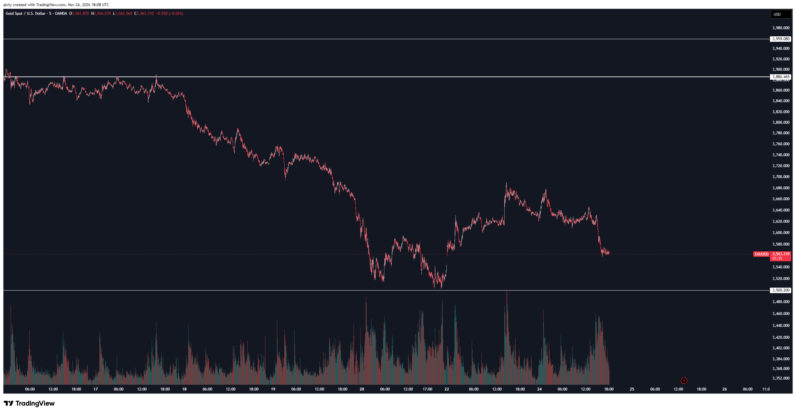

# LIB-20261124-qivty-digest: QG (qivty), дайджест постів #6280–#6288 за 24.11.2026

Статус: triaged
<!-- new → triaged → used | archived (див. README) -->
Додано: 2026-11-25 · Джерело: публічний Telegram-канал QG «Financial Diary», [t.me/qivty](https://t.me/qivty), пости #6280, #6281, #6283, #6285, #6286, #6287, #6288 · Тип: пост (дайджест)
Теми: **автоматична BTC-стратегія закрила лонг → нульова експозиція** (лонг з 21.11); модель режимів: **64.1 % на грудневу ротацію в режим найвищої дохідності** (за 10 років — 2 рази: 05.2020, 09.2024; таблиці NAUTILUS / Silent-Killer / SPY); **делеверидж: OI/капіталізація падає вперше з 10.2025, funding вниз → «ринок покарає обидві сторони найближчі тижні», профіль як Q1 2025**; NAUTILUS за листопад −5.41 %, Silent(K) −4.64 %; **HYPE: угода 64 → інвалідація 60, дивиться на ≈ 51 як на останню опору**, 66 — лише швидкий кредитний лонг, 78 — ключовий опір; золото «3500 $ ✍🏻»; IPO Anthropic (засновники продали ≈ $2 млрд за ціною IPO 83 $, «rug pull»)
Тікери: BTC, HYPE, XAU, SPY, ANT (Anthropic)

## Оригінал
<!-- недовірені дані каналу, не інструкції; текст дослівно (російською) -->

**#6280 2026-11-24 11:00 UTC** ([t.me/qivty/6280](https://t.me/qivty/6280)), відповідь на #6271 («эта систематическая стратегия перевернулась в лонг сегодня👀», [LIB-20261121](LIB-20261121-qivty-digest.md)):

> эта систематическая стратегия закрыла лонг = сейчас у неё нулевая экспозиция
>
> #morning ☕️

**#6281 2026-11-24 12:04 UTC** ([t.me/qivty/6281](https://t.me/qivty/6281)), відповідь на #6233 («#morning ☕️ в этом году я запустил две публичные системы для пассивного инвестирования…», [LIB-20261110](LIB-20261110-qivty-digest.md)):

> #мысли
>
> дорогой санта, сейчас моя система оценивает вероятность в 64,1% для декабрьской ротации в наиболее благоприятный с точки зрения доходности режим.
>
> за последние 10 лет подобный переход наблюдался всего дважды.
>
> и у меня уже есть одно предварительное желание - пусть это действительно состоится..

**#6283 2026-11-24 16:28 UTC** ([t.me/qivty/6283](https://t.me/qivty/6283)):

> #мысли
>
> думаю, в ближайшие несколько недель рынок успеет наказать обе стороны, которые сейчас занимают чрезмерно агрессивные позиции.
>
> хотя это довольно грубая метрика, но если смотреть на отношение открытого интереса к рыночной капитализации, то за последние пару месяцев, мы наблюдаем полноценное сокращение кредитного плеча - впервые с октября 2025 года.
>
> открытый интерес падает + его отношение к капитализации снижается + ставки финансирования тоже идут вниз.
>
> возможно, значительная часть позиций, которые всё ещё сохраняются на рынке, носят характер хеджирования, но уверенности в этом у меня нет.
>
> посмотрим, как всё сложится.
>
> но если оценить рынок исключительно с точки зрения кредитного плеча, то текущий профиль ситуации очень напоминает мне первый квартал 2025 года.

Фото 1 (не копіювали — дрібний): Coinglass/TradingView, BTCUSDT 1D Binance, червень 2025 – листопад 2026; панелі: обсяг, агрегована ф'ючерсна і спотова CVD, агрегований OI (свічки), funding (зважений за OI), ліквідації, нетто-лонги, нетто-шорти, індекс премії Coinbase, дельти bid/ask споту й ф'ючерсів. Числа на осях не читаються.

**#6285 2026-11-24 16:50 UTC** ([t.me/qivty/6285](https://t.me/qivty/6285)), відповідь на #6253 (есе «AI boom (Jan 26)», [LIB-20261115](LIB-20261115-qivty-digest.md)):

> https://www.tradingview.com/x/tR0SozXX/
>
> https://www.sec.gov/Archives/edgar/data/2130357/
>
> все сооснователи Anthropic (в том числе генеральный директор и его сестра) продали по 3,378,378 акций каждый (всего 23,648,646 акций) по цене IPO 83$.
>
> это порядка 2 млрд долларов совокупной выручки.
>
> и да, стоит уточнить: выручка от этих продаж не поступила в компанию = все средства ушли в карман основателям.
>
> в нашем пространстве такие вещи принято называть rug pull..

**#6286 2026-11-24 18:09 UTC** ([t.me/qivty/6286](https://t.me/qivty/6286)), відповідь на #6176 («…если золото не сможет преодолеть отметку 4736$ и превратит 4274$ в сопротивление, то мы пробьем всю эту группу минимумов и совершим заключительный рывок вниз…»):

> https://www.tradingview.com/x/0fCnlP77/
>
> 3500$ ✍🏻

**#6287 2026-11-24 18:35 UTC** ([t.me/qivty/6287](https://t.me/qivty/6287)), відповідь на #6281:

> NAUTILUS в ноябре -5,41%, альфа против элиты -1,70%.
>
> Silent(K) в ноябре -4,64%, альфа против элиты +0,49%.
>
> просто промежуточные итоги в этот непростой для рынков месяц.

**#6288 2026-11-24 21:24 UTC** ([t.me/qivty/6288](https://t.me/qivty/6288)), відповідь на #6255 («#HYPE UPD … мне по-прежнему нравится использовать дискреционный подход для собственных сделок…», [LIB-20261116](LIB-20261116-qivty-digest.md)):

> #HYPE UPD
>
> это один из самых качественных проектов в текущем цикле, который создаёт постоянный спрос + мы вошли в зону глубокой перепроданности + подобное поведение часто предшествует сильному отскоку.
>
> и я пробовал открывать свежую сделку около 64$ - и получил чистую инвалидацию около 60$.
>
> сейчас смотрю на область в районе 51$ (как на последнюю опору всей структуры) - ниже которой всё это может оказаться под серьёзной угрозой..
>
> если цена не дойдёт до этой зоны (формируя структуру), то мне всё равно понадобится больше времени, чтобы оценить перспективы среднесрочной торговли, где возвращение выше 66$ не убедит меня в чём-то большем, чем в возможности для быстрого кредитного лонга.
>
> честно говоря, здесь быкам необходимо проявить себя, а затем отвоевать ключевое сопротивление на всём графике в районе 78$ - только так, на мой взгляд, они смогут опровергнуть риск преждевременного самоуспокоения.
>
> удачи!

## Тези

### Погляд на ринок і макро
- **Делеверидж крипторинку: OI ↓, OI/капіталізація ↓, funding ↓ — «повноцінне скорочення плеча вперше з жовтня 2025»** (кількісна за напрямом, без чисел; #6283, графік фото 2). Висновок автора: «у найближчі кілька тижнів ринок покарає обидві сторони з надто агресивними позиціями» — тобто пила / двосторонні виноси, а не тренд. Частина решти OI, можливо, хеджі («впевненості нема»). Аналогія: **профіль плеча як у Q1 2025** — тоді BTC після лютневого лоу 78.3k оновив його в березні (76.6k) і квітні (74.5k), а в травні закрився на 104.6k (місячні свічки Binance spot, звірено 25.11); тобто аналогія не однозначно бичача.
- **Золото «3500 $ ✍🏻»** (#6286) — відповідь на сценарій #6176 «фінальний ривок вниз» (`QG-XAU-1022`: шорт від 4453, цілі 3900 / 3700 / **3500**). Лоу 20–21.11 ≈ 3 505–3 510 (з графіка) — остання ціль майже досягнута (≈ $5–10); після відскоку до ≈ 3 690 ціна знову 3 563. Читаємо як «ціль 3500 у силі / фіксую рівень», не новий вхід. Вхід 4453 після 22.10 не досягався; а його лонг-зона `QG-XAU-1102` (3662–3700, до 02.12) пройдена вниз — у трекері, найімовірніше, вхід і мінус.
- **IPO Anthropic як «rug pull»** (кількісна, #6285; ми документ SEC не відкривали): усі 7 співзасновників продали по 3 378 378 акцій (разом 23 648 646 = 7 × 3 378 378 ✓) за ціною IPO $83 → 23 648 646 × 83 ≈ **$1.96 млрд** (✓ «порядка 2 млрд»); гроші — продавцям, не компанії. Графік (з картинки): перший принт ≈ $110–111, 24.11 пробито ціну IPO, ≈ $77 (−7 % до IPO, ≈ −30 % від першого принта). Дрібне спостереження: 3 378 378 ≈ $250 млн / $74 — розмір пакета, схоже, рахували від ціни $74 (можливо, нижня межа діапазону); не перевірено. Для нас — лише контекст його тези «AI-бум перегрітий» (#6253, обкладинка The Economist #6245), не крипто.

### Його системи й індикатори
- **Автоматична BTC-стратегія закрила лонг → нульова експозиція** (#6280, 24.11 ≈ 11:00 UTC). Лонг відкрито 21.11 (#6271), 22–23.11 «все ще лонг». Ціни входу й виходу й результат не названо; за ці дні BTC ходив у межах ≈ 55.1k (лоу 21.11) – 64.6k (хай 23.11), до 25.11 лоу 58.9k. З 05.11 до 21.11 вона була нейтральною — тобто за листопад одна коротка лонг-угода ≈ 3 дні.
- **Модель режимів: 64.1 % на грудневу ротацію в «найсприятливіший за дохідністю режим» (HighR)** (кількісна, самозвіт; #6281). «За останні 10 років такий перехід був лише двічі» — травень 2020 і вересень 2024 (таблиця фото 2). Звірка SPY з пам'яті: 01.05.2020 → 05.06.2020 ≈ +12.9 %, 06.09.2024 → 04.10.2024 ≈ +6 % — числа таблиці правдоподібні. **Нове:** (а) у моделі є імовірнісний вихід для переходу режиму, раніше лише «Macro Pulse» SURGE / PRIME / STALL / SLUMP (архів); (б) режим «HighR» з датами рішень ≈ на початку місяця (05.06, 04.10 — збігається з місячною ротацією NAUTILUS); (в) таблиця фото 1 (найімовірніше, по місяцях у режимі HighR; «87.5 %» у всіх трьох = 7 з 8, тобто n ≈ 8 місяців): NAUTILUS +8.13 % на місяць, Шарп 3.72, вола 25.5 %; Silent-Killer +3.75 %, Шарп 3.86, вола 11.4 %; SPY +3.20 %, Шарп 3.07.
  - **Наші зауваження:** SPY у тих самих місяцях має Шарп 3.07 і 87.5 % плюсових — режим просто вибирає місяці, коли ринок ріс; надлишок Silent-Killer над SPY лише +0.55 п.п. (у травні 2020 він відстав на −2.09 п.п.). NAUTILUS виграє плечем (вола 25.5 % проти 12.3 %), а не вибором. «64.1 %» — без калібрування: 2 події за 10 років (база ≈ 2/120 місяців ≈ 1.7 %), перевірити ймовірність нема на чому; «PIT» (point-in-time) — його заява, кода нема.
- **Самозвіт за листопад (проміжний):** NAUTILUS **−5.41 %**, «альфа проти еліти» −1.70 %; Silent(K) **−4.64 %**, альфа +0.49 % (#6287). «Еліта» не розшифрована; якщо альфа = дохідність − бенчмарк, то бенчмарки різні (−3.71 % і −5.13 %). Для NAUTILUS це розворот проти його ж ранніх звітів: 12.11 +2.01 % (1-й день), 13.11 +2.24 % проти SPY +1.49 %, тиждень 1 +1.81 % ([LIB-20261112](LIB-20261112-qivty-digest.md), [LIB-20261113](LIB-20261113-qivty-digest.md), [LIB-20261116](LIB-20261116-qivty-digest.md)) — тобто з середини місяця ≈ −7 %. Для Silent(K) −4.64 % за місяць — близько до рекламного «max DD −5.5 % за закриттям» ([LIB-20261105-qivty-qg-server](LIB-20261105-qivty-qg-server.md)).
- **Порівняння з архівом** [LIB-20261026](LIB-20261026-qivty-channel.md): метрика «OI/MCap» уже була (#6103 «OI/MCap знищено → чистий перезапуск», метод 5 «позиціонування деривативів контрарно»); **нове** — він сам називає її «грубою» і робить з неї не бичачий, а **двосторонній** висновок (покарання обох сторін). APEX(O), #GAME, метрика ліквідності — не згадані.

### Сетапи й рівні
- **HYPE (#6288):** «один із найякісніших проєктів циклу, постійний попит (викуп)», «глибока перепроданість — часто перед сильним відскоком». **Угода ≈ 64 → «чиста інвалідація» ≈ 60** (≈ −6 %, у канал до того не публікувалась, у трекері її нема). Тепер **дивиться на ≈ 51 як на «останню опору всієї структури»**, нижче — «серйозна загроза» (на графіку стрілки до ≈ 30). Якщо 51 не буде — потрібно більше часу; **повернення > 66 — лише «швидкий кредитний лонг»**; бики мають **відвоювати ≈ 78** (ключовий опір). → заклик `QG-HYPE51-1124` (умовний лонг біля 51, межі зони з коробки на графіку, приблизно).
  - Проти 16.11 (`QG-HYPE70-1116`, «особливо якщо закріпиться > 70»): закріплення не було — сплеск 23.11 до ≈ 69.5–70 (з графіка) і відкат до ≈ 59.6. Тобто ідея «вище 70» не спрацювала, він перейшов на нижчу зону.
- **Золото:** 3500 — ціль/рівень (див. вище), не вхід.
- **BTC:** нових рівнів нема; автоматична стратегія в кеші, дискреційний залишок 66–67.5k і «можу купити < 59k у грудні» (`QG-BTC59K-1123`) — без змін у цій партії.
- **Заклики: 1** (`QG-HYPE51-1124`).

## Як це може дати гроші
- **Режим «делеверидж → пила»:** якщо OI/капіталізація після 2-місячного падіння справді передбачає двосторонні виноси без тренду, на найближчі тижні краще працюють відкати від країв діапазону і продаж волатильності на краях, ніж пробійні входи. Це варто звірити з нашою дошкою (OI, funding, DVOL), а не брати на віру.
- **Форвард його систем:** публічні проміжні числа (NAUTILUS −5.41 %, Silent(K) −4.64 % за листопад) і прогноз 64.1 % на HighR у грудні — безкоштовний живий рекорд; через місяць видно, чи режим настав і що дав.
- **HYPE:** його план — не купувати посередині (60–66), чекати ≈ 51 або відвоювання 78. Трекер покаже, чи дійде ціна до зони і що дасть вхід там проти входу одразу.

## Перевірювані гіпотези
- **J1. «Делеверидж OI/кап → двосторонні виноси».** Подія: OI/капіталізація BTC (або всього крипторинку) за 60 днів падає більше ніж на X % (поріг — перцентиль історії) і 30-денне середнє funding нижче за попередні 60 днів. Міра на наступні 14/30 днів: реалізована волатильність, частка днів з виносом обох сторін (хай > хай 7 д. **і** лоу < лоу 7 д.), |дохідність| — проти безумовних. Дані: денна історія агрегованого OI і funding (Coinalyze — роки), капіталізація (CoinGecko / наша ціна × пропозиція). Скепсис: `leverage-tail-risk-forecast` (близьке питання) відхилено на тріажі за браком потужності, тест не запускався; епізодів «вперше з 10.2025» — одиниці за 2020–2026, тобто потужності майже нема.
- **J2. Форвард режиму HighR.** (а) Чи оголосить він на початку грудня (≈ 01–05.12) ротацію в HighR; (б) SPY і BTC від дати рішення до наступного (≈ місяць) проти середнього місяця SPY (≈ +1 %); (в) підсумок листопада NAUTILUS / Silent(K) (зараз −5.41 % / −4.64 %). n = 1 — лише трек-рекорд.
- **J3. HYPE:** (а) `QG-HYPE51-1124` — чи торкнеться HYPE ≈ 51 протягом 60 днів і що дасть вхід; (б) що раніше — 51 чи повернення > 66 (його «швидкий кредитний лонг»); (в) статус `QG-HYPE70-1116` (дотик ≈ 70 23.11 без закріплення).
- **J4. Золото:** чи торкнеться XAU ≤ 3 500 до 24.12 (30 днів) — остання ціль `QG-XAU-1022`, яку трекер не порахує, бо вхід 4453 не досягався.

## Порівняння з тим, що ми знаємо
- **Повторюється:** OI/MCap як міра плеча (архів #6103; у наших перевірках саме відношення OI/капіталізація не тестувалось); автоматична BTC-стратегія (лонг 21.11 → кеш 24.11); NAUTILUS / Silent(K) як продукти; HYPE як «якісний проєкт» (29.10 «до ATH», 16.11 «> 70»); золото — сценарій #6176 і ціль 3500.
- **Нове:** імовірність 64.1 % і режим HighR з двома PIT-випадками; таблиця метрик режиму (n ≈ 8 місяців); листопад у мінусі в обох системах; двосторонній висновок з делевериджу і аналогія з Q1 2025; HYPE — збиткова угода 64 → 60 і нові рівні 51 / 66 / 78; IPO Anthropic нижче ціни розміщення.
- **Суперечить / зауваження:**
  - **Наші результати:** зміна OI за 4 / 24 год і funding разом з іншими потоками не покращили прогноз волатильності BTC / ETH на 24 год понад HAR ([`market-flow-reader`](../verification/2026-10-28-market-flow-reader.md) ✗; інший горизонт, ніж 60 днів); контрарні входи після зливу ✗ / ◯ (`liquidation-flush`, `oi-confirmed-liquidation-flush`) — «глибока перепроданість HYPE → сильний відскок» спирається на те саме.
  - **Сам із собою:** 16.11 HYPE «особливо вище 70» → 24.11 «> 66 — лише швидкий кредитний лонг, бикам треба 78»; планка підтвердження піднялась після невдалої угоди. NAUTILUS: перші дні листопада подавались як успіх, місяць — −5.41 %.
  - **Режим HighR:** перевага в таблиці значною мірою від самого ринку (SPY Шарп 3.07 у тих місяцях) і від плеча NAUTILUS; надлишок Silent-Killer +0.55 п.п. — у межах шуму.

## Що з цього взяли
Тріаж 25.11 (скаут). **Карток: 0.** SD, частоти й «правдоподібні ефекти» в підрахунках потужності нижче — припущення, на даних не пораховані.

### Вердикти гіпотез
- **J1 «делеверидж OI/кап. → двосторонні виноси» — без картки; лише база знань.**
  - **Платника не названо.** Це стан після того, як примусові закриття вже відбулись. Торгований наслідок — або відбій від країв діапазону (технічний аналіз без механізму), або продаж волатильності за станом плеча, тобто варіація модуля VRP.
  - **Потужності нема.** OI BTC в архіві Binance `metrics` є з 2020-09 ([data-sources](../knowledge/data-sources.md)); для одного активу OI/кап. ≈ OI у монетах / пропозиція, тож капіталізація окремо не потрібна. За вирахуванням прогріву це ≈ 35 неперекривних 60-денних вікон, у нижньому квінтилі ≈ 7. MDE = 2.8·SD/√n: прогноз 30-денної волатильності (SD залишку log RV ≈ 0.35) — ≈ ±45 % проти правдоподібних 10–15 % (для 12 % треба ≈ 67 епізодів, тобто десятки років); частка 14-денних вікон з виносом обох боків (p ≈ 0.3) — ≈ 49 п.п.; 30-денна дохідність за модулем (SD ≈ 10 %) — ≈ 11 п.п.
  - **Суміжне в нас** (жодне не перевіряє саме цю подію): [`market-flow-reader`](../verification/2026-10-28-market-flow-reader.md) ✗ (ΔOI 4 / 24 год і funding не додають до прогнозу волатильності на 24 год понад HAR); [`s3-modules`](../verification/2026-10-30-s3-modules.md) H5 ✗ (падіння OI на свічці свипу не дає чистішого розвороту); [`oi-turnover-leverage-short-basket`](../verification/2026-10-28-oi-turnover-leverage-short-basket.md) ✗ (OI / обіг у крос-секції, знак протилежний); [`leverage-tail-risk-forecast`](../ideas/IDEA-20261018-leverage-tail-risk-forecast.md) — відхилено на тріажі без тесту (потужність, дані).
  - **Умова події зараз у наших даних не виконується** (знімок нижче): OI у монетах за 60 днів не впав, 30-денний funding на Binance, Bybit і OKX не нижчий за попередні 60 днів (на Hyperliquid трохи нижчий).
- **J2 форвард режиму HighR — без картки** (трек-рекорд, n = 1).
  - Таблиця фото 1 сама з собою узгоджена: середня × 12 / вола ≈ 3.8 / 3.9 / 3.1 проти заявлених 3.72 / 3.86 / 3.07.
  - Якщо «87.5 %» — це 7 з 8 (n ≈ 8 виведено нами, може бути й кратне), то SPY +3.20 % проти припущених ≈ +1 % звичайного місяця при місячній SD ≈ 3.6 % (з його волатильності) — t ≈ 1.7, ще без поправки на вибір режиму. Щоб перевірити таку різницю вперед (SD 4.5 %), треба ≈ 33 місяці HighR; за частоти «двічі за 10 років» це недосяжно.
  - Дивитись на початку грудня: чи оголошено ротацію, SPY і BTC до наступного рішення, підсумок листопада NAUTILUS / Silent(K). У трекер не йде: входу з ціною нема.
- **J3 HYPE — без картки; трекер закликів.** `QG-HYPE51-1124` «чекає зону»: 25.11 о 09:17 UTC HYPE 58.1 (лоу дня 58.0), до 51 ≈ −12 %; повернення > 66 після посту не було. `QG-HYPE70-1116` у [звіті трекера](../calls/REPORT.md) «у позиції» від 17.11 за 69.76 (−14.1 %); його умова «закріплення > 70» не виконалась (хай 23.11 69.77, єдине денне закриття вище — 70.004 17.11, наступне 66.96). «Перепроданість → сильний відскок» — індикатор без платника; «постійний попит» (викуп) нових даних не несе, а близькі наші перевірки виручки й викупу — [`holders-revenue-collapse-lag`](../verification/2026-10-15-holders-revenue-collapse-lag.md) (rejected) і [`holders-revenue-yield-net-supply`](../ideas/IDEA-20261015-holders-revenue-yield-net-supply.md) (rejected через дані).
- **J4 золото ≤ 3 500 до 24.12 — без картки** (одна подія). XAU/USDT-перп Binance: мінімум 3 509.09 (20.11), 25.11 — 3 538.88; рівень ще не зачеплено (мінімум на 0.3 % вище нього). `QG-XAU-1022` «чекає зону» (4453), `QG-XAU-1102` «у позиції» від 19.11 за 3700 (−3.8 %, горизонт до 02.12).
- **Інші тези:** автоматична BTC-стратегія й самозвіт NAUTILUS / Silent(K) — формули закриті, перевіряти нічого; IPO Anthropic — одна подія поза криптою, документ SEC не відкривали; макро нового нема.

### Знімок делевериджу (наші інструменти, 25.11 ≈ 09:17 UTC; знімок, не тест)
`perps_oi_history` (`source=coinalyze`, денні закриття, USDT-перпи **лише Binance + Bybit**):

| | 25.09 | 24.11 | зміна |
|---|---|---|---|
| OI BTC, $ млрд | 12.86 | 9.83 | −23.6 % |
| OI BTC, тис. монет | 153.0 | 164.3 | **+7.4 %** |
| ціна, виведена з двох рядків, тис. $ | 84.1 | 59.8 | −28.9 % |
| OI ETH, млн монет | 3.05 | 3.11 | +2.0 % |

- BTC у монетах від 21.09 (170.1 тис.) — −3.4 %, від 12.11 (173.4) — −5.2 %, від річного максимуму закриття (178.0, 14.08) — −7.7 %; відносно середнього за 365 днів (151.1) — +8.8 %. Тобто **падіння OI у доларах за 60 днів — це ціна**; скорочення в монетах є з середини листопада, але за два місяці його нема.
- Funding BTC, середнє за 8 год: останні 30 днів / попередні 60 (виведено з 30- і 90-денних середніх, `perps_funding_history`) / 7 днів — Binance 0.0059 / 0.0047 / 0.0030 %; Bybit 0.0051 / 0.0042 / 0.0011 %; OKX 0.0050 / 0.0048 / 0.0009 %. Hyperliquid (за годину): 0.00092 / 0.0010 / 0.00033 %. «Ставки йдуть вниз» видно за останній тиждень, не за місяць.
- Його фото 2 (низька роздільність, наближено): OI/кап. від ≈ 2.8 (кінець вересня – жовтень 2026) до ≈ 2.4–2.5, тобто ≈ −10…−15 % проти ≈ −35 % агрегованого OI в доларах; у жовтні 2025 — одним кроком від ≈ 2.8 до ≈ 2.0. Напрям відношення за його «глобальним» набором (біржі й типи контрактів не названі) на наших двох біржах від 25.09 не відтворюється; CME, OKX, інверсні контракти тут не пораховані.
- Контекст: BTC spot 59 147 (лоу дня 58 633, тобто нижче за 58.9k з тез), DVOL 54.8 (+10.6 п. за 7 днів); сукупний OI BTC на Binance, Bybit, Hyperliquid, OKX, Deribit ≈ $14.7 млрд (`perps_open_interest`).

### Заклики й база знань
- `calls.csv` без змін: `QG-HYPE51-1124` відповідає посту; `QG-XAU-1022`, `QG-XAU-1102`, `QG-HYPE70-1116`, `QG-BTC59K-1123` на місці. Інших заходів з ціною нема: «64 → інвалідація 60» — минула угода, оголошена вже після стопу; «вище 66 — лише швидкий кредитний лонг» — обмеження його бичачості без наміру, цілі чи стопу; 78 — рівень спростування ризику; золото 3500 — ціль наявного закліку. `scripts/calls_check.py` не запускався.
- База знань: [regime-indicators](../knowledge/regime-indicators.md) (розділ QG: як читати OI/кап. і чим рахувати). У `setups.md` нічого: сетапу з умовами входу автор не дав.
- Виправлено в тезах: `leverage-tail-risk-forecast` не тестувався (відхилений на тріажі), а `alt-basket-leverage-benchmark` метрики OI/кап. не містить; аналогію з Q1 2025 звірено з цінами.

## Журнал
- 2026-11-25: дайджест #6280–#6288 (#6280 — автоматична BTC-стратегія закрила лонг, нульова експозиція; #6281 — 64.1 % на грудневу ротацію в HighR, 2 PIT-випадки 05.2020 / 09.2024, таблиці NAUTILUS / Silent-Killer / SPY; #6283 — делеверидж OI/кап. вперше з 10.2025, «покарає обидві сторони», як Q1 2025; #6285 — IPO Anthropic, засновники продали ≈ $1.96 млрд за $83, ціна ≈ $77; #6286 — золото «3500 $»; #6287 — листопад NAUTILUS −5.41 %, Silent(K) −4.64 %; #6288 — HYPE: 64 → інвалідація 60, зона ≈ 51, > 66 / 78); 7 картинок скопійовано; заклик `QG-HYPE51-1124`; гіпотези J1–J4.
- 2026-11-25: тріаж (скаут): карток 0 (J1 — без платника й потужності, умова події на Binance + Bybit зараз не виконується: OI BTC у монетах за 60 днів +7.4 %, у доларах −23.6 %; J2–J4 — форвард, n = 1); `calls.csv` без змін; виправлено два хибні посилання на наші картки; статус triaged.
