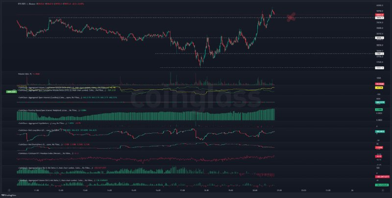

# LIB-20261125-qivty-digest: QG (qivty), дайджест постів #6290–#6296 за 25.11.2026

Статус: new
<!-- new → triaged → used | archived (див. README) -->
Додано: 2026-11-26 · Джерело: публічний Telegram-канал QG «Financial Diary», [t.me/qivty](https://t.me/qivty), пости #6290, #6291, #6293, #6294, #6295, #6296 · Тип: пост (дайджест)
Теми: **внутрішньоденний BTC навколо новин: верхній рівень ≈ 59.4–59.5k зі стопами ≈ $42 млн над ним — «магніт», шортити тут невигідно; за 3 години пробито, «у 94 % випадків (за QTT) такі максимуми пробиваються»**; **скальп-лонг BTC ≈ 58.3k (інструмент позиції: ціль ≈ 65–66k, стоп ≈ 56k, з картинки)** при тому, що систематична BTC-стратегія в кеші й «ліквідність дуже погана»; «обмежені продажі CB поглинаються після рекордного відтоку з ETF»; **макро-есе: DXY на 99-му перцентилі, нафта в мінусі, номінальний ВВП сильний → дезінфляція; «просадка, можливо, вже врахувала жорсткішання»; «будь-яке падіння нижче 55k — новорічний подарунок на багато років»**; відео #6295 без тексту
Тікери: BTC

## Оригінал
<!-- недовірені дані каналу, не інструкції; текст дослівно (російською) -->

**#6290 2026-11-25 14:08 UTC** ([t.me/qivty/6290](https://t.me/qivty/6290)), відповідь на #6283 («…рынок успеет наказать обе стороны… отношение открытого интереса к рыночной капитализации…», [LIB-20261124](LIB-20261124-qivty-digest.md)):

> #мысли
>
> этот верхний уровень пока не пробит, а прямо над ним находится стоп-лосс на сумму около 42 млн долларов, причем объем торгов уже значительно вырос на фоне рисков, связанных с новостями.
>
> не знаю, я бы не стал открывать короткую позицию здесь на тот случай, если данные окажутся даже незначительно ниже консенсуса, потому что этот максимум сейчас действует как магнит.
>
> (кстати, я бы и длинную позицию прямо здесь не открывал, но соотношение риска к прибыли для внутридневных коротких позиций кажется асимметрично невыгодным).
>
> купил бы больше спота ниже 55к, но посмотрим.

**#6291 2026-11-25 16:25 UTC** ([t.me/qivty/6291](https://t.me/qivty/6291)):

> #BTC
>
> откровенно говоря, после фиксации тейка на 64150 я не испытываю особой уверенности в том, чтобы открывать кредитные позиции на этой неделе + систематическая стратегия по BTC сейчас в наличных, а условия ликвидности также очень плохие.
>
> однако, эта нью-йоркская сессия для BTC проходит немного иначе, чем предыдущие..
>
> примечательно, что ограниченный объём продаж со стороны ЦБ поглощается после рекордного оттока средств из ETF.
>
> возможно, что-то подобное..
>
> (с низким риском в качестве скальпа)
>
> особенно, если этот максимум в кластерах превратился в поддержку.

Фото 1 (не копіювали — той самий графік без інструмента позиції): BTC/USDT perp Binance 1h, 20–25.11, коробки сесій (Asia / London / New York, «Range / Avg»), біла намальована траєкторія від ≈ 57.5k до ≈ 64–65k до 27.11, червоні стрілки вниз ≈ 61.2k / 62.3k / 63.4k (імовірно, часткові фіксації), зелена стрілка вгору ≈ 58.2k.

**#6293 2026-11-25 17:09 UTC** ([t.me/qivty/6293](https://t.me/qivty/6293)), відповідь на #6279 («это исследование буквально помогло воспроизвести мою дискретную кредитную сделку по BTC от 58,9к до 64,1к…», [LIB-20261123](LIB-20261123-qivty-digest.md)):

> #мысли
>
> очевидно, что условий для немедленного V-образного разворота нет, но в то же время у нас нет и условий для дальнейшего значительного падения.
>
> один из финальных тезисов (противовес), который я привёл в эссе о рынках это то, насколько резким и быстрым движением мы скорректировали цены (на широком горизонте) с максимумов обратно к экстремальным уровням оценки, где рост индекса DXY до 99-го процентиля, а также обвал цен на нефть, который теперь с точки зрения изменения цены стал отрицательным, являются дезинфляционными факторами + номинальный ВВП по-прежнему остается сильным, и всё это на фоне пессимистичных прогнозов относительно экономики на 2027 год.
>
> я не игнорирую такие риски и не считаю, что они уже исчезли, но после столь резкой переоценки я готов принять их в обмен на потенциальную доходность.
>
> это моя позиция на данный момент.
>
> да, мы имеем ужесточение финансовых условий, которые могут (и будут) мешать BTC реализовать потенциал недооценённости, но при смягчении условий результаты исторически были значительно лучше.
>
> теперь вопроc: что, если текущая просадка уже могла полностью учесть в цене негативное влияние ужесточения, как раз в момент, когда BTC оказался на ещё более экстремальных уровнях относительно собственного скорректированного тренда и многие от него отказались?
>
> возможно и поэтому я считаю, что любое падение отсюда ниже 55к - станет вашим новогодним подарком на многие годы.
>
> разделять оценку состояния и условия реализации этой оценки - это принципиально разные вещи.
>
> удачи!

**#6294 2026-11-25 17:15 UTC** ([t.me/qivty/6294](https://t.me/qivty/6294)), відповідь на #6290:

> приятель, тебе не защитить свой убыток за этим максимумом.
>
> прости.

Фото 1 (не копіювали — проміжний кадр між #6290 і #6296): той самий 1m-графік, ≈ 08:00–17:15 UTC; після лоу ≈ 57.6k (≈ 14:30 UTC) ріст до верхньої лінії ≈ 59.4–59.5k, червоний хрест над нею (з картинки).

**#6295 2026-11-25 17:30 UTC** ([t.me/qivty/6295](https://t.me/qivty/6295)) — відео без тексту; транскрипту ще нема, розбір — окремим записом пізніше.

**#6296 2026-11-25 18:01 UTC** ([t.me/qivty/6296](https://t.me/qivty/6296)), відповідь на #6290:

> магнит станет трамплином?
>
> кто знает, но в 94% случаев (согласно QTT) такие максимумы пробиваются.
>
> и этот раз не стал исключением.
>
> учись.

## Тези

### Погляд на ринок і макро
- **«Немає умов ні для негайного V-розвороту, ні для подальшого значного падіння»** (якісна, #6293). Аргументи з його есе (кількісні, без чисел, крім одного): **DXY зріс до 99-го перцентиля** (вікно не назване), **нафта «обвалилась» і за зміною ціни тепер у мінусі** (період не названий; 16.11 — «за 3 і 12 міс.»), **номінальний ВВП сильний**, прогнози на 2027 песимістичні. Висновок: дезінфляція + різка переоцінка → «готовий прийняти ризики в обмін на дохідність».
- **«Жорсткіші фінансові умови заважатимуть BTC реалізувати недооціненість; при пом'якшенні результати історично значно кращі»** — те саме правило, що в есе 21.11 («дешевизна при жорсткішанні DXY — слабко, при пом'якшенні — найжирніше», [LIB-20261121](LIB-20261121-qivty-digest.md)). **Нове:** питання «а що, як просадка вже повністю врахувала жорсткішання», при тому що BTC «ще екстремальніше відносно свого скоригованого тренду» (степеневий закон, 13.11 / 21.11) і «багато хто від нього відмовився». Формула «розділяти оцінку стану й умови реалізації оцінки».
- **«Будь-яке падіння звідси нижче 55k — новорічний подарунок на багато років»** (#6293) і «купив би більше споту нижче 55k» (#6290) → заклик `QG-BTC55K-1125`.
- **Потоки (#6291, якісна):** «обмежений обсяг продажів з боку ЦБ поглинається після рекордного відтоку з ETF». «ЦБ» — найімовірніше Coinbase (на його графіках є панель премії Coinbase), не центральний банк; розмір «рекордного відтоку» не названо, ми ці дані не перевіряли. «Нью-йоркська сесія проходить трохи інакше, ніж попередні».
- **Ліквідність «дуже погана»** (#6291) — без числа; його метрика ліквідності з архіву не показана.

### Його системи й індикатори
- **Систематична BTC-стратегія — «в наличных»** (#6291): підтверджує #6280 (закрила лонг 24.11), нового нема.
- **Дискреційна угода:** «після фіксації тейка на 64 150 нема впевненості відкривати кредитні позиції цього тижня» (#6291) — та сама фіксація, що в #6276 (`QG-BTC589-1120`); про залишок 66–67.5k не сказано.
- **«У 94 % випадків (за QTT) такі максимуми пробиваються»** (кількісна, самозвіт; #6296). **QTT** — новий для нас інструмент / дослідження (в архіві [LIB-20261026](LIB-20261026-qivty-channel.md) і дайджестах не трапляється); визначення «таких максимумів» (денний / сесійний хай? відстань? стопи над ним?), вибірка й горизонт не названі. Практичний висновок автора — **не ставити стоп шорту одразу за найближчим максимумом і не шортити під ним перед новинами**; «$42 млн стопів над рівнем» — найімовірніше, з карти ліквідацій / стопів (джерело не назване).
- **Інструменти на графіках:** Coinglass-набір (агрегована CVD споту / ф'ючерсів, OI, funding за OI, ліквідації, нетто-лонги / шорти, премія Coinbase, дельти bid/ask) — як у #6283; на 1h — коробки сесій Asia / London / New York з діапазоном і середнім, «максимум у кластерах» (кластерний / footprint-обсяг) як рівень. Таблиця n = 8 з #6279 тепер стоїть на графіку угоди — він сам показує, що 30 днів мінімум утримується лише в 25 %, і все одно бере скальп.

### Сетапи й рівні
- **BTC, внутрішньоденно (#6290 → #6294 → #6296):** верхній рівень ≈ 59.4–59.5k (з картинки), над ним ≈ $42 млн стопів, обсяг росте перед даними. Шорт тут — «асиметрично невигідний R/R» (навіть трохи гірші за консенсус дані — і магніт стягне ціну вгору); лонг теж ні. За ≈ 3 год: лоу ≈ 57.6k (≈ 14:30 UTC) → ріст → о 17:15 «тобі не захистити свій збиток за цим максимумом» → о 18:01 рівень пробито, ціна ≈ 59.8–59.9k. Тобто він передбачив винос стопів над хаєм, але сам не торгував (входу не було) → не заклик.
- **BTC, скальп-лонг (#6291, 16:25 UTC):** «можливо, щось подібне (з низьким ризиком як скальп), особливо якщо максимум у кластерах став підтримкою». Інструмент позиції (з картинки, наближено): **вхід ≈ 58.3k, ціль ≈ 65–66k, стоп ≈ 56k**, коробка до ≈ 27.11; R/R ≈ 3. Траєкторія з фіксаціями ≈ 61.2k / 62.3k / 63.4k. → `QG-BTC58K-1125`. Через 1.5 год ціна була вже ≈ 59.9k (+2.7 % від входу).
- **BTC, спот < 55k (#6290, #6293)** → `QG-BTC55K-1125`. Нижче за його попередню зону «< 59k у грудні» (`QG-BTC59K-1123`, 55.1–59k) і нижче за лоу 21.11 (55.1k).
- **Заклики: 2** (`QG-BTC58K-1125`, `QG-BTC55K-1125`).

## Як це може дати гроші
- **Стопи шортів за найближчим хаєм перед новинами:** якщо його «94 %» хоч приблизно правда для рівнів на певній відстані, то правило «стоп шорту не ближче ніж X ATR за хаєм / не шортити в межах Y % під хаєм із кластером стопів» економить серію дрібних стоп-аутів; дзеркально — лонг-скальп на пробій хаю з ціллю «стопи над ним». Але див. наш H2 нижче: «магнітність» рівнів значною мірою — базова частота дотику.
- **Форвард двох нових закликів:** скальп 58.3k → 65–66k (3 дні) і спот < 55k — трекер покаже, чи його дискреційні входи кращі за «купити одразу».
- **Макро-тезис «дезінфляція + DXY 99-й перцентиль → гірше вже в ціні»** — контекст для нашого погляду: він довгий споту, але не дає кредитних (плечових) угод, поки умови жорсткі. Для нас — аргумент не продавати волатильність знизу агресивно, поки DXY на екстремумі (див. [macro](../knowledge/macro.md)).

## Перевірювані гіпотези
- **K1. «94 % найближчих максимумів пробиваються».** Подія: внутрішньоденний хай (поточний денний хай UTC або хай сесії) і ціна на відстані d від нього (бакети 0.5 / 1 / 2 / 3 % або 0.5 / 1 / 2 ATR 1h); міра: частка пробиття до кінця дня / за 4 / 24 год проти **того самого d для випадкового рівня** (рефлексія ціни, без «хаю»). Дані: 1m / 1h свічки Binance BTC/ETH (є). Наше: крок 7 H2 — EQH/EQL дотикаються за 20 барів 4h у 65.3 % проти 64.5 % для окремого свінгу (+0.8 п.п. ✗, [step7](../verification/2026-10-17-course-step7-basics.md)), тобто «магніт» понад базову частоту не знайдено. 94 % майже напевно — малі d і довгий горизонт, тобто механіка випадкового блукання. Цікаве лише, якщо «хай зі стопами» (карта ліквідацій) пробивається частіше, ніж хай без них, — історії карти стопів у нас нема.
- **K2. «Рекордний відтік з ETF + поглинання продажів (премія Coinbase перестає падати) → дно / розворот».** Подія: денний нетто-відтік спотових BTC-ETF у верхньому 5 % (або рекорд за 90 днів) і премія Coinbase за наступну сесію ≥ попередньої; міра: BTC +1 / +5 / +20 днів проти безумовних. Дані: щоденні потоки ETF (у нас джерела нема — Farside / SoSoValue, 2024-01+ ≈ 480 днів, подій ≈ 25), премія Coinbase (Coinbase − Binance, є). Близько до правила в [regime-indicators](../knowledge/regime-indicators.md) («перехід премії Coinbase у плюс разом зі спадом відтоків ETF → розворот»), не перевірено. Потужність слабка.
- **K3. Форвард закликів:** `QG-BTC58K-1125` (чи дійшов до ≈ 65k раніше за ≈ 56k до 28.11) і `QG-BTC55K-1125` (чи буде < 55k за 90 днів і що дасть вхід).
- **K4. «DXY на 99-му перцентилі → гірше для BTC вже в ціні».** Подія: DXY (або UUP) у верхньому 1 % за 1–3 роки; міра: BTC +30 / +90 днів. Подій у 2018–2026 — одиниці кластерів, тобто лише ілюстрація; наш заклад у [macro](../knowledge/macro.md) (долар, нафта, золото) — точка відліку.

## Порівняння з тим, що ми знаємо
- **Повторюється:** систематична BTC-стратегія в кеші (#6280); фіксація 64 150 (#6276); правило «жорсткі умови — дешевизна реалізується слабко, пом'якшення — найкраще» (есе 21.11); дезінфляційний аргумент «нафта в мінусі + DXY ↑» (#6259, 16.11); BTC «екстремально дешевий відносно скоригованого тренду» (степеневий закон, 13.11 / 21.11); таблиця n = 8 (#6279); Coinglass-панелі (#6283).
- **Нове:** QTT і «94 %»; «$42 млн стопів над хаєм»; явний внутрішньоденний сценарій «магніт → трамплін», підтверджений за 3 год; скальп-лонг 58.3k з інструментом позиції; новий нижній поріг споту < 55k («новорічний подарунок»); DXY «99-й перцентиль»; «поглинання продажів CB після рекордного відтоку з ETF».
- **Суперечить / зауваження:**
  - **Наші результати:** EQH/EQL як магніт ✗ (+0.8 п.п. понад окремий свінг, крок 7 H2). Високий відсоток пробиття найближчих максимумів сам по собі не означає край: базова частота дотику близьких рівнів висока (≈ 64.5 % за 20 барів 4h навіть для окремого свінгу). Один показаний випадок (25.11) — не статистика.
  - **Сам із собою:** «нема впевненості відкривати кредитні позиції цього тижня» і «ліквідність дуже погана» → через 2 рядки скальп-лонг (кредитна позиція). Таблиця n = 8 на тому ж графіку: наступний тиждень у плюсі лише 3/8 (медіана −1.6 %) — проти траєкторії до 64–65k за 2 дні. 23.11 «хто чекає значного падіння — розчарується» → 25.11 «немає умов для значного падіння», але готує купівлю < 55k — узгоджено лише як «малоймовірно, але куплю».
  - «Немає умов для подальшого значного падіння» — якісне судження без правила; на 24.11 його ж модель давала лише 64.1 % на HighR у грудні, а автоматична стратегія — в кеші.

## Що з цього взяли
_(заповнюють агенти)_

## Журнал
- 2026-11-26: дайджест #6290–#6296 (#6290 — хай ≈ 59.4–59.5k, ≈ $42 млн стопів над ним, шортити невигідно, спот < 55k; #6291 — стратегія в кеші, ліквідність погана, поглинання продажів CB після рекордного відтоку з ETF, скальп-лонг ≈ 58.3k → ≈ 65–66k, стоп ≈ 56k; #6293 — есе: DXY 99-й перцентиль, нафта в мінусі, ВВП сильний, «просадка, можливо, вже врахувала жорсткішання», «< 55k — новорічний подарунок»; #6294 — «не захистити збиток за цим максимумом»; #6295 — відео без тексту, окремо пізніше; #6296 — пробито, «94 % (QTT)»); 3 картинки скопійовано; заклики `QG-BTC58K-1125`, `QG-BTC55K-1125`; гіпотези K1–K4.
