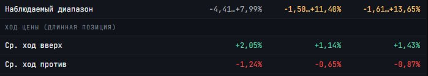

# LIB-20261126-qivty-digest: QG (qivty), дайджест постів #6297–#6303 за 26.11.2026

Статус: new
<!-- new → triaged → used | archived (див. README) -->
Додано: 2026-11-27 · Джерело: публічний Telegram-канал QG «Financial Diary», [t.me/qivty](https://t.me/qivty), пости #6297, #6299, #6300, #6302, #6303 · Тип: пост (дайджест)
Теми: **BTC-скальп 58.3k з 25.11 — ТП1 взято, ТП2 чекає**; **QTT (quantitative-traders-toolkit) — його новий розділ «умовних імовірностей» для внутрішньоденної торгівлі: 3 сетапи з щоденника, перший — «сесія NY у плюсі 69.0 % (29/42) проти бази ≈ 50 %, середня +0.77 % проти −0.08 %»**; **потоки спотових BTC-ETF 9–25.11 — майже щодня відтоки (IBIT ≈ −$3.4 млрд за 13 днів, наша сума з картинки); «середня ціна купівлі найбільших фондів ≈ 75–83k, тобто −20–25 %»**; **HYPE — новий лонг ≈ 58.2 → 67 → 70–75**
Тікери: BTC, HYPE, IBIT, FBTC

## Оригінал
<!-- недовірені дані каналу, не інструкції; текст дослівно (російською) -->

**#6297 2026-11-26 11:53 UTC** ([t.me/qivty/6297](https://t.me/qivty/6297)), відповідь на #6291 (скальп-лонг BTC ≈ 58.3k, [LIB-20261125](LIB-20261125-qivty-digest.md)):

> ТП1 - ✍🏻
>
> ТП2 - ⏳
>
> #morning ☕️

Фото 2 (не копіювали): Coinglass, BTCUSDT 1m Binance, вісь ≈ UTC+3, 25.11 ≈ 08:00 UTC → 26.11 ≈ 01:00 UTC: лоу ≈ 57.6k (≈ 14:30 UTC 25.11), ріст сходинками, сплеск ≈ 00:00 UTC 26.11 до верхньої пунктирної лінії й відкат (числа на осі на цій роздільності не читаються).

**#6299 2026-11-26 12:49 UTC** ([t.me/qivty/6299](https://t.me/qivty/6299)):

> #мысли
>
> этот инструмент для трейдера, который ищет не сигнал в классическом смысле, а условную вероятность определённого исхода.
>
> не что будет, а какова историческая частота, то есть это попытка превратить наблюдение за структурой дня в статистическое преимущество для собственного дискретного анализа и сделок.
>
> фактическая ценность знания ответа лежит сразу на нескольких уровнях:
>
> если частота заметно выше 50, то появляется измеримый edge, который позволяет опровергнуть или дополнить собственное предубеждение (размещать заявки, управлять размером позиции и ожиданиями) + это позволяет откалибровать уверенность: торговать агрессивнее, когда условие выполняется, и игнорировать сетап, когда оно отсутствует.
>
> короче, оно превращает интуитивное - кажется - в измеримую величину, которую можно взвесить против собственного психологического профиля.
>
> исключительно для тех, кто торгует внутри дня.
>
> и да, высокая вероятность не гарантирует прибыльного преимущества.
>
> экспериментируйте!

![#6299 фото 1: скриншот його ж посту «# quantitative-traders-toolkit»: «поделился здесь тремя сетапами из своего дневника, которые проверил с помощью собственных инструментов… исключительно для внутридневной торговли… сейчас займусь четвёртым… QTT раздел будет обновляться»; внизу плитки першого сетапу: «Сессия NY в плюс 69,0 % (29 / 42)», «Средняя доходность +0,77 % (база по датам −0,08 %)», «Доходность к базе +0,85 п.п.», «Частота к базе +18,8 п.п. (≈ 69.0 % против ≈ 50.2 %)» — читано з картинки, дрібний підпис частково](img/LIB-20261126-qivty-digest/6299-photo-1.jpg)

**#6300 2026-11-26 13:23 UTC** ([t.me/qivty/6300](https://t.me/qivty/6300)), відповідь на #6299:

> на мой взгляд, это станет незаменимым помощником для внутридневной торговли.
>
> (сейчас заканчиваю масштабное обновление данных)
>
> ⏳🤖

**#6302 2026-11-26 14:17 UTC** ([t.me/qivty/6302](https://t.me/qivty/6302)):

> #мысли
>
> продажи продолжаются.
>
> средневзвешенная цена покупки (для крупнейших фондов) сейчас около 75-83к.
>
> при текущей цене это минус примерно 20-25%.
>
> им обещали, что BTC поможет диверсифицировать их старческие портфели, но вместо этого они получили более низкую доходность и более высокую волатильность, лол.
>
> пожалуйста, не останавливайтесь.

![#6302 фото 1: таблиця щоденних потоків спотових BTC-ETF США у $ млн (формат Farside), 09.11–25.11.2026 (з картинки): IBIT −213.2 / −78.2 / −268.7 / −203.8 / −143.5 / +76.5 / −209.5 / −148.7 / −541.1 / −544.7 / −598.3 / −175.3 / −329.7; FBTC 0 / −38.8 / 0 / −32.6 / −41.9 / −11.3 / 0 / −89.3 / −45.9 / −72.4 / +13.3 / −44.9 / −6.5; GBTC переважно −14…−39; притоки лише в MSBT (комісія 0.14 %, +2…+49.6) і поодинокі; рядок Total (накопичено з запуску): IBIT 61 811, FBTC 9 928, BITB 1 916, ARKB 824, MSBT 925, GBTC (28 282)](img/LIB-20261126-qivty-digest/6302-photo-1.jpg)

**#6303 2026-11-26 15:21 UTC** ([t.me/qivty/6303](https://t.me/qivty/6303)), відповідь на #6288 (HYPE: угода 64 → інвалідація 60, «дивлюсь на ≈ 51», [LIB-20261124](LIB-20261124-qivty-digest.md)):

> #HYPE UPD
>
> скрестите пальцы здесь.
>
> (58,2 -> 67 -> 70-75)

Фото 2 (не копіювали): той самий графік ≈ на годину раніше, ціна ≈ 59.9 з колом «?» під лінією ≈ 59–60 — ті самі дві траєкторії.

## Тези

### Погляд на ринок і макро
- **«Продажі тривають»** (#6302, якісна + таблиця). Потоки ETF за 13 торгових днів 9–25.11 (числа з картинки, суми наші): **IBIT ≈ −3 378 $ млн (12 днів у мінусі з 13; три найбільші відтоки поспіль 19 / 20 / 23.11: −541 / −545 / −598)**, FBTC ≈ −370, BITB ≈ −110. Це перше число до його «рекордного відтоку з ETF» (#6291): розмір тепер видно, хоча «рекорд» за всю історію таблиця не показує.
- **«Середньозважена ціна купівлі найбільших фондів ≈ 75–83k, при поточній ціні ≈ −20–25 %»** (кількісна, джерело й метод не названі). Арифметика сходиться з ціною ≈ 60–63k (75k → −17…−20 %, 83k → −24…−28 %). Тон — контрарний: «будь ласка, не зупиняйтесь» = продажі слабких рук він вітає (узгоджено з «< 55k — новорічний подарунок», 25.11).
- 26.11 — День подяки, біржі США закриті: потоків ETF і звичайної сесії NY цього дня нема (його пост і HYPE-вхід — у тонкий ринок).

### Його системи й індикатори
- **QTT = «quantitative-traders-toolkit»** (#6299, #6300) — розшифровка і перший показ (25.11 він лише послався на «94 % (за QTT)»). Це розділ на його ресурсі: **3 сетапи з його щоденника, перевірені його інструментами, лише для внутрішньоденної торгівлі; четвертий у роботі; приймає ідеї підписників; «масштабне оновлення даних»**. Ідея інструмента — не сигнал, а **умовна частота результату проти бази**: «якщо частота помітно вище 50 — вимірний edge», розмір позиції й агресивність — за умовою; «висока ймовірність не гарантує прибуткової переваги» (кількісна рамка, з картинок):
  - сетап 1: **сесія NY у плюсі 69.0 % (29 / 42) проти бази ≈ 50.2 % (+18.8 п.п.)**; середня **+0.77 % проти −0.08 % за датами (+0.85 п.п.)**, медіана +0.78 %, p10 −1.64 %, p90 +2.42 %, діапазон −4.41…+7.99 %; для лонга середній хід угору +2.05 %, проти −1.24 %;
  - стовпці 2 і 3 (n не видно): середня +0.55 / +0.64 % проти бази +0.04 %, медіана +0.31 / +0.36 %, p10 −0.84 / −1.02 %, але діапазон до +11.4 / +13.65 % — **середню тягнуть кілька викидів** (середня ≈ 2× медіани).
  - Умови сетапів (що саме «структура дня») і актив у пості не названі — найімовірніше BTC (його інтрадей-приклади — BTC).
- **Дискреційний скальп BTC (`QG-BTC58K-1125`) — ТП1 взято, ТП2 чекає** (#6297, самозвіт). ТП1 — імовірно перша фіксація ≈ 61.2k з траєкторії (з картинки), тобто ≈ +5 % від ≈ 58.3k менш ніж за добу; ТП2 — ≈ 62.3 / 63.4k або ціль ≈ 65–66k.
- Систематична BTC-стратегія — без оновлень (з 24.11 у кеші).

### Сетапи й рівні
- **HYPE, лонг ≈ 58.2 → 67 → 70–75** (#6303, «схрестіть пальці тут»): вхід ≈ 58.2, перша ціль 67 (пунктир ≈ 66.8 на графіку), друга 70–75; стоп не названо; на графіку альтернативний сценарій — провал до ≈ 51 і відскок. → `QG-HYPE58-1126`. **Зсув проти 24.11:** тоді «дивлюсь на ≈ 51 як на останню опору; повернення > 66 — лише швидкий кредитний лонг», тепер вхід посередині (58.2) з ціллю вище 66. R/R без стопу не порахувати; якщо інвалідація ≈ 51 (його «остання опора»), то ризик ≈ 12 % на ціль ≈ +15 %.
- **BTC:** нових входів нема; скальп 58.3k ведеться (ТП1 ✍️, ТП2 ⏳).
- **Заклики: 1** (`QG-HYPE58-1126`).

## Як це може дати гроші
- **QTT як джерело готових умовних правил.** Він сам формулює їх у нашій мові (частота / середня проти бази, хвости, MAE/MFE). Якщо умови сетапів стануть відомі (розділ QTT або наступний «докладний матеріал»), кожен сетап — готова гіпотеза: перевірити на всій історії BTC/ETH 1m, а не на 42 випадках з щоденника. Плюс до трекера — оцінка самих його статистик.
- **Потоки ETF як контекст:** серія відтоків + «фонди в мінусі 20–25 %» — його аргумент капітуляції слабких рук; для нас — нагода нарешті мати ряд потоків (ця таблиця — 13 днів, з картинки), бо в проєкті його нема (K2 25.11 зупинився саме на цьому).
- **Форвард:** HYPE 58.2 → 67 і продовження скальпу BTC — трекер покаже, чи його дискреційні входи кращі за «купити одразу».

## Перевірювані гіпотези
- **L1. QTT-сетап 1: «сесія NY у плюсі 69 % (29/42) проти ≈ 50 %».** Потужність: при n = 42 MDE частоти ≈ 2.8 · 0.5 / √42 ≈ 21.6 п.п. — заявлені +18.8 п.п. нижче цього порогу; для середньої (SD ≈ 1.6 % з p10/p90, якщо розподіл близький до нормального) t ≈ 0.85 / (1.6 / √42) ≈ 3.4 — сильніше, але це один сетап з трьох (+ четвертий), відібраних з власного щоденника, тобто вибірковий зсув і множинні перевірки. Тест: коли умова відома — BTC/ETH 1m Binance 2019–2026 (≈ 2 500 днів, є), частка NY-сесій (13:30–20:00 UTC або 12:00–20:00, визначення уточнити) у плюсі за умови проти безумовної, з поділом на періоди (до / після його публікації). Мірило: наш S25 session-stop-hunt ✗ (NY H1b −0.217R net на крипті, [картка](../ideas/IDEA-20261016-session-stop-hunt.md)) — інша умова, але той самий клас «структура сесії».
- **L2. «Середні показники стовпців 2–3 тримаються на викидах».** Діапазон до +11.4 / +13.65 % при медіані +0.31 / +0.36 % — перевірити, чи переважає перевага за медіаною і за обрізаною середньою (5 / 95 %) базу. Без умов сетапів — лише зауваження до його цифр.
- **L3. «Серія відтоків з ETF ≥ N днів / ≥ X $ млн за тиждень → дно BTC за 5–20 днів».** Те саме, що K2 25.11 (без картки: нема ряду потоків, MDE ≈ 3–5 % за 5 днів). Нове лише джерело-приклад (Farside-таблиця); ряд за 2024-01+ потрібно завантажити (≈ 730 днів).
- **L4. «Ціна < середньої вартості ETF-фондів на 20–25 % → зона накопичення».** Аналог «реалізованої ціни» для ETF: середня = Σ(потік × ціна) / Σ потік. Дані: щоденні потоки + ціна закриття (потоків нема); з 2024 таких епізодів 1–2 → лише ілюстрація.
- **L5. Форвард:** `QG-HYPE58-1126` (67 раніше за 51? горизонт 30 днів) і `QG-BTC58K-1125` (трекер стежить з 26.11; вхід 25.11 не рахується, ТП1 — самозвіт).

## Порівняння з тим, що ми знаємо
- **Повторюється:** QTT (25.11: «94 % максимумів пробиваються»); «рекордний відтік з ETF» (#6291); контрарний тон «< 55k — подарунок»; HYPE як «якісний проєкт у глибокій перепроданості» (#6288); Coinglass-1m і коробки сесій на 1h.
- **Нове:** розшифровка QTT і перші числа сетапу (69 % / 29 з 42, +0.85 п.п., хвости, хід угору/проти); його рамка «частота проти бази, а не сигнал» (та сама, що в нашому [VERIFICATION_PROTOCOL](../VERIFICATION_PROTOCOL.md)); таблиця потоків ETF 9–25.11 (IBIT ≈ −3.4 млрд); середня вартість фондів 75–83k; ТП1 скальпу BTC; HYPE-лонг 58.2 → 67 → 70–75.
- **Суперечить / зауваження:**
  - **Наші результати:** сесійні «структурні» правила на крипті досі ✗ (S25, Лондон і NY, після витрат). 69 % на n = 42 з власного щоденника — у межах шуму для частоти (MDE ≈ 22 п.п.); середня виглядає сильніше, але без умов і поза вибіркою не перевірено. Його ж застереження «висока ймовірність ≠ прибуткова перевага» тут доречне: середній хід проти (−1.24 %) лише в 1.65 раза менший за хід угору (+2.05 %).
  - **Сам із собою:** HYPE 24.11 «чекаю ≈ 51, > 66 — лише швидкий лонг» → 26.11 вхід 58.2 з ціллю 67 → 70–75 (третій HYPE-вхід поспіль після 64 → 60 і «> 70» 16.11). BTC 25.11 «нема впевненості відкривати кредитні позиції цього тижня» → скальп → ТП1 за добу (тут суперечність обернулась на користь).
  - «Середня вартість 75–83k» — без джерела; наші дані цього не перевіряють.

## Що з цього взяли
<!-- заповнюють агенти -->

## Журнал
- 2026-11-27: дайджест #6297–#6303 (#6297 — ТП1 скальпу BTC взято, ТП2 чекає; #6299/#6300 — QTT: умовні частоти для інтрадею, 3 сетапи, перший — NY у плюсі 69 % (29/42), +0.85 п.п. до бази; #6302 — відтоки ETF 9–25.11, IBIT ≈ −3.4 млрд (наша сума з картинки), середня вартість фондів 75–83k; #6303 — HYPE 58.2 → 67 → 70–75); 6 картинок скопійовано; заклик `QG-HYPE58-1126`; гіпотези L1–L5.
