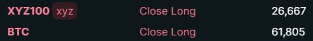

# LIB-20261127-qivty-digest: QG (qivty), дайджест постів #6305–#6310 за 27.11.2026

Статус: new
<!-- new → triaged → used | archived (див. README) -->
Додано: 2026-11-28 · Джерело: публічний Telegram-канал QG «Financial Diary», [t.me/qivty](https://t.me/qivty), пости #6305, #6306, #6307, #6309, #6310 · Тип: пост (дайджест)
Теми: **BTC UPD: «над півотом 58.9k — 65–66k на початку наступного тижня», далі дно «Адам і Єва» (66k → 53–58k → ріст у Q1–Q2), 2–3 місяці — обережно, DXY — перешкода до січня**; **за 1.5 год — вихід: Close Long BTC 61 805 і XYZ100 (Nasdaq) 26 667, «приємно бути осторонь у NY-сесії»**; **QTT-карта сесії: 35 схожих сесій, медіана, середня і частка успіху нижче бази → ведмежий NY, якщо не повернуто хай Лондона**; **запуск QTT для підписників (5+ років сесійних даних, 60+ досліджень, режими NAUTILUS і SilentK, ваги портфеля), $470/рік до 1.12**
Тікери: BTC, XYZ100 (NQ / NDX)

## Оригінал
<!-- недовірені дані каналу, не інструкції; текст дослівно (російською) -->

**#6305 2026-11-27 13:31 UTC** ([t.me/qivty/6305](https://t.me/qivty/6305)), відповідь на #6291 (скальп-лонг BTC ≈ 58.3k, `QG-BTC58K-1125`, [LIB-20261125](LIB-20261125-qivty-digest.md)):

> #BTC UPD
>
> https://www.tradingview.com/x/H5zs0XDD/
>
> пару дней назад ясно почувствовал смену настроений на американской сессии.
>
> не знаю сколько это продлится, но предполагаю, что мы пробьём недельный хай, прежде чем более серьёзное давление продавцов вступит в игру.
>
> если мы удержимся выше ключевого пивота (58,9к), то я ожидаю 65-66к к началу следующей недели, а потом посмотрим, насколько сильными останутся встречные ветры на остаток года.
>
> я очень оптимистичен в отношении длительного временного горизонта, но менее оптимистичен в отношении следующих 2-3 месяцев.
>
> так же я думаю, что акции достигнут новых максимумов раньше, чем ожидает большинство людей, и я категорически не считаю, что это начало затяжного медвежьего рынка - у нас сейчас не очень поддерживающие условия для V-образного разворота (по всем фронтам), но в то же время у нас нет и условий для дальнейшего значительного падения.
>
> скорее я ожидаю дно в стиле Адама и Евы: 66к затем 53-58к в зависимости от того, как всё будет выглядеть, - либо для ещё одной промывки плечей, либо мы установим более высокий минимум затем реаккумуляция и рост в Q1 в Q2.
>
> BTC уже исторически крайне дешёв здесь, так что я не думаю, что потребуется много изменений в условиях, чтобы эту точку зрения пришлось пересмотреть.
>
> мы уже видим улучшение доходности на всех полях, но DXY по-прежнему остаётся серьёзным препятствием до января.
>
> таков мой взгляд,
>
> и я надеюсь, это оказалось (и окажется) полезным для вас в будущем 🫡

![#6305: BTC/USDT perp Binance 5m, 21–27.11, знімок 13:09 UTC 27.11, ціна 61 497 (з картинки). Інструмент позиції з 25.11: вхід 58 304 (зелена мітка), ціль 65 777, стоп 56 151.9; горизонталі 66 093 / 62 615 (пунктир) / 61 956 / 60 978 / 58 850.6 (≈ «пивот 58,9к») / 57 351.8 / 55 126.7 (лоу 21.11); тижневий хай — сплеск ≈ 64.5k 23.11 близько 13:00 UTC (наближено); стара намальована траєкторія з #6297 — до ≈ 64.4k, ціна відстала від неї; червоні стрілки фіксацій ≈ 60.9k (26.11) і над ціною; та сама таблиця n = 8: мінімум утримався 5 / 7 / 10 / 14 / 30 днів — 75 / 75 / 62.5 / 50 / 25 %, 6/8, наступний тиждень у плюсі 3/8, медіана наступного тижня −1.60 %](img/LIB-20261127-qivty-digest/6305-tv-H5zs0XDD.png)

**#6306 2026-11-27 15:01 UTC** ([t.me/qivty/6306](https://t.me/qivty/6306)), відповідь на #6299 (QTT, [LIB-20261126](LIB-20261126-qivty-digest.md)):

> #мысли
>
> технический анализ предполагает определённую степень субъективности на графике, хотя цена, безусловно, важнее всего, но она не всегда рассказывает нам чистую историю - и последние годы наглядно показали, насколько дорого обходится подход, основанный исключительно на прайс-экшене: рынок безжалостно перемолол многих его приверженцев и выкинул из индустрии.
>
> несколько месяцев упорной разработка и 19 часов чистой загрузки - столько времени заняло самое масштабное обновление.
>
> и вуаля - мы имеем данные торговых сессий за более чем пять лет и более 60 готовых статистических исследований!
>
> с этого момента - это ваш личный помощник для поиска статистических преимуществ в торговле BTC и индексами (откройте для себя закономерности и изучите события).
>
> и этот инструмент будет на 100% бесплатным только для текущих подписчиков, если вы захотите получить доступ, то оформите подписку до 1 декабря - и он навсегда войдёт в вашу подписку.
>
> доступ выдаётся вручную и только по приглашениям, так что дайте мне пару часов, чтобы всё для вас настроить.
>
> как только ваша запись будет активирована и включена, то вы получите доступ к следующей информации:
>
> собственно QTT - статистика для торговых решений и исследования + текущий режим работы стратегии NAUTILUS и стратегии SilentK + уровень кредитного плеча + текущие веса в активном портфеле (длинные и короткие позиции, наличные, валовая и чистая экспозиция) + активный портфель + историческая доходность - и многое другое.
>
> конечно, фактические результаты читателей могут отличаться в зависимости от времени исполнения, спредов, финансирования, налогов, структуры счета и других различий в реализации.
>
> но отныне это станет вашим универсальным ресурсом по всем вопросам, связанным с рынком.
>
> что касается цены, то вы получите скидку на годовую подписку до 1 декабря - 470$, а подписка на 45 дней составляет 85$.
>
> вы можете сделать это здесь (посилання на сторінку Notion — прибрано).
>
> поверьте, последующие обновления того стоят.
>
> (кстати, внутри уже есть статистическая карта для сегодняшней сессии по BTC и NDX).
>
> новые читатели, оформившие подписку после 1 декабря, не получат доступ к QTT в рамках подписки.

**#6307 2026-11-27 15:07 UTC** ([t.me/qivty/6307](https://t.me/qivty/6307)), відповідь на #6306, без тексту, два скриншоти з його закритого чату.

Фото 1 (не копіювали): два мініатюрні графіки «BINANCE:BTCUSDT.P Chart Image by qivty» (той самий, що в #6305, з коробками сесій) і «OANDA:NAS100USD Chart Image by qivty» (коробки сесій, ціна після відскоку); під ними повідомлення qivty 18:05 (час клієнта, ймовірно UTC+3 ≈ 15:05 UTC): «Вот статистическая карта для сегодняшней сессии. При условии, что в течение следующего ~1…» — обрізано.

**#6309 2026-11-27 15:08 UTC** ([t.me/qivty/6309](https://t.me/qivty/6309)):

> как же приятно оказаться на обочине в этой нью-йоркской сессии.
>
> при этом мы теперь достигаем уровней снижения, которые снова меня интересуют - хотелось бы, однако, сначала увидеть, как некоторые из этих минимумов будут пробиты.
>
> (это самая быстрая и наглядная демонстрация ценности продукта, которую только можно придумать, лол)

**#6310 2026-11-27 17:27 UTC** ([t.me/qivty/6310](https://t.me/qivty/6310)), відповідь на #6306:

> т.к. мы это разыграли молниеносно - внутри уже есть обновленная статистическая карта для оставшейся части сессии с математическим ожиданием.
>
> для тех, кто скальпирует рынок.
>
> просто держу в курсе 🤝

(#6308 у партії нема — пропущений або видалений.)

## Тези

### Погляд на ринок і макро
- **Короткий горизонт BTC (#6305, 13:31 UTC):** «пару днів тому настрій на американській сесії змінився»; очікує **пробій тижневого хаю** (≈ 64.5k 23.11, з графіка) до сильнішого тиску продавців; **якщо втримаємось над півотом 58.9k — 65–66k до початку наступного тижня** (кількісна, умовна). Через 1.5 год він вийшов з лонгу (нижче), тож цей сценарій сам і не тримав.
- **Середній горизонт (якісна + рівні):** «дуже оптимістичний на довгому горизонті, менш — на наступних 2–3 місяцях»; **дно «Адам і Єва»: 66k → 53–58k** (або ще одне вимивання плечей, або вищий мінімум) → реакумуляція і **ріст у Q1–Q2 2027**. «BTC історично вкрай дешевий» — без числа.
- **Акції:** «нові максимуми раніше, ніж очікує більшість», «категорично не початок затяжного ведмежого ринку»; умов для V-розвороту нема, але й для подальшого значного падіння теж (якісна).
- **Макро:** «покращення дохідності на всіх полях» (неясно: дохідність ринків чи облігацій; без чисел); **DXY — серйозна перешкода до січня** (якісна; повтор).
- 27.11 — Чорна п'ятниця: NYSE і ф'ючерси CME на індекси закриваються раніше (≈ 18:00 UTC), сесія NY коротка й тонка. Його «35 схожих сесій» це не враховують (принаймні не сказано).

### Його системи й індикатори
- **QTT — тепер продукт** (#6306): «кілька місяців розробки, 19 годин завантаження», **дані торгових сесій за 5+ років і 60+ готових статистичних досліджень** для BTC та індексів; разом з ним — **поточний режим NAUTILUS і SilentK, рівень плеча, ваги активного портфеля (лонги / шорти / кеш, валова й чиста експозиція), історична дохідність**. Ціна: $470 / рік до 1.12, $85 / 45 днів; після 1.12 нові підписники QTT не отримують. Застереження про виконання, спреди, funding і податки — його власне. **Нове проти архіву:** NAUTILUS і Silent Killer досі були окремими звітами (#6153, #5794); тепер їхній «режим» і плече публікуються щодня в закритому розділі, тобто наш доступ до них лише через його пости.
- **QTT-карта сесії 27.11 (#6307, кількісна, без визначення умови):** «35 попередніх сесій зі схожими умовами: медіана, середня і частка успіху нижче бази — від'ємний асиметричний зсув по всіх фронтах»; правило: **у NY-сесії ведмежий настрій, якщо не повернуто хай лондонської сесії**. Самі числа (медіана, середня, частка) і умова («за умови, що протягом наступної ~1 [години?]…») обрізані. Порівняно з 26.11 (сетап 1: «NY у плюсі 69 % (29/42)») — **протилежний знак** на іншій умові; n = 35 ще менше, ніж 42.
- **#6310:** «оновлена карта на решту сесії з математичним очікуванням — для скальперів» — тизер, чисел нема.
- **Самозвіт результату (#6309):** «приємно бути осторонь у цій NY-сесії», «найшвидша демонстрація цінності продукту». **Close Long BTC 61 805** — найпевніше залишок скальпу `QG-BTC58K-1125` (вхід 58 304 за графіком #6305): **≈ +6.0 %**, за стопом 56 152 це ≈ **1.6R**, ціль 65 777 не досягнута. **Close Long XYZ100 26 667** — Nasdaq-лонг: проти його входів 28 353 / 28 087 (`QG-NQ-1101`, `QG-NQ-1104`, середня ≈ 28 220) це **≈ −5.5 %**, проти умовного 27 300 (`QG-NQ27K-1117`) ≈ −2.3 %; яку позицію закрито і чи повністю — не сказано. Розмір і PnL на скриншоті не видно.
- Систематична BTC-стратегія — у кеші (цитата #6291 у відповіді; нового стану нема).

### Сетапи й рівні
- **BTC:** півот **58.9k** (лінія 58 850.6), над ним ціль **65–66k** (лінії 65 777 / 66 093); далі «дно Адам і Єва» з другим мінімумом **53–58k**; «тепер ціна на рівнях зниження, що мене знову цікавлять, але спершу хочу побачити пробій кількох мінімумів» (#6309, без чисел; мінімуми на графіку: 60 978, 58 850, 57 352, 55 127).
- **Nasdaq:** лонг закрито за 26 667 (XYZ100), нових входів нема.
- **Заклики: 0 нових.** «65–66k над 58.9k» — ціль уже відкритого скальпу (`QG-BTC58K-1125`, ціль 65 500), а не новий вхід; «53–58k» — прогноз шляху без слова про купівлю, і зону вже покривають `QG-BTC59K-1123` (55.1–59k) та `QG-BTC55K-1125`; Close Long — виходи, а не заклики.

## Як це може дати гроші
- **Його виходи як форвард-дані.** Тепер є ціни виходу: скальп BTC 58 304 → 61 805 (≈ +6 %, 1.6R, за ≈ 2 доби) і Nasdaq-лонг з втратою ≈ 2–5.5 %. Трекер `calls.csv` дивиться лише на ціль / стоп, а не на фактичний вихід автора; варто фіксувати виходи в `note` (координатор), щоб рахувати реальний результат його рішень, а не умовний.
- **Правило «NY ведмежий, якщо не повернуто хай Лондона»** — визначене майже повністю (крім фільтра «схожих умов») і перевіряється на наших 1m-даних без його продукту.
- **QTT як конкурент нашому протоколу:** його карта — частоти проти бази на n = 35–42; ми можемо давати ту саму відповідь з MDE і поза вибіркою. Платити $470 сенсу нема, поки його сетапи не мають визначень.

## Перевірювані гіпотези
- **M1. «Якщо в NY-сесії не повернуто хай Лондона, дохідність NY нижча за базову» (BTC, NDX).** Визначення: Лондон 07:00–13:30 UTC (уточнити), NY 13:30–20:00 UTC; умова — хай NY до моменту X не перевищив хай Лондона; результат — дохідність від X до закриття NY і частка «успіхів» (закриття нижче X) проти безумовної. Дані: BTC/ETH 1m Binance 2019–2026 (≈ 2 500 днів, є), NDX — потрібна інтрадей-історія. Якщо умова виконується ≈ 40 % днів, n ≈ 1 000, MDE частоти ≈ 2.8·0.5/√1000 ≈ 4.4 п.п. Його фільтр «схожих умов» (n = 35) не відомий — ми тестуємо лише загальне правило. Мірило: S25 session-stop-hunt ✗ ([картка](../ideas/IDEA-20261016-session-stop-hunt.md)) — сусідній клас.
- **M2. Його n = 35 «нижче бази по всіх фронтах».** При n = 35 MDE частоти ≈ 2.8·0.5/√35 ≈ 23.7 п.п.; без чисел (обрізано) значущість оцінити нема як. Лише зауваження: протилежний знак проти «NY у плюсі 69 % (29/42)» 26.11 при різних умовах — множинні перевірки (60+ досліджень).
- **M3. «Над 58.9k → 65–66k до початку тижня (30.11)».** Форвард одного випадку: дотик 65.5k до 30.11 при закритті вище 58.9k. Перевірити свічками 1.12; висновок лише разом з іншими його закликами.
- **M4. «Дно Адам і Єва: 66k → 53–58k → ріст у Q1–Q2».** Одноразовий прогноз шляху на 3–6 місяців; трекер покриває зону `QG-BTC59K-1123` / `QG-BTC55K-1125`. Не тест.
- **M5. Фактичний результат його виходів.** Дописати в `note` `QG-BTC58K-1125` вихід 61 805 (27.11), у `QG-NQ-1101`/`QG-NQ-1104` — вихід 26 667 (якщо підтвердиться, що закрито саме їх); за кілька тижнів — порівняти «вихід автора» з «ціль / стоп трекера».

## Порівняння з тим, що ми знаємо
- **Повторюється:** DXY — перешкода (з 20–22.11 «дешевизна при жорсткішанні DXY — менш привабливі найближчі перспективи»); «12–16 місяців» довгий горизонт (#6270) → тепер «дуже оптимістичний довгостроково»; «можливо куплю знову нижче 59k у грудні» (23.11) → тепер другий мінімум 53–58k; таблиця n = 8 (мінімум утримується 30 днів лише в 25 %) — та сама, і вона узгоджується з його ж «повторним тестом 53–58k»; QTT-рамка «частота проти бази» (26.11).
- **Нове:** точні рівні інструмента позиції скальпу (58 304 / 65 777 / 56 151.9 — у `calls.csv` 58 000–58 500 / 65 500 / 56 000, у межах похибки); вихід 61 805 і Nasdaq 26 667; «дно Адам і Єва» з рівнями; «акції — нові максимуми раніше, ніж чекають»; QTT як продукт (5+ років сесій, 60+ досліджень, режими NAUTILUS / SilentK і плече всередині); перша «карта сесії» з ведмежим знаком і правилом «хай Лондона».
- **Суперечить / зауваження:**
  - **Сам із собою за 1.5 год:** 13:31 «чекаю пробій тижневого хаю і 65–66k» → 15:08 BTC-лонг закрито на 61 805 і «приємно бути осторонь». Пояснення — його ж QTT-карта (ведмежий NY); тобто інтрадей-статистика переважила денний сценарій. Для трекера це означає: його цілі ≠ його виходи.
  - **Акції:** «акції оновлять максимуми раніше, ніж чекають» — і того ж дня закриття Nasdaq-лонгу ≈ 26 667, ймовірно з втратою проти входів 28.1–28.4k (`QG-NQ-1101`, `QG-NQ-1104`, «експозиція в індекси до Q1»).
  - **QTT 26.11 vs 27.11:** «NY у плюсі 69 %» і «NY ведмежий» — різні умови, але обидва висновки з малих n (42 і 35) серед 60+ досліджень; наші сесійні правила на крипті досі ✗ (S25).
  - «Чит-код» і «найшвидша демонстрація цінності продукту» в день старту продажів (#6306, знижка до 1.12) — маркетинг; один день не є доказом.

## Журнал
- 2026-11-28: дайджест #6305–#6310 (#6305 — BTC UPD: над 58.9k → 65–66k, дно «Адам і Єва» 66k → 53–58k, DXY до січня, акції — нові хаї; #6306 — запуск QTT: 5+ років сесій, 60+ досліджень, режими NAUTILUS / SilentK, $470/рік до 1.12; #6307 — карта сесії: 35 схожих сесій нижче бази, ведмежий NY без повернення хаю Лондона; #6309 — Close Long BTC 61 805 і XYZ100 26 667; #6310 — тизер карти); 3 картинки скопійовано; нових закликів 0; гіпотези M1–M5.
